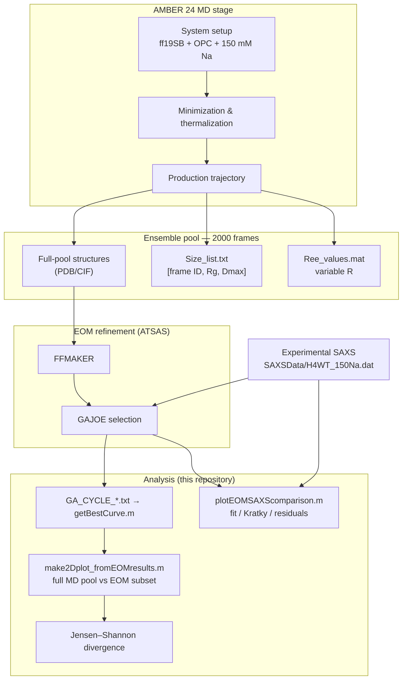

This page documents the upstream stage of the IDP MD–SAXS benchmark: how intrinsically disordered protein (IDP) conformational pools are generated by molecular dynamics in **AMBER** and packaged into the exact artifact formats that the EOM refinement and MATLAB/Python analysis halves of this repository consume. Because the repository ships the *analysis half* of the pipeline rather than simulation scripts, this page separates two layers explicitly: the **repo-verified configuration** of the H4 benchmark, and the **canonical AMBER protocol** needed to reproduce an equivalent pool.

Sources: [README.md](README.md#L1-L8), [README.md](README.md#L22-L25)

## Where the MD Stage Sits in the Architecture

In this benchmark, MD is the **source of physical sampling**. Instead of relying on randomly generated conformers, the full structural pool originates from an atomistic trajectory; EOM then re-weights a SAXS-consistent subset out of that pool. The benchmark signal — what the paper is actually measuring — is the *distance* between the full MD distribution and the SAXS-refined distribution, quantified through 2D histograms and Jensen–Shannon divergence. The full data flow is:

The critical architectural fact for anyone extending this workflow: **this repository does not ship AMBER input files**. The README states only that *"Molecular dynamics simulations are run using AMBER 24"*, while everything downstream — pool descriptors, GAJOE outputs, and the comparison scripts — is present and executable. The MD stage is therefore defined here by its *output contract* (see next sections), which the analysis code hard-codes.

Sources: [README.md](README.md#L10-L17), [README.md](README.md#L22-L25), [make2Dplot_fromEOMresults.m](make2Dplot_fromEOMresults.m#L2-L4)

## Verified Simulation Configuration

Every configuration value below is anchored to repository evidence — the folder naming, data file headers, and pool statistics — rather than to assumption:

| Setting | Value | Evidence basis |
|---|---|---|
| MD engine | AMBER 24 | README Software Notes |
| Protein force field | **ff19SB** | Pool folder name `H4_tail_WT_ff19SB_OPC` |
| Water model | **OPC** | Pool folder name `H4_tail_WT_ff19SB_OPC` |
| System | H4 histone tail, wild type, 26 residues | `protein.seq`, `assignment.txt` |
| Disorder designation | Residues 1–26 fully disordered | `assignment.txt`: `A 1 26 disordered` |
| Ionic condition | 150 mM Na⁺ | Data files named `H4WT_150Na.dat` / `H4KQ_150Na.dat` |
| Ensemble size | 2000 conformations | `Size_list.txt` contains 2000 data rows |
| Variants compared | WT vs. K-to-Q (charge-neutralized) | README, `SAXSData/` |

Sources: [README.md](README.md#L22-L25), [Example_tutorial/protein.seq](Example_tutorial/protein.seq#L1-L3), [Example_tutorial/assignment.txt](Example_tutorial/assignment.txt#L1-L2), [SAXSData/H4WT_150Na.dat](SAXSData/H4WT_150Na.dat#L1-L4), [ExampleData/H4_tail_WT_ff19SB_OPC/GA001/curve_1/Size_list.txt](ExampleData/H4_tail_WT_ff19SB_OPC/GA001/curve_1/Size_list.txt#L1-L30)

The benchmark system is the 26-residue H4 histone tail sequence `SGRGKGGKGLGKGGAKRHRKVLRDNI`, assigned as fully disordered — the canonical RANCH input representation of an IDP. The scientific point of running MD rather than random-pool generation is the charge-driven hypothesis: comparing the WT ensemble against the K-to-Q variant, in which lysines are neutralized to glutamine, isolates how electrostatics shape the conformational landscape. The experimental side of this comparison is the pair of SAXS profiles shipped in `SAXSData/` (53 q-points each, three columns: q, I(q), error).

Sources: [Example_tutorial/protein.seq](Example_tutorial/protein.seq#L1-L3), [Example_tutorial/assignment.txt](Example_tutorial/assignment.txt#L1-L2), [README.md](README.md#L5-L13), [SAXSData/H4WT_150Na.dat](SAXSData/H4WT_150Na.dat#L1-L4)

## From Trajectory to Ensemble Pool: The Data Contract

The MD stage terminates by emitting **three artifacts**, and the analysis code binds to them by exact name, column position, and ordering. `make2Dplot_fromEOMresults.m` imports them as: `load([dir,'/Ree_values.mat'])` (exposing variable `R`), `Sizelist = importdata([dir,'/Size_list.txt'])`, then maps `pool.dmax = Sizelist(:,3)`, `pool.rg = Sizelist(:,2)`, and `pool.r = R(1:end)`.

| Artifact | Format | Content | Consumed by |
|---|---|---|---|
| Full-pool structures | PDB/CIF files, numbered by frame | Every saved snapshot, solvent stripped | FFMAKER, GAJOE pool |
| `Size_list.txt` | Whitespace-delimited, 3 columns: `[ID, Rg, Dmax]` (Å) | One row per MD frame, e.g. `1 9.25 26.79` | `make2Dplot_fromEOMresults.m` |
| `Ree_values.mat` | MATLAB binary, variable name `R` | End-to-end distance per frame | `make2Dplot_fromEOMresults.m` |
| `GA_CYCLE_*.txt` | GAJOE workfiles, 1 per GA run | Ranked candidate ensembles per generation | `getBestCurve.m` |

Sources: [make2Dplot_fromEOMresults.m](make2Dplot_fromEOMresults.m#L33-L39), [ExampleData/H4_tail_WT_ff19SB_OPC/GA001/curve_1/Size_list.txt](ExampleData/H4_tail_WT_ff19SB_OPC/GA001/curve_1/Size_list.txt#L1-L30), [ExampleData/H4_tail_WT_ff19SB_OPC/GA001/curve_1/GA_CYCLE_100.txt](ExampleData/H4_tail_WT_ff19SB_OPC/GA001/curve_1/GA_CYCLE_100.txt#L1-L10)

> [!TIP]
> **Frame numbering is a join key, not a label.** Ensemble member IDs inside `GA_CYCLE_*.txt` index directly into `Size_list.txt` rows and the `Ree_values.mat` ordering — the scripts join `bestcurve(n,1)` against `Sizelist(...)` and `R(...)`. If you re-sort, renumber, or subset the MD frames between the descriptor computation and the GAJOE run, the pool-to-selection mapping silently corrupts and every downstream histogram plots wrong pairings.

One caution inherited from the code comments: the header of `make2Dplot_fromEOMresults.m` instructs *"get end-to-end distance R by running pdb_Rmeas.m in directory with all the PDBs of full pool"* — but `pdb_Rmeas.m` is **not shipped** in this repository. You must compute Ree over the full pool with your own tool and persist it as `Ree_values.mat` containing variable `R` before the comparison script can run.

Sources: [make2Dplot_fromEOMresults.m](make2Dplot_fromEOMresults.m#L2-L4), [make2Dplot_fromEOMresults.m](make2Dplot_fromEOMresults.m#L33-L39)

## Canonical AMBER Protocol for Pool Generation

Since simulation inputs are not included, the table below states the canonical AMBER sequence for producing a contract-compliant pool. Steps marked *canonical* are standard AMBER practice; the repo-verified anchors are the engine version, force field/water combination, ionic condition, and ensemble size.

| Step | Tool | Purpose | Anchor to repo evidence |
|---|---|---|---|
| 1. Build system | `tleap` | Load `ff19SB` + OPC water, build the 26-residue sequence, solvate, neutralize/add ions to 150 mM NaCl | ff19SB/OPC folder name; 150 mM Na from data filenames |
| 2. Minimize | `sander`/`pmemd` | Relax solvent and solute geometry | Canonical |
| 3. Heat / equilibrate | `pmemd` | Raise to production temperature, density stabilization (constant-pressure) | Canonical |
| 4. Production | `pmemd` (GPU advisable for 26-residue IDP × multi-µs sampling) | Sample the disordered state; save enough snapshots for a 2000-frame pool | AMBER 24; 2000-row `Size_list.txt` |
| 5. Trajectory post-processing | `cpptraj` | Strip solvent, autoimage, extract per-frame PDB/CIF structures | Full-pool structure files consumed by FFMAKER |
| 6. Descriptor extraction | `cpptraj` (`radial`, distance/max-diameter measurements) | Compute Rg and Dmax per frame → `Size_list.txt`; compute Ree per frame → `Ree_values.mat` (variable `R`) | Exact column mapping in `make2Dplot_fromEOMresults.m` |

The pool statistics shipped in the repository give you a sanity target: in `Size_list.txt`, early MD frames show Rg ≈ 9.2–11.2 Å and Dmax ≈ 27–35 Å for compact states, extending up to Rg ≈ 18.9 Å and Dmax ≈ 59.8 Å as the ensemble explores extended conformations — a spread wide enough that GAJOE member IDs up to ~1997 appear in the shipped GA workfiles.

Sources: [README.md](README.md#L22-L25), [make2Dplot_fromEOMresults.m](make2Dplot_fromEOMresults.m#L33-L39), [ExampleData/H4_tail_WT_ff19SB_OPC/GA001/curve_1/Size_list.txt](ExampleData/H4_tail_WT_ff19SB_OPC/GA001/curve_1/Size_list.txt#L1-L30), [ExampleData/H4_tail_WT_ff19SB_OPC/GA001/curve_1/GA_CYCLE_100.txt](ExampleData/H4_tail_WT_ff19SB_OPC/GA001/curve_1/GA_CYCLE_100.txt#L1-L10)

## MD Pool vs. RANCH Pool: Why MD for Benchmarking

The repository contains two pool-generation paradigms side by side, and understanding the distinction prevents a common misuse: the tutorial under `Example_tutorial/` demonstrates the EOM machinery with 20 **RANCH-generated** random conformations, while the benchmark under `ExampleData/` consumes a 2000-frame **AMBER MD** pool.

| Dimension | RANCH random pool (tutorial) | AMBER MD pool (benchmark) |
|---|---|---|
| Sampling model | Stochastic conformer generation from generic geometry restraints | Force-field-consistent physical sampling (ff19SB/OPC) |
| Typical size | 20 structures (demonstration) | 2000 frames (quantitative) |
| Conformational correlations | None — coordinates sampled independently | Realistic internal correlations from dynamics |
| Role in workflow | Verify the EOM toolchain mechanics | Measure force-field bias against experiment |
| Variants available | Any sequence string | One pool per variant (WT, K-to-Q) per force field |

This distinction is precisely what makes the benchmark meaningful: when GAJOE re-weights the MD pool against experiment, the JSD between the full MD distribution and the selected subset quantifies *how much the SAXS data would need the force field's conformational ensemble to shift*. `make2Dplot_fromEOMresults.m` computes this divergence for both Rg and Ree distributions using binned probability densities and Shannon entropy.

Sources: [README.md](README.md#L30-L40), [Example_tutorial/assignment.txt](Example_tutorial/assignment.txt#L1-L2), [ExampleData/H4_tail_WT_ff19SB_OPC/GA001/curve_1/Size_list.txt](ExampleData/H4_tail_WT_ff19SB_OPC/GA001/curve_1/Size_list.txt#L1-L2001), [make2Dplot_fromEOMresults.m](make2Dplot_fromEOMresults.m#L185-L225)

## Reading the Shipped MD-Derived Artifacts

The example output in `ExampleData/H4_tail_WT_ff19SB_OPC/GA001/curve_1/` is the GAJOE result of fitting the **MD pool** against the WT experimental profile, and its header records the benchmark-scale settings actually used: `CYCLE: 29 Chi^2: 1.226 GENER.:1000 ENSEMBLES: 50 CURVES: 9` — that is, 1000 GA generations, 50 candidate ensembles per generation, 9 curves per ensemble, with the best fit achieved at cycle 29. This is an order of magnitude heavier than the tutorial's quick-run parameters, and it is the scale you should reproduce for quantitative comparisons.

Sources: [ExampleData/H4_tail_WT_ff19SB_OPC/GA001/curve_1/profiles_001_1.fit](ExampleData/H4_tail_WT_ff19SB_OPC/GA001/curve_1/profiles_001_1.fit#L1-L1), [README.md](README.md#L30-L40)

Selection provenance flows through `GA_CYCLE_1.txt` … `GA_CYCLE_100.txt` (one file per GA run, enabled via GAJOE's *"Save workfiles with the entire GA runs?"* option). `getBestCurve.m` parses all 100 workfiles, tallies how often each pool-structure ID was selected, and returns the `[PDBnum, freq]` best-curve matrix; `make2Dplot_fromEOMresults.m` then renders the 2D Rg–Ree and Rg–Dmax comparison of **full MD pool vs. EOM subset**, prints mean ± standard error for both ensembles, and computes the Jensen–Shannon divergence. The companion script `plotEOMSAXScomparison.m` closes the loop by plotting the EOM ensemble fit against `SAXSData/H4WT_150Na.dat` in direct, Kratky, and residual forms.

Sources: [getBestCurve.m](getBestCurve.m#L10-L43), [make2Dplot_fromEOMresults.m](make2Dplot_fromEOMresults.m#L14-L18), [make2Dplot_fromEOMresults.m](make2Dplot_fromEOMresults.m#L73-L130), [make2Dplot_fromEOMresults.m](make2Dplot_fromEOMresults.m#L185-L225), [plotEOMSAXScomparison.m](plotEOMSAXScomparison.m#L7-L14)

> [!TIP]
> **Reproduce the benchmark GAJOE settings before drawing conclusions.** The shipped example used GENER 1000 / ENSEMBLES 50 / CURVES 9 with workfile saving enabled (`nRuns = 100`, `curvesPerEnsemble` set in the MATLAB parameters block). The tutorial's 100-generation, 20-conformation demo exists only to verify the toolchain — its JSD values are not meaningful.

## Continue the Journey

A logical reading path through the catalog: ground the system context in [H4 Histone Tail Case Study](17-h4-histone-tail-case-study), study the EOM machinery this page feeds into — [RANCH Conformational Pool Generation](6-ranch-conformational-pool-generation), [FFMAKER Theoretical SAXS Profiles](7-ffmaker-theoretical-saxs-profiles), and [GAJOE Genetic Algorithm Ensemble Fitting](8-gajoe-genetic-algorithm-ensemble-fitting) — then master the descriptors the MD stage exports in [Structural Descriptors: Rg, Dmax, Ree](16-structural-descriptors-rg-dmax-ree). For the consumption side, proceed to [Best-Curve Reconstruction from GA Cycles](10-best-curve-reconstruction-from-ga-cycles), [2D Ensemble Comparison Histograms](11-2d-ensemble-comparison-histograms), [Jensen-Shannon Divergence Quantification](12-jensen-shannon-divergence-quantification), and [SAXS Fit, Kratky Plot, and Residuals](13-saxs-fit-kratky-plot-and-residuals). Finally, apply the same MD-to-EOM contract to your own system via [Extending Workflow to Other IDPs](19-extending-workflow-to-other-idps), with installation prerequisites covered in [Software Requirements and Installation](3-software-requirements-and-installation).
