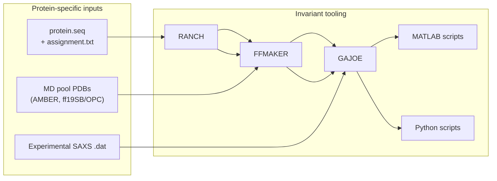
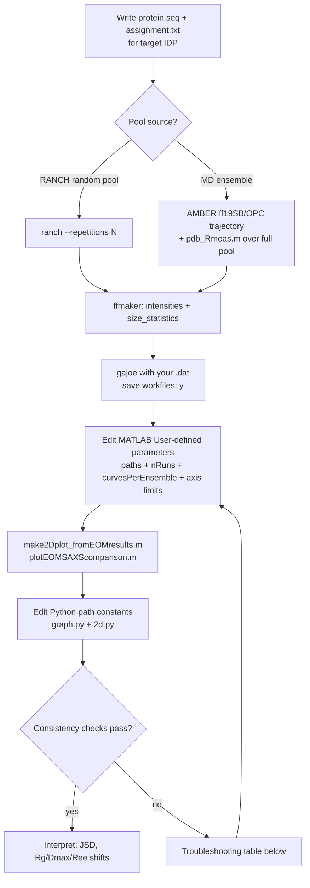

The H4 histone tail benchmark is not a sequence-locked pipeline — it is a **template**. Every script in this repository consumes GAJOE outputs and plain-text inputs through path variables and a single "User-defined parameters" block; no script hardcodes the H4 sequence. Porting the MD–SAXS ensemble workflow to another intrinsically disordered protein (IDP) therefore reduces to swapping a **small, well-defined adaptation surface**: two RANCH sequence files, one experimental SAXS profile, one conformational pool, and a handful of axis-scale parameters. This page walks through that adaptation end-to-end for advanced users, assuming you have already run the H4 case once — if not, start with [EOM Tutorial with ATSAS Tools](4-eom-tutorial-with-atsas-tools) and [H4 Histone Tail Case Study](17-h4-histone-tail-case-study).


Sources: [README.md](README.md#L5-L18), [make2Dplot_fromEOMresults.m](make2Dplot_fromEOMresults.m#L13-L27), [plotEOMSAXScomparison.m](plotEOMSAXScomparison.m#L8-L22)

## Portability Map: What Changes and What Doesn't

From first principles, the pipeline has two layers. The **invariant core** — `getBestCurve.m`, the JSD computation, the plotting logic in both MATLAB and Python — operates purely on GAJOE output formats (`GA_CYCLE_*.txt`, `Size_list.txt`, `profiles_*.fit`, distribution files) and never sees your sequence. The **adaptation surface** is the set of inputs that encode *which* IDP you are studying. The repository itself proves this modularity: `SAXSData/` ships two experimental profiles (WT and K-to-Q charge-neutralized H4) that are analyzed with identical scripts and identical pool machinery — only the `.dat` path and plot color change between them.



| Pipeline stage | Files involved | Protein-specific? |
|---|---|---|
| Sequence definition | `protein.seq`, `assignment.txt` | **Yes — swap entirely** |
| Conformational pool | AMBER MD trajectories or RANCH CIFs | **Yes — regenerate** |
| Experimental data | `SAXSData/<protein>_<salt>.dat` | **Yes — supply yours** |
| Theoretical profiles | FFMAKER `intensities_*.csv`, `size_statistics_*.csv` | No — regenerated automatically |
| GA fitting | GAJOE output directory (`GA001/curve_1/…`) | No — paths only |
| Ensemble analysis | `getBestCurve.m`, `make2Dplot_fromEOMresults.m`, `plotEOMSAXScomparison.m` | No — parameter block only |
| Plotting | `graph.py`, `2d.py` | No — two path constants |

Sources: [README.md](README.md#L11-L18), [README.md](README.md#L34-L36), [getBestCurve.m](getBestCurve.m#L19-L39), [SAXSData/H4WT_150Na.dat](SAXSData/H4WT_150Na.dat#L1-L5), [SAXSData/H4KQ_150Na.dat](SAXSData/H4KQ_150Na.dat#L1-L6)

## Step 1: Encode the New IDP Sequence for RANCH

RANCH consumes exactly two files, both present in `Example_tutorial/`. The `protein.seq` file is a minimal FASTA: a one-line chain header (`>A`) followed by the one-letter sequence — for H4 that is the 26-residue tail `SGRGKGGKGLGKGGAKRHRKVLRDNI`. The companion `assignment.txt` is a single row with four whitespace-separated fields: chain ID, first residue index, last residue index, and the secondary-structure class `disordered`, which instructs RANCH to generate random-coil-like conformers for the whole chain. To extend the workflow, replace both files with your target's sequence and make the residue range in `assignment.txt` match the sequence length exactly (26 → *N* for your IDP).

| File | H4 tail (shipped) | Generic IDP (your target) |
|---|---|---|
| `protein.seq` line 1 | `>A` | `>X` (your chain ID) |
| `protein.seq` line 2 | `SGRGKGGKGLGKGGAKRHRKVLRDNI` | your sequence, one-letter code |
| `assignment.txt` | `A 1 26 disordered` | `X 1 N disordered` |

Keep the header chain ID consistent between the two files — RANCH matches the `assignment.txt` chain letter against the `protein.seq` header. If your IDP contains ordered domains flanking the disordered region, add a row per segment and use the appropriate class tag per ATSAS conventions instead of a single `disordered` row.

Sources: [protein.seq](Example_tutorial/protein.seq#L1-L2), [assignment.txt](assignment.txt#L1), [README.md](README.md#L38-L47), [RANCH Conformational Pool Generation](6-ranch-conformational-pool-generation)

## Step 2: Supply the Conformational Pool and Experimental Profile

Two inputs replace the H4 defaults here. First, the conformational pool: either let RANCH generate it from your new sequence files (the `--repetitions` flag controls pool size), or — as the H4 production data did — generate structures from your own AMBER 24 trajectory using ff19SB with OPC water, then feed those PDBs directly into FFMAKER in place of `pool_20/*.cif` (the README explicitly supports this substitution). Pool-generation specifics for AMBER are covered in [MD Ensemble Generation with AMBER](18-md-ensemble-generation-with-amber). Second, the experimental SAXS profile: the parsers in this repo expect a three-column `Q, I(Q), Error` file with **four header lines**, exactly the format of the shipped `H4WT_150Na.dat` and `H4KQ_150Na.dat` (whose only meaningful differences are the point count `# 53` vs `# 56` in the header comment and the intensity scale). Both MATLAB and Python readers tolerate header variation — see Step 5 — but the MATLAB reader's header count is fixed, so normalize your instrument export to this shape.

> [!TIP]
> The end-to-end distance matrix `Ree_values.mat` (workspace variable `R`) is **not produced by any script in this repository** — `make2Dplot_fromEOMresults.m` documents that it comes from running the external `pdb_Rmeas.m` utility over your full pool PDBs. For a new IDP you must regenerate this file for the new pool, or the 2D histograms and JSD calculation will fail at the `load()` step.

Sources: [README.md](README.md#L49-L60), [make2Dplot_fromEOMresults.m](make2Dplot_fromEOMresults.m#L3-L4), [make2Dplot_fromEOMresults.m](make2Dplot_fromEOMresults.m#L35-L39), [SAXSData/H4WT_150Na.dat](SAXSData/H4WT_150Na.dat#L1-L4), [SAXSData/H4KQ_150Na.dat](SAXSData/H4KQ_150Na.dat#L1-L4), [plotEOMSAXScomparison.m](plotEOMSAXScomparison.m#L15-L16)

## Step 3: Re-run the RANCH → FFMAKER → GAJOE Chain

The three ATSAS commands are identical in form to the tutorial; only pool-size-derived numbers change. The tutorial's demonstration values (20 conformations, 100 generations) are intentionally minimal — the shipped production data used a ~2000-conformation pool and 1000 generations, visible in `GA_CYCLE_1.txt` reaching generation 1000. Scale `--repetitions`, `--generation`, and `--ensemble` to your IDP's conformational complexity, and keep the GAJOE prompt **"Save workfiles with the entire GA runs? (default: no)"** answered `y`.

```bash
ranch --repetitions N --prefix pool_N/model_ --seed 12345 assignment.txt protein.seq
ffmaker --output intensities_N.csv --pool size_statistics_N.csv pool_N/*.cif
gajoe --intensity intensities_N.csv --size size_statistics_N.csv \
      --times T --generation G --ensemble E --minimum 1 --maximum M \
      --no-repeated  <your_protein>_<salt>.dat
```

| GAJOE setting | H4 tutorial value | Adaptation rule for a new IDP |
|---|---|---|
| `--repetitions` (pool size) | 20 | Scale with conformational complexity; production H4 used ~2000 |
| `--times` (independent GA runs) | 1 | Increase for quantitative work; must equal MATLAB `nRuns` |
| `--generation` | 100 | Production example converged at 1000 generations |
| `--ensemble` (candidates/generation) | 20 | Match pool size (ATSAS caps pool at 2000) |
| `--minimum` / `--maximum` | 1 / 10 | `--maximum` must equal MATLAB `curvesPerEnsemble` (max 50) |
| `--no-repeated` | set | Retain unless duplicate conformers are physically meaningful |
| Experimental `.dat` | `H4WT_150Na.dat` | Your file, 3-column, 4 header lines |

Sources: [README.md](README.md#L38-L89), [ExampleData/H4_tail_WT_ff19SB_OPC/GA001/curve_1/GA_CYCLE_1.txt](ExampleData/H4_tail_WT_ff19SB_OPC/GA001/curve_1/GA_CYCLE_1.txt#L19999-L20001), [getBestCurve.m](getBestCurve.m#L8-L9), [GAJOE Genetic Algorithm Ensemble Fitting](8-gajoe-genetic-algorithm-ensemble-fitting), [FFMAKER Theoretical SAXS Profiles](7-ffmaker-theoretical-saxs-profiles)

## Step 4: Retune the MATLAB "User-defined Parameters" Block

Both analysis scripts are driven entirely by their first code block — per the README, "mostly the paths just need to be matched," but for a new IDP the **axis limits also require rescaling** because they encode H4's physical size (its pool spans Rg ≈ 9–10 Å, Dmax ≈ 27–31 Å, as seen in `Size_list.txt`, while the plots reserve `[5 30]` × `[20 80]` × `[0 80]`). A 100-residue IDP will clip silently at these limits. `getBestCurve` is parameterless from your perspective — it inherits `nRuns` and `curvesPerEnsemble` from the calling script, and its parser (delimiter `-`, last *k* rows per `GA_CYCLE` file) works for any IDP.

| MATLAB variable | Location | H4 value | Adaptation for new IDP |
|---|---|---|---|
| `dir` / `folder` | `make2Dplot…` L14 / `plotEOMSAXS…` L9 | `ExampleData/H4_tail_WT_ff19SB_OPC/GA001/curve_1` | Your `GA00X/curve_Y` path |
| `nRuns` | `make2Dplot…` L15 | 100 | = GAJOE `--times`; = number of `GA_CYCLE_*.txt` files |
| `curvesPerEnsemble` | `make2Dplot…` L16 | 20 | = GAJOE `--maximum` (1–50) |
| `xlim_Dmax`, `ylim_Rg`, `xlim_R` | `make2Dplot…` L18 | `[20 80]`, `[5 30]`, `[0 80]` | Rescale to your IDP's size distributions |
| `binsRg`, `binsDmax`, `binsR`, `gajoeHistBins` | `make2Dplot…` L21-L26 | 22, 22, 22, 15 | Adjust for distribution resolution |
| `expData` | `plotEOMSAXS…` L15 | `SAXSData/H4WT_150Na.dat`, 4 header lines | Your `.dat`; keep `NumHeaderLines=4` accurate |
| `fitFile` | `plotEOMSAXS…` L16 | `profiles_001_1.fit`, 1 header line | Update filename for your run |
| `theColour` | `plotEOMSAXS…` L12-L13 | `[238 68 0]` (WT) / `[46 80 122]` (KQ) | Optional per-variant color |

> [!TIP]
> The coupling between GAJOE and MATLAB is silent and two-fold: `nRuns` ↔ "number of times the genetic algorithm is repeated" and `curvesPerEnsemble` ↔ "maximum number of curves per ensemble" *at GAJOE runtime*. Additionally, GAJOE defaults to **not** saving workfiles — without answering `y` at that prompt, no `GA_CYCLE_*.txt` files exist and `getBestCurve` has nothing to parse.

Sources: [make2Dplot_fromEOMresults.m](make2Dplot_fromEOMresults.m#L13-L27), [make2Dplot_fromEOMresults.m](make2Dplot_fromEOMresults.m#L36-L39), [plotEOMSAXScomparison.m](plotEOMSAXScomparison.m#L8-L22), [getBestCurve.m](getBestCurve.m#L19-L27), [ExampleData/H4_tail_WT_ff19SB_OPC/GA001/curve_1/Size_list.txt](ExampleData/H4_tail_WT_ff19SB_OPC/GA001/curve_1/Size_list.txt#L1-L10), [Best-Curve Reconstruction from GA Cycles](10-best-curve-reconstruction-from-ga-cycles)

## Step 5: Point the Python Scripts at Your Output

The tutorial plotting scripts carry three path constants in total, and nothing else is protein-aware. In `graph.py`, the single constant `folder = Path("GA001/curve_1")` locates the `.fit` profile (globbed via `profiles_*.fit`) and the `Rg`/`Dmax`/`Ree` distribution files. In `2d.py`, update `size_file` to your FFMAKER `size_statistics_*.csv` and `selected_dir` to your `GA00X/curve_Y/pdbs` folder; the script cross-checks GAJOE-selected structure names against the pool CSV and raises an assertion if any selected structure is missing, which doubles as a free consistency audit after you swap pools. `graph.py`'s numeric parser skips every non-numeric line, so the multi-line headers of ATSAS distribution files (`Rg`, pool/ensemble averages) are tolerated automatically regardless of protein.

| Script | Constant | H4 default | Action |
|---|---|---|---|
| `graph.py` | `folder` | `GA001/curve_1` | Point at your GAJOE output directory |
| `2d.py` | `size_file` | `size_statistics_20.csv` | Your FFMAKER size statistics CSV |
| `2d.py` | `selected_dir` | `GA001/curve_1/pdbs` | Your run's `pdbs/` folder (CIF or PDB) |

Sources: [graph.py](graph.py#L5-L24), [graph.py](graph.py#L40-L44), [2d.py](2d.py#L8-L9), [2d.py](2d.py#L28-L41), [SAXS Curve and Distribution Plots](14-saxs-curve-and-distribution-plots), [Rg-Ree Scatter Plot with Marginals](15-rg-ree-scatter-plot-with-marginals)

## Adaptation Workflow at a Glance



Sources: [README.md](README.md#L30-L118), [make2Dplot_fromEOMresults.m](make2Dplot_fromEOMresults.m#L185-L206)

## Verification Checklist and Troubleshooting

Before trusting any cross-protein comparison, verify the adapter surface explicitly. The failure modes below are all deterministic consequences of the parsers examined above — none involve the algorithmic core.

| Symptom | Root cause | Fix |
|---|---|---|
| `getBestCurve` returns empty / MATLAB errors on `GA_CYCLE` | GAJOE "Save workfiles with entire GA runs?" left at default `no` | Re-run GAJOE answering `y`; files `GA_CYCLE_1.txt`… appear under `curve_N` |
| `Unable to read file 'Ree_values.mat'` | Variable `R` never regenerated for new pool | Run `pdb_Rmeas.m` over full-pool PDBs; save result as `Ree_values.mat` |
| 2D plots show clipped/empty point clouds | H4-scale axis limits (`[5 30]` Rg etc.) kept for larger IDP | Rescale `xlim_Dmax`, `ylim_Rg`, `xlim_R` from your `Size_list.txt` ranges |
| MATLAB misreads experimental curve | Header-line count ≠ 4 in your instrument export | Reformat to 3 columns + 4 header lines, or adjust `NumHeaderLines` |
| `graph.py` silently plots no distributions | Glob patterns expect `*_distr_*.dat`; some ATSAS builds write `.txt` | Edit the three patterns at L41–L43 to match your GAJOE's actual extensions |
| `2d.py` assertion "Some selected structures were not found in the pool!" | `size_statistics` CSV and `pdbs/` folder from different runs/pools | Regenerate both from the same FFMAKER/GAJOE run |
| GA rejects pool / poor fits with tiny pool | Tutorial-scale pool (20) used for quantitative claim | Increase pool size; README warns demonstration settings are non-quantitative |

Sources: [graph.py](graph.py#L40-L44), [2d.py](2d.py#L40-L41), [getBestCurve.m](getBestCurve.m#L8-L9), [make2Dplot_fromEOMresults.m](make2Dplot_fromEOMresults.m#L18-L26), [README.md](README.md#L89-L118), [plotEOMSAXScomparison.m](plotEOMSAXScomparison.m#L15-L16)

## What Survives the Port Untouched

Everything downstream of the GAJOE output directory is protein-agnostic: best-curve reconstruction tallies structure IDs across GA cycles with a categorical tabulation; the Jensen–Shannon divergence compares MD-pool vs EOM-selected histograms in bins you define; and the Kratky/residual plots are pure *q*-space arithmetic. Because the two shipped SAXS datasets (WT and KQ) already exercise the "same machinery, different data" path, a successful H4 run is your regression baseline: after swapping in a new IDP, re-running the H4 configuration should reproduce the shipped `ExampleData` results bit-for-bit, confirming your environment before you trust new-protein output. For the analytical interpretation of the quantities you just regenerated — Rg, Dmax, Ree and their ensemble meaning — proceed to [Structural Descriptors: Rg, Dmax, Ree](16-structural-descriptors-rg-dmax-ree), and for a worked production example of the full chain, [H4 Histone Tail Case Study](17-h4-histone-tail-case-study).
