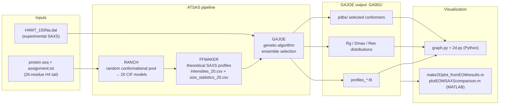
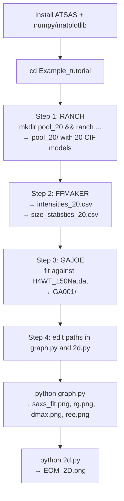

This page gets you from a fresh clone to your first EOM result in two independent paths: **Path A** runs the complete ATSAS pipeline (RANCH → FFMAKER → GAJOE → Python plots) on a small 20-conformation H4 histone tail demo shipped in `Example_tutorial/`, and **Path B** analyzes the pre-computed GAJOE output in `ExampleData/` using the repository's MATLAB scripts — no ATSAS installation required. The repository's core purpose is comparing intrinsically disordered protein (IDP) structural ensembles generated from molecular dynamics (MD) against small-angle X-ray scattering (SAXS) data, with the H4 histone tail as the worked example case.


Sources: [README.md](README.md#L1-L17), [README.md](README.md#L3)

## What You Need Before Starting

The analysis runs on a standard computer with enough memory for moderate computing tasks — no workstation or GPU cluster is needed for the Quick Start demo. The toolchain divides into a mandatory core (ATSAS + Python) and an optional MATLAB layer used only for Path B and the deeper ensemble analysis described in the Deep Dive pages.

| Component | Role in Quick Start | Version note | Needed for |
|---|---|---|---|
| ATSAS (RANCH, FFMAKER, GAJOE) | Generates conformers, theoretical SAXS profiles, ensemble fits | GAJOE v2.1 is easiest | Path A, Steps 1–4 |
| Python + `numpy` + `matplotlib` | Plots SAXS fit and Rg–Ree scatter | Any recent 3.x | Path A, Step 5 |
| MATLAB | 2D histograms, SAXS fit/Kratky/residual comparison | R2021 or later | Path B (optional) |
| AMBER 24 | MD ensemble generation | 24 | Not needed on this page |

If you have not yet installed ATSAS, follow [Software Requirements and Installation](3-software-requirements-and-installation) first — the ATSAS download is at https://www.embl-hamburg.de/biosaxs/software.html.

Sources: [README.md](README.md#L19-L25), [README.md](README.md#L34)

## A Map of the Repository

Only four locations matter for the Quick Start, and each maps to exactly one stage of the workflow.

```
H4_tail_benchmarking/
├── Example_tutorial/          ← Path A workspace: a complete, self-contained demo
│   ├── protein.seq            ← H4 tail sequence fed to RANCH
│   ├── assignment.txt         ← RANCH domain assignment
│   ├── H4WT_150Na.dat         ← experimental SAXS data (fit target)
│   ├── graph.py / 2d.py       ← Python plotting scripts
│   └── keeper.git
├── ExampleData/
│   └── H4_tail_WT_ff19SB_OPC/GA001/curve_1/   ← Path B: pre-computed GAJOE output
├── SAXSData/
│   ├── H4WT_150Na.dat         ← wild-type experimental profile
│   └── H4KQ_150Na.dat         ← charge-neutralized (K→Q) profile
├── getBestCurve.m             ← rebuilds GAJOE v2 best-curve from GA cycles
├── make2Dplot_fromEOMresults.m ← 2D histogram: MD pool vs SAXS-refined ensemble
└── plotEOMSAXScomparison.m    ← averaged EOM SAXS profile vs experiment
```

| Path | Quick Start role |
|---|---|
| `Example_tutorial/` | Self-contained 20-conformer EOM demo; run all four ATSAS stages here |
| `ExampleData/.../GA001/curve_1/` | Shipped GAJOE results: `profiles_001_1.fit`, 100 `GA_CYCLE_*.txt` files, `Rg_distr`, `Size_distr`, `CaCa_distr` distributions, `Size_list.txt`, `Ree_values.mat` |
| `SAXSData/` | Experimental SAXS profiles (53 q-points, format: `Q  I(Q)  Error` after 4 header lines) |
| Three `.m` scripts at root | Post-GAJOE MATLAB analysis layer |

Sources: [README.md](README.md#L10-L17), [SAXSData/H4WT_150Na.dat](SAXSData/H4WT_150Na.dat#L1-L5)

## How the Pieces Fit Together

The pipeline is a strictly linear chain of three ATSAS programs, with two visualization front-ends branching off the GAJOE output. Understanding this shape before typing any commands makes every subsequent step self-explanatory: each tool consumes the previous tool's file and emits files whose names the next stage expects.



Note that GAJOE is the only stage that touches the experimental data — RANCH and FFMAKER work purely on the model side, which is why Path B can analyze pre-computed GAJOE output without regenerating anything upstream.

Sources: [README.md](README.md#L11-L17), [README.md](README.md#L38-L98)

## Path A — Your First EOM Run in `Example_tutorial`

This is the complete hands-on sequence. The demo deliberately uses a tiny 20-conformation pool and modest GA settings so the whole cycle finishes quickly; a full quantitative analysis scales these up later.



Sources: [README.md](README.md#L30-L36), [README.md](README.md#L38-L118)

### Step 1 — Install and Enter the Workspace

After installing ATSAS, install the two Python dependencies and change into the tutorial directory. Everything you need is already there: the experimental dataset `H4WT_150Na.dat`, 20 example PDB structures, the two plotting scripts, and the two RANCH input files described in the next step.

```bash
python -m pip install numpy matplotlib
cd Example_tutorial
```

Sources: [README.md](README.md#L34-L36), [README.md](README.md#L102-L106)

### Step 2 — Generate Conformations with RANCH

RANCH builds a random conformational pool from two text inputs. `assignment.txt` declares a single residue range as disordered (`A 1 26 disordered`), and `protein.seq` carries the 26-residue H4 tail sequence `SGRGKGGKGLGKGGAKRHRKVLRDNI`. The `--seed` flag makes the random pool reproducible.

```bash
mkdir pool_20

ranch --repetitions 20 --prefix pool_20/model_ \
    --seed 12345 assignment.txt protein.seq
```

**Output:** a `pool_20/` directory containing 20 randomly generated conformations in CIF format.

Sources: [README.md](README.md#L38-L47), [assignment.txt](Example_tutorial/assignment.txt#L1), [protein.seq](Example_tutorial/protein.seq#L1-L2)

### Step 3 — Compute Theoretical SAXS Profiles with FFMAKER

FFMAKER converts every CIF model into a theoretical intensity profile and a size-statistics table. Both outputs are the mandatory inputs to GAJOE in the next step.

```bash
ffmaker --output intensities_20.csv \
    --pool size_statistics_20.csv pool_20/*.cif
```

| Output file | Contents |
|---|---|
| `intensities_20.csv` | Theoretical SAXS intensity profiles for all 20 conformations |
| `size_statistics_20.csv` | Per-conformation structural properties: R_g, D_max, end-to-end distance (R_ee), and volume |

To analyze the provided PDB structures instead of a fresh RANCH pool, replace `pool_20/*.cif` with the path to those PDB files.

Sources: [README.md](README.md#L49-L60)

### Step 4 — Fit Ensembles with GAJOE

GAJOE runs a genetic algorithm that selects the subset of conformers whose averaged theoretical profile best matches the experimental data. The command line encodes every major fitting decision:

```bash
gajoe \
    --intensity intensities_20.csv \
    --size size_statistics_20.csv \
    --times 1 \
    --generation 100 \
    --ensemble 20 \
    --minimum 1 \
    --maximum 10 \
    --no-repeated \
    H4WT_150Na.dat
```

| Flag | Value | Meaning |
|---|---|---|
| `--intensity` | `intensities_20.csv` | Theoretical SAXS profiles from FFMAKER |
| `--size` | `size_statistics_20.csv` | Structural properties (R_g, D_max, R_ee) per conformer |
| `--times` | `1` | Number of independent genetic algorithm runs |
| `--generation` | `100` | Generations per run |
| `--ensemble` | `20` | Candidate ensembles evaluated per generation |
| `--minimum` / `--maximum` | `1` / `10` | Bounds on conformations in the selected ensemble |
| `--no-repeated` | — | Prevents the same conformer appearing twice within one ensemble |
| *(positional)* | `H4WT_150Na.dat` | Experimental SAXS data to fit |

**Output:** a `GA001/` directory containing `profiles_*.fit` (experimental data plus fitted ensemble intensity with χ²), `Rg_distr_*.txt`, `Size_distr_*.txt`, and `CaCa_distr_*.txt` distribution files, a `pdbs/` subfolder with the selected conformations, and `logFile_*.log` with all optimization settings. The full file anatomy is documented in [GAJOE Output File Reference](9-gajoe-output-file-reference).

These settings are intended for a quick demonstration only — for quantitative analysis, increase generations and independent runs, and use a substantially larger conformational pool.

Sources: [README.md](README.md#L62-L98)

### Step 5 — Plot with the Python Scripts

Both scripts hard-code their input paths near the top, so the only edit required is pointing them at your fresh GAJOE output directory before running them.

| Script | Edit this line | Produces |
|---|---|---|
| `graph.py` | `folder = Path("GA001/curve_1")` | `saxs_fit.png` (experiment + GAJOE fit, log-scale I(q)); `rg.png`, `dmax.png`, `ree.png` distribution overlays |
| `2d.py` | `size_file = Path("size_statistics_20.csv")` and `selected_dir = Path("GA001/curve_1/pdbs")` | `EOM_2D.png` — R_g vs R_ee scatter of the full pool with GAJOE-selected conformers circled, plus marginal histograms |

```bash
python graph.py
python 2d.py
```

`2d.py` cross-checks the selected conformers against the pool statistics and prints a summary (`Pool: N`, `Selected by GAJOE: N`) before rendering, failing loudly with an assertion if any selected structure is missing from the pool.

> [!TIP]
> `graph.py` silently skips a distribution plot when no file matches its glob (`if not files: continue`), and its patterns expect `Rg_distr_*.dat` / `Size_distr_*.dat` / `CaCa_distr_*.dat` — yet GAJOE commonly writes these as `.txt` files (exactly what the shipped `ExampleData` contains). If only `saxs_fit.png` appears, rename the distribution files or relax the glob patterns.

Sources: [README.md](README.md#L100-L118), [graph.py](Example_tutorial/graph.py#L5), [graph.py](Example_tutorial/graph.py#L23-L59), [2d.py](Example_tutorial/2d.py#L7-L9), [2d.py](Example_tutorial/2d.py#L36-L41), [2d.py](Example_tutorial/2d.py#L106)

## Path B — Zero-Install Analysis of the Shipped Example Data

The repository ships a complete, pre-computed GAJOE run (`ExampleData/H4_tail_WT_ff19SB_OPC/GA001/curve_1/`, 100 GA cycles) alongside the experimental profiles, so the two MATLAB scripts work immediately after cloning — both already have repo-relative paths configured in their **User-defined parameters** block, which the README notes is the only block you ever interact with. This is also how the published H4WT figure was produced.

| Script | Parameter | Value in repo | Meaning |
|---|---|---|---|
| `plotEOMSAXScomparison.m` | `folder` | `ExampleData/.../GA001/curve_1` | GAJOE output directory |
| | `expData` | `SAXSData/H4WT_150Na.dat`, `NumHeaderLines=4` | Experimental profile (Q, I(Q), Error columns) |
| | `fitFile` | `profiles_001_1.fit`, `NumHeaderLines=1` | GAJOE fitted profile |
| | `theColour` | `[238 68 0]/255` (H4WT) or `[46 80 122]/255` (H4KQ) | Plot color per variant |
| `make2Dplot_fromEOMresults.m` | `dir` | `ExampleData/.../GA001/curve_1` | GAJOE output directory |
| | `nRuns` | `100` | Number of GA runs — must match your GAJOE `--times` setting |
| | `curvesPerEnsemble` | `20` | Maximum curves per ensemble |

Running `plotEOMSAXScomparison.m` produces the SAXS-vs-EOM overlay, a Kratky representation, and residual plots; `make2Dplot_fromEOMresults.m` produces the 2D (R_g, R_ee) histogram comparison between the full MD pool and the SAXS-refined ensemble, including the Jensen-Shannon divergence between the two distributions. Both scripts route through the helper `getBestCurve.m`, which exists because GAJOE v2 dropped the `best_curve.txt` file of v1.3 — it reconstructs the selected-structure frequencies by tallying structures across all `GA_CYCLE_*.txt` files and returns a `[PDB_number, frequency]` matrix. For `make2Dplot_fromEOMresults.m` specifically, the shipped dataset already contains the required `Ree_values.mat` and `Size_list.txt`, so no pre-processing is needed on your side.

> [!TIP]
> `GA_CYCLE_*.txt` files — the raw material `getBestCurve.m` reads — are only written when you answer `y` to GAJOE's prompt *"Save workfiles with the entire GA runs? (default: no)"*. If you run your own GAJOE job intending to use the MATLAB scripts later, make sure this option is enabled, or `getBestCurve` will have nothing to read.

The K→Q (charge-neutralized) comparison uses the same scripts — swap `expData` to `SAXSData/H4KQ_150Na.dat` and the color to the blue variant. The scientific interpretation of these two variants is covered in [H4 Histone Tail Case Study](17-h4-histone-tail-case-study), and the divergence metric itself in [Jensen-Shannon Divergence Quantification](12-jensen-shannon-divergence-quantification).

Sources: [README.md](README.md#L12-L17), [make2Dplot_fromEOMresults.m](make2Dplot_fromEOMresults.m#L13-L31), [make2Dplot_fromEOMresults.m](make2Dplot_fromEOMresults.m#L33-L55), [plotEOMSAXScomparison.m](plotEOMSAXScomparison.m#L8-L22), [getBestCurve.m](getBestCurve.m#L2-L11), [getBestCurve.m](getBestCurve.m#L19-L39)

## Where to Go Next

If anything in this page raised questions about *why* the pipeline is shaped this way, the conceptual grounding lives in [Overview](1-overview) and [Architecture Overview](5-architecture-overview). Practical follow-ups in reading order:

1. **[Software Requirements and Installation](3-software-requirements-and-installation)** — if ATSAS or MATLAB are not yet installed, resolve this before running Path A.
2. **[EOM Tutorial with ATSAS Tools](4-eom-tutorial-with-atsas-tools)** — the step-by-step ATSAS walkthrough this page summarized, with deeper command context.
3. **Python plotting deep dives** — [SAXS Curve and Distribution Plots](14-saxs-curve-and-distribution-plots) extends `graph.py`, and [Rg-Ree Scatter Plot with Marginals](15-rg-ree-scatter-plot-with-marginals) extends `2d.py`.
4. **Scaling up** — [RANCH Conformational Pool Generation](6-ranch-conformational-pool-generation), [FFMAKER Theoretical SAXS Profiles](7-ffmaker-theoretical-saxs-profiles), and [GAJOE Genetic Algorithm Ensemble Fitting](8-gajoe-genetic-algorithm-ensemble-fitting) explain how to grow the 20-conformer demo into a production-grade analysis.

The repository is released under the Apache 2.0 License; if you use the code in published work, cite the accompanying paper (Wang, Kolesnikov, Pollack, Onufriev, 2026, in submission).
