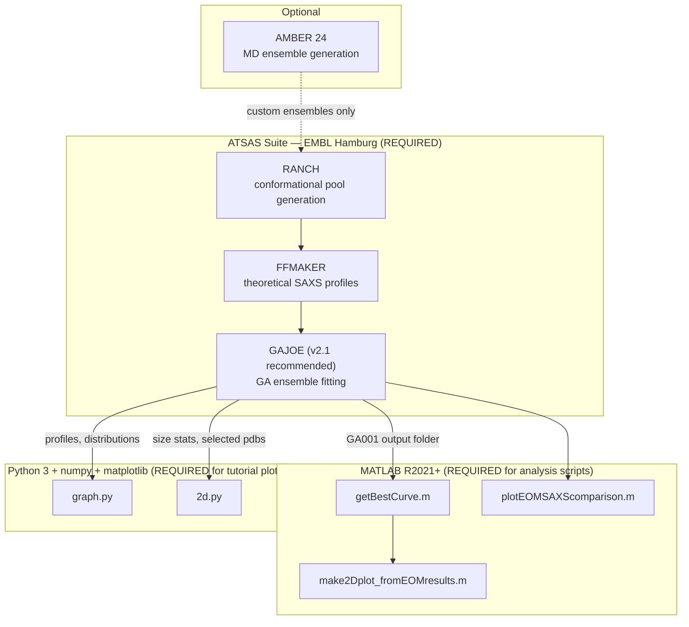
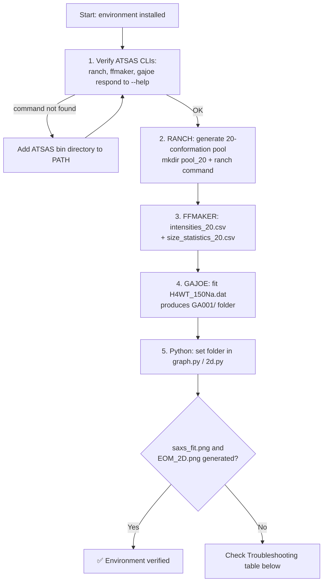

This page specifies everything you need to install before running the H4 tail benchmarking workflow, which compares intrinsically disordered protein (IDP) ensembles from molecular dynamics (MD) against small-angle X-ray scattering (SAXS) data. The workflow has three mandatory software components — the **ATSAS suite**, **MATLAB**, and a small **Python environment** — plus one optional dependency, **AMBER**, that you only need if you plan to generate your own MD ensembles. By the end of this page you will know exactly what to install, which versions matter, how each component fits into the pipeline, and how to verify your setup end-to-end.


Sources: [README.md](README.md#L1-L8), [README.md](README.md#L22-L25)

## The Software Stack at a Glance

The repository splits its work across four environments. **ATSAS** (developed and distributed by EMBL Hamburg) performs the Ensemble Optimization Method (EOM) pipeline: RANCH builds random conformational pools, FFMAKER computes theoretical SAXS profiles, and GAJOE fits ensembles to experimental data using a genetic algorithm. **MATLAB** scripts then compare the full MD ensemble with the SAXS-refined ensemble and plot the fit against experiment. **Python** scripts provide lightweight plotting for the bundled tutorial, and **AMBER** is only involved upstream when producing MD ensembles from scratch.



| Component | Role in the Workflow | Version Guidance | Required? |
|---|---|---|---|
| ATSAS (RANCH, FFMAKER, GAJOE) | EOM pipeline: pool generation, SAXS profile calculation, GA fitting | GAJOE v2.1 recommended ("will be easiest") | **Required** |
| MATLAB | 2D ensemble histograms, Jensen-Shannon divergence, SAXS fit/Kratky/residual plots | R2021 or later | **Required** for the MATLAB analysis scripts |
| Python 3 + numpy + matplotlib | Tutorial SAXS curve, Rg–Ree scatter with marginals | Any modern Python 3 (no version pinned) | **Required** to reproduce the tutorial plots |
| AMBER 24 | Generating MD structural ensembles (ff19SB/OPC path) | AMBER 24 used in the paper | **Optional** — example GAJOE results ship in `ExampleData/` |

Sources: [README.md](README.md#L11-L13), [README.md](README.md#L19-L25), [Example_tutorial/2d.py](Example_tutorial/2d.py#L2-L4), [make2Dplot_fromEOMresults.m](make2Dplot_fromEOMresults.m#L7-L8)

## Hardware Requirements

No exotic hardware is needed. The authors state the analysis "should only require a standard computer that is able to run the commonly available software below, with enough memory to complete moderate intensity computing tasks." In practice, your machine mainly needs to be able to run MATLAB and ATSAS comfortably; the heavy lifting (MD simulation) is only relevant if you opt into the AMBER path.

Sources: [README.md](README.md#L19-L20)

## Installing ATSAS (Core Dependency)

ATSAS is the backbone of the entire workflow — EOM and GAJOE are part of it, and the repository explicitly recommends **GAJOE v2.1** as the easiest version to use. Obtain ATSAS from the EMBL Hamburg download page linked in the repository's tutorial, complete their registration, and install it so the command-line tools (`ranch`, `ffmaker`, `gajoe`) are on your `PATH`. The repository's tutorial then drives these tools purely from the terminal, so a working CLI is the verification target — no GUI configuration is required by this project.

The three commands you must be able to call are exactly those exercised in the tutorial: `ranch` (generate conformations), `ffmaker` (theoretical SAXS profiles + size statistics), and `gajoe` (genetic-algorithm ensemble fitting against an experimental `.dat` file). If any of them responds with "command not found," add your ATSAS installation's binary directory to your `PATH` before proceeding.

> [!TIP]
> Version sensitivity matters here: the MATLAB scripts in this repository were "adapted for use with GAJOE v2.1," which **no longer outputs a `best_curve.txt` file** (that was a v1.3 feature). Installing GAJOE v2.x keeps the pipeline consistent with `getBestCurve.m`, which programmatically rebuilds the missing best-curve data from GA cycle files.

Sources: [README.md](README.md#L11), [README.md](README.md#L22-L23), [README.md](README.md#L30-L36), [make2Dplot_fromEOMresults.m](make2Dplot_fromEOMresults.m#L6-L8)

## MATLAB Environment

The three analysis scripts require **MATLAB R2021 or later** per the repository's software notes. Examining the scripts confirms why a recent release matters: `plotEOMSAXScomparison.m` and `getBestCurve.m` both rely on `readmatrix` (introduced in R2019a), including its text-file options, and the plots use the LaTeX text interpreter for axis labels. One script also depends on a toolbox function, which is the single most commonly missed installation step for beginners — detailed in the table below.

| Script | Key MATLAB Functions Used | Installation Note |
|---|---|---|
| `getBestCurve.m` | `readmatrix`, `categorical`, `tabulate` | `tabulate` belongs to the **Statistics and Machine Learning Toolbox** — verify it is included in your MATLAB license |
| `make2Dplot_fromEOMresults.m` | `importdata`, `load`, `repmat`, LaTeX interpreter | Base MATLAB; R2021+ recommended by the README |
| `plotEOMSAXScomparison.m` | `readmatrix` with `'FileType','text'`, `interp1` | `readmatrix` requires R2019a+ |

Both high-level scripts are run by editing the "User-defined parameters" block at the top — mostly path matching to your GAJOE output folder — so no additional MATLAB configuration is needed beyond the installation itself.

Sources: [README.md](README.md#L25), [README.md](README.md#L17), [getBestCurve.m](getBestCurve.m#L20-L30), [plotEOMSAXScomparison.m](plotEOMSAXScomparison.m#L15-L16), [make2Dplot_fromEOMresults.m](make2Dplot_fromEOMresults.m#L13-L18), [make2Dplot_fromEOMresults.m](make2Dplot_fromEOMresults.m#L73-L74)

## Python Environment

The Python footprint is deliberately minimal — exactly **two third-party packages**. The repository gives the exact install command in its tutorial, and inspection of both scripts confirms nothing beyond `numpy`, `matplotlib` (including `GridSpec` for the marginal-histogram layout), and the standard-library `pathlib` is imported. Any standard Python 3 environment works; there is no pinned version, no `requirements.txt`, and no conda file in the repository.

```bash
python -m pip install numpy matplotlib
```

| Package | Imported By | Role | Source of Truth |
|---|---|---|---|
| `numpy` | `graph.py`, `2d.py` | Array math for SAXS curves, Rg/Ree statistics | First import line of each script |
| `matplotlib` (pyplot, GridSpec) | `graph.py`, `2d.py` | SAXS fit plots, distribution plots, 2D scatter with marginals | Import lines + `GridSpec` usage |
| `pathlib` (stdlib) | `graph.py`, `2d.py` | Locating GAJOE output files via glob patterns | Built into Python 3 — nothing to install |

The scripts are then run directly with no arguments: `python graph.py` produces the experimental SAXS curve and EOM fit, and `python 2d.py` produces the Rg-versus-Ree scatter plot with marginal histograms (after you point each script's folder variable at your GAJOE output directory).

Sources: [README.md](README.md#L100-L116), [Example_tutorial/graph.py](Example_tutorial/graph.py#L1-L5), [Example_tutorial/2d.py](Example_tutorial/2d.py#L2-L9)

## AMBER 24 (Optional — MD Ensemble Generation)

AMBER is listed in the software notes because the paper's H4 tail ensembles were produced with **AMBER 24**, but it sits outside the analysis pipeline itself. If you only want to benchmark existing ensembles against SAXS data, skip this entirely — the repository ships example GAJOE results (`ExampleData/H4_tail_WT_ff19SB_OPC/GA001/`) and both wild-type and K-to-Q experimental SAXS profiles (`SAXSData/`), so the full MATLAB analysis path runs without any MD software installed. If you do intend to generate your own ensembles, install AMBER 24 and continue to the dedicated MD page afterward.

> [!TIP]
> Check the `ExampleData` folder name: `H4_tail_WT_ff19SB_OPC` records the force field (ff19SB) and water model (OPC) used for the shipped ensemble — useful context if you later install AMBER to reproduce or extend the MD side, but irrelevant to the ATSAS/MATLAB/Python installation on this page.

Sources: [README.md](README.md#L12-L13), [README.md](README.md#L24)

## Verifying Your Setup (End-to-End Smoke Test)

The fastest confidence check is to run the bundled tutorial in `Example_tutorial/`, which contains everything needed: an experimental SAXS dataset (`H4WT_150Na.dat`), 20 example PDB structures, the two Python plotting scripts, and the two RANCH input files (`assignment.txt`, `protein.seq`). The following sequence exercises every component you just installed — ATSAS three times, Python once — and finishes in minutes on a standard computer:



A successful run confirms ATSAS end-to-end: GAJOE writes a `GA001`-style directory containing `profiles_*.fit`, the `Rg_distr_*.txt` / `Size_distr_*.txt` / `CaCa_distr_*.txt` distributions, a `pdbs/` folder of selected conformations, and a `logFile_*.log` — precisely the files the MATLAB and Python scripts consume next. Note that the tutorial's small 20-conformation pool is explicitly a workflow demonstration; quantitative analysis later requires much larger pools, but the 20-structure smoke test is ideal for installation verification.

Sources: [README.md](README.md#L30-L36), [README.md](README.md#L38-L75), [README.md](README.md#L91-L98), [README.md](README.md#L108-L118)

## What the Repository Provides

No data acquisition is needed to get started — the repository bundles the example GAJOE output folder (`ExampleData/H4_tail_WT_ff19SB_OPC/GA001/`), experimental SAXS profiles for wild-type and charge-neutralized (K-to-Q) H4 tails in `SAXSData/`, three MATLAB analysis scripts at the root, and the complete self-contained tutorial directory. This means the **minimum viable installation** for exploring the project is ATSAS + MATLAB (for the root scripts) or just ATSAS + Python (for the tutorial):

```
H4_tail_benchmarking/
├── ExampleData/
│   └── H4_tail_WT_ff19SB_OPC/
│       └── GA001/                  ← example GAJOE output (no rerun needed)
├── Example_tutorial/               ← self-contained ATSAS + Python smoke test
│   ├── 2d.py                       ← needs numpy + matplotlib
│   ├── graph.py                    ← needs numpy + matplotlib
│   ├── H4WT_150Na.dat              ← experimental SAXS profile
│   ├── assignment.txt, protein.seq ← RANCH inputs
│   └── (20 example PDB structures)
├── SAXSData/
│   ├── H4WT_150Na.dat              ← wild-type H4 tail, 150 mM Na
│   └── H4KQ_150Na.dat              ← K-to-Q variant, 150 mM Na
├── getBestCurve.m                  ← MATLAB (needs Statistics toolbox fn)
├── make2Dplot_fromEOMresults.m     ← MATLAB R2021+
├── plotEOMSAXScomparison.m         ← MATLAB R2021+
└── LICENSE.txt                     ← Apache 2.0
```

Sources: [README.md](README.md#L10-L18), [README.md](README.md#L36), [README.md](README.md#L27-L28)

## Common Installation & Setup Issues

Beginners hit a small, well-defined set of failure modes with this stack. The table below maps each symptom to its verified cause and fix, drawing directly on the repository's own documentation and script comments:

| Symptom | Likely Cause | Fix |
|---|---|---|
| `ranch` / `ffmaker` / `gajoe`: command not found | ATSAS binaries not on `PATH` | Add the ATSAS installation's binary directory to your shell `PATH` |
| MATLAB: `Undefined function 'tabulate'` | Statistics and Machine Learning Toolbox not installed | Add the toolbox to your MATLAB installation; `tabulate` is called inside `getBestCurve.m` |
| `getBestCurve.m` cannot find `GA_CYCLE_*.txt` files | GAJOE was run with workfile saving disabled | When GAJOE prompts "Save workfiles with the entire GA runs? (default: no)", answer **`y`** |
| `make2Dplot_fromEOMresults.m` expects a missing `best_curve` file | Running GAJOE v1.3-era assumptions against v2.x output | Use GAJOE v2.x consistently; the script calls `getBestCurve.m` to reconstruct the curve from GA cycle files |
| Python: `ModuleNotFoundError: numpy` / `matplotlib` | Packages not installed in the active interpreter | Run `python -m pip install numpy matplotlib` in the same environment you use to launch the scripts |
| MATLAB scripts point at wrong data | Path in "User-defined parameters" block not matched to your output | Edit the `dir` / `folder` variables at the top of each script — "mostly the paths just need to be matched" |

> [!TIP]
> The single most valuable habit from this table: when running GAJOE v2.x, always answer **`y`** to saving workfiles. `getBestCurve.m` — the foundation of the 2D histogram workflow — reconstructs the best curve from the per-cycle `GA_CYCLE_*.txt` files that only exist if you saved them. Without that answer, the MATLAB pipeline cannot start.

Sources: [getBestCurve.m](getBestCurve.m#L2-L9), [make2Dplot_fromEOMresults.m](make2Dplot_fromEOMresults.m#L6-L8), [README.md](README.md#L17), [README.md](README.md#L104-L106)

## Recommended Reading Path

You now have the full stack installed and verified. The logical progression through this documentation is: revisit [Overview](1-overview) and [Quick Start](2-quick-start) for high-level context if you haven't already, then proceed to the hands-on [EOM Tutorial with ATSAS Tools](4-eom-tutorial-with-atsas-tools), which walks through the RANCH → FFMAKER → GAJOE commands you just smoke-tested in detail. From there, [Architecture Overview](5-architecture-overview) explains how all the components you installed interact, and the Deep Dive pages (starting with [RANCH Conformational Pool Generation](6-ranch-conformational-pool-generation)) cover each ATSAS tool's behavior. If you took the optional AMBER path, continue to [MD Ensemble Generation with AMBER](18-md-ensemble-generation-with-amber); if you plan to extend beyond H4, [Extending Workflow to Other IDPs](19-extending-workflow-to-other-idps) is the natural endpoint.
