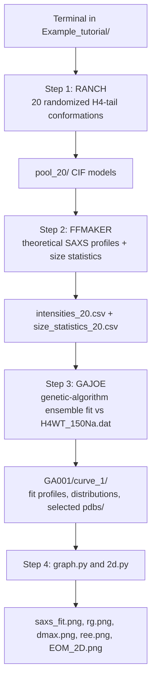

This page is a hands-on walkthrough of the **Ensemble Optimization Method (EOM)** pipeline using the ATSAS toolchain — `ranch` → `ffmaker` → `gajoe` — as implemented in the `Example_tutorial/` directory of this repository. The tutorial intentionally uses a minimal pool of **20 H4 histone tail conformations** so the entire pipeline can be executed end-to-end in minutes; the same four-step protocol scales directly to the production-size ensembles used in the full benchmark. Theory and per-tool internals are deliberately deferred to the Deep Dive pages linked at the end of each section.


Sources: [README.md](README.md#L30-L36), [README.md](README.md#L3-L8)

## Prerequisites and Workspace Inventory

Before starting, install ATSAS (GAJOE v2.1 is recommended for CLI compatibility) and Python with `numpy` and `matplotlib`. Detailed installation guidance is covered in [Software Requirements and Installation](3-software-requirements-and-installation). All commands are executed from inside the `Example_tutorial/` directory.

The tutorial folder contains exactly six working files, each with a defined role in the pipeline:

| File | Role in the pipeline |
|---|---|
| `assignment.txt` | RANCH input: declares chain `A`, residues 1–26, as `disordered` |
| `protein.seq` | FASTA-format 26-residue H4 tail sequence consumed by RANCH |
| `H4WT_150Na.dat` | Experimental SAXS curve (53 q-points; columns Q, I(Q), Error) |
| `graph.py` | Plots experimental curve vs. GAJOE fit plus Rg / Dmax / Ree distributions |
| `2d.py` | Rg-vs-Ree scatter with marginal histograms, highlighting GAJOE-selected conformers |
| `pool_20/`, `GA001/` | Created at runtime by RANCH and GAJOE respectively |

The README also notes the directory ships with 20 example PDB structures as an alternative pool for FFMAKER, useful if you want to fit pre-generated models instead of RANCH output.

Sources: [README.md](README.md#L32-L36), [assignment.txt](Example_tutorial/assignment.txt#L1), [protein.seq](Example_tutorial/protein.seq#L1-L2), [H4WT_150Na.dat](Example_tutorial/H4WT_150Na.dat#L1-L5), [graph.py](Example_tutorial/graph.py#L5), [2d.py](Example_tutorial/2d.py#L8-L9), [README.md](README.md#L60)

## Workflow at a Glance

The tutorial is a strict four-stage pipeline where each stage's output is the next stage's input. Understanding this data dependency chain before running anything prevents the most common setup mistakes:



Each numbered section below corresponds to one stage. All commands are quoted verbatim from the repository's tutorial so you can copy-paste them directly.

Sources: [README.md](README.md#L38-L118)

## Step 1 — RANCH: Generating the Conformational Pool

RANCH generates a randomized conformational pool from a sequence and an "assignment" descriptor. First create an output directory, then invoke `ranch` with the two bundled input files:

```bash
mkdir pool_20

ranch --repetitions 20 --prefix pool_20/model_ \
    --seed 12345 assignment.txt protein.seq
```

The two positional input files follow a minimal, verifiable format. `assignment.txt` contains the single line `A 1 26 disordered` — chain ID `A`, residue range 1 to 26, treated as a disordered region. `protein.seq` is a two-line FASTA record: header `>A` followed by the 26-residue sequence `SGRGKGGKGLGKGGAKRHRKVLRDNI` (the H4 tail construct analyzed in the case study).

| CLI flag | Value | Effect |
|---|---|---|
| `--repetitions` | `20` | Number of conformations generated |
| `--prefix` | `pool_20/model_` | Output directory and filename prefix |
| `--seed` | `12345` | PRNG seed → reproducible pool |
| positional 1 | `assignment.txt` | Chain/residue-range assignment |
| positional 2 | `protein.seq` | FASTA sequence |

**Output:** `pool_20/` containing 20 randomly generated conformations in CIF format. The fixed `--seed` makes the pool reproducible — remove it only if you want a new random draw.

Sources: [README.md](README.md#L38-L47), [assignment.txt](Example_tutorial/assignment.txt#L1), [protein.seq](Example_tutorial/protein.seq#L1-L2)

For the theory behind random-pool construction, see [RANCH Conformational Pool Generation](6-ranch-conformational-pool-generation).

## Step 2 — FFMAKER: Theoretical SAXS Profiles and Size Statistics

FFMAKER converts every structure in the pool into two tabular artifacts consumed by GAJOE:

```bash
ffmaker --output intensities_20.csv \
    --pool size_statistics_20.csv pool_20/*.cif
```

| Output file | Contents |
|---|---|
| `intensities_20.csv` | Theoretical SAXS intensity profiles I(q) for all 20 conformations |
| `size_statistics_20.csv` | Per-conformation structural properties: Rg, Dmax, end-to-end distance (Ree), and volume |

Two practical notes verified in the repository: (1) to fit the bundled example PDB structures instead of the RANCH pool, simply replace the `pool_20/*.cif` glob with the path to those PDB files — the command structure is otherwise identical; (2) despite the `.csv` extension, downstream consumers in this repo parse these files with whitespace-token splitting that also tolerates commas, so either delimiter variant works.

Sources: [README.md](README.md#L49-L60), [2d.py](Example_tutorial/2d.py#L14-L22), [graph.py](Example_tutorial/graph.py#L10-L11)

For how the profiles are computed, see [FFMAKER Theoretical SAXS Profiles](7-ffmaker-theoretical-saxs-profiles).

## Step 3 — GAJOE: Genetic Algorithm Ensemble Selection

GAJOE is the optimization core: it runs a genetic algorithm that selects the sub-ensemble of pool conformations whose averaged theoretical profile best matches the experimental curve `H4WT_150Na.dat`.

```bash
gajoe \
    --intensity intensities_20.csv \
    --size size_statistics_20.csv \
    --times 1 \
    --generation 100 \
    --ensemble 20 \
    --minimum 1 \
    --maximum 10 \
    --no-repeated \
    H4WT_150Na.dat
```

Every flag has a precise meaning — keep this table at hand when tuning runs:

| Parameter | Value | Meaning |
|---|---|---|
| `--intensity` | `intensities_20.csv` | FFMAKER theoretical profiles |
| `--size` | `size_statistics_20.csv` | Structural properties (Rg, Dmax, Ree, …) |
| `--times` | `1` | Number of independent GA runs |
| `--generation` | `100` | Generations per run |
| `--ensemble` | `20` | Candidate ensembles evaluated per generation |
| `--minimum` | `1` | Minimum conformations in a selected ensemble |
| `--maximum` | `10` | Maximum conformations in a selected ensemble |
| `--no-repeated` | — | Forbids duplicate conformations within an ensemble |
| positional | `H4WT_150Na.dat` | Experimental SAXS data being fitted |

**Output:** a result directory named `GA001` (then `GA002`, … for additional `--times` runs) containing:

| Artifact | Content |
|---|---|
| `profiles_*.fit` | Experimental data + fitted ensemble intensity, including χ² |
| `Rg_distr_*.txt` | Rg distributions of full pool and selected ensemble |
| `Size_distr_*.txt` | Corresponding Dmax distributions |
| `CaCa_distr_*.txt` | End-to-end distance distributions |
| `pdbs/` | Conformations selected by the GA |
| `logFile_*.log` | Optimization settings and results |

Sources: [README.md](README.md#L62-L98)

The GA mechanics — selection, crossover, and ensemble fitness evaluation — are dissected in [GAJOE Genetic Algorithm Ensemble Fitting](8-gajoe-genetic-algorithm-ensemble-fitting), and every output file is cataloged in [GAJOE Output File Reference](9-gajoe-output-file-reference).

## Step 4 — Visualizing Results with the Python Scripts

The final step renders GAJOE's numerical output into publication figures. Install the two dependencies, then run both scripts:

```bash
python -m pip install numpy matplotlib
python graph.py
python 2d.py
```

Both scripts read from fixed paths relative to `Example_tutorial/` and produce distinct figure families:

| Script | Inputs consumed | Figures produced |
|---|---|---|
| `graph.py` | `GA001/curve_1/profiles_*.fit` + `*_distr_*.dat` files | `saxs_fit.png`, `rg.png`, `dmax.png`, `ree.png` |
| `2d.py` | `size_statistics_20.csv` + `GA001/curve_1/pdbs/*.cif` | `EOM_2D.png` |

`graph.py` uses a purpose-built `read_numeric()` parser that silently skips non-numeric header lines and accepts both comma- and whitespace-delimited tokens — this is why GAJOE's raw `.fit` and distribution files, which begin with four text header lines, load without any preprocessing. The SAXS-fit branch plots experimental points with error bars against the fitted curve on a log intensity scale; the distribution branch plots every numeric column after the first (pool frequency and selected-ensemble frequency) for Rg, Dmax, and Ree.

`2d.py` takes a different route: it parses `size_statistics_20.csv` directly (columns 1, 3, and 6 hold Rg, Ree, and the structure name), then builds a boolean mask by matching the stems of CIF files in `GA001/curve_1/pdbs/` against pool names. The resulting figure is a GridSpec layout: a central Ree-vs-Rg scatter (full pool as filled coral points, EOM-selected structures as open dodgerblue circles) flanked by shared-axis marginal histograms, with 12 bins scaled to 1.1× the maximum of each quantity. A built-in assertion aborts execution if any selected structure cannot be found in the pool statistics file.

Sources: [README.md](README.md#L100-L118), [graph.py](Example_tutorial/graph.py#L7-L21), [graph.py](Example_tutorial/graph.py#L23-L59), [2d.py](Example_tutorial/2d.py#L14-L41), [2d.py](Example_tutorial/2d.py#L43-L107)

> [!TIP]
> The `read_numeric()` helper truncates all rows to the minimum column count found (`np.array([row[:ncols] ...])`). If GAJOE ever emits trailing annotation columns in one row of a `.fit` file, the parser degrades gracefully rather than crashing — but verify column alignment if your fit curve looks shifted.

The plotting internals are documented in depth in [SAXS Curve and Distribution Plots](14-saxs-curve-and-distribution-plots) and [Rg-Ree Scatter Plot with Marginals](15-rg-ree-scatter-plot-with-marginals).

## Cross-Checking Against the Bundled Reference Output

You do not need to guess what a successful run looks like: `ExampleData/H4_tail_WT_ff19SB_OPC/GA001/` contains a full production-scale GAJOE result for the same H4 tail system. Its structure maps one-to-one onto the tutorial's expected output — `curve_1/` holds `profiles_001_1.fit`, the three distribution files plus `Volume_distr_001_1.txt`, `Size_list.txt`, `Ree_values.mat`, and per-cycle logs `GA_CYCLE_1.txt` through `GA_CYCLE_100.txt`.

Comparing the reference header against the tutorial's demo settings quantifies the scale gap you must close for quantitative work:

| Setting | Tutorial demo | Bundled reference run |
|---|---|---|
| Generations | 100 | 1000 |
| Ensembles per generation | 20 | 50 |
| Curves (independent GA runs) | 9 (reported in `.fit` header) | — |
| Pool size | 20 conformations | Full MD ensemble |
| χ² (best cycle) | — | 1.226 (cycle 29) |

The reference distribution files also reveal the four-line header + three-column layout (`value`, `Pool freq.`, `Sel. freq.`) that `graph.py` is designed to parse — and they show a real biological signature: the EOM-selected ensemble averages Rg ≈ 15.3 Å versus the pool's 13.8 Å, i.e., SAXS selection shifts the ensemble toward extended conformations.

Sources: [profiles_001_1.fit](ExampleData/H4_tail_WT_ff19SB_OPC/GA001/curve_1/profiles_001_1.fit#L1), [Rg_distr_001_1.txt](ExampleData/H4_tail_WT_ff19SB_OPC/GA001/curve_1/Rg_distr_001_1.txt#L1-L6), [README.md](README.md#L12-L13), [README.md](README.md#L89)

## Troubleshooting

The tutorial's fixed-path assumptions are its main fragility. The table below maps observed symptoms to their verified root causes in the scripts:

| Symptom | Root cause | Fix |
|---|---|---|
| `rg.png` / `dmax.png` / `ree.png` silently missing after a successful run | `graph.py` globs `Rg_distr_*.dat` etc., but GAJOE output distribution files in this repo are named `*.txt` (and unmatched globs are skipped via `if not files: continue`) | Edit the three glob patterns in `graph.py` to `*.txt`, or rename outputs |
| `ValueError: No numeric data found in …` | Wrong `folder` path or empty glob match in `graph.py` | Point `folder` at the actual `GA001/curve_1/` produced by your run |
| `AssertionError: Some selected structures were not found in the pool!` | `size_statistics_20.csv` does not correspond to the pool GAJOE fitted (e.g., regenerated pool between steps) | Re-run FFMAKER on the exact pool passed to GAJOE |
| `FileNotFoundError` on `GA001/curve_1/pdbs` | `--times` / run-number mismatch — GAJOE creates `GA002`, `GA003`, … for later runs | Update paths in both scripts to the latest `GA00X/curve_N` |

Sources: [graph.py](Example_tutorial/graph.py#L40-L46), [graph.py](Example_tutorial/graph.py#L17-L18), [2d.py](Example_tutorial/2d.py#L40-L41), [README.md](README.md#L91-L98)

> [!TIP]
> Before automating multi-run pipelines, grep the distribution-file extension GAJOE v2.1 actually emits on your system (`ls GA001/curve_1/`). The README documents `*.txt` while `graph.py` defaults to `*.dat` globs — a one-character mismatch that produces silent, empty figure sets rather than errors.

## From Demonstration to Production

The 20-conformation pool exists solely to demonstrate mechanics. Both the README and the reference run's fit header encode the production recipe: increase generations and independent `--times` runs, and build the pool from a well-sampled MD trajectory (e.g., AMBER-generated ensembles as in the H4 benchmark) so that conformational space is adequately covered before GAJOE samples it. The MATLAB scripts in the repository root (`make2Dplot_fromEOMresults.m`, `plotEOMSAXScomparison.m`, `getBestCurve.m`) then extend this analysis to production-scale GAJOE folders.

**Recommended reading progression:**

1. Deepen each pipeline stage: [RANCH Conformational Pool Generation](6-ranch-conformational-pool-generation) → [FFMAKER Theoretical SAXS Profiles](7-ffmaker-theoretical-saxs-profiles) → [GAJOE Genetic Algorithm Ensemble Fitting](8-gajoe-genetic-algorithm-ensemble-fitting) → [GAJOE Output File Reference](9-gajoe-output-file-reference)
2. Master the analysis scripts: [Best-Curve Reconstruction from GA Cycles](10-best-curve-reconstruction-from-ga-cycles), [2D Ensemble Comparison Histograms](11-2d-ensemble-comparison-histograms), [SAXS Fit, Kratky Plot, and Residuals](13-saxs-fit-kratky-plot-and-residuals)
3. Contextualize the science: [Structural Descriptors: Rg, Dmax, Ree](16-structural-descriptors-rg-dmax-ree) and [H4 Histone Tail Case Study](17-h4-histone-tail-case-study)
4. Reuse the workflow: [MD Ensemble Generation with AMBER](18-md-ensemble-generation-with-amber) and [Extending Workflow to Other IDPs](19-extending-workflow-to-other-idps)
