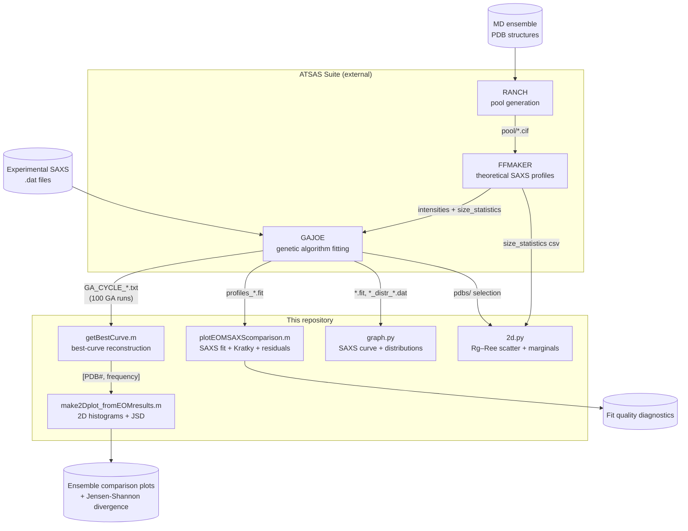

This page maps the structural organization of the **H4_tail_benchmarking** repository — a toolkit for benchmarking intrinsically disordered protein (IDP) structural ensembles from molecular dynamics (MD) against small-angle X-ray scattering (SAXS) data, exemplified by the H4 histone tail. The architecture follows a deliberate separation: **data assets**, **ATSAS EOM pipeline artifacts**, and **analysis tooling** are organized into independent layers coupled only through well-defined file formats. Understanding this contract-driven design is essential before diving into individual pipeline stages or scripts. For a high-level introduction to the science, see [Overview](1-overview).

The repository is the companion to the paper: *Tong Wang, Egor S. Kolesnikov, Lois Pollack, Alexey V. Onufriev — "Combining atomistic simulation and solution scattering to reveal charge-driven histone H4 tail conformational changes"*.


Sources: [README.md](/README.md#L1-L26)

## Repository Layout: A Three-Layer Architecture

The repository's directory tree encodes its conceptual architecture. Each top-level location serves exactly one architectural role, and the boundaries between them are strict:

| Layer | Location | Role | Key Contents |
|---|---|---|---|
| **Experimental data** | `SAXSData/` | Raw SAXS profiles of wild-type and K-to-Q (charge-neutralized) H4 tail | `H4WT_150Na.dat`, `H4KQ_150Na.dat` |
| **RANCH inputs** | `Example_tutorial/` | Sequence definition files consumed by the conformational pool generator | `assignment.txt` (residue range assignment), `protein.seq` (26-residue H4 sequence) |
| **EOM output artifacts** | `ExampleData/.../GA001/` | Frozen GAJOE genetic algorithm results, ready for post-hoc analysis | 100 `GA_CYCLE_*.txt` files, `profiles_001_1.fit`, size distributions, `Ree_values.mat` |
| **MATLAB analysis tooling** | repository root | Publication-quality ensemble analysis and SAXS comparison | `getBestCurve.m`, `make2Dplot_fromEOMresults.m`, `plotEOMSAXScomparison.m` |
| **Python plotting tooling** | `Example_tutorial/` | Lightweight visualization of the ATSAS tutorial workflow | `graph.py`, `2d.py` |

This layout encodes a key insight: the repository does **not** reimplement the EOM pipeline itself — that is delegated to the external ATSAS suite (RANCH, FFMAKER, GAJOE). Instead, the repository owns two things: (1) the *input contracts* that feed ATSAS, and (2) the *post-processing analysis* that extracts scientific conclusions from ATSAS output. The tutorial inputs illustrate this minimalism — the entire RANCH configuration is a single line declaring residue A, positions 1–26, as `disordered`:

```
A 1 26 disordered
```

Sources: [README.md](/README.md#L27-L40), [assignment.txt](/Example_tutorial/assignment.txt#L1), [protein.seq](/Example_tutorial/protein.seq#L1-L2), [getBestCurve.m](/getBestCurve.m#L6-L9)

## End-to-End Data Flow

The complete system spans two worlds: the **external ATSAS pipeline** (steps 1–3, installed separately) and the **in-repo analysis layer** (step 4). The Mermaid diagram below shows the flow of artifacts between them, with in-repo components highlighted:



Three data contracts cross the ATSAS/repository boundary. First, GAJOE's `GA_CYCLE_*.txt` logs record every generation's best ensembles as chi² values paired with structure index chains (e.g., `-122-180-257-374-...`), spanning ~20,000 lines per run — this is the raw material `getBestCurve.m` mines. Second, `profiles_*.fit` carries the experimental data and the CRYSOL-computed ensemble fit in one file, which both MATLAB and Python plotting consume. Third, FFMAKER's size statistics table (Rg, Dmax, Ree, volume per conformation) provides the structural descriptors that populate all histograms and scatter plots.

Sources: [README.md](/README.md#L30-L40), [GA_CYCLE_1.txt](/ExampleData/H4_tail_WT_ff19SB_OPC/GA001/curve_1/GA_CYCLE_1.txt#L1-L15)

## The Analysis Tooling Layer: MATLAB vs. Python

The repository ships **two independent tooling implementations** over the same GAJOE output format, targeting different depths of analysis:

| Dimension | MATLAB scripts (root) | Python scripts (`Example_tutorial/`) |
|---|---|---|
| **Entry points** | `make2Dplot_fromEOMresults.m`, `plotEOMSAXScomparison.m` | `graph.py`, `2d.py` |
| **Shared helper** | `getBestCurve.m` (function) | Inline parsing (`read_numeric`) |
| **Primary inputs** | `GA_CYCLE_*.txt`, `Size_list.txt`, `Ree_values.mat`, `profiles_001_1.fit` | `profiles_*.fit`, `*_distr_*.dat`, `size_statistics_20.csv`, `pdbs/*.cif` |
| **Outputs** | Rg–Ree and Dmax–Rg joint distributions with marginals; SAXS fit, Kratky plot, residuals; JSD scalars | `saxs_fit.png`, `rg.png`, `dmax.png`, `ree.png`; Rg–Ree scatter with marginals |
| **Quantitative analysis** | Yes — Jensen-Shannon divergence between MD pool and EOM pool | No — visualization only |
| **Dependencies** | MATLAB R2021+, Statistics functions | `numpy`, `matplotlib` |
| **Intended use** | Publication analysis of full-scale MD ensembles | Quick verification of the 20-conformation tutorial run |

The division of labor is intentional rather than redundant. The MATLAB suite is the scientific workhorse: it handles the benchmarking-scale GAJOE output (100 GA runs × 100 generations) and computes the Jensen-Shannon divergence that quantifies how much SAXS refinement shifts ensemble distributions. The Python pair covers the ATSAS-native tutorial workflow, using robust heuristic parsing (skipping non-numeric header lines, tolerating comma or space delimiters) that works directly against fresh GAJOE output directories.

Sources: [README.md](/README.md#L30-L40), [graph.py](/Example_tutorial/graph.py#L1-L21), [2d.py](/Example_tutorial/2d.py#L1-L41)

## Component Anatomy: The Best-Curve Reconstruction Bridge

One component deserves architectural attention because it solves a **version-compatibility problem** in the toolchain. `getBestCurve.m` exists because GAJOE v2.1 — unlike v1.3 — no longer emits a `best_curve.txt` summary of which conformations the genetic algorithm selected. This function recreates that lost artifact from the workfile logs, requiring the GAJOE option *"Save workfiles with the entire GA runs"* to be enabled during fitting.

Its algorithm is a two-phase aggregation:

1. **Extraction** — for each of the `nRuns` GA cycles, read `GA_CYCLE_<i>.txt` with a `'-'` delimiter, take the last `curvesPerEnsemble` rows (the final generation's population), flatten into a single list of selected structure indices, and drop `NaN` padding from variable-length ensembles.
2. **Aggregation** — tabulate selection frequencies across all runs via `categorical`/`tabulate`, returning an `[PDB_number, frequency]` matrix that downstream scripts treat exactly like the historical `best_curve.txt`.

> [!TIP]
> The frequency column is load-bearing: `make2Dplot_fromEOMresults.m` expands each selected structure by its selection count using `repmat` before building the EOM ensemble histograms. If you re-run GAJOE with different run counts, you must update **both** `nRuns` and `curvesPerEnsemble` in the caller's parameter block — the parser slices the last N rows by position, so mismatched values silently corrupt the ensemble reconstruction.

Sources: [getBestCurve.m](/getBestCurve.m#L1-L42), [make2Dplot_fromEOMresults.m](/make2Dplot_fromEOMresults.m#L13-L55)

## Internal Script Architecture: Parameter Block Pattern

Both MATLAB entry scripts follow an identical internal structure that you should recognize before modifying them. Each script is organized into `%%`-delimited cell blocks with a strict execution order:

| Block | `make2Dplot_fromEOMresults.m` | `plotEOMSAXScomparison.m` |
|---|---|---|
| **1. User-defined parameters** | `dir`, `nRuns`, `curvesPerEnsemble`, axis limits, histogram bins, font sizes | `folder`, plot colour (WT orange vs. KQ blue), axis limits |
| **2. Data ingestion** | `getBestCurve()` call + `Size_list.txt` (cols: Rg, Dmax) + `Ree_values.mat` | `readmatrix` on `SAXSData/*.dat` (4 header lines) and `profiles_*.fit` (1 header line, col 4 = ensemble fit) |
| **3. Ensemble expansion** | `repmat` frequency-weighted expansion of selected structures | — |
| **4. Visualization** | Two joint-distribution figures (Ree–Rg, Dmax–Rg), each with normalized marginal histograms; printed mean ± SEM statistics | SAXS fit overlay, Kratky transform (q²I(q)), residuals via `interp1` alignment of experimental points onto the fit grid |
| **5. Quantification** | Jensen-Shannon divergence for Rg and Ree distributions, with Shannon entropy `H(p)` subfunction | — |

All configuration lives in Block 1 — per the README, "mostly the paths just need to be matched." No script accepts command-line arguments; every run is an edit-and-execute interaction. The JSD block is self-contained: it histogram-normalizes both distributions to PDFs on shared bin edges and applies the divergence formula `JSD = H(0.5·p₁ + 0.5·p₂) − 0.5·H(p₁) − 0.5·H(p₂)`, with `0·log(0)` handled by zeroing NaN entropy contributions.

> [!TIP]
> The two scripts deliberately share no code beyond `getBestCurve.m` — a conscious trade-off favoring standalone readability over DRY. When adapting the workflow to a new IDP, you will typically duplicate a script and change one parameter block rather than refactor shared logic, so keep parameter blocks at the top exactly where they are.

Sources: [make2Dplot_fromEOMresults.m](/make2Dplot_fromEOMresults.m#L13-L130), [make2Dplot_fromEOMresults.m](/make2Dplot_fromEOMresults.m#L185-L234), [plotEOMSAXScomparison.m](/plotEOMSAXScomparison.m#L8-L80), [README.md](/README.md#L40-L42)

## File Format Contracts

The entire architecture hinges on ATSAS-standard file formats. These are the interfaces every script depends on — knowing them lets you trace any data flow in the system:

| File | Producer | Consumer | Content Contract |
|---|---|---|---|
| `GA_CYCLE_<i>.txt` | GAJOE v2.1 (workfiles) | `getBestCurve.m` | Generations of best ensembles: rank, chi², structure-index chain; final-generation rows are the selected ensemble |
| `Size_list.txt` | GAJOE | `make2Dplot_fromEOMresults.m` | Per-conformation structural table; column 2 = Rg, column 3 = Dmax |
| `Ree_values.mat` | Companion preprocessing (`pdb_Rmeas.m`) | `make2Dplot_fromEOMresults.m` | End-to-end distance vector `R` indexed by conformation number |
| `profiles_001_1.fit` | GAJOE/CRYSOL | `plotEOMSAXScomparison.m`, `graph.py` | Columns: q, experimental I(q), error, ensemble-fitted I(q) |
| `Rg_distr_*.txt`, `Size_distr_*.txt`, `CaCa_distr_*.txt` | GAJOE | `graph.py` | Pool vs. selected-ensemble distribution curves per descriptor |
| `size_statistics_20.csv` | FFMAKER | `2d.py` | Space-delimited: Rg, ReE, ..., conformation filename (col 6) |
| `assignment.txt` + `protein.seq` | User | RANCH | Sequence range/type assignment and FASTA-style sequence |

Note the one asymmetry: `Ree_values.mat` is not produced by ATSAS at all — it comes from a separate measurement of end-to-end distances over the full MD pool's PDBs, which is why the pool carries three descriptor sources (two from ATSAS, one computed locally).

Sources: [make2Dplot_fromEOMresults.m](/make2Dplot_fromEOMresults.m#L33-L39), [plotEOMSAXScomparison.m](/plotEOMSAXScomparison.m#L15-L16), [graph.py](/Example_tutorial/graph.py#L23-L49), [2d.py](/Example_tutorial/2d.py#L8-L30)

## Architectural Principles Summary

Three design decisions govern everything in this repository. **Delegation over reimplementation**: the EOM pipeline itself (RANCH → FFMAKER → GAJOE) is owned by ATSAS; this repo provides inputs and interprets outputs, keeping it usable with ATSAS v2.1+ without duplicating physics. **File-format coupling**: components never call each other directly — they exchange data exclusively through ATSAS-standard files, so any script can be run independently and against any conforming GAJOE output directory. **Explicit-configuration scripts**: all tunables sit in visible parameter blocks rather than hidden defaults or CLI flags, making the publication-reproducible settings auditable at a glance.

The consequence is a system with near-zero coupling surface: you can swap in your own GAJOE run (e.g., H4KQ instead of H4WT) by changing one path string, or adopt the Python tools for a different ATSAS project entirely.

Sources: [README.md](/README.md#L30-L42), [make2Dplot_fromEOMresults.m](/make2Dplot_fromEOMresults.m#L11-L31)

## Where to Go Next

With the architectural map in hand, follow these entry points by goal:

- **Understand the pipeline stages** that produce the artifacts analyzed here: start with [RANCH Conformational Pool Generation](6-ranch-conformational-pool-generation), then [FFMAKER Theoretical SAXS Profiles](7-ffmaker-theoretical-saxs-profiles) and [GAJOE Genetic Algorithm Ensemble Fitting](8-gajoe-genetic-algorithm-ensemble-fitting).
- **Work with the MATLAB tooling**: the best-curve bridge is dissected in [Best-Curve Reconstruction from GA Cycles](10-best-curve-reconstruction-from-ga-cycles), the joint-distribution plots in [2D Ensemble Comparison Histograms](11-2d-ensemble-comparison-histograms), and the divergence metric in [Jensen-Shannon Divergence Quantification](12-jensen-shannon-divergence-quantification).
- **Run the pipeline yourself**: follow [Quick Start](2-quick-start) and the step-by-step [EOM Tutorial with ATSAS Tools](4-eom-tutorial-with-atsas-tools), which exercises the Python path (`graph.py`, `2d.py`).
- **Apply the framework to your own protein**: see [Extending Workflow to Other IDPs](19-extending-workflow-to-other-idps), grounded in the concrete [H4 Histone Tail Case Study](17-h4-histone-tail-case-study).