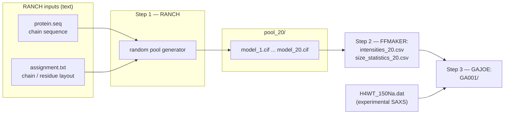
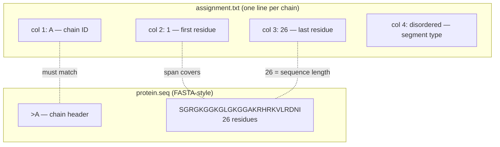
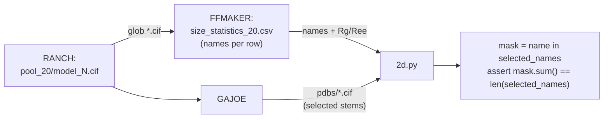

RANCH is the first executable stage of the Ensemble Optimization Method (EOM) workflow in this repository: it converts a bare protein sequence definition into a pool of randomly generated 3D conformations. This page documents RANCH's role in the pipeline, its exact input contract as used in the H4 histone tail tutorial, its command-line parameters, the artifacts it produces, and the pool-design trade-offs between reproducibility and statistical power. RANCH itself is part of the external ATSAS suite — this repository consumes it, and the tutorial in the README demonstrates it end-to-end with a deliberately small 20-conformation pool.

Sources: [README.md](README.md#L30-L36), [README.md](README.md#L23-L25)

## Role in the EOM Pipeline

The EOM pipeline in this repository is a strict three-stage sequence: **RANCH** (generate), **FFMAKER** (compute theoretical SAXS profiles), and **GAJOE** (genetic-algorithm ensemble fitting against experimental data). RANCH is the only stage that creates structural data from scratch — everything downstream operates on the pool it emits. The two files RANCH requires (`assignment.txt` and `protein.seq`) are pure text inputs checked into `Example_tutorial/`, and its output (`pool_20/` of CIF files) is consumed positionally by FFMAKER via a glob.

Sources: [README.md](README.md#L34-L36), [README.md](README.md#L38-L54)

The diagram below shows the data flow. RANCH takes the two text inputs, emits numbered CIF conformations into `pool_20/`, and those files become FFMAKER's input glob (`pool_20/*.cif`). FFMAKER then produces the intensity and size-statistics CSVs that GAJOE fits against the experimental curve `H4WT_150Na.dat`. Steps 2 and 3 are covered in detail on [FFMAKER Theoretical SAXS Profiles](7-ffmaker-theoretical-saxs-profiles) and [GAJOE Genetic Algorithm Ensemble Fitting](8-gajoe-genetic-algorithm-ensemble-fitting).



Sources: [README.md](README.md#L38-L47), [README.md](README.md#L51-L58)

Note that RANCH is not the only way to obtain a conformational pool. The repository's broader benchmarking workflow also compares pools derived from all-atom molecular dynamics; that alternative source is documented in [MD Ensemble Generation with AMBER](18-md-ensemble-generation-with-amber). Within the EOM tutorial itself, however, RANCH defines the starting ensemble.

Sources: [README.md](README.md#L5-L7), [README.md](README.md#L15-L16)

## The Input Contract: `assignment.txt` and `protein.seq`

RANCH requires exactly two positional input files, both present in `Example_tutorial/`. The README explicitly identifies them as "two input files (`assignment.txt`, `protein.seq`) required by RANCH". They are deliberately minimal — together they contain no 3D data at all, only the sequence identity and a declaration of how each chain should be modeled.

Sources: [README.md](README.md#L34-L36), [Example_tutorial/assignment.txt](Example_tutorial/assignment.txt#L1-L2), [Example_tutorial/protein.seq](Example_tutorial/protein.seq#L1-L3)

| File | Role | Format | Tutorial content |
|---|---|---|---|
| `protein.seq` | Defines the amino acid sequence per chain | FASTA-style: `>A` header line, then one-letter residue codes | 26 residues: `SGRGKGGKGLGKGGAKRHRKVLRDNI` (H4 histone tail) |
| `assignment.txt` | Declares each chain's residue span and structural type | One whitespace-delimited line per chain: `chain start end type` | Single line: `A 1 26 disordered` |

Sources: [Example_tutorial/protein.seq](Example_tutorial/protein.seq#L1-L2), [Example_tutorial/assignment.txt](Example_tutorial/assignment.txt#L1), [README.md](README.md#L7-L8)

The assignment file for the H4 tail is a single line — `A 1 26 disordered` — which decomposes as follows:

| Column | Value in tutorial | Meaning |
|---|---|---|
| 1 | `A` | Chain identifier, matching the `>A` header in `protein.seq` |
| 2 | `1` | First residue of the modeled segment |
| 3 | `26` | Last residue of the modeled segment |
| 4 | `disordered` | The segment is treated as a flexible/disordered region, not a rigid body |

Sources: [Example_tutorial/assignment.txt](Example_tutorial/assignment.txt#L1), [Example_tutorial/protein.seq](Example_tutorial/protein.seq#L1-L2)

The two files are linked by the chain identifier, and the residue span must be consistent with the sequence it indexes. In the tutorial both constraints hold exactly: the `>A` header matches chain `A`, and the declared span `1–26` equals the actual 26-residue sequence length.



> [!TIP]
> When adapting this to another IDP, the residue span in `assignment.txt` is the consistency check point: column 3 minus column 2 plus one must equal the residue count under that chain's header in `protein.seq`, or the pool generation operates on an inconsistent definition. The tutorial pair (`A 1 26` ↔ 26 residues) is the minimal verified reference configuration.

Sources: [Example_tutorial/assignment.txt](Example_tutorial/assignment.txt#L1), [Example_tutorial/protein.seq](Example_tutorial/protein.seq#L1-L2)

## Running RANCH: Command, Parameters, and Output

The tutorial runs RANCH from inside `Example_tutorial/` after creating an output directory. The full invocation is a single command with three options and the two positional files:

```bash
mkdir pool_20

ranch --repetitions 20 --prefix pool_20/model_ \
    --seed 12345 assignment.txt protein.seq
```

The README documents the result precisely: "`pool_20/` containing 20 randomly generated conformations in CIF format". Note the CIF output format (not PDB) — downstream steps reference CIF files explicitly, and the plotting utilities in step 4 also glob for `*.cif` when identifying GAJOE's selected structures.

Sources: [README.md](README.md#L38-L47), [README.md](README.md#L100-L117)

| CLI element | Tutorial value | Effect |
|---|---|---|
| `--repetitions` | `20` | Number of conformations in the generated pool |
| `--prefix` | `pool_20/model_` | Output directory combined with filename stem; each conformation is written as `model_N.cif` inside `pool_20/` |
| `--seed` | `12345` | Deterministic seed for the random generator — the same seed regenerates the identical pool |
| positional arg 1 | `assignment.txt` | Chain/residue layout declaration |
| positional arg 2 | `protein.seq` | Per-chain sequence definition |

Sources: [README.md](README.md#L40-L45), [README.md](README.md#L47)

RANCH requires an ATSAS installation, which is the same external dependency as the rest of the EOM pipeline (the README recommends GAJOE v2.1 for ease of use). Installation guidance is on [Software Requirements and Installation](3-software-requirements-and-installation), and the full worked sequence including GAJOE is on [EOM Tutorial with ATSAS Tools](4-eom-tutorial-with-atsas-tools).

Sources: [README.md](README.md#L22-L24), [README.md](README.md#L34)

## Output Artifacts and Downstream Traceability

The pool directory is not a throwaway intermediate — the repository's analysis scripts depend on being able to match GAJOE's selected structures back to the pool by **filename stem**. This creates a traceability contract that spans three stages:

1. RANCH writes `pool_20/model_N.cif` using the `--prefix` stem.
2. FFMAKER consumes the glob `pool_20/*.cif` and records each conformation's name in `size_statistics_20.csv` (the tutorial's step 2; the README also notes you can substitute provided PDB structures in place of the generated pool for that analysis).
3. `2d.py` reads the pool statistics, globs GAJOE's selected structures (`GA001/curve_1/pdbs/*.cif`), builds a boolean mask by comparing file stems, and **asserts** that every selected structure was found in the pool — raising `"Some selected structures were not found in the pool!"` otherwise.

Sources: [README.md](README.md#L51-L60), [Example_tutorial/2d.py](Example_tutorial/2d.py#L8-L31), [Example_tutorial/2d.py](Example_tutorial/2d.py#L36-L41)



The practical consequence for a developer adapting this workflow: once a pool is generated and fed to FFMAKER, its directory name and filename stems are load-bearing identifiers. Renaming pool files between generation and analysis breaks the `2d.py` assertion and silently corrupts the pool-versus-selection comparison.

> [!TIP]
> The stem-matching assert in `2d.py` (lines 40–41) is the repository's only automated check that the GAJOE selection and the pool statistics describe the same conformational set. If you regenerate the pool with a different seed but reuse an old `size_statistics_20.csv`, the assert can still pass while comparing inconsistent populations — regenerate the FFMAKER statistics together with the pool.

Sources: [Example_tutorial/2d.py](Example_tutorial/2d.py#L27-L31), [Example_tutorial/2d.py](Example_tutorial/2d.py#L40-L41)

## Pool Design: Reproducibility versus Statistical Power

The tutorial's 20-conformation pool exists to demonstrate mechanics, not to support quantitative conclusions. The README states this constraint twice, in both directions: the GAJOE settings are "intended for a quick demonstration" and the pool itself is "intended only to demonstrate the workflow. Quantitative ensemble analysis requires substantially larger, adequately sampled conformational pools."

Sources: [README.md](README.md#L85-L89), [README.md](README.md#L118)

| Aspect | Tutorial pool | Production pool |
|---|---|---|
| `--repetitions` | 20 | "sufficiently large" pool for quantitative analysis |
| Purpose | Demonstrate the RANCH → FFMAKER → GAJOE → plotting sequence | Statistically meaningful ensemble distributions |
| GAJOE budget paired with it | 1 run × 100 generations, ensemble 1–10 | More independent runs and generations (README's explicit recommendation) |
| Interpreting outputs | Shape of workflow only | Distributions of Rg, Dmax, Ree comparable to experiment |

Sources: [README.md](README.md#L62-L89), [README.md](README.md#L118)

The `--seed 12345` parameter is the mechanism that makes the small pool a stable benchmark artifact: every execution with the same seed and inputs yields byte-identical conformations, so the tutorial is reproducible across machines. When you scale up for real analysis, keep the seed discipline — record the seed alongside the pool so that a published ensemble can be regenerated exactly, while selecting a pool size large enough that the random sampling adequately covers conformational space.

Sources: [README.md](README.md#L40-L45), [README.md](README.md#L118)

The downstream interpretation of pool-derived distributions — and how GAJOE selects a sub-ensemble from them — continues in [GAJOE Genetic Algorithm Ensemble Fitting](8-gajoe-genetic-algorithm-ensemble-fitting), with a field-by-field description of GAJOE's result files in [GAJOE Output File Reference](9-gajoe-output-file-reference).

## Next Steps

The natural reading progression after this page follows the pipeline's execution order: [FFMAKER Theoretical SAXS Profiles](7-ffmaker-theoretical-saxs-profiles) documents how the generated CIF pool is converted into theoretical intensity and size-statistics files, then [GAJOE Genetic Algorithm Ensemble Fitting](8-gajoe-genetic-algorithm-ensemble-fitting) covers the fitting stage that consumes both. For the complete worked command sequence in one place, see [EOM Tutorial with ATSAS Tools](4-eom-tutorial-with-atsas-tools). If your goal is to supply pools from simulation rather than random generation, proceed to [MD Ensemble Generation with AMBER](18-md-ensemble-generation-with-amber); for the biological context of the 26-residue sequence used here, see [H4 Histone Tail Case Study](17-h4-histone-tail-case-study).
