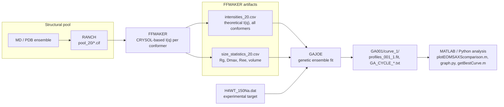
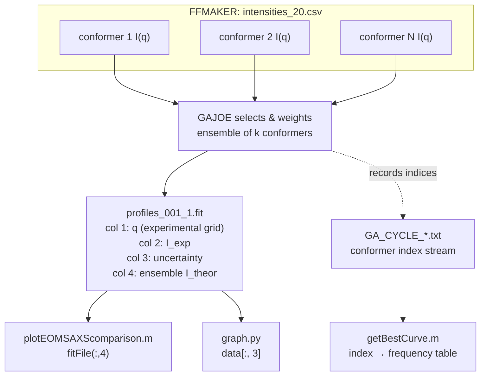

FFMAKER is the ATSAS stage that converts raw structural coordinates into the *language GAJOE speaks*: per-conformer theoretical small-angle X-ray scattering (SAXS) intensity profiles, I(q). This page explains FFMAKER's role in the EOM pipeline as exercised in this repository, its exact input/output contract as invoked by the tutorial, how its output is resampled against experimental data, and how the theoretical-profile lineage can be traced all the way into the MATLAB and Python analysis scripts. For pool *generation* (RANCH) and genetic *fitting* (GAJOE), see their dedicated pages.

Sources: [README.md](README.md#L49-L60), [README.md](README.md#L10-L13)

## Where FFMAKER Sits in the Pipeline

FFMAKER occupies the middle of the three-stage EOM workflow: it consumes the conformational pool emitted by RANCH and produces the two artifacts — theoretical intensities and size statistics — that GAJOE requires as its search space and fitness landscape. Conceptually, it is the *simulation-to-scattering bridge*: each disordered conformation sampled from MD or generated de novo becomes one computable scattering curve, turning a structural ensemble question ("which conformations exist?") into an intensity-ensemble question ("which weighted sum of curves reproduces the measurement?").



Sources: [README.md](README.md#L38-L47), [README.md](README.md#L49-L60), [README.md](README.md#L62-L74)

## The FFMAKER Input/Output Contract

The tutorial invokes FFMAKER with two flags and a file glob:

```bash
ffmaker --output intensities_20.csv \
    --pool size_statistics_20.csv pool_20/*.cif
```

FFMAKER is deliberately agnostic about where the coordinates come from: it accepts RANCH-generated CIF files, and the README notes that user-provided PDB structures (e.g., MD snapshots) can be substituted by replacing `pool_20/*.cif` with the path to those files. This is exactly the entry point this repository exploits for its benchmarking purpose — MD ensembles generated with AMBER enter the SAXS pipeline here, not at RANCH.

| Element | Role | Verified content |
|---|---|---|
| `pool_20/*.cif` (positional) | Input conformations | RANCH output pool, one structure file per conformation |
| PDB paths (alternative) | Input conformations | MD-derived or user-supplied structures |
| `--output intensities_20.csv` | Theoretical intensities | "theoretical SAXS intensity profiles for all conformations" |
| `--pool size_statistics_20.csv` | Size statistics | Per-conformation **R_g**, **D_max**, end-to-end distance (**R_ee**), and **volume** |

Sources: [README.md](README.md#L49-L60), [README.md](README.md#L56-L58)

## Theoretical vs. Experimental Profiles

Understanding FFMAKER means understanding what its output must eventually compete against. The repository ships the experimental counterpart in `SAXSData/`: a 4-line header (`### DATA:`, point count `53`, column legend `Q I(Q) Error`) followed by 53 evenly spaced points covering q ≈ 1.56×10⁻² to 2.96×10⁻¹ Å⁻¹ (spacing ≈ 5.4×10⁻³ Å⁻¹). The two artifact families differ in every property that matters downstream:

| Property | FFMAKER theoretical profile | Experimental `.dat` (`H4WT_150Na.dat`) |
|---|---|---|
| Origin | Computation from atomic coordinates (CRYSOL lineage) | SAXS measurement |
| Content | One I(q) curve **per conformation** in the pool | A single measured curve |
| Uncertainty | None | Per-point σ column |
| q-grid | FFMAKER-native (see resampling below) | 53 points, q ∈ [0.0156, 0.296] Å⁻¹ |
| Pipeline role | GAJOE's search space | GAJOE's fitting target |

Sources: [README.md](README.md#L56-L58), [SAXSData/H4WT_150Na.dat](SAXSData/H4WT_150Na.dat#L1-L5), [SAXSData/H4WT_150Na.dat](SAXSData/H4WT_150Na.dat#L50-L57)

## Handoff to GAJOE: The Fitting Interface

GAJOE consumes both FFMAKER artifacts through explicitly named flags — `--intensity intensities_20.csv` ("theoretical SAXS profiles calculated by FFMAKER") and `--size size_statistics_20.csv` ("structural properties of the conformations") — while the experimental `.dat` is passed as the final positional argument. This flag naming makes the data lineage unambiguous: intensities define what GAJOE can *add up* (weighted sums of theoretical curves), size statistics define what GAJOE can *report* (R_g, D_max, R_ee distributions of the selected ensemble), and the experimental curve defines what GAJOE optimizes against.

> [!TIP]
> The theoretical q-grid never survives into the fit: `profiles_001_1.fit` contains **exactly 53 data rows** — one per experimental point — and its q column matches the `.dat` values to rounding precision (e.g., `1.563542e-002` vs `1.56E-02`). Downstream scripts can therefore treat column 1 of any `.fit` file as *the experimental q-grid*, regardless of how FFMAKER sampled I(q) internally.

Sources: [README.md](README.md#L62-L87), [SAXSData/H4WT_150Na.dat](SAXSData/H4WT_150Na.dat#L1-L5)

## Anatomy of the Fitted Profile: `profiles_*.fit`

GAJOE's fit files are where FFMAKER's theoretical curves re-emerge in human-readable form. The first line is a metadata header; the remaining 53 rows are four aligned channels on the experimental q-grid. Both shipped consumers decode the file identically: the MATLAB script reads it with `NumHeaderLines=1` and extracts `fitFile(:,4)` into a variable tellingly named `crysolEOM`, while the Python tutorial unpacks `q, exp, err, fit = data[:, :4].T`. The `crysolEOM` naming corroborates the CRYSOL lineage documented for EOM in the README ("GAJOE, which uses CRYSOL").

| File region | Column / field | Content |
|---|---|---|
| Header line | `CYCLE: 29` | GA cycle (run) that produced the reported fit |
| Header line | `Chi^2: 1.226` | Fit quality of the reported ensemble |
| Header line | `GENER.: 1000`, `ENSEMBLES: 50` | Optimization budget (case-study scale, vs. the tutorial's 100/20) |
| Header line | `CURVES: 9` | Number of conformers in the winning ensemble |
| Data rows | 1 | q — experimental grid (Å⁻¹) |
| Data rows | 2 | Experimental I(q) |
| Data rows | 3 | Uncertainty channel as recorded in the fit |
| Data rows | 4 | **Fitted ensemble intensity — the weighted sum of FFMAKER's theoretical curves** |



Sources: [ExampleData/H4_tail_WT_ff19SB_OPC/GA001/curve_1/profiles_001_1.fit](ExampleData/H4_tail_WT_ff19SB_OPC/GA001/curve_1/profiles_001_1.fit#L1-L2), [plotEOMSAXScomparison.m](plotEOMSAXScomparison.m#L18-L21), [graph.py](Example_tutorial/graph.py#L26-L31), [README.md](README.md#L10-L13), [README.md](README.md#L93)

## Conformer Index Traceability Back to FFMAKER's Pool Order

GAJOE never re-references structures by filename in its logs — it identifies conformers by **integer index**, and those indices are positions in the pool ordering that FFMAKER processed. Each line of `GA_CYCLE_*.txt` records a generation, a χ² rank, and the winning ensemble as a dash-delimited index stream (e.g., `-156-359-734-792-792-805-812-1159-1166`). `getBestCurve.m` exploits this by parsing all cycle files with `-` as the delimiter and tabulating how frequently each index appears across runs, producing the `[PDB number, frequency]` table that recreates GAJOE 1.3's removed `best_curve.txt`. The case study's consistency checks confirm the mapping: indices reach 1994 in `GA_CYCLE_1.txt` while `Size_list.txt` retains exactly 2000 per-conformer rows of (index, R_g, D_max) — matching the ~2000-conformer MD pool behind the published analysis.

> [!TIP]
> Index-to-structure mapping depends on **file ordering at FFMAKER invocation time**. Shell glob expansion (`pool_20/*.cif`) is lexicographic and stable on a given system, but if you regenerate or rename pool files between the FFMAKER run and any downstream index interpretation, `getBestCurve.m` frequencies will silently point at the wrong structures. Keep the pool directory immutable after FFMAKER runs.

Sources: [ExampleData/H4_tail_WT_ff19SB_OPC/GA001/curve_1/GA_CYCLE_1.txt](ExampleData/H4_tail_WT_ff19SB_OPC/GA001/curve_1/GA_CYCLE_1.txt#L1-L2), [getBestCurve.m](getBestCurve.m#L16-L35), [ExampleData/H4_tail_WT_ff19SB_OPC/GA001/curve_1/Size_list.txt](ExampleData/H4_tail_WT_ff19SB_OPC/GA001/curve_1/Size_list.txt#L1-L15)

## Practical Considerations

Three verified observations calibrate expectations when running FFMAKER in this workflow. First, **pool scale matters**: the tutorial's 20-conformation run is explicitly flagged as a workflow demonstration only, with the README noting that quantitative ensemble analysis requires substantially larger, adequately sampled pools — the shipped case study used ~2000 conformers and a proportionally larger GA budget (1000 generations, 50 candidate ensembles per generation, vs. the tutorial's 100/20). Second, **input format flexibility is the MD-entry point**: replacing the CIF glob with PDB paths is the documented mechanism for feeding simulation ensembles into the scattering pipeline. Third, **the size-statistics artifact is not optional bookkeeping** — GAJOE derives every structural distribution it reports (R_g, D_max, R_ee) from the `--pool` file, so FFMAKER's second output directly shapes the ensemble descriptors analyzed in later pages.

Sources: [README.md](README.md#L118-L118), [README.md](README.md#L60-L60), [README.md](README.md#L80-L80)

## Summary and Next Steps

FFMAKER's contract in this repository is compact but load-bearing: take a pool of conformations (RANCH CIFs or MD PDBs), emit one theoretical I(q) per conformer plus a size-statistics table, and hand both to GAJOE. Its influence persists through the entire output chain — resampled onto the experimental q-grid in `profiles_*.fit` column 4, and addressable by pool-order index in `GA_CYCLE_*.txt`. Natural continuation points from here: how the pool itself is generated in [RANCH Conformational Pool Generation](6-ranch-conformational-pool-generation), how the theoretical curves are genetically recombined in [GAJOE Genetic Algorithm Ensemble Fitting](8-gajoe-genetic-algorithm-ensemble-fitting), a file-by-file breakdown in [GAJOE Output File Reference](9-gajoe-output-file-reference), how ensemble averages are reconstructed in [Best-Curve Reconstruction from GA Cycles](10-best-curve-reconstruction-from-ga-cycles) and [SAXS Fit, Kratky Plot, and Residuals](13-saxs-fit-kratky-plot-and-residuals), and the physical meaning of the size descriptors FFMAKER emits in [Structural Descriptors: Rg, Dmax, Ree](16-structural-descriptors-rg-dmax-ree).
