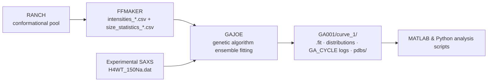
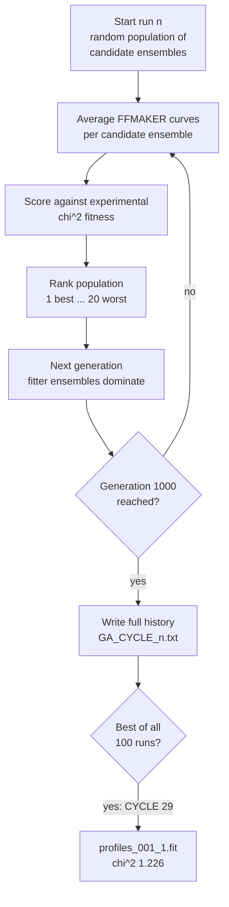
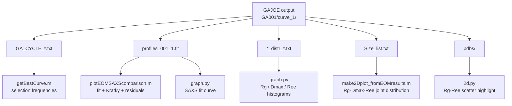

GAJOE is the ensemble-fitting engine of the EOM pipeline: it takes a pool of theoretical SAXS profiles plus per-conformation structural descriptors, and runs a genetic algorithm that discovers which small subset of conformations, when averaged, reproduces an experimental SAXS curve. This page explains GAJOE's role in this repository, its command-line contract, the genetic algorithm mechanics as recorded in real output logs, and the exact file formats downstream analysis scripts depend on. All evidence is drawn from the shipped example output in `ExampleData/H4_tail_WT_ff19SB_OPC/GA001/curve_1/` and the parsing code that consumes it.

Sources: [README.md](README.md#L11-L12), [README.md](README.md#L15-L17)

## Position in the EOM Pipeline

GAJOE is the third and decisive stage of the EOM chain. RANCH generates the conformational pool, FFMAKER converts that pool into per-conformation theoretical intensities and a size-statistics table, and GAJOE then searches that pool for the sub-ensemble that best matches experiment. It consumes three inputs — FFMAKER's intensity file, FFMAKER's size statistics, and an experimental `.dat` profile — and produces an output directory (`GA001`, `GA002`, …) whose artifacts feed every downstream MATLAB and Python analysis script in this repository. The repository's README explicitly delegates the tool's internal documentation to the ATSAS manual, noting that GAJOE computes profiles through CRYSOL, so this page documents the tool *through its observable interface and outputs* as they appear here.



Sources: [README.md](README.md#L11-L13), [README.md](README.md#L15-L18)

The experimental input that anchors the fit is a standard three-column SAXS dataset (`Q`, `I(Q)`, `Error`) with four header lines, of which 53 q-points are used. GAJOE scores every candidate ensemble directly against these measured intensities and errors.

Sources: [SAXSData/H4WT_150Na.dat](SAXSData/H4WT_150Na.dat#L1-L5)

## Running GAJOE: Command-Line Contract

The tutorial's runnable invocation shows the full CLI surface. The first positional argument is the experimental data file; all pool inputs and algorithm controls are passed as flags. Note that the tutorial's `--times 1 --generation 100` values are deliberately minimal for a quick demonstration — the shipped ExampleData run used substantially larger settings (100 runs × 1000 generations), as its outputs prove.

```bash
gajoe \
    --intensity intensities_20.csv \
    --size size_statistics_20.csv \
    --times 1 \
    --generation 100 \
    --ensemble 20 \
    --minimum 1 \
    --maximum 10 \
    --no-repeated \
    H4WT_150Na.dat
```

Sources: [README.md](README.md#L62-L75)

| Flag | Tutorial value | Meaning | ExampleData evidence |
|---|---|---|---|
| `--intensity` | `intensities_20.csv` | FFMAKER theoretical SAXS profiles per conformation | — |
| `--size` | `size_statistics_20.csv` | Per-conformation Rg, Dmax, Ree, volume | `Size_list.txt` holds the 2000-row pool table |
| `--times` | `1` | Number of independent GA runs | 100 `GA_CYCLE_N.txt` files exist |
| `--generation` | `100` | Generations per run | Each log records 1000 generations |
| `--ensemble` | `20` | Candidate ensembles evaluated per generation | 20 ranked entries per generation in logs |
| `--minimum` | `1` | Minimum conformations in the selected ensemble | Final ensembles span ~5–15 members |
| `--maximum` | `10` | Maximum conformations in the selected ensemble | Some ensembles exceed 10 (repeat mode) |
| `--no-repeated` | flag | Forbids duplicate conformations within one ensemble | *Not* used in the ExampleData run — winning ensembles repeat indices |
| positional | `H4WT_150Na.dat` | Experimental SAXS data to fit | 53 q-points |

Sources: [README.md](README.md#L77-L87), [README.md](README.md#L89-L89)

> [!TIP]
> For quantitative work, the README itself warns that the tutorial's small pool and few generations are for workflow demonstration only — increase generations, independent runs, and pool size before trusting χ² values. The ExampleData directory is what a production-scale run looks like: 100 runs at 1000 generations each.

Sources: [README.md](README.md#L89-L89), [README.md](README.md#L118-L118)

## The Genetic Algorithm at Work: Evidence from GA_CYCLE Logs

The most granular window into GAJOE's behavior is the `GA_CYCLE_N.txt` family — one file per independent GA run (N = 1…100 here), each containing the complete ranked population for every generation. The format is two-column-header (`Gener Best`) followed by one line per candidate: generation number, rank within the generation (1 = best), the candidate's χ² fitness, and its ensemble composition as a dash-delimited list of pool indices. Run 1's log is exactly 20,002 lines: 1,000 generations × 20 ranked candidates, plus header — confirming the population-size semantics of `--ensemble` and `--generation`.

Sources: [GA_CYCLE_1.txt](ExampleData/H4_tail_WT_ff19SB_OPC/GA001/curve_1/GA_CYCLE_1.txt#L1-L21), [make2Dplot_fromEOMresults.m](make2Dplot_fromEOMresults.m#L14-L16)

The fitness trajectory shows textbook GA convergence. In run 1, generation 1, the population's χ² spans 16.43 to 35.26 — a wide, poorly adapted spread. By the final generation of run 29 (the run GAJOE ultimately selected), the entire population has homogenized into a narrow band of χ² 1.23–1.27, and the top-ranked candidate's composition is dominated by repeated selections of just four pool indices (`1093, 1592, 1623, 1734`). That repetition is direct evidence of selection pressure: conformations that individually improve the fit get amplified across the ensemble, which is only possible because this run was executed *without* the `--no-repeated` flag that the tutorial uses.

Sources: [GA_CYCLE_1.txt](ExampleData/H4_tail_WT_ff19SB_OPC/GA001/curve_1/GA_CYCLE_1.txt#L2-L21), [GA_CYCLE_29.txt](ExampleData/H4_tail_WT_ff19SB_OPC/GA001/curve_1/GA_CYCLE_29.txt#L19981-L20001)

| Snapshot | Location | Best χ² | Population spread |
|---|---|---|---|
| Run 1, generation 1 | [GA_CYCLE_1.txt#L21](ExampleData/H4_tail_WT_ff19SB_OPC/GA001/curve_1/GA_CYCLE_1.txt#L21) | 16.43 | 16.43 – 35.26 |
| Run 29, generation 1000 | [GA_CYCLE_29.txt#L20001](ExampleData/H4_tail_WT_ff19SB_OPC/GA001/curve_1/GA_CYCLE_29.txt#L20001) | 1.23 | 1.23 – 1.27 |
| Winning-run header (exact) | [profiles_001_1.fit#L1](ExampleData/H4_tail_WT_ff19SB_OPC/GA001/curve_1/profiles_001_1.fit#L1) | 1.226 | — |

Because `--times` controls independent restarts, GAJOE's final answer is a *best-of-runs* selection. The `.fit` file header records this as `CYCLE: 29` — run 29 won among the 100 restarts with χ² 1.226, with `GENER.:1000 ENSEMBLES: 50 CURVES: 9` summarizing the optimization settings used. Independent restarts matter precisely because each GA run converges to a different local optimum: compare run 1's final best ensemble (`-156-359-734-792-805-812-1159-1166`-family indices, run 1 file) against run 100's (`-729-1093-1592-1623` family in run 29, different again in run 100's log).

Sources: [profiles_001_1.fit](ExampleData/H4_tail_WT_ff19SB_OPC/GA001/curve_1/profiles_001_1.fit#L1-L1), [GA_CYCLE_100.txt](ExampleData/H4_tail_WT_ff19SB_OPC/GA001/curve_1/GA_CYCLE_100.txt#L1-L21)



> [!TIP]
> χ² drops roughly 13× from a random first-generation population (16.43) to the converged optimum (1.23), and the final generation's population spread collapses from ~19 χ² units to 0.04 — use this spread as a quick convergence diagnostic when tuning `--generation` for your own pools.

Sources: [GA_CYCLE_1.txt](ExampleData/H4_tail_WT_ff19SB_OPC/GA001/curve_1/GA_CYCLE_1.txt#L2-L21), [GA_CYCLE_29.txt](ExampleData/H4_tail_WT_ff19SB_OPC/GA001/curve_1/GA_CYCLE_29.txt#L19982-L20001)

## The GA_CYCLE Workfile Contract

The `GA_CYCLE` files are not part of GAJOE's default output — `getBestCurve.m` documents that they only appear when you answer **yes** to GAJOE v2–3's interactive prompt *"Save workfiles with the entire GA runs? (default: no)"*. Without them, this repository's analysis chain loses its main input, because GAJOE v2 removed the `best_curve.txt` file that version 1.3 used to emit. `getBestCurve.m` reconstructs that lost artifact: it reads every `GA_CYCLE_N.txt` using `-` as the column delimiter (which splits ensemble indices cleanly), keeps only the last `curvesPerEnsemble` lines of each run — the final generation's ranked population — and tabulates how often each pool index was selected across all runs.

Sources: [getBestCurve.m](getBestCurve.m#L3-L12), [getBestCurve.m](getBestCurve.m#L19-L30)

The frequency table it returns is what turns GA logs into science: a pool index that appears in many final-generation ensembles across 100 independent runs is robustly selected, whereas one appearing in a single lucky run is noise. This is why `make2Dplot_fromEOMresults.m` asks you to declare `nRuns` (what you told GAJOE for "Number of times you want the genetic algorithm repeated") and `curvesPerEnsemble` (what you entered for "Maximum number of curves per ensemble") — those two numbers parameterize the parsing of the very same prompts GAJOE asked during setup.

Sources: [getBestCurve.m](getBestCurve.m#L31-L39), [make2Dplot_fromEOMresults.m](make2Dplot_fromEOMresults.m#L15-L16)

## Output Artifact Reference

A completed GAJOE run deposits everything downstream scripts need into `GA001/curve_1/`. The following table maps every artifact observed in the shipped example to its verified format.

| Artifact | Count | Verified format |
|---|---|---|
| `GA_CYCLE_N.txt` | 100 | Header `Gener Best` + 1,000 generations × 20 ranked candidates (χ² + ensemble indices) |
| `profiles_001_1.fit` | 1 | Header (`CYCLE/Chi²/GENER./ENSEMBLES/CURVES`) + 53 rows of `q, I_exp, σ, I_fit` |
| `Rg_distr_001_1.txt` | 1 | 4 summary lines + 54-bin table: `Rg, Pool freq., Sel. freq.` |
| `Size_distr_001_1.txt` | 1 | Same structure for Dmax |
| `CaCa_distr_001_1.txt` | 1 | Same structure for Ca(N)–Ca(C) distance — **zero-filled** here |
| `Volume_distr_001_1.txt` | 1 | Same structure for volume — **zero-filled** here |
| `Size_list.txt` | 1 | 2,000 rows: `pool index, Rg, Dmax` |
| `Ree_values.mat` | 1 | MATLAB array `R` (end-to-end distances, computed externally per script header) |
| `pdbs/`, `logFile_*.log` | — | Selected conformations; optimization settings — documented for tutorial runs |

Sources: [GA_CYCLE_1.txt](ExampleData/H4_tail_WT_ff19SB_OPC/GA001/curve_1/GA_CYCLE_1.txt#L1-L2), [profiles_001_1.fit](ExampleData/H4_tail_WT_ff19SB_OPC/GA001/curve_1/profiles_001_1.fit#L1-L2), [Rg_distr_001_1.txt](ExampleData/H4_tail_WT_ff19SB_OPC/GA001/curve_1/Rg_distr_001_1.txt#L1-L6), [Size_list.txt](ExampleData/H4_tail_WT_ff19SB_OPC/GA001/curve_1/Size_list.txt#L1-L3), [README.md](README.md#L91-L98), [make2Dplot_fromEOMresults.m](make2Dplot_fromEOMresults.m#L1-L4)

Two artifacts deserve special attention. First, `Size_list.txt` contains exactly 2,000 data rows — one per pool conformation with its Rg and Dmax — and its index range (up to 1994) matches the maximum index observed inside `GA_CYCLE` ensemble strings; this is the join key that maps abstract pool indices back to physical descriptors. Second, `CaCa_distr` and `Volume_distr` files exist but are entirely zero-filled: when the FFMAKER input lacked those descriptors, GAJOE still emits the files with empty histograms rather than omitting them, so downstream code must tolerate degenerate distributions.

Sources: [Size_list.txt](ExampleData/H4_tail_WT_ff19SB_OPC/GA001/curve_1/Size_list.txt#L1-L15), [GA_CYCLE_1.txt](ExampleData/H4_tail_WT_ff19SB_OPC/GA001/curve_1/GA_CYCLE_1.txt#L4-L8), [CaCa_distr_001_1.txt](ExampleData/H4_tail_WT_ff19SB_OPC/GA001/curve_1/CaCa_distr_001_1.txt#L1-L12), [Volume_distr_001_1.txt](ExampleData/H4_tail_WT_ff19SB_OPC/GA001/curve_1/Volume_distr_001_1.txt#L1-L12)

## The Fit File: Format and Physical Result

`profiles_001_1.fit` is the single most consumed GAJOE artifact. Its one-line header packs the winning run's metadata (`CYCLE: 29  Chi^2: 1.226  GENER.:1000  ENSEMBLES: 50  CURVES:  9`), and its 53 data rows carry four columns: q, experimental intensity, experimental error, and the ensemble-averaged fitted intensity. The q-grid matches the experimental dataset point-for-point, because the fit is evaluated exactly where data exists. The repository's two independent consumers agree on this layout: `plotEOMSAXScomparison.m` reads the file with one header line and takes columns 1 and 4 as the fitted (q, I) pair, while `graph.py` unpacks all four columns as `q, exp, err, fit`.

Sources: [profiles_001_1.fit](ExampleData/H4_tail_WT_ff19SB_OPC/GA001/curve_1/profiles_001_1.fit#L1-L2), [plotEOMSAXScomparison.m](plotEOMSAXScomparison.m#L16-L28), [graph.py](Example_tutorial/graph.py#L24-L31)

Beyond the curve itself, the distribution files quantify *what kind* of conformations the GA selected versus what the MD pool contained. The answer for H4-WT is a systematic shift toward extended states: the selected ensemble's average Rg is 15.27 Å against the pool's 13.77 Å, and its average Dmax is 47.33 Å against 42.69 Å. Each distribution file also reports the histogram-mode values separately from the arithmetic average, and provides paired `Pool freq.` / `Sel. freq.` columns so the shift can be plotted directly as overlapping histograms.

Sources: [Rg_distr_001_1.txt](ExampleData/H4_tail_WT_ff19SB_OPC/GA001/curve_1/Rg_distr_001_1.txt#L1-L5), [Size_distr_001_1.txt](ExampleData/H4_tail_WT_ff19SB_OPC/GA001/curve_1/Size_distr_001_1.txt#L1-L5)

| Descriptor | Pool average | Selected ensemble average | Shift |
|---|---|---|---|
| Rg | 13.77 Å | 15.27 Å | +1.50 Å |
| Dmax | 42.69 Å | 47.33 Å | +4.64 Å |

Sources: [Rg_distr_001_1.txt](ExampleData/H4_tail_WT_ff19SB_OPC/GA001/curve_1/Rg_distr_001_1.txt#L1-L4), [Size_distr_001_1.txt](ExampleData/H4_tail_WT_ff19SB_OPC/GA001/curve_1/Size_distr_001_1.txt#L1-L4)

## Downstream Consumption Map

Every analysis entry point in the repository starts from a GAJOE output directory. `make2Dplot_fromEOMresults.m` joins three artifacts: selection frequencies from `getBestCurve(dir, nRuns, curvesPerEnsemble)`, per-pool Rg/Dmax from `Size_list.txt`, and end-to-end distances from `Ree_values.mat` (loaded as variable `R`); it then replicates each selected structure's descriptors by its selection frequency to build the SAXS-refined ensemble's joint (Ree, Rg, Dmax) distribution. `plotEOMSAXScomparison.m` overlays the `.fit` file's column-4 fitted curve against the experimental data from `SAXSData/`, including Kratky and residual views. The Python side mirrors this: `graph.py` plots the fit and the three distribution files, and `2d.py` identifies GAJOE's chosen conformations by matching filenames in `GA001/curve_1/pdbs/` against the FFMAKER size-statistics table.

Sources: [make2Dplot_fromEOMresults.m](make2Dplot_fromEOMresults.m#L30-L55), [plotEOMSAXScomparison.m](plotEOMSAXScomparison.m#L15-L45), [graph.py](Example_tutorial/graph.py#L39-L50), [2d.py](Example_tutorial/2d.py#L8-L38)



Since each consumer is documented in its own page, use the following routes to continue: the complete field-by-field specification of every output file lives in [GAJOE Output File Reference](9-gajoe-output-file-reference); the frequency-extraction logic sketched above is fully developed in [Best-Curve Reconstruction from GA Cycles](10-best-curve-reconstruction-from-ga-cycles); the fit/Kratky/residual plots belong to [SAXS Fit, Kratky Plot, and Residuals](13-saxs-fit-kratky-plot-and-residuals); and the Jensen-Shannon divergence computed between the full MD pool and GAJOE's refined ensemble is covered in [2D Ensemble Comparison Histograms](11-2d-ensemble-comparison-histograms). To understand where GAJOE's inputs come from, go one step upstream to [FFMAKER Theoretical SAXS Profiles](7-ffmaker-theoretical-saxs-profiles).
