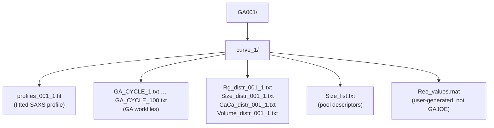
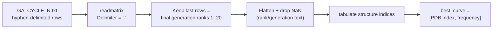
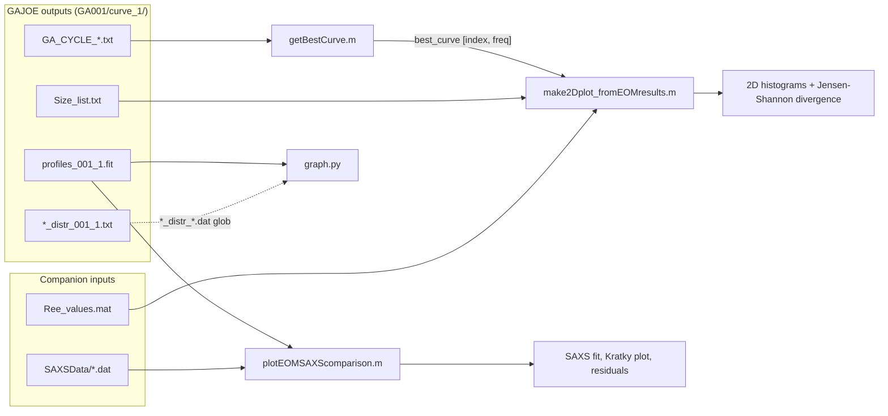

This page is the canonical field guide to the files GAJOE v2.x writes after an Ensemble Optimization Method (EOM) run, documented against the concrete example shipped in this repository (`ExampleData/H4_tail_WT_ff19SB_OPC/GA001/curve_1`). For the algorithm itself, see [GAJOE Genetic Algorithm Ensemble Fitting](8-gajoe-genetic-algorithm-ensemble-fitting); for how these files are produced from a pool, see [FFMAKER Theoretical SAXS Profiles](7-ffmaker-theoretical-saxs-profiles). Every format described here is verified against the actual example files and against the MATLAB/Python parsers in this repo that read them.

Sources: [README.md](/README.md#L12-L17), [README.md](/README.md#L90-L97)

## Output Directory Layout and Naming

GAJOE creates one output directory per invocation — `GA001`, `GA002`, etc. — and one `curve_N` subdirectory per experimental dataset fitted. The example folder contains 100 `GA_CYCLE_N.txt` workfiles (one per independent GA repeat), a fitted profile, four structural distribution files, the pool descriptor table, and one non-GAJOE companion file (`Ree_values.mat`, added by the analysis workflow). Note that `pdbs/` and `logFile_*.log` appear in fresh GAJOE runs (per the tutorial) but are omitted from this archived example.

| File(s) | Content | Written by | Primary consumer in repo |
|---|---|---|---|
| `GA_CYCLE_1.txt` … `GA_CYCLE_100.txt` | Per-generation ranked ensembles for each GA run | GAJOE (opt-in) | `getBestCurve.m` |
| `profiles_001_1.fit` | q-grid, experimental I(q), error, fitted ensemble I(q) | GAJOE | `plotEOMSAXScomparison.m`, `graph.py` |
| `Rg_distr_001_1.txt`, `Size_distr_001_1.txt`, `CaCa_distr_001_1.txt`, `Volume_distr_001_1.txt` | Pool vs. selected-ensemble distributions | GAJOE | `graph.py` (pattern-based) |
| `Size_list.txt` | Per-structure Rg and Dmax for the full pool | GAJOE | `make2Dplot_fromEOMresults.m` |
| `Ree_values.mat` | End-to-end distances (variable `R`) | User workflow | `make2Dplot_fromEOMresults.m` |
| `pdbs/`, `logFile_*.log` | Selected conformations; run log | GAJOE | `2d.py` (pdbs only) |

The numeric suffixes `_001_1` carry dataset and curve indices; the authoritative linkage to a specific GA cycle is stored *inside* the file headers, not in the file names.

Sources: [README.md](/README.md#L90-L97), [ExampleData/H4_tail_WT_ff19SB_OPC/GA001/curve_1](/ExampleData/H4_tail_WT_ff19SB_OPC/GA001/curve_1)

## GA_CYCLE_N.txt — Genetic Algorithm Workfiles

Each `GA_CYCLE_N.txt` records one complete independent GA run. Line 1 is the header `Gener Best`; the remainder consists of one block per generation (1000 blocks here), each listing 20 ranked candidate ensembles from rank 20 down to rank 1. A row encodes: generation number, rank, the ensemble's chi², and the ensemble membership as pool-structure indices delimited by hyphens — e.g. `-156-359-734-792-792-805-812-1159-1166-`, where a repeated index means that conformation appears multiple times in the ensemble. The chi² trajectory is visible directly in the file: the best ensemble in generation 1 of cycle 1 scores 16.43, converging to 1.37 by generation 1000.

Critically, these files only exist if you answered **yes** to GAJOE's prompt *"Save workfiles with the entire GA runs? (default: no)"* — `getBestCurve.m` documents this requirement because GAJOE v2 removed the `best_curve.txt` summary that version 1.3 emitted. The parser reads each file with `readmatrix(..., "Delimiter", '-')`, keeps the final `curvesPerEnsemble` rows (the last generation's ranked list), flattens the matrix to a column, and discards `NaN` cells (which is where the non-numeric "chi²:" text lands), then tabulates how often each pool structure occurs across those top-ranked ensembles. The resulting `best_curve = [PDBnums, freqnums]` matrix is the join key into `Size_list.txt` and `Ree_values.mat` downstream.

> [!TIP]
> Without the workfiles opt-in, a GAJOE v2.x run leaves you with no machine-readable record of *which* structures were selected — `getBestCurve.m` exists precisely to reconstruct the lost `best_curve.txt` from `GA_CYCLE_*.txt`. This is elaborated in [Best-Curve Reconstruction from GA Cycles](10-best-curve-reconstruction-from-ga-cycles).

Sources: [GA_CYCLE_1.txt](/ExampleData/H4_tail_WT_ff19SB_OPC/GA001/curve_1/GA_CYCLE_1.txt#L1-L21), [GA_CYCLE_1.txt](/ExampleData/H4_tail_WT_ff19SB_OPC/GA001/curve_1/GA_CYCLE_1.txt#L19982-L20001), [getBestCurve.m](/getBestCurve.m#L4-L17), [getBestCurve.m](/getBestCurve.m#L28-L42)

## profiles_001_1.fit — Fitted Scattering Profile

The `.fit` file is the primary quantitative artifact: the ensemble-averaged theoretical curve GAJOE selected as the best fit, evaluated on the experimental q-grid. Line 1 is a single-line header echoing the run configuration; lines 2+ are four-column numeric data (53 rows here, exactly matching the 53-point experimental dataset declared in `H4WT_150Na.dat`).

| Header field (example value) | Meaning |
|---|---|
| `CYCLE: 29` | The independent GA run whose ensemble produced this fit |
| `Chi^2: 1.226` | Goodness-of-fit of the winning ensemble |
| `GENER.: 1000` | Generations per run |
| `ENSEMBLES: 50` | Candidate ensembles evaluated per generation |
| `CURVES: 9` | Conformations in the winning ensemble |

The data columns are `q`, experimental `I(q)`, error, and fitted `I(q)`. Both consumers treat it the same way structurally: `plotEOMSAXScomparison.m` reads it with `NumHeaderLines=1` and uses columns 1 and 4 for the fit overlay, while `graph.py` unpacks all four as `q, exp, err, fit`. Note that the header's cycle (29) differs from cycle 1's best chi² (1.37) — the stored fit comes from the best-performing cycle among all runs, which is why the file name suffix alone cannot identify the source cycle.

> [!TIP]
> The error column in `.fit` is GAJOE-processed, not a copy of the raw experimental errors: at low q the example shows ~10⁻¹⁷ values versus 10⁻³ in `H4WT_150Na.dat`. That is why `plotEOMSAXScomparison.m` deliberately re-reads the raw experimental `.dat` (with `NumHeaderLines=4`) for its error bars and interpolates experimental intensities onto the `.fit` q-grid when computing residuals. This pipeline is covered in [SAXS Fit, Kratky Plot, and Residuals](13-saxs-fit-kratky-plot-and-residuals).

Sources: [profiles_001_1.fit](/ExampleData/H4_tail_WT_ff19SB_OPC/GA001/curve_1/profiles_001_1.fit#L1-L4), [H4WT_150Na.dat](/SAXSData/H4WT_150Na.dat#L1-L4), [plotEOMSAXScomparison.m](/plotEOMSAXScomparison.m#L10-L22), [graph.py](/Example_tutorial/graph.py#L26-L30)

## *_distr_001_1.txt — Structural Distributions

All four distribution files share one schema: four summary lines reporting pool and selected-ensemble statistics (average and histogram-derived values), a column-header line, then three-column binned data: bin value, normalized pool frequency, and normalized selected-ensemble frequency. These are the files to consult for a quick read of whether the GA shifted the ensemble's structural landscape — for example, the Rg file shows the ensemble average rising to 15.27 Å against a pool average of 13.77 Å, a direct fingerprint of the SAXS-driven selection pressure.

| File | Bin variable | Ensemble avg | Pool avg |
|---|---|---|---|
| `Rg_distr_001_1.txt` | Radius of gyration (Å) | 15.27 | 13.77 |
| `Size_distr_001_1.txt` | Dmax (Å) | 47.33 | 42.69 |
| `CaCa_distr_001_1.txt` | Ca(N)–Ca(C) end-to-end distance (Å) | 0.00 | 0.00 |
| `Volume_distr_001_1.txt` | Excluded volume | 0.00 | 0.00 |

> [!TIP]
> The CaCa and Volume distributions are **all zeros in this workflow** — the FFMAKER statistics for this pool were generated without end-to-end distances. The repository compensates by measuring Ree externally from pool PDBs into `Ree_values.mat` (via `pdb_Rmeas.m`), which `make2Dplot_fromEOMresults.m` then loads as variable `R`, index-aligned with `Size_list.txt`. Do not treat the zeroed CaCa bins as a physical result; the structural concept is covered in [Structural Descriptors: Rg, Dmax, Ree](16-structural-descriptors-rg-dmax-ree).

Sources: [Rg_distr_001_1.txt](/ExampleData/H4_tail_WT_ff19SB_OPC/GA001/curve_1/Rg_distr_001_1.txt#L1-L6), [Size_distr_001_1.txt](/ExampleData/H4_tail_WT_ff19SB_OPC/GA001/curve_1/Size_distr_001_1.txt#L1-L5), [CaCa_distr_001_1.txt](/ExampleData/H4_tail_WT_ff19SB_OPC/GA001/curve_1/CaCa_distr_001_1.txt#L1-L5), [Volume_distr_001_1.txt](/ExampleData/H4_tail_WT_ff19SB_OPC/GA001/curve_1/Volume_distr_001_1.txt#L1-L5)

## Size_list.txt — Pool Descriptor Table

`Size_list.txt` is the flat, one-row-per-conformation descriptor table for the entire RANCH/MD pool: column 1 is the 1-based structure index (1–2000 here, matching the 2001-line file), column 2 is Rg, and column 3 is Dmax. This index is the shared namespace for the whole output directory: the hyphen-delimited integers inside `GA_CYCLE_*.txt` ensembles reference these row numbers, and `make2Dplot_fromEOMresults.m` relies on that alignment when it maps each selected structure to its descriptors via `Sizelist(bestcurve(n,1), 2:3)` and to its end-to-end distance via `R(bestcurve(n,1))`. Any downstream tool that joins GAJOE outputs must preserve this 1-based indexing convention.

Sources: [Size_list.txt](/ExampleData/H4_tail_WT_ff19SB_OPC/GA001/curve_1/Size_list.txt#L1-L15), [make2Dplot_fromEOMresults.m](/make2Dplot_fromEOMresults.m#L25-L34), [make2Dplot_fromEOMresults.m](/make2Dplot_fromEOMresults.m#L38-L50)

## Companion Files Not Written by GAJOE

Three artifacts in or around the output directory come from outside GAJOE proper, and knowing their provenance prevents misconfiguration. **`Ree_values.mat`** is generated by the analysis workflow (running `pdb_Rmeas.m` over the full pool's structures) and is the only source of end-to-end distances in this pipeline, given the zeroed `CaCa_distr` file. **`pdbs/`** — present in fresh GAJOE runs per the tutorial — holds the selected conformations as CIF/PDB; `2d.py` consumes it by globbing file stems and intersecting them against FFMAKER's `size_statistics_20.csv` to build the Rg–Ree scatter with selected structures highlighted ([Rg-Ree Scatter Plot with Marginals](15-rg-ree-scatter-plot-with-marginals)). **`logFile_*.log`** records the interactive GAJOE session settings and results. Finally, the experimental `.dat` files in `SAXSData/` (4-line headers, tab-separated q/I/error) are the fitting targets that `plotEOMSAXScomparison.m` reads alongside the `.fit` output.

Sources: [make2Dplot_fromEOMresults.m](/make2Dplot_fromEOMresults.m#L2-L4), [2d.py](/Example_tutorial/2d.py#L6-L30), [README.md](/README.md#L90-L97), [H4WT_150Na.dat](/SAXSData/H4WT_150Na.dat#L1-L4)

## File-Consumption Map

The following diagram consolidates how every output file flows into the repository's analysis tooling, which is useful when wiring up a new GAJOE run: the workfiles feed ensemble membership, `Size_list.txt` + `Ree_values.mat` feed pool descriptors, and the `.fit` file pairs with the raw experimental data for scattering-level comparison.

| Consumer script | Reads | Produces | Catalog page |
|---|---|---|---|
| `getBestCurve.m` | `GA_CYCLE_*.txt` | `best_curve` matrix | [Best-Curve Reconstruction from GA Cycles](10-best-curve-reconstruction-from-ga-cycles) |
| `make2Dplot_fromEOMresults.m` | `best_curve`, `Size_list.txt`, `Ree_values.mat` | 2D histograms, JSD | [2D Ensemble Comparison Histograms](11-2d-ensemble-comparison-histograms), [Jensen-Shannon Divergence Quantification](12-jensen-shannon-divergence-quantification) |
| `plotEOMSAXScomparison.m` | `profiles_001_1.fit`, `SAXSData/*.dat` | Fit, Kratky, residual plots | [SAXS Fit, Kratky Plot, and Residuals](13-saxs-fit-kratky-plot-and-residuals) |
| `graph.py` | `profiles_*.fit`, `*_distr_*.dat` | SAXS and distribution plots | [SAXS Curve and Distribution Plots](14-saxs-curve-and-distribution-plots) |
| `2d.py` | `pdbs/*.cif`, `size_statistics_20.csv` | Rg–Ree scatter with marginals | [Rg-Ree Scatter Plot with Marginals](15-rg-ree-scatter-plot-with-marginals) |

Sources: [README.md](/README.md#L15-L17), [graph.py](/Example_tutorial/graph.py#L34-L47), [2d.py](/Example_tutorial/2d.py#L6-L30)

## Practical Notes and Cross-Version Behavior

Three implementation details matter when adapting these parsers to your own GAJOE runs. First, version behavior: GAJOE v2.x removed the `best_curve.txt` summary file, so the repository standardizes on GAJOE v2.1 plus `getBestCurve.m` for ensemble membership extraction — running v1.x or later v2.x releases may shift prompts and file naming. Second, the `graph.py` distribution globs target `*_distr_*.dat`, while the archived example stores distributions as `*.txt`; the reader is defensive (`if not files: continue`) and its header-skipping `read_numeric` helper tolerates either layout, but be aware the distribution plots may silently be skipped on an extension mismatch. Third, header-line counts are contract-critical in MATLAB: experimental `.dat` files use 4 header lines (`NumHeaderLines=4`) while `.fit` files use 1 — off-by-one here shifts every column and corrupts the comparison silently rather than raising an error.

To go deeper, run the tutorial yourself in [EOM Tutorial with ATSAS Tools](4-eom-tutorial-with-atsas-tools), then follow the consumers in order: [Best-Curve Reconstruction from GA Cycles](10-best-curve-reconstruction-from-ga-cycles) → [2D Ensemble Comparison Histograms](11-2d-ensemble-comparison-histograms) → [SAXS Fit, Kratky Plot, and Residuals](13-saxs-fit-kratky-plot-and-residuals). For the end-to-end application of these outputs to a real benchmark, continue to [H4 Histone Tail Case Study](17-h4-histone-tail-case-study).
