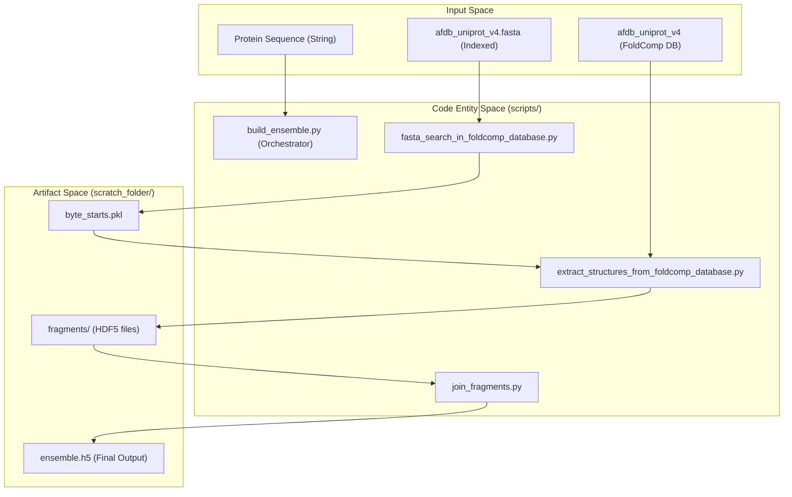
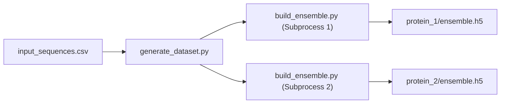

# Getting Started

<details>
<summary>Relevant source files</summary>

The following files were used as context for generating this wiki page:

- [.dockerignore](.dockerignore)
- [.gitignore](.gitignore)
- [Dockerfile](Dockerfile)
- [README.md](README.md)

</details>


This page provides a technical guide for setting up and running IDP-o, a fragment-based ensemble generator for Intrinsically Disordered Proteins (IDPs). The system utilizes a GPU-accelerated pipeline to search for structural fragments within the AlphaFold Database (AFDB) and assembles them into a conformational ensemble.

## System Prerequisites and Environment

IDP-o is designed to run within a containerized environment to manage complex dependencies, including NVIDIA JAX and CuPy for GPU acceleration.

### Docker Image Construction
The project provides a `Dockerfile` based on the NVIDIA JAX runtime. It installs specialized dependencies such as `foldcomp` for structural data handling, `nerfax` for backbone and hydrogen reconstruction, and `cupy-cuda12x` for vectorized sequence searching [Dockerfile:1-8]().

To build the container:
```bash
# Clone the repository
git clone https://github.com/PeptoneLtd/IDP-o
cd IDP-o

# Build Docker container
docker build --platform=linux/amd64 . -t idp-o
```
[README.md:14-21]()

### Repository Structure and Exclusions
The repository includes scripts for both single-sequence and batch processing. Local development environments typically exclude large datasets and cache folders via `.gitignore` and `.dockerignore` [ .gitignore:168-173](); [.dockerignore:1]().

**Sources:**
- [Dockerfile:1-8]()
- [README.md:14-21]()
- [.gitignore:168-172]()
- [.dockerignore:1]()

---

## Database Preparation

IDP-o requires the `afdb_uniprot_v4` database in FoldComp format. Because the standard FoldComp distribution does not include the specific byte-offset FASTA headers required for IDP-o's GPU search, a preprocessing step is mandatory.

### Offset-FASTA Format
The required FASTA format uses the byte offset of the structure within the binary FoldComp database as the header identifier:
```text
> {offset in bytes in the foldcomp db}
{sequence}
```
[README.md:24-32]()

### Automated Setup
The `prepare_foldcomp_fasta.py` script automates the download of the ~1.1 TB database and the generation of the indexed FASTA file [README.md:33-40]().

```bash
docker run -v $(pwd):/data --entrypoint python idp-o /IDP-o/scripts/prepare_foldcomp_fasta.py --workdir /data
```
[README.md:36]()

**Sources:**
- [README.md:24-40]()

---

## Data Flow and Execution

The execution of IDP-o follows a linear pipeline from a raw amino acid sequence to a structural ensemble stored in HDF5 format.

### Entity Mapping: Pipeline Logic
The following diagram maps the logical stages of the ensemble generation to the specific scripts and data artifacts involved in the process.

**IDP-o Execution Data Flow**

**Sources:**
- [README.md:42-52]()
- [Dockerfile:8]()

---

## Minimal End-to-End Example

To generate an ensemble for a single sequence, use the `build_ensemble.py` entrypoint. This script orchestrates the fragmentation (6-mers with 2-residue overlaps), searching, extraction, and assembly [README.md:8]().

### Running the Orchestrator
The command below mounts the current directory to `/data` inside the container and executes the pipeline on a single GPU.

```bash
docker run -v $(pwd):/data --gpus 1 \
  idp-o \
    --sequence DLIVERANDSANDRDANDCARLDANDMICHELEANDLDHIEANDFADIDANDSTEFANDANDISTVANANDALDERTANDDLIVERAGAINPLASDTHERS \
    --outpath /data/example/ensemble.h5 \
    --scratch_folder /data/example/ \
    --foldcomp_fasta /data/afdb_uniprot_v4.fasta \
    --foldcomp_db /data/afdb_uniprot_v4 \
    --n_max_structures_per_fragment 100
```
[README.md:43-52]()

### Configuration Parameters
| Parameter | Description |
| :--- | :--- |
| `--sequence` | The amino acid sequence of the IDP to model. |
| `--outpath` | Path for the final `.h5` ensemble file. |
| `--scratch_folder` | Directory for intermediate files (fragments, byte offsets). |
| `--foldcomp_fasta` | Path to the byte-offset indexed FASTA file created in Step 2. |
| `--foldcomp_db` | Path to the binary FoldComp database files. |
| `--n_max_structures_per_fragment` | Limit on the number of structural matches to keep for each 6-mer. |

**Sources:**
- [README.md:8-10]()
- [README.md:43-53]()

---

## Batch Processing
For large-scale generation (e.g., creating datasets like IDRome-o), the system provides `generate_dataset.py`. This script acts as a wrapper that manages multiple calls to `build_ensemble.py` [README.md:55]().

**Batch Workflow Diagram**

**Sources:**
- [README.md:55]()

---