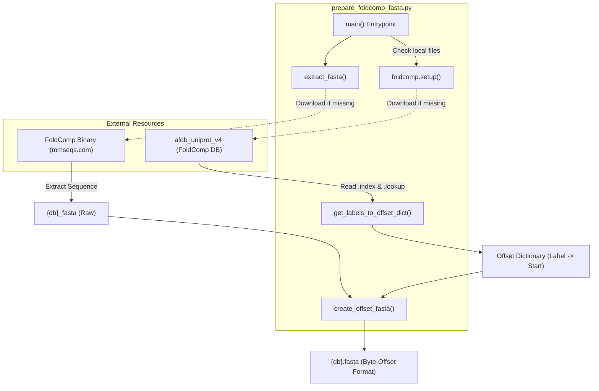
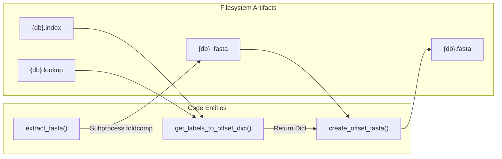

# Database Preparation: prepare_foldcomp_fasta.py

<details>
<summary>Relevant source files</summary>

The following files were used as context for generating this wiki page:

- [README.md](README.md)
- [scripts/prepare_foldcomp_fasta.py](scripts/prepare_foldcomp_fasta.py)

</details>


The `prepare_foldcomp_fasta.py` script is a critical pre-processing utility designed to bootstrap the IDP-o pipeline by preparing the necessary structural and sequence databases. Its primary responsibility is to transform the standard FoldComp database format into a specialized "byte-offset FASTA" format required for high-speed fragment searching in downstream stages [README.md:23-32]().

## Purpose and Scope

IDP-o relies on a specific FASTA format where the header of each sequence entry contains the exact byte offset of the corresponding structure within the FoldComp binary database [README.md:27-30](). This allows the `fasta_search_in_foldcomp_database.py` stage to immediately identify the physical location of structural data for any sequence match, bypassing expensive database lookups during the search phase.

The script automates three main tasks:
1.  **Database Acquisition**: Downloading the `afdb_uniprot_v4` FoldComp database (~1.1 TB) if not present [scripts/prepare_foldcomp_fasta.py:133-135]().
2.  **Binary Provisioning**: Automatically detecting or downloading the platform-specific `foldcomp` binary (Linux, macOS, or Windows) to perform sequence extraction [scripts/prepare_foldcomp_fasta.py:60-98]().
3.  **Index Joining**: Merging FoldComp `.index` and `.lookup` files to map UniProt labels to binary offsets [scripts/prepare_foldcomp_fasta.py:33-50]().

## Data Flow and Logic

The script orchestrates the flow from raw database files to the specialized FASTA index.

### Database Preparation Workflow
"Logic Flow of prepare_foldcomp_fasta.py"

**Sources:** [scripts/prepare_foldcomp_fasta.py:120-149](), [scripts/prepare_foldcomp_fasta.py:52-105](), [scripts/prepare_foldcomp_fasta.py:106-118]()

## Implementation Details

### Offset Mapping Logic
The core of the preparation lies in `get_labels_to_offset_dict`. FoldComp databases store structural data in a binary blob, with metadata split across two files:
*   `.index`: Contains the `id`, `start` byte, and `end` byte [scripts/prepare_foldcomp_fasta.py:35]().
*   `.lookup`: Contains the `id` and the human-readable `label` (e.g., UniProt accession) [scripts/prepare_foldcomp_fasta.py:41-45]().

The function performs an inner join on the `id` column using `pandas` to create a direct mapping from the `label` to the `start` byte offset [scripts/prepare_foldcomp_fasta.py:49]().

### The Byte-Offset FASTA Format
After extracting the raw sequences using the `foldcomp extract --fasta` command [scripts/prepare_foldcomp_fasta.py:103](), the script iterates through the resulting file. It replaces the standard FASTA headers (UniProt labels) with the integer byte-offset retrieved from the mapping dictionary [scripts/prepare_foldcomp_fasta.py:112-115]().

**Format Example:**
```text
>1024
MKVLVLDDANR...
>50482
MLILIDDHALL...
```
*In this example, `1024` is the byte position in the binary `.afdb_uniprot_v4` file where the structure for the first sequence begins.*

### Cross-Platform Binary Management
To ensure portability, `extract_fasta` checks for an existing `foldcomp` installation [scripts/prepare_foldcomp_fasta.py:54-56](). If not found, it detects the OS (`platform.system()`) and architecture (`platform.machine()`) to download the appropriate pre-compiled binary from `mmseqs.com` [scripts/prepare_foldcomp_fasta.py:62-85](). It handles `.zip` extraction for Windows and `.tar.gz` for Unix-like systems, including setting executable permissions via `os.chmod` [scripts/prepare_foldcomp_fasta.py:87-96]().

## Component Interaction
The following diagram maps the Python functions to the file artifacts they manipulate.

"Code Entity to File Artifact Mapping"

**Sources:** [scripts/prepare_foldcomp_fasta.py:33-50](), [scripts/prepare_foldcomp_fasta.py:52-105](), [scripts/prepare_foldcomp_fasta.py:106-118]()

## Execution Arguments

| Argument | Default | Description |
| :--- | :--- | :--- |
| `--foldcomp-db` | `afdb_uniprot_v4` | The name/path of the FoldComp database to process [scripts/prepare_foldcomp_fasta.py:125](). |
| `--threads` | `8` | Number of threads to use for `foldcomp extract` [scripts/prepare_foldcomp_fasta.py:126](). |
| `--workdir` | `/data/foldcomp_db` | Directory where the database will be downloaded and processed [scripts/prepare_foldcomp_fasta.py:127](). |

**Sources:** [scripts/prepare_foldcomp_fasta.py:121-128]()

---