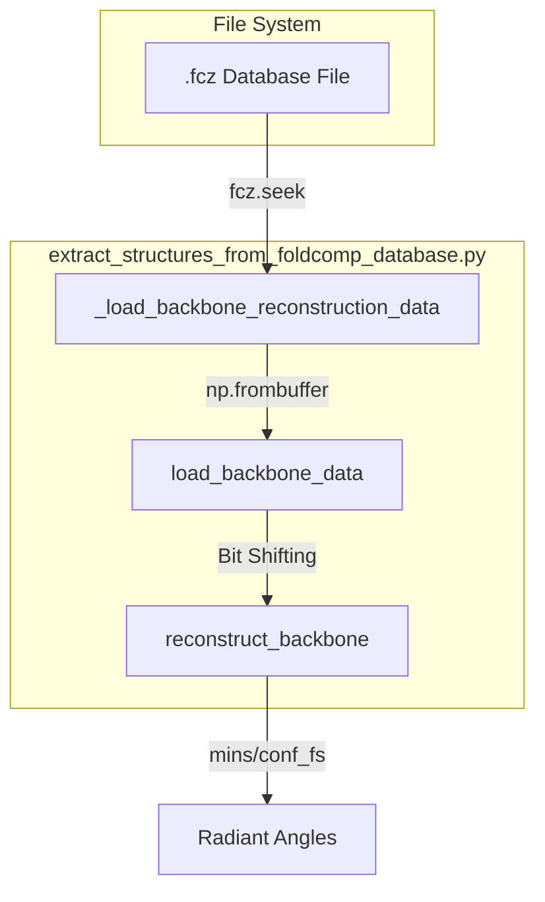
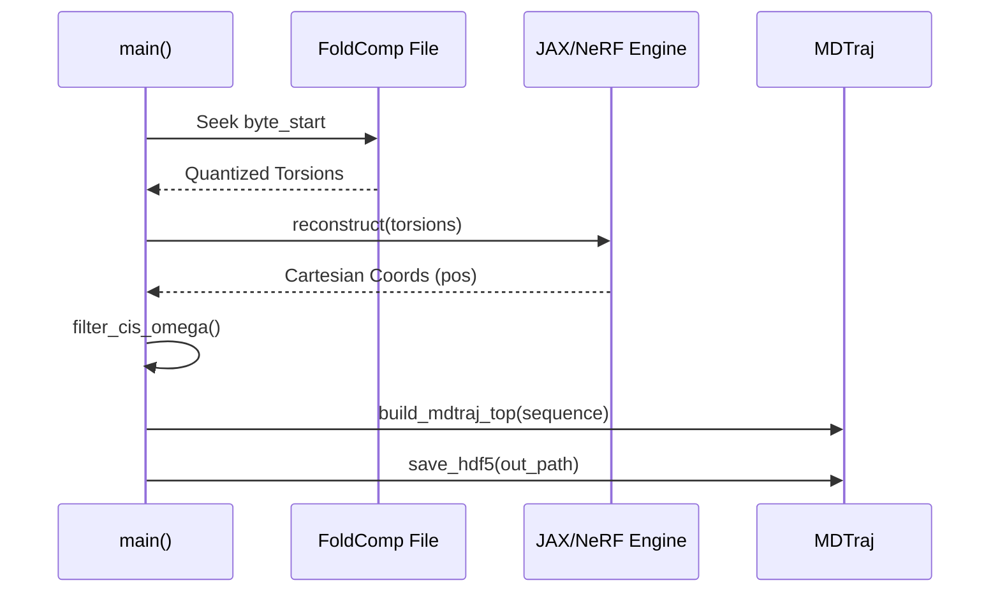

# Structure Extraction: extract_structures_from_foldcomp_database.py

Relevant source files

The following files were used as context for generating this wiki page:

- [Dockerfile](Dockerfile)
- [scripts/extract_structures_from_foldcomp_database.py](scripts/extract_structures_from_foldcomp_database.py)

This module is responsible for extracting atomic coordinates from the binary FoldComp database based on sequence match indices. It implements a high-performance reconstruction engine using JAX to de-quantize torsion angles and compute 3D Cartesian coordinates via the Natural Extension Reference Frame (NeRF) algorithm.

## Purpose and Scope

The `extract_structures_from_foldcomp_database.py` script serves as the bridge between compressed binary structural data and standard molecular trajectory formats. It parses `.fcz` files, performs discretized torsion de-quantization, reconstructs backbone and sidechain atoms, and filters fragments based on physical constraints (e.g., cis-omega bonds). The final output is an HDF5 file containing the extracted structural ensemble.

## FCMP Binary Parsing

FoldComp files (`.fcz`) store protein structures in a highly compressed format. This script manually parses the binary stream to extract the necessary discretizers and quantized angles.

### Binary Header Structure
The script identifies the start of a record by searching for the `b'FCMP'` tag [scripts/extract_structures_from_foldcomp_database.py:86-86](). It then extracts metadata including the number of residues, anchors, and the title length to calculate the exact byte offsets for backbone and sidechain data [scripts/extract_structures_from_foldcomp_database.py:88-96]().

### Torsion De-quantization
Backbone data is stored as 8-byte blocks per residue [scripts/extract_structures_from_foldcomp_database.py:67-67](). The script performs bit-shifting to recover the 12-bit quantized values for $\phi, \psi, \omega$ and the three backbone bond angles [scripts/extract_structures_from_foldcomp_database.py:70-76](). These are de-quantized using `mainChainAnglesTorsionsDicretizers` [scripts/extract_structures_from_foldcomp_database.py:142-142]().

### Data Extraction Flow
The following diagram illustrates the transition from the binary file to de-quantized internal coordinates.

**FoldComp Binary Parsing Flow**

Sources: [scripts/extract_structures_from_foldcomp_database.py:66-77](), [scripts/extract_structures_from_foldcomp_database.py:83-103](), [scripts/extract_structures_from_foldcomp_database.py:137-155]()

## Coordinate Reconstruction

The reconstruction process converts internal coordinates (bond lengths, angles, and torsions) into Cartesian $(x, y, z)$ coordinates.

### Backbone Reconstruction
Backbone reconstruction utilizes the `reconstruct_from_internal_coordinates_pure_sequential` function from the `nerfax` library [scripts/extract_structures_from_foldcomp_database.py:31-31](). 
1. **Bond Lengths**: Fixed values are retrieved from `BACKBONE_BOND_LENGTHS` [scripts/extract_structures_from_foldcomp_database.py:156-156]().
2. **Angles**: Torsion and bond angles are reordered to follow the $N \rightarrow CA \rightarrow C$ sequence [scripts/extract_structures_from_foldcomp_database.py:146-150]().
3. **NeRF**: The sequential NeRF algorithm builds the chain atom-by-atom [scripts/extract_structures_from_foldcomp_database.py:159-162]().

### Sidechain Placement
Sidechains are reconstructed using `reconstruct_sidechains` [scripts/extract_structures_from_foldcomp_database.py:168-168](). This requires:
- The residue sequence mapped to indices via a `HashTable` [scripts/extract_structures_from_foldcomp_database.py:62-63]().
- Discretized sidechain angles extracted from the `.fcz` sidechain data block [scripts/extract_structures_from_foldcomp_database.py:130-132]().

**Entity Mapping: Logic to Code**
| Scientific Concept | Code Entity | Implementation |
| :--- | :--- | :--- |
| Internal Coordinates | `mainChainAnglesTorsions` | [scripts/extract_structures_from_foldcomp_database.py:76-76]() |
| Coordinate Transform | `reconstruct_backbone` | [scripts/extract_structures_from_foldcomp_database.py:137-137]() |
| Atom Placement | `reconstruct_from_internal_coordinates_pure_sequential` | [scripts/extract_structures_from_foldcomp_database.py:159-162]() |
| Topology Building | `build_mdtraj_top` | [scripts/extract_structures_from_foldcomp_database.py:32-32]() |

Sources: [scripts/extract_structures_from_foldcomp_database.py:137-170](), [scripts/extract_structures_from_foldcomp_database.py:30-32]()

## Execution Pipeline

The script operates in a batched manner, processing multiple fragment matches for a single query sequence.

### Input Processing
The script reads `byte_starts.pkl` (generated by the fragment search stage) which contains the locations of sequence matches in the FoldComp database [scripts/extract_structures_from_foldcomp_database.py:228-232]().

### Cis-Omega Filtering
A critical quality control step is the filtering of residues with `cis` $\omega$ angles. By default, the script excludes structures where the $\omega$ angle (the peptide bond torsion) is in the `cis` conformation, as these are rare in natural proteins unless specifically required [scripts/extract_structures_from_foldcomp_database.py:246-248]().

### Output Generation
The reconstructed coordinates are stored using `mdtraj`. The script:
1. Builds a topology for the fragment [scripts/extract_structures_from_foldcomp_database.py:202-202]().
2. Aggregates all valid fragments into a single trajectory [scripts/extract_structures_from_foldcomp_database.py:261-263]().
3. Saves the ensemble to an HDF5 file [scripts/extract_structures_from_foldcomp_database.py:265-265]().

**System Execution Diagram**

Sources: [scripts/extract_structures_from_foldcomp_database.py:188-266]()

## Performance Optimization

- **JAX Acceleration**: The reconstruction logic is wrapped in `jax.jit` and `jax.vmap` to allow for rapid processing of thousands of fragments [scripts/extract_structures_from_foldcomp_database.py:28-29]().
- **CPU Platform**: The script explicitly sets `JAX_PLATFORMS = "cpu"` [scripts/extract_structures_from_foldcomp_database.py:17-17]() because the reconstruction of small fragments is often bottlenecked by GPU memory transfer latency rather than computation.
- **Hashing**: A `hirola.HashTable` is used for fast amino acid one-letter code to index mapping [scripts/extract_structures_from_foldcomp_database.py:62-63]().

Sources: [scripts/extract_structures_from_foldcomp_database.py:17-29](), [scripts/extract_structures_from_foldcomp_database.py:62-63]()

---