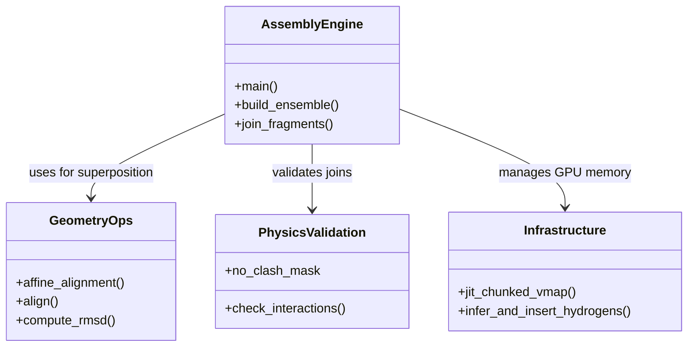

# Fragment Assembly: join_fragments.py

<details>
<summary>Relevant source files</summary>

The following files were used as context for generating this wiki page:

- [scripts/build_ensemble.py](scripts/build_ensemble.py)
- [scripts/join_fragments.py](scripts/join_fragments.py)

</details>


The fragment assembly engine is the final stage of the IDP-o pipeline. It takes the individual structural ensembles extracted from the FoldComp database and merges them into a full-length protein ensemble using a hierarchical power-of-two strategy. The engine utilizes JAX for accelerated affine alignment, steric clash detection, and memory-efficient batch processing.

## Overview and Purpose

The primary goal of `join_fragments.py` is to assemble a coherent ensemble of full-length structures from overlapping 6-mer fragments [scripts/join_fragments.py:1-13](). Because the search space for combinations grows exponentially, the script employs a stochastic sampling approach combined with geometric filtering (RMSD and steric clashes) to ensure physical plausibility [scripts/join_fragments.py:112-123]().

### Key Features
*   **Hierarchical Merging**: Fragments are joined in pairs, then pairs of pairs, reducing the number of assembly steps to $log_2(N)$ [scripts/join_fragments.py:200-220]().
*   **SVD-based Affine Alignment**: Overlapping residues are aligned using Singular Value Decomposition to find the optimal rotation and translation [scripts/join_fragments.py:38-50]().
*   **JAX Acceleration**: The entire alignment and clash-detection pipeline is vectorized using `vmap` and `jit` [scripts/join_fragments.py:121-179]().
*   **Steric Filtering**: New joins are rejected if they result in atomic overlaps (clashes) or if the overlap RMSD exceeds a threshold [scripts/join_fragments.py:117-122]().

---

## Assembly Logic and Data Flow

The assembly follows a "bottom-up" approach. Given a set of fragments $F_1, F_2, ..., F_n$, the engine first joins $(F_1, F_2), (F_3, F_4)$, etc., and continues this pattern until a single ensemble remains.

### Fragment Joining Diagram
The following diagram illustrates the transition from structural fragments to the final ensemble.

"Structural Assembly Data Flow"
```mermaid
graph TD
    subgraph "Input Fragments"
        F1["Fragment 1 (H5)"]
        F2["Fragment 2 (H5)"]
        F3["Fragment 3 (H5)"]
        F4["Fragment 4 (H5)"]
    end

    subgraph "join_fragments.py Entities"
        PJF["pre_join_fragments()"]
        JF["join_fragments()"]
        AA["affine_alignment()"]
        CI["check_interactions()"]
        JCV["jit_chunked_vmap()"]
    end

    F1 & F2 --> PJF
    PJF --> JF
    JF --> JCV
    JCV --> AA
    JCV --> CI
    
    subgraph "Hierarchical Steps"
        S1["Step 1: Join Pairs"]
        S2["Step 2: Join Results"]
    end

    JF --> S1
    S1 --> S2
    S2 --> "Final Ensemble (.h5/.xtc)"
```
Sources: [scripts/join_fragments.py:76-93](), [scripts/join_fragments.py:147-193](), [scripts/join_fragments.py:200-220]()

---

## Technical Implementation

### 1. Affine Alignment and Superposition
When two fragments (Left and Right) are joined, they must overlap by exactly 2 residues [scripts/join_fragments.py:76-78](). The `affine_alignment` function calculates the rotation matrix $R$ and translation vectors to minimize the distance between the overlapping backbone atoms [scripts/join_fragments.py:38-50]().

*   **Function**: `affine_alignment(geom, ref_geom)` [scripts/join_fragments.py:38]()
*   **Logic**: Uses `jnp.linalg.svd` on the covariance matrix of the two geometries. It includes a check on the determinant of $UV^T$ to handle reflection cases, ensuring a proper rotation matrix [scripts/join_fragments.py:43-49]().

### 2. Geometric Filtering
Each proposed join is subjected to two filters in `_join_fragments`:
1.  **RMSD Filter**: The RMSD of the overlapping residues after alignment must be $< 0.06$ nm ($0.6$ Å) [scripts/join_fragments.py:122]().
2.  **Steric Clash Filter**: The `check_interactions` function calculates a distance matrix for all atoms in the new structure. A clash is defined as any non-bonded atom pair closer than $0.1$ nm ($1.0$ Å) [scripts/join_fragments.py:60-70]().

### 3. Memory Management: Chunked Vmap
To prevent GPU Out-of-Memory (OOM) errors when processing thousands of potential joins, the script calculates a dynamic `chunk_size` based on the number of residues [scripts/join_fragments.py:150-151]().

*   **Function**: `jit_chunked_vmap(f, args, chunk_size)` [scripts/join_fragments.py:132]()
*   **Mechanism**: Uses `jax.lax.scan` to iterate through chunks of data, applying the JIT-compiled assembly function to each chunk sequentially while maintaining vectorization within the chunk [scripts/join_fragments.py:139-144]().

---

## Component Mapping

"Code Entity to Assembly Logic Map"

Sources: [scripts/join_fragments.py:22-35](), [scripts/join_fragments.py:38-73](), [scripts/join_fragments.py:132-145]()

---

## Output Generation

After the hierarchical assembly is complete, the final ensemble undergoes post-processing:
1.  **Hydrogen Reconstruction**: Since the FoldComp database primarily stores heavy atoms, `nerfax.reduce_utils.reconstruct_from_mdtraj` is used to place hydrogens [scripts/join_fragments.py:34](), [scripts/join_fragments.py:245]().
2.  **RMSD Sorting**: If requested via `--rmsd_sort`, the ensemble is sorted by a distance matrix to group similar structures together, facilitating visualization [scripts/build_ensemble.py:137-141]().
3.  **Format Conversion**: The internal JAX/NumPy coordinates are converted to an MDTraj `Trajectory` and saved to the user-specified format (e.g., `.h5`, `.xtc`, `.pdb`) [scripts/join_fragments.py:240-260]().

Sources: [scripts/join_fragments.py:240-265](), [scripts/build_ensemble.py:78-80]()

---