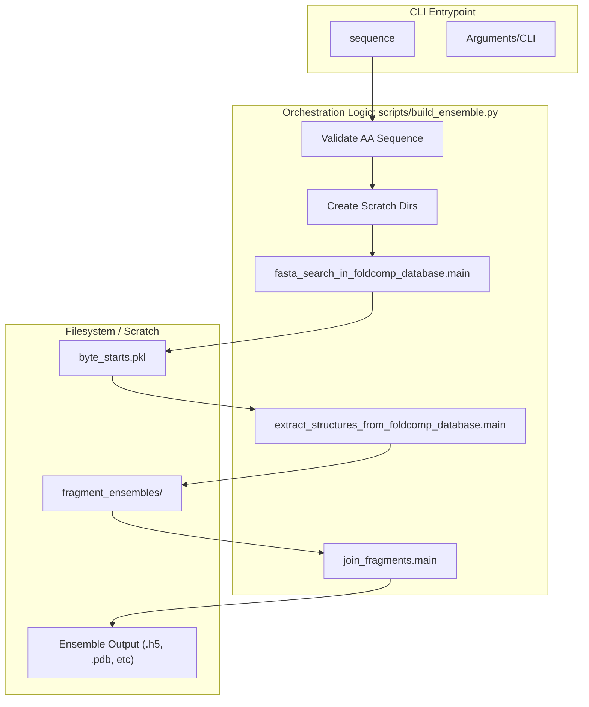
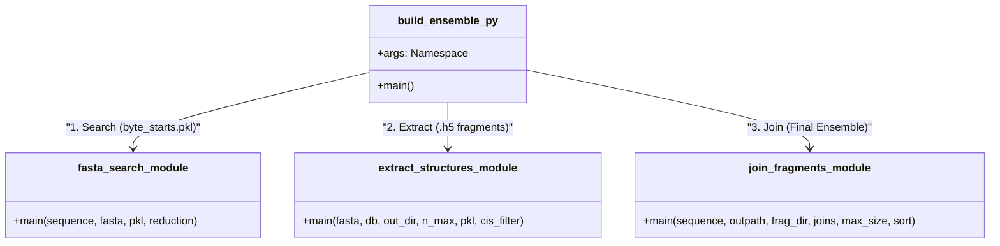

# Single-Sequence Ensemble Builder: build_ensemble.py

Relevant source files

The following files were used as context for generating this wiki page:

- [README.md](README.md)
- [scripts/build_ensemble.py](scripts/build_ensemble.py)

The `build_ensemble.py` script serves as the primary command-line interface (CLI) and orchestration engine for the IDP-o pipeline. It manages the end-to-end workflow of transforming a single protein sequence into a structural ensemble by coordinating three specialized sub-modules: fragment searching, structure extraction, and fragment assembly [scripts/build_ensemble.py:20-22]().

## Purpose and Scope

The builder automates the fragment-based assembly approach, which cuts a protein sequence into overlapping 6-mer fragments, retrieves matching structural configurations from the AlphaFold Database (via FoldComp), and stitches them together [README.md:8-10](). It handles environment setup, intermediate file management in a scratch directory, and final ensemble serialization into multiple user-defined formats.

## CLI Reference

The script is executed via `python scripts/build_ensemble.py` or through the provided Docker entrypoint [README.md:44-52]().

### Arguments

| Argument | Type | Default | Description |
| :--- | :--- | :--- | :--- |
| `--sequence` | `str` | **Required** | The amino acid sequence of the protein to model. |
| `--foldcomp_fasta` | `str` | `/data/afdb/afdb_uniprot_v4.fasta` | Path to the byte-offset indexed FASTA file [scripts/build_ensemble.py:93-103](). |
| `--foldcomp_db` | `str` | `/data/afdb/afdb_uniprot_v4` | Path to the FoldComp binary database file [scripts/build_ensemble.py:105-108](). |
| `--outpath` | `str` | **Required** | Path for the final ensemble. Supported: `.h5`, `.xtc`, `.dcd`, `.pdb`, `.pdb.gz` [scripts/build_ensemble.py:116-119](). |
| `--scratch_folder` | `str` | `/tmp` | Directory for intermediate `.pkl` and fragment `.h5` files [scripts/build_ensemble.py:120](). |
| `--n_max_structures_per_fragment` | `int` | `1000` | Maximum structural matches to extract for each 6-mer [scripts/build_ensemble.py:110-114](). |
| `--reduction_factor` | `int` | `1` | Subsampling factor for the database search (e.g., 10 searches 1/10th of the DB) [scripts/build_ensemble.py:122-127](). |
| `--joins_to_attempt_per_pairing` | `int` | `500000` | Budget for stochastic fragment joining attempts [scripts/build_ensemble.py:128](). |
| `--max_structures_in_ensemble` | `int` | `100` | Final number of full-length structures to retain [scripts/build_ensemble.py:129](). |
| `--exclude_cis_omega` | `bool` | `False` | If set, filters out fragments containing *cis* peptide bonds [scripts/build_ensemble.py:131-135](). |
| `--rmsd_sort` | `bool` | `False` | If set, sorts the final ensemble by RMSD for smoother visualization [scripts/build_ensemble.py:137-141](). |
| `--overwrite` | `bool` | `False` | Overwrite existing output files [scripts/build_ensemble.py:142](). |

**Sources:** [scripts/build_ensemble.py:87-143]()

## Orchestration Logic

The `main` function in `build_ensemble.py` acts as a controller that sequences the execution of the three core pipeline stages.

### Data Flow Diagram

The following diagram illustrates how the `build_ensemble.py` `main` function orchestrates the flow of data between the sub-modules and the filesystem.

"build_ensemble.py Execution Flow"

**Sources:** [scripts/build_ensemble.py:25-80]()

### Logic Steps
1.  **Validation**: Checks if the sequence contains only standard amino acids [scripts/build_ensemble.py:47-50]().
2.  **Filesystem Preparation**: Creates the `scratch_folder` and a sub-directory for fragment ensembles (optionally named `fragment_ensembles-exclude_cis_omega` if filtering is enabled) [scripts/build_ensemble.py:52-59]().
3.  **Search Stage**: Invokes the GPU-accelerated search to find occurrences of 6-mers in the database, producing `byte_starts.pkl` [scripts/build_ensemble.py:61]().
4.  **Extraction Stage**: Reads the FoldComp binary database using the byte offsets and reconstructs 3D coordinates for each fragment, saving them as individual HDF5 files in the fragment directory [scripts/build_ensemble.py:63-70]().
5.  **Assembly Stage**: Merges the fragments into full-length structures using alignment and steric filtering, then writes the final ensemble to the requested `outpath` [scripts/build_ensemble.py:72-80]().

## System Entity Mapping

This diagram maps the high-level functional stages to the specific Python modules and their primary outputs.

"Code Entity Mapping"

**Sources:** [scripts/build_ensemble.py:20-22](), [scripts/build_ensemble.py:61-80]()

## Output Formats and Error Handling

### Supported Formats
The final ensemble is serialized using MDTraj, supporting several formats based on the extension provided in `--outpath` [scripts/build_ensemble.py:116-119]():
*   **HDF5 (.h5)**: Recommended for large ensembles; preserves all metadata.
*   **Trajectories**: `.xtc` (GROMACS), `.dcd` (CHARMM/NAMD).
*   **PDB**: `.pdb` or compressed `.pdb.gz`.

### Error Handling
The script implements a global `try-except` block to capture and log failures during any stage of the pipeline [scripts/build_ensemble.py:163-166]().
*   **Pre-existing Files**: If the output file exists, the script will log a warning and exit unless `--overwrite` is specified [scripts/build_ensemble.py:40-45]().
*   **Invalid Sequences**: Raises a `ValueError` if non-standard amino acids are detected [scripts/build_ensemble.py:49-50]().
*   **Tracebacks**: Full stack traces are logged to `stderr` to facilitate debugging of GPU/JAX-related failures in sub-modules [scripts/build_ensemble.py:164-165]().

**Sources:** [scripts/build_ensemble.py:40-51](), [scripts/build_ensemble.py:163-166]()

---