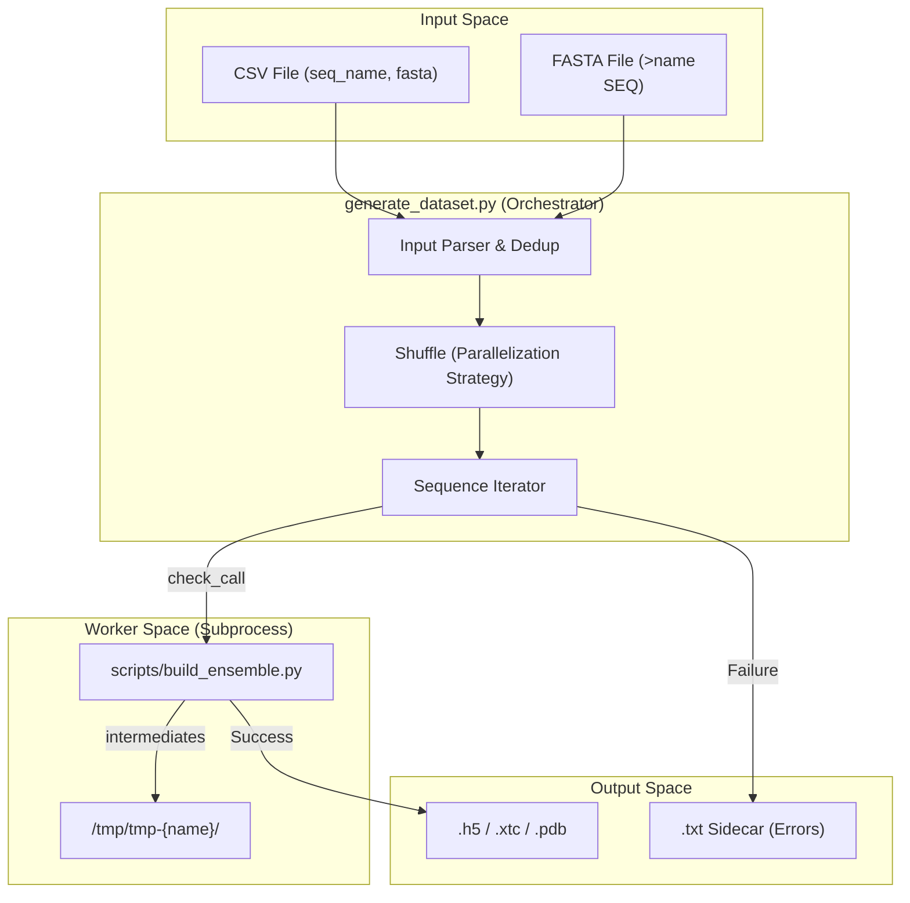
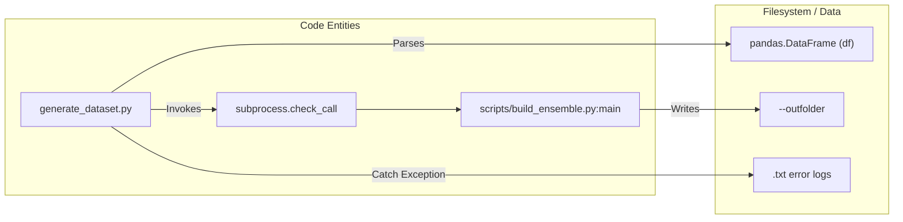

# Batch Dataset Generator: generate_dataset.py

Relevant source files

The following files were used as context for generating this wiki page:

- [generate_dataset.py](generate_dataset.py)
- [scripts/build_ensemble.py](scripts/build_ensemble.py)

The `generate_dataset.py` script serves as the high-level batch processing entry point for the IDP-o pipeline. It is designed to consume large-scale sequence datasets (such as the IDRome-o collection) and orchestrate the ensemble generation process for each sequence by delegating to the single-sequence builder. It manages input parsing, duplicate handling, filesystem isolation, and parallelization-friendly execution ordering.

## Purpose and Scope

While `build_ensemble.py` handles the scientific logic of fragment search and assembly for a single protein, `generate_dataset.py` provides the infrastructure for high-throughput production. Its primary responsibilities include:
*   **Input Handling**: Parsing bulk sequence data from CSV or FASTA formats [generate_dataset.py:29-81]().
*   **Data Integrity**: Automatic detection and removal of duplicate sequences or identifiers [generate_dataset.py:84-88]().
*   **Process Isolation**: Creating unique scratch directories per sequence to prevent race conditions [generate_dataset.py:101-111]().
*   **Fault Tolerance**: Capturing subprocess failures into sidecar `.txt` log files to ensure the batch continues even if specific sequences fail [generate_dataset.py:120-124]().

## System Data Flow

The following diagram illustrates how `generate_dataset.py` transforms raw sequence files into a structured dataset of structural ensembles.

### Data Transformation Workflow

**Sources:** [generate_dataset.py:24-59](), [generate_dataset.py:97-124]()

---

## Implementation Details

### Input Parsing and Configuration
The script supports two primary input formats:
1.  **FASTA**: Standard format where headers (prefixed with `>`) are treated as sequence IDs and the following line as the amino acid sequence [generate_dataset.py:68-76]().
2.  **CSV**: A delimited file where column names for the identifier and the sequence can be configured via the `--column_names` argument (defaulting to `seq_name,fasta`) [generate_dataset.py:45-49](), [generate_dataset.py:77-79]().

### Parallelization Strategy: The Shuffle Mechanism
The script includes a `--shuffle` flag [generate_dataset.py:50-50](). When enabled, the internal DataFrame of sequences is randomized before processing [generate_dataset.py:94-96](). 

This is a critical feature for distributed computing: multiple instances of `generate_dataset.py` can be pointed at the same input file and output directory. Because the order is randomized and the script checks for existing output files (or skips them unless `--overwrite` is set), multiple workers can effectively "graze" the dataset without explicit MPI coordination, significantly increasing throughput on GPU clusters.

### Subprocess Delegation
Rather than importing `build_ensemble.py` as a module, `generate_dataset.py` invokes it via `subprocess.check_call` [generate_dataset.py:118](). This provides several technical advantages:
*   **Memory Recovery**: JAX and CuPy memory allocations are fully released when the subprocess exits, preventing GPU memory fragmentation over long batch runs.
*   **Environment Isolation**: Each sequence run starts with a clean state.
*   **Error Sidecars**: If a subprocess fails, the traceback is captured and written to a `.txt` file with the same base name as the intended output ensemble [generate_dataset.py:121-124](). This allows researchers to easily identify and debug "difficult" sequences (e.g., those with no fragment hits) after the batch completes.

### Sequence Processing Logic
For every row in the input, the script performs the following steps:
1.  **Path Resolution**: Determines the final output path based on the provided `--format` (h5, xtc, pdb, pdb.gz, or dcd) [generate_dataset.py:52-57](), [generate_dataset.py:100]().
2.  **Scratch Isolation**: Defines a unique directory in `/tmp` using the sequence name to store `byte_starts.pkl` and intermediate fragment HDF5 files [generate_dataset.py:101-102]().
3.  **Execution**: Constructs and executes the CLI command for `build_ensemble.py` [generate_dataset.py:103-114]().

**Sources:** [generate_dataset.py:97-125](), [scripts/build_ensemble.py:25-80]()

---

## Code Entity Map

The following diagrams map the high-level batch operations to the specific code entities and filesystem artifacts they interact with.

### Batch Execution Entity Mapping

**Sources:** [generate_dataset.py:75](), [generate_dataset.py:105](), [generate_dataset.py:118](), [generate_dataset.py:123]()

### Per-Sequence Execution Flow
| Step | Code Reference | Description |
| :--- | :--- | :--- |
| **Dedup** | [generate_dataset.py:84-88]() | Removes duplicate sequences and names from the input `df`. |
| **Shuffle** | [generate_dataset.py:94-96]() | Randomizes `df` rows for parallel worker distribution. |
| **Isolation** | [generate_dataset.py:101-102]() | Creates `/tmp/tmp-{name}` for intermediate artifacts. |
| **Delegation** | [generate_dataset.py:103-118]() | Calls `build_ensemble.py` via `check_call`. |
| **Logging** | [generate_dataset.py:120-124]() | Writes `traceback.format_exc()` to sidecar `.txt` on failure. |

**Sources:** [generate_dataset.py:84-124]()

---