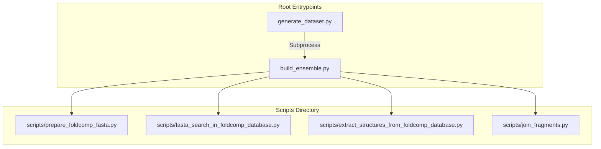
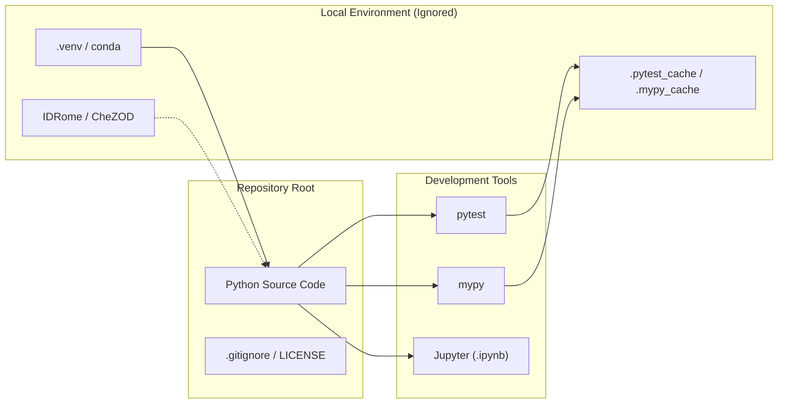

# Development Environment and Repository Layout

Relevant source files

The following files were used as context for generating this wiki page:

- [.gitignore](.gitignore)
- [LICENSE](LICENSE)
- [assets/idp-o.png](assets/idp-o.png)

This page provides a technical overview of the IDP-o repository structure, the configuration of the Python development environment, and the licensing terms governing the codebase. It details how the project integrates various tooling for testing, type checking, and data management.

## Repository Structure

The IDP-o repository is organized to separate core logic, orchestration scripts, and static assets. The root directory contains the primary entrypoints for users, while the `scripts/` directory houses the modular pipeline stages.

### Directory Organization

| Path | Description |
| :--- | :--- |
| `build_ensemble.py` | The primary CLI entrypoint for single-sequence processing. |
| `generate_dataset.py` | Batch processing script for large-scale ensemble generation. |
| `scripts/` | Contains the four core pipeline modules (`prepare_foldcomp_fasta.py`, `fasta_search_in_foldcomp_database.py`, `extract_structures_from_foldcomp_database.py`, `join_fragments.py`). |
| `assets/` | Static project assets, including the project logo `idp-o.png`. |
| `tests/` | (Implicit) Target for `pytest` integration. |
| `.gitignore` | Defines excluded files, including environment folders and large datasets. |

### Data Flow and Code Entity Mapping

The following diagram maps the logical pipeline stages to their corresponding script entities within the repository.

**Pipeline Entity Mapping**

**Sources:** `build_ensemble.py`, `generate_dataset.py`, `scripts/` directory contents.

---

## Python Environment and Tooling

IDP-o requires a specialized environment due to its heavy reliance on GPU acceleration (CuPy, JAX) and structural biology libraries.

### Environment Management
The repository is configured to support standard Python environment managers. Common environment directories are explicitly ignored by version control to prevent local configuration leaks `[.gitignore:122-130]()`.

*   **Virtual Environments:** Supported via `venv/`, `.venv/`, or `env/` `[.gitignore:124-126]()`.
*   **Conda/Mamba:** Recommended for managing CUDA toolkit dependencies, though not explicitly defined by a `conda.yaml` in the root.
*   **Pipenv/Poetry:** The repository includes configurations to ignore lock files if they are generated locally `[.gitignore:90-102]()`.

### Tooling Integrations
The project integrates with several standard Python quality assurance tools:
*   **pytest:** Unit and integration testing. Cache files are excluded `[.gitignore:51]()`.
*   **mypy:** Static type checking. The `.mypy_cache/` is excluded to maintain a clean workspace `[.gitignore:142]()`.
*   **Jupyter:** Used for prototyping and data analysis. Notebook checkpoints are ignored `[.gitignore:79]()`.
*   **Rope/PyCharm/Spyder:** IDE-specific metadata and project settings are filtered out to ensure cross-IDE compatibility `[.gitignore:131-160]()`.

**Sources:** `[.gitignore:1-160]()`

---

## Excluded Datasets

To maintain repository performance and adhere to data storage best practices, large-scale biological datasets and intermediate results are excluded from Git tracking. Developers must ensure these datasets are provisioned in the local environment as described in the **Getting Started** guide.

| Dataset / Pattern | Description |
| :--- | :--- |
| `IDR-30` | Redundant IDR dataset used for benchmarking `[.gitignore:168]()`. |
| `CheZOD*` | Chemical shift-based disorder datasets `[.gitignore:170]()`. |
| `IDRome` | The full IDRome structural ensemble collection `[.gitignore:172]()`. |
| `trizod/2024-05-09/` | Specific versioned snapshots of disorder data `[.gitignore:171]()`. |
| `old-IDRs` | Legacy IDR data files `[.gitignore:169]()`. |

**Sources:** `[.gitignore:167-172]()`

---

## License Terms

IDP-o is released under the **Apache License, Version 2.0**. This license is a permissive free software license written by the Apache Software Foundation (ASF).

### Key Provisions
*   **Grant of Copyright License:** Contributors grant a perpetual, worldwide, non-exclusive, no-charge, royalty-free, irrevocable copyright license to reproduce, prepare derivative works of, and distribute the Work `[LICENSE:66-71]()`.
*   **Grant of Patent License:** Contributors grant a patent license for any patent claims necessarily infringed by their contributions `[LICENSE:73-81]()`.
*   **Redistribution:** You may reproduce and distribute copies of the Work or Derivative Works in any medium, provided you give recipients a copy of the license and retain all copyright, patent, and trademark notices `[LICENSE:89-104]()`.
*   **Trademarks:** The license does not grant permission to use the trade names, trademarks, service marks, or product names of the Licensor (Peptone Ltd) `[LICENSE:130-131]()` (implied by standard Apache 2.0 terms).

**Sources:** `[LICENSE:1-131]()`

---

## Infrastructure Summary

The following diagram illustrates the relationship between the repository layout and the development tools.

**Environment and Tooling Interaction**

**Sources:** `[.gitignore:1-172]()`, `[LICENSE:1-131]()`

---