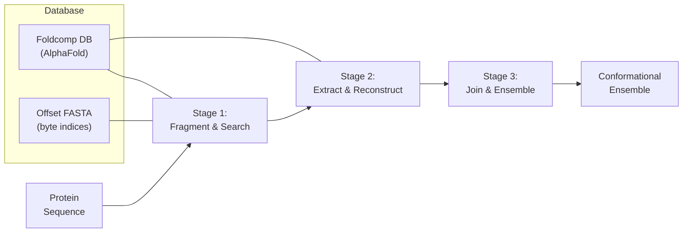

**IDP-o** is a fragment-based ensemble generator for Intrinsically Disordered Proteins (IDPs). Given a protein sequence, it produces a **conformational ensemble** — a collection of physically plausible 3D structures — by decomposing the sequence into overlapping fragments, searching for structural homologs in the AlphaFold database, reconstructing their 3D coordinates, and hierarchically stitching them together. Each resulting structure has hydrogens inferred, making it ready for downstream computational biophysics tasks such as NMR chemical shift prediction or molecular dynamics initialization.


Sources: [README.md](/README.md#L1-L15)

## What Problem Does IDP-o Solve?

Intrinsically disordered proteins (IDPs) do not adopt a single stable fold. Instead, they interconvert among a vast ensemble of conformations in solution. Traditional structure prediction tools (AlphaFold, RoseTTAFold) return a single static structure — a point estimate that fundamentally misrepresents the disordered state. IDP-o addresses this by generating **many structures** that collectively sample the conformational landscape, producing output that captures the structural heterogeneity essential for biophysical analysis of IDPs.

Sources: [README.md](/README.md#L1-L15)

## Core Pipeline at a Glance

IDP-o's pipeline is orchestrated by `build_ensemble.py`, which sequentially invokes three stages. Each stage is a dedicated script that handles one transformation in the sequence-to-ensemble workflow:



| Stage | Script | Input | Output | Accelerator |
|-------|--------|-------|--------|-------------|
| **1. Fragment & Search** | `fasta_search_in_foldcomp_database.py` | Protein sequence | Pickled hit dictionary (byte offsets + residue indices) | GPU (CuPy) |
| **2. Extract & Reconstruct** | `extract_structures_from_foldcomp_database.py` | Hit dictionary | Per-fragment `.h5` trajectory files | CPU (JAX JIT) |
| **3. Join & Ensemble** | `join_fragments.py` | Fragment `.h5` files | Final ensemble file (`.h5`, `.xtc`, `.pdb`, etc.) | GPU (JAX vmap) |

Sources: [scripts/build_ensemble.py](/scripts/build_ensemble.py#L22-L54), [scripts/fasta_search_in_foldcomp_database.py](/scripts/fasta_search_in_foldcomp_database.py#L1-L194), [scripts/extract_structures_from_foldcomp_database.py](/scripts/extract_structures_from_foldcomp_database.py#L1-L326), [scripts/join_fragments.py](/scripts/join_fragments.py#L1-L348)

## Fragmentation Strategy

IDP-o cuts a protein sequence into **6-residue fragments** with an **overlap of 2 residues** between consecutive fragments. The overlap region provides the structural anchor used during fragment joining — the two shared residues are aligned via affine (Kabsch) superposition to determine the relative placement of adjacent fragments. The final fragment may be shorter than 6 residues, depending on the total sequence length.

For a sequence of length *L*, the number of fragments is approximately ⌈(*L* − 6) / (6 − 2)⌉ + 1 = ⌈(*L* − 6) / 4⌉ + 1. This sliding-window fragmentation ensures every residue is covered by at least one fragment while keeping fragments short enough to have abundant structural homologs in the database.

Sources: [scripts/fasta_search_in_foldcomp_database.py](/scripts/fasta_search_in_foldcomp_database.py#L117-L126), [README.md](/README.md#L7-L8)

## Structural Database: Foldcomp + AlphaFold

IDP-o relies on the **Foldcomp** compressed representation of the AlphaFold database (`afdb_uniprot_v4`, ~1.1 TB). Foldcomp stores backbone dihedral angles (φ, ψ, ω), bond angles, and sidechain conformations in a discretized binary format rather than full Cartesian coordinates. This compression is critical: it allows IDP-o to perform exhaustive substring search across the entire AlphaFold database (covering the UniProt proteome) and then reconstruct only the relevant 3D structures on demand using JAX-compiled coordinate reconstruction functions.

A specially formatted FASTA file is required, where each header contains the **byte offset** of the corresponding entry in the Foldcomp database file rather than a sequence identifier. The `prepare_foldcomp_fasta.py` script automates the download and creation of this file.

Sources: [scripts/prepare_foldcomp_fasta.py](/scripts/prepare_foldcomp_fasta.py#L1-L150), [scripts/extract_structures_from_foldcomp_database.py](/scripts/extract_structures_from_foldcomp_database.py#L60-L110), [README.md](/README.md#L20-L28)

## Project Structure

```
IDP-o/
├── Dockerfile                          # NVIDIA JAX GPU container definition
├── LICENSE                             # Apache 2.0
├── README.md                           # Repository readme with usage examples
├── assets/
│   └── idp-o.png                       # Pipeline workflow diagram
├── generate_dataset.py                 # Batch wrapper: CSV/FASTA → many ensembles
└── scripts/
    ├── build_ensemble.py               # Pipeline orchestrator (entrypoint)
    ├── fasta_search_in_foldcomp_database.py   # Stage 1: GPU substring search
    ├── extract_structures_from_foldcomp_database.py  # Stage 2: Structure reconstruction
    ├── join_fragments.py               # Stage 3: Hierarchical fragment joining
    └── prepare_foldcomp_fasta.py       # Database setup: download + offset FASTA
```

Sources: [Dockerfile](/Dockerfile#L1-L9), [generate_dataset.py](/generate_dataset.py#L1-L126), [scripts/build_ensemble.py](/scripts/build_ensemble.py#L1-L167)

## Technology Stack

| Layer | Technology | Role in IDP-o |
|-------|-----------|---------------|
| **GPU Compute** | JAX (NVIDIA container) | Vectorized fragment joining (`vmap`), JIT-compiled reconstruction |
| **GPU Search** | CuPy | Parallelized substring matching across the Foldcomp FASTA |
| **Coordinate Engine** | nerfax (Peptone) | Internal-coordinate → Cartesian reconstruction, sidechain placement, hydrogen inference |
| **Structure I/O** | MDTraj | Trajectory loading/saving in multiple formats (HDF5, XTC, PDB, DCD) |
| **Database** | Foldcomp | Compressed AlphaFold DB access, binary angle decoding |
| **Hashing** | hirola | Fast amino-acid lookup table for sequence encoding |
| **Deployment** | Docker (NVIDIA JAX 24.10) | Reproducible GPU runtime environment |

Sources: [Dockerfile](/Dockerfile#L1-L9), [scripts/fasta_search_in_foldcomp_database.py](/scripts/fasta_search_in_foldcomp_database.py#L19-L20), [scripts/join_fragments.py](/scripts/join_fragments.py#L14-L20), [scripts/extract_structures_from_foldcomp_database.py](/scripts/extract_structures_from_foldcomp_database.py#L19-L29)

## Key Outputs

IDP-o generates a **conformational ensemble** saved in any of the following formats, selectable via the `--format` flag:

| Format | Extension | Best For |
|--------|-----------|----------|
| HDF5 | `.h5` | Compact, fast random access, native MDTraj |
| XTC | `.xtc` | GROMACS-compatible, compressed trajectory |
| PDB | `.pdb` | Human-readable, visualization tools |
| Compressed PDB | `.pdb.gz` | Storage-efficient PDB |
| DCD | `.dcd` | CHARMM/NAMD-compatible trajectory |

Each ensemble contains `--max_structures_in_ensemble` structures (default: 100), with hydrogens inferred automatically via MDTraj's standard residue templates, making the output immediately usable for downstream NMR or MD applications.

Sources: [scripts/join_fragments.py](/scripts/join_fragments.py#L299-L330), [generate_dataset.py](/generate_dataset.py#L44-L49), [README.md](/README.md#L35-L46)

> [!TIP]
> When running in Docker, the `--gpus 1` flag is required — the GPU-accelerated sequence search (Stage 1) and JAX-vectorized fragment joining (Stage 3) both depend on CUDA. Ensure your host has NVIDIA drivers and the container toolkit installed.

## Where to Go Next

Now that you understand what IDP-o does and how its pipeline is structured, follow this reading path to go deeper:

1. **[Quick Start](2-quick-start)** — Run your first ensemble generation end-to-end
2. **[Foldcomp Database Setup](3-foldcomp-database-setup)** — Download and prepare the ~1.1 TB structural database
3. **[Architecture Overview](4-architecture-overview)** — Detailed data flow and inter-module relationships
4. **[Fragment Generation Strategy](5-fragment-generation-strategy)** — How overlap fragmentation works and why 6 residues
5. **[GPU-Accelerated Sequence Search](6-gpu-accelerated-sequence-search)** — CuPy-based substring matching internals
6. **[Hierarchical Fragment Joining](8-hierarchical-fragment-joining)** — The power-of-two joining algorithm and clash detection
7. **[Batch Dataset Generation](11-batch-dataset-generation)** — Scale up to thousands of sequences with `generate_dataset.py`
