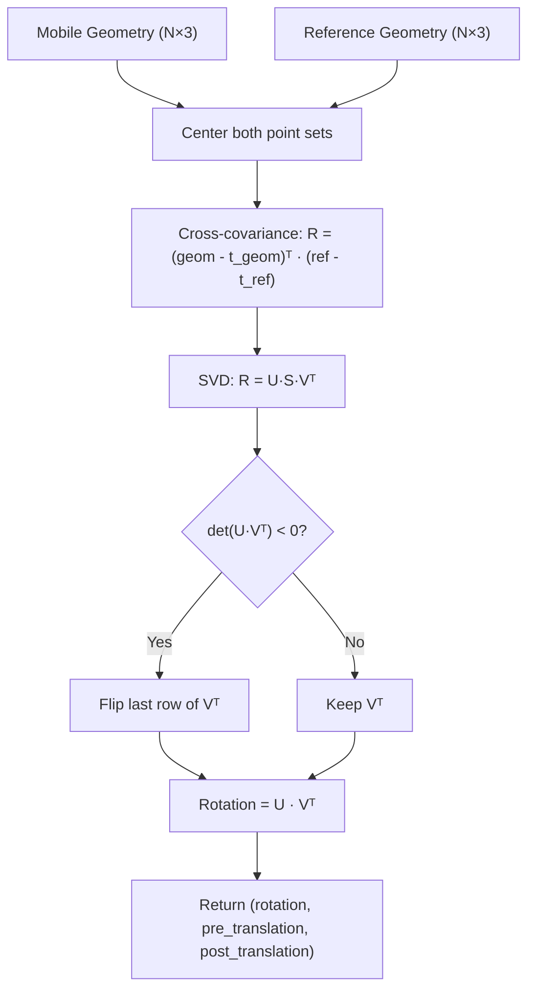
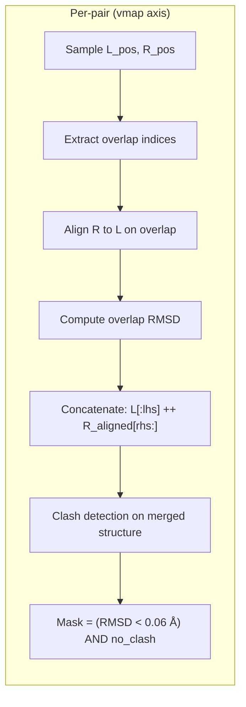
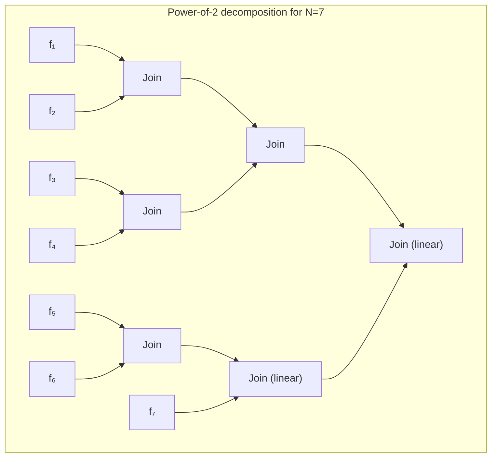

IDP-o leverages JAX's functional array programming model—specifically `vmap`, `jit`, and `jax.lax.scan`—to transform what would otherwise be an O(N²) serial fragment-joining loop into a **GPU-accelerated, batch-vectorized ensemble construction pipeline**. The core computational kernel aligns, validates, and filters thousands of candidate fragment joins per pairing in a single compiled XLA graph, eliminating Python-level loop overhead and achieving throughput on the order of hundreds of thousands of join attempts per second. This page dissects the three JAX kernels that power the ensemble builder: the **SVD alignment kernel**, the **vectorized clash-detection kernel**, and the **memory-adaptive chunked vmap scheduler**.

Sources: [join_fragments.py](/scripts/join_fragments.py#L1-L348), [extract_structures_from_foldcomp_database.py](/scripts/extract_structures_from_foldcomp_database.py#L1-L326)

## GPU Memory Reservation and Runtime Configuration

Before any JAX computation begins, the runtime is configured to reserve **96% of available GPU memory** for the XLA compiler via the `XLA_PYTHON_CLIENT_MEM_FRACTION` environment variable. This aggressive allocation ensures that the large batch tensors produced during vectorized joining—particularly the N×N distance matrices in clash detection—can be resident in GPU memory without triggering on-demand allocation stalls. The Docker image builds on `nvcr.io/nvidia/jax:24.10-py3`, which ships the JAX/XLA runtime with CUDA 12 support and the `nerfax` library for internal-coordinate reconstruction and hydrogen inference.

```python
os.environ["XLA_PYTHON_CLIENT_MEM_FRACTION"] = ".96"
```

After the hierarchical ensemble build completes, the main entry point performs an explicit cleanup of live XLA buffers to release GPU memory before writing the final trajectory to disk:

```python
backend = jax.lib.xla_bridge.get_backend()
for buf in backend.live_buffers():
    buf.delete()
```

Sources: [join_fragments.py](/scripts/join_fragments.py#L22-L22), [join_fragments.py](/scripts/join_fragments.py#L289-L292)

## The SVD Alignment Kernel

The alignment kernel implements the **Kabsch algorithm** in pure `jnp` operations, making it fully differentiable and `vmap`-compatible. Given a mobile geometry and a reference geometry (both as N×3 coordinate arrays), the kernel computes the optimal rigid-body rotation that minimizes RMSD between the two point sets.



The implementation uses `jnp.linalg.svd` with `full_matrices=False` for the thin decomposition, then applies a **reflection correction**: if the determinant of U·Vᵀ is negative, the last row of Vᵀ is negated to ensure a proper rotation (det = +1) rather than an improper reflection. This correction is implemented as a `jnp.where` conditional, which remains traceable under `jit` compilation.

The `align` function then applies the affine transformation to the full mobile structure (not just the overlap residues) using `jnp.einsum("ij,bj", rot, mobile_pos - pre_trans) + post_trans`, where the Einstein summation convention efficiently expresses the batch rotation application.

| Component | JAX Operation | Shape | Purpose |
|-----------|--------------|-------|---------|
| Cross-covariance | `jnp.dot((geom - t).T, (ref - t))` | (3, 3) | Optimal rotation target |
| Thin SVD | `jnp.linalg.svd(R, full_matrices=False)` | U,S,Vᵀ each (3,3) | Decompose rotation |
| Reflection fix | `jnp.where(det < 0, Vt.at[-1].multiply(-1), Vt)` | (3, 3) | Ensure proper rotation |
| Batch rotation | `jnp.einsum("ij,bj", rot, pos)` | (N, 3) | Apply to all atoms |

Sources: [join_fragments.py](/scripts/join_fragments.py#L38-L57)

## Vectorized Clash Detection

The `check_interactions` function computes a full pairwise distance matrix and identifies steric clashes—atoms closer than a configurable cutoff distance (default 0.1 nm = 1.0 Å) that are not connected by a covalent bond. This is the most memory-intensive operation in the join pipeline because it materializes an N×N distance matrix.

```python
distances = jnp.sqrt(((xyz[:, None] - xyz[None, :]) ** 2).sum(-1))
mask = distances < cutoff
mask = mask.at[tuple(bonds.T)].set(False)   # exclude bonded pairs
mask = jnp.triu(mask, k=1)                   # upper triangle only (j > i)
```

The broadcasting `xyz[:, None] - xyz[None, :]` creates the pairwise difference tensor without an explicit Python loop. Bonded atom pairs are explicitly excluded by indexing into the mask with the bond table transposed as a tuple of index arrays. The `jnp.triu` with `k=1` ensures each violation is counted exactly once. The resulting boolean mask is then reduced with `.any()` in the join kernel to produce a single `no_clash_mask` per candidate join.

> [!TIP]
> The N×N distance matrix is the primary memory bottleneck. The `batch_size` function in `join_fragments` dynamically computes the chunk size as `target_GB / (1e-5 × nres²)`, where `target_GB = 10` GB. For a 100-residue protein, this yields a chunk size of ~100, keeping peak memory within the 96% GPU reservation.

Sources: [join_fragments.py](/scripts/join_fragments.py#L60-L69)

## The Vectorized Join Kernel: `_join_fragments`

The `_join_fragments` function is the **inner computational loop** of the ensemble builder. It receives pairs of randomly sampled left and right fragment conformations and, for each pair, performs overlap alignment, RMSD computation, clash checking, and produces a merged coordinate array—all within a single `vmap`-decorated function.



The key architectural insight is that `vmap` is applied **only over the batch dimension** of the sampled conformations, while the overlap indices (`l_indices`, `r_indices`) are broadcast as `None` in `in_axes`. This means the SVD alignment and clash detection are compiled once for a specific overlap pattern and reused across all N candidates in the batch:

```python
pos, no_clash_mask, rmsds = vmap(align_and_validate, in_axes=(0, 0, None, None))(
    rpos, lpos, r_indices, l_indices
)
mask = (rmsds < 0.06) & no_clash_mask   # 0.6 Å overlap RMSD threshold
```

The **acceptance mask** combines two criteria: the overlap RMSD must be below 0.06 nm (0.6 Å), and the merged structure must have no steric clashes. This dual filter ensures both geometric consistency at the join seam and physical plausibility of the full conformation.

Sources: [join_fragments.py](/scripts/join_fragments.py#L96-L123)

## Memory-Adaptive Chunked vmap: `jit_chunked_vmap`

Direct `vmap` over hundreds of thousands of candidates would exceed GPU memory for the N×N distance matrices. The `jit_chunked_vmap` scheduler solves this by **splitting the batch into memory-safe chunks** and iterating over them using `jax.lax.scan`, which maintains a fixed memory footprint per iteration.

```python
def jit_chunked_vmap(f, args, chunk_size):
    lengths = jax.tree.flatten(jax.tree.map(lambda x: jnp.shape(x)[0], args))[0]
    assert len(set(lengths)) == 1

    def _body(_, args):
        return (None, f(*args))

    _, outputs = jax.lax.scan(
        _body,
        init=None,
        xs=jax.tree.map(lambda x: x.reshape((-1, chunk_size) + x.shape[1:]), args),
    )
    return jax.tree.map(lambda x: x.reshape((-1,) + x.shape[2:]), outputs)
```

The function operates in three phases: **(1)** reshape all input pytrees from `(N, ...)` to `(N/chunk_size, chunk_size, ...)`, **(2)** scan over the leading dimension applying `f` to each chunk (where `f` itself contains the `vmap` over the chunk's batch dimension), and **(3)** reshape the output back to `(N, ...)`. Because `jax.lax.scan` reuses the same XLA buffer across iterations, peak memory is bounded by the cost of a single chunk rather than the full batch.

| Parameter | Formula | Example (100 residues) |
|-----------|---------|----------------------|
| Target memory | 10 GB | 10 GB |
| Chunk size | `10 / (1e-5 × nres²)` | 100 |
| Total attempts | Rounded up to multiple of chunk_size | 500,000 → 500,000 |
| Peak memory per chunk | O(chunk_size × nres²) | ~10 GB |

Sources: [join_fragments.py](/scripts/join_fragments.py#L132-L144), [join_fragments.py](/scripts/join_fragments.py#L150-L152)

## Probabilistic Sampling and Join Orchestration

The `join_fragments` function implements an **importance-weighted stochastic join**. Rather than exhaustively testing all pairs of left and right conformations (which would be O(M²) where M is the number of conformations per fragment), it samples indices from each fragment's conformation pool using `jax.random.choice` with per-structure probability weights:

```python
random_indices = tuple(
    random.choice(key, jnp.arange(len(pos)), shape=(n,), p=probs)
    for key, pos, probs in ((lkey, lpos, lprobs), (rkey, rpos, rprobs))
)
```

The probability weights (`probs`) are computed by the `get_probs` function, which assigns **inverse-frequency weights** based on how many times each structure's source indices appear in the pool. This deduplicates overrepresented conformations that arise from multiple fragment sources mapping to the same Foldcomp entry:

```python
def get_probs(x):
    _, indices, counts = jnp.unique(x, return_counts=True, return_inverse=True, size=x.shape[0])
    probs = (1 / counts)[indices]
    return probs
```

When joining two fragments, the output probabilities are the **element-wise product** of the left and right probability arrays, computed via `jax.tree.map(jnp.multiply, *map(get_probs, sources))`. This multiplicative combination reflects the independence assumption between fragment conformation selections.

If no joins pass the acceptance mask after sampling, the function **retries up to 5 times** with new random keys, issuing a warning on each attempt. After 5 failures, it falls back to selecting a single random structure, ensuring the pipeline always produces output rather than crashing.

Sources: [join_fragments.py](/scripts/join_fragments.py#L147-L192), [join_fragments.py](/scripts/join_fragments.py#L126-L129)

## Hierarchical Ensemble Assembly: `build_ensemble`

The `build_ensemble` function orchestrates the **tree-reduction pattern** for combining N fragments into a single ensemble. Rather than joining fragments linearly (which would accumulate alignment errors), it decomposes N into a sum of powers of two and performs pairwise joins in a hierarchical tree:



The decomposition uses `np.unpackbits` on a 32-bit unsigned integer representation of the fragment count to extract the binary representation, then `2 ** np.arange(16)[::-1]` masked by the bit array to yield the power-of-two segments. For N=7, this produces segments [4, 2, 1], which are joined in order: first the 4-fragment block (two levels of pairwise joining), then the 2-fragment block (one level), then the 1-fragment singleton.

After all power-of-two subsets are independently assembled, they are **linearly combined** in a final sequential pass. This hybrid strategy minimizes the depth of the join tree (reducing error propagation) while handling arbitrary fragment counts without padding.

**Memory management** is integrated into the hierarchy: after each level of joining completes (i.e., when `i > 1`), the intermediate fragment data from two levels prior is explicitly deleted from the `data` dictionary using `jax.tree.map` to call `.delete()` on any `jax.Array` objects, freeing GPU memory for the next level of joins.

Sources: [join_fragments.py](/scripts/join_fragments.py#L195-L249)

## JAX in Structure Reconstruction (CPU Mode)

While the join pipeline runs on GPU, the structure reconstruction stage in `extract_structures_from_foldcomp_database.py` explicitly forces **CPU execution** via `os.environ["JAX_PLATFORMS"] = "cpu"`. This separation exists because the reconstruction kernel (`reconstruct_from_internal_coordinates_pure_sequential`) is inherently sequential—each residue's position depends on the preceding residue's computed coordinates—and does not benefit from GPU parallelism for individual structures.

Instead, JAX's `vmap` is applied **across the batch dimension** to reconstruct multiple structures in parallel:

```python
def build_parallel_reconstruct_fn(sequence):
    return build_reconstruct_fn(sequence, reconstruct_fn=vmap(reconstruct, in_axes=(0, 0, None, 0)))
```

The `in_axes=(0, 0, None, 0)` specification vectorizes over the discretizer parameters, angle/torsion arrays, and sidechain angles, while keeping the amino acid sequence (axis `None`) constant—since all structures in a fragment ensemble share the same sequence. The `@jit` decorator on the inner function, combined with `jax.ensure_compile_time_eval()`, locks the amino acid indices as compile-time constants, enabling the XLA compiler to unroll sidechain reconstruction logic specific to that sequence. This specialization can yield **~2000× speedup** compared to the non-specialized path.

Sources: [extract_structures_from_foldcomp_database.py](/scripts/extract_structures_from_foldcomp_database.py#L17-L17), [extract_structures_from_foldcomp_database.py](/scripts/extract_structures_from_foldcomp_database.py#L189-L206)

## JAX Pattern Summary

The following table consolidates all JAX patterns used across the ensemble computation pipeline, their locations, and their specific roles:

| JAX Pattern | Location | Role | Hardware |
|-------------|----------|------|----------|
| `vmap` (batch alignment) | `join_fragments.py#L121` | Vectorize alignment+validation over N candidate pairs | GPU |
| `vmap` (batch reconstruction) | `extract_structures...py#L206` | Vectorize structure reconstruction over M structures | CPU |
| `jax.lax.scan` (chunked vmap) | `join_fragments.py#L139` | Memory-bounded iteration over chunked batches | GPU |
| `jnp.linalg.svd` | `join_fragments.py#L43` | Kabsch alignment rotation | GPU |
| `jnp.einsum` | `join_fragments.py#L56` | Batch rotation application | GPU |
| `random.choice` | `join_fragments.py#L166` | Importance-weighted stochastic sampling | GPU |
| `jax.tree.map` | `join_fragments.py#L222,L231` | Pytree manipulation for probability weights and cleanup | GPU |
| `@jit` + `ensure_compile_time_eval` | `extract_structures...py#L192-L199` | Compile-time sequence specialization | CPU |
| `jnp.where` (reflection fix) | `join_fragments.py#L44-L48` | Traceable conditional for proper rotation | GPU |

> [!TIP]
> The dual-hardware strategy (GPU for joins, CPU for reconstruction) is not accidental. The join kernel's N×N distance matrix and batch SVD decompositions are highly parallelizable and benefit enormously from GPU throughput. The reconstruction kernel's sequential dependency chain (residue i+1 depends on residue i) makes it latency-bound on GPU but bandwidth-efficient on CPU, where XLA's CPU backend avoids PCIe transfer overhead for the ~1 GB Foldcomp database reads.

Sources: [join_fragments.py](/scripts/join_fragments.py#L28-L33), [join_fragments.py](/scripts/join_fragments.py#L38-L72), [extract_structures_from_foldcomp_database.py](/scripts/extract_structures_from_foldcomp_database.py#L28-L29)

## Computational Complexity and Scaling

The computational cost of the ensemble build is dominated by the clash detection step within each chunked vmap iteration. For a single join attempt on a structure with `nres` residues:

- **Alignment**: O(nres) — SVD on a 3×3 matrix is constant; einsum is O(nres)
- **Distance matrix**: O(nres²) — pairwise broadcasting creates nres×nres×3 tensor
- **Clash mask**: O(nres²) — comparison + bond exclusion + triu

For `N` total join attempts with chunk size `C`, the total cost is O(N/C × C × nres²) = O(N × nres²). The chunk size `C = 10 / (1e-5 × nres²)` is chosen precisely so that each chunk's O(C × nres²) memory footprint fits within ~10 GB, making the algorithm **memory-scalable**: larger proteins automatically reduce the chunk size to stay within the GPU memory budget.

| Residues | Chunk Size | Memory per Chunk | Attempts | Total Cost |
|----------|-----------|-----------------|----------|------------|
| 50 | 400 | ~10 GB | 500K | O(500K × 2500) |
| 100 | 100 | ~10 GB | 500K | O(500K × 10000) |
| 200 | 25 | ~10 GB | 500K | O(500K × 40000) |
| 500 | 4 | ~10 GB | 500K | O(500K × 250000) |

Sources: [join_fragments.py](/scripts/join_fragments.py#L150-L152), [join_fragments.py](/scripts/join_fragments.py#L60-L69)

## Relationship to Adjacent Pipeline Stages

The JAX vectorized ensemble computation sits at the convergence point of two upstream data flows and feeds one downstream consumer. The [Overlap Alignment and Clash Detection](9-overlap-alignment-and-clash-detection) page covers the mathematical foundations of the SVD alignment and distance-based clash criteria that this JAX kernel implements. The [Structure Reconstruction from Foldcomp](7-structure-reconstruction-from-foldcomp) page describes the CPU-side `vmap`-batched reconstruction that produces the fragment coordinate pools consumed by the join kernel. The [Hierarchical Fragment Joining](8-hierarchical-fragment-joining) page explains the tree-reduction strategy that orchestrates when and how the JAX kernel is invoked across the fragment hierarchy.

For the complete pipeline configuration options that control the JAX kernel's behavior (chunk sizes, attempt counts, ensemble sizes), see [Command-Line Configuration Reference](13-command-line-configuration-reference).