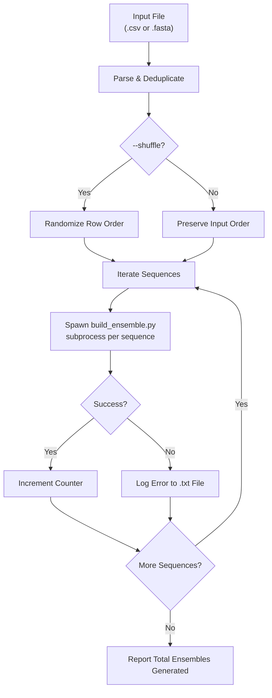
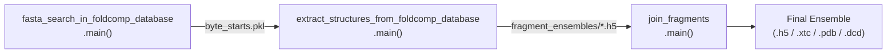

IDP-o's batch dataset generation system transforms a collection of protein sequences—provided as either a CSV or FASTA file—into a complete dataset of structural ensembles. The orchestrator script `generate_dataset.py` iterates over every sequence in the input, dispatching each one to the full three-stage pipeline (GPU-accelerated search → structure reconstruction → fragment joining) via a subprocess call to `build_ensemble.py`. This design separates **batch-level concerns** (input parsing, deduplication, parallelization, error resilience) from **sequence-level concerns** (the actual ensemble computation), enabling scalable dataset generation across thousands of intrinsically disordered proteins.

Sources: [generate_dataset.py](/generate_dataset.py#L1-L126), [scripts/build_ensemble.py](/scripts/build_ensemble.py#L1-L167)

## Batch Orchestrator Architecture

The batch system is driven entirely by `generate_dataset.py`, which acts as a lightweight coordinator. It does not import the pipeline stages directly—instead, it invokes `build_ensemble.py` as a subprocess via `subprocess.check_call`. This architectural choice provides **process isolation**: a crash or GPU memory leak in one ensemble computation cannot corrupt the state of the orchestrator or subsequent sequences.



The orchestrator reads the input file, deduplicates rows, optionally shuffles the processing order, then loops through each sequence dispatching it to `build_ensemble.py`. On failure, it captures the full traceback and writes it to a companion `.txt` file alongside the expected output path, allowing the batch to continue uninterrupted.

Sources: [generate_dataset.py](/generate_dataset.py#L67-L125)

## Input Format Handling

The batch generator accepts two input formats, each with specific column-mapping semantics controlled by the `--column_names` flag:

| Format | Detection Rule | Parsing Method | Required Columns |
|--------|---------------|----------------|-----------------|
| **FASTA** (`.fasta`) | Filename ends with `.fasta` | Line-by-line: header stripped of `>` prefix → sequence on next line | Implicit: `>name` then `sequence` |
| **CSV** (`.csv`) | Filename ends with `.csv` | `pandas.read_csv` with `usecols` for selective loading | Configurable via `--column_names` |

The `--column_names` parameter defaults to `seq_name,fasta` and is split on the comma to identify the sequence identifier column and the amino acid sequence column. For FASTA files, these column names are assigned to the internally constructed DataFrame. For CSV files, only the two specified columns are loaded into memory, minimizing I/O for wide tables.

**Deduplication** is performed on both columns independently. If duplicate sequence names or duplicate FASTA strings are detected, a warning is logged and duplicates are dropped with `pandas.drop_duplicates`, retaining only the first occurrence.

Sources: [generate_dataset.py](/generate_dataset.py#L67-L87)

## Subprocess Dispatch and Error Resilience

For each sequence row, the orchestrator constructs a command list that invokes `build_ensemble.py` with the following arguments:

| Argument | Value Source | Description |
|----------|-------------|-------------|
| `--sequence` | `row[fasta]` | The amino acid sequence string |
| `--outpath` | `{outfolder}/{seq_name}.{format}` | Output file path derived from sequence name and format |
| `--scratch_folder` | `/tmp/tmp-{seq_name}` | Isolated scratch directory per sequence |
| `--max_structures_in_ensemble` | CLI argument `--max_structures_in_ensemble` | Frames to retain in final ensemble |
| `--overwrite` | CLI flag | Passed through if specified |

> [!TIP]
> Each sequence receives an **isolated scratch directory** under `/tmp/tmp-{seq_name}`. This prevents intermediate files (fragment ensembles, byte-start pickles) from colliding when running multiple batch processes concurrently against the same input file.

When a subprocess fails, the exception is caught, the full traceback is formatted, and both the command that was attempted and the error are written to `{seq_name}.txt` in the output folder. The batch then proceeds to the next sequence. This **fail-open** strategy ensures that a single problematic sequence (e.g., one with non-standard amino acids) does not halt dataset generation for the remaining entries.

Sources: [generate_dataset.py](/generate_dataset.py#L97-L125)

## Shuffle-Based Parallelization

The `--shuffle` flag randomizes the processing order of sequences using `pandas.sample(frac=1)`. This is not merely cosmetic—it is the **primary mechanism for distributed parallelization**. Since each sequence is processed independently (no shared mutable state between iterations), multiple workers can independently run `generate_dataset.py` against the **same input file** with `--shuffle` enabled. By statistical expectation, each worker will process a different random subset first, naturally distributing the workload without any central coordinator or queue system.

In practice, you would partition work by launching N containers or processes, each reading the same input file with `--shuffle`. The `--overwrite` flag should be omitted so that completed ensembles (whose output files already exist) are skipped by `build_ensemble.py`, providing implicit **idempotent checkpointing**.

Sources: [generate_dataset.py](/generate_dataset.py#L94-L96), [scripts/build_ensemble.py](/scripts/build_ensemble.py#L40-L45)

## Per-Sequence Pipeline Integration

Each subprocess invocation triggers the full three-stage pipeline inside `build_ensemble.py`, which chains the three core scripts as module-level function calls:



| Stage | Script | Input | Output | Key Parameters Passed |
|-------|--------|-------|--------|----------------------|
| **1. Search** | `fasta_search_in_foldcomp_database` | Sequence, foldcomp FASTA | `byte_starts.pkl` | `sequence`, `foldcomp_fasta`, `reduction_factor` |
| **2. Reconstruct** | `extract_structures_from_foldcomp_database` | Foldcomp DB, byte starts | Fragment `.h5` files | `foldcomp_fasta`, `foldcomp_db`, `n_max_structures_per_fragment`, `exclude_cis_omega` |
| **3. Join** | `join_fragments` | Fragment `.h5` files | Final ensemble | `joins_to_attempt_per_pairing`, `max_structures_in_ensemble`, `rmsd_sort` |

The batch orchestrator only exposes `--max_structures_in_ensemble` and `--overwrite` to the subprocess; all other pipeline parameters (`foldcomp_fasta`, `foldcomp_db`, `reduction_factor`, `n_max_structures_per_fragment`, `joins_to_attempt_per_pairing`, `exclude_cis_omega`, `rmsd_sort`) fall back to their defaults inside `build_ensemble.py`. This keeps the batch interface simple while relying on sensible per-sequence defaults.

Sources: [scripts/build_ensemble.py](/scripts/build_ensemble.py#L60-L80), [scripts/build_ensemble.py](/scripts/build_ensemble.py#L91-L142)

## Output File Organization

The batch generator writes one ensemble file per input sequence into the specified `--outfolder` directory. The naming convention is `{sequence_name}.{format}`, where the format extension is determined by the `--format` flag:

| Format | Extension | Trajectory Topology File | Notes |
|--------|-----------|--------------------------|-------|
| **HDF5** | `.h5` | Embedded | Native MDTraj format; most efficient for I/O |
| **XTC** | `.xtc` | Companion `.pdb` | GROMACS compressed format; `.pdb` written for first frame |
| **DCD** | `.dcd` | Companion `.pdb` | CHARMM format; `.pdb` written for first frame |
| **PDB** | `.pdb` | N/A | Single-frame; only last conformation retained |
| **PDB.GZ** | `.pdb.gz` | N/A | Gzip-compressed PDB |

> [!TIP]
> For trajectory formats (`.xtc`, `.dcd`), `join_fragments.py` automatically writes a companion `.pdb` file containing the topology from the first frame. This is required because these binary formats store only coordinates—the `.pdb` provides the atom names, residue information, and bond connectivity needed by downstream tools.

Failed sequences produce a `.txt` error log instead of a structure file, making it straightforward to identify and retry failed entries.

Sources: [generate_dataset.py](/generate_dataset.py#L100-L124), [scripts/join_fragments.py](/scripts/join_fragments.py#L317-L319)

## Safety Guard and Dry-Run Mode

When `--max_structures_in_ensemble` is omitted or set to `0` (the default), the orchestrator loads and deduplicates the input file but **does not spawn any subprocesses**. Instead, it logs a warning: `"set '--max_structures_in_ensemble' to actually generate the ensembles"`. This serves as a **safety guard** against accidental full-dataset runs (which could take hours or days) and doubles as a **dry-run/validation mode**—you can confirm that your input file parses correctly and check the deduplication warnings before committing to the full computation.

Sources: [generate_dataset.py](/generate_dataset.py#L91-L93)

## CLI Reference Summary

The following table summarizes all arguments accepted by `generate_dataset.py`:

| Argument | Short | Type | Default | Required | Description |
|----------|-------|------|---------|----------|-------------|
| `--input` | `-i` | `str` | — | **Yes** | Path to input CSV or FASTA file |
| `--outfolder` | `-o` | `str` | `./ensembles` | No | Output directory for ensemble files |
| `--max_structures_in_ensemble` | `-n` | `int` | `0` | No | Frames per ensemble; `0` = dry run |
| `--fragments_overlap` | — | `int` | `1` | No | Overlapping residues between fragments |
| `--column_names` | — | `str` | `seq_name,fasta` | No | Column names in CSV (comma-separated) |
| `--shuffle` | — | flag | `False` | No | Randomize processing order for parallelization |
| `--format` | — | `str` | `xtc` | No | Output format: `h5`, `xtc`, `pdb`, `pdb.gz`, `dcd` |
| `--overwrite` | — | flag | `False` | No | Overwrite existing ensemble files |

Sources: [generate_dataset.py](/generate_dataset.py#L24-L59)

## Typical Usage Patterns

**Single-machine batch generation** from a CSV file with 500 sequences:

```bash
docker run -v $(pwd):/data --gpus 1 idp-o \
  python /IDP-o/generate_dataset.py \
    --input /data/sequences.csv \
    --outfolder /data/ensembles \
    --max_structures_in_ensemble 100 \
    --format h5
```

**Distributed parallelization** across 4 GPUs on separate machines, all reading the same input:

```bash
# On each machine (runs 1-4):
docker run -v $(pwd):/data --gpus 1 idp-o \
  python /IDP-o/generate_dataset.py \
    --input /data/sequences.csv \
    --outfolder /data/ensembles \
    --max_structures_in_ensemble 100 \
    --shuffle \
    --format xtc
```

Each worker independently shuffles and processes sequences; already-completed ensembles are skipped due to the absence of `--overwrite`, providing natural work-stealing behavior.

**Validation dry run** to check input parsing before a long batch:

```bash
python generate_dataset.py \
  --input sequences.fasta \
  --outfolder ./ensembles
# Leaves -n at default 0 → logs count and duplicates, no computation
```

Sources: [generate_dataset.py](/generate_dataset.py#L23-L59)

## Next Steps

- For the per-sequence pipeline that each batch invocation triggers, see [Architecture Overview](4-architecture-overview) and the individual pipeline stage pages: [GPU-Accelerated Sequence Search](6-gpu-accelerated-sequence-search), [Structure Reconstruction from Foldcomp](7-structure-reconstruction-from-foldcomp), and [Hierarchical Fragment Joining](8-hierarchical-fragment-joining).
- For details on the output file formats and how to consume them in downstream analyses, see [Output Formats and Downstream Use](12-output-formats-and-downstream-use).
- For the complete set of CLI arguments across all scripts (including per-sequence parameters not exposed by the batch wrapper), see [Command-Line Configuration Reference](13-command-line-configuration-reference).