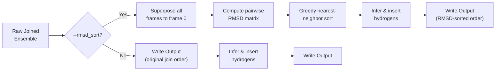

IDP-o produces **structurally complete, multi-frame protein ensembles** — trajectory files where each frame represents one plausible conformation of an intrinsically disordered protein. The output is deliberately designed to be immediately consumable by standard molecular dynamics (MD) analysis toolkits, visualization software, and downstream simulation engines, with no post-processing required. This page details every format IDP-o can emit, the auxiliary files it generates alongside the primary output, and concrete patterns for integrating those outputs into common downstream workflows.

Sources: [generate_dataset.py](/generate_dataset.py#L1-L126), [scripts/build_ensemble.py](/scripts/build_ensemble.py#L1-L167), [scripts/join_fragments.py](/scripts/join_fragments.py#L1-L348)

## Supported Output Formats

IDP-o supports five trajectory formats, selectable via the `--format` flag in `generate_dataset.py` or inferred from the `--outpath` extension in `build_ensemble.py`. All formats are written through **MDTraj's** I/O layer, guaranteeing byte-level compatibility with every tool that reads these standards.

| Format | Extension | Topology Storage | Compression | Best For |
|---|---|---|---|---|
| **HDF5** | `.h5` | Embedded in file | Lossless | Single-file portability, Python-native analysis |
| **XTC** | `.xtc` | Companion `.pdb` | Lossy (GROMACS) | GROMACS pipelines, large trajectories |
| **PDB** | `.pdb` | Embedded per model | None | Visual inspection, small ensembles |
| **Gzipped PDB** | `.pdb.gz` | Embedded per model | gzip | Archival, reduced disk footprint |
| **DCD** | `.dcd` | Companion `.pdb` | None | CHARMM/OpenMM pipelines |

> [!TIP]
> Choose **XTC** for production-scale datasets (hundreds of sequences × hundreds of frames) — its lossy compression achieves ~3× smaller files than DCD while preserving sub-angstrom precision, and GROMACS tools read it natively. Choose **HDF5** when your downstream analysis is entirely Python-based and you want topology + coordinates in a single file with no companion artifacts.

The format is specified at the batch level in `generate_dataset.py` through the `--format` argument, which defaults to `xtc`. Each sequence in the input CSV/FASTA produces one output file named `{sequence_name}.{format}` in the output folder.

Sources: [generate_dataset.py](/generate_dataset.py#L74-L78), [scripts/join_fragments.py](/scripts/join_fragments.py#L321-L326)

## Companion Files and Auxiliary Outputs

### Topology Sidecar for Binary Formats

Binary trajectory formats (`.xtc`, `.dcd`) store only coordinate arrays — they lack the atom names, residue identities, and bonding information needed to interpret the coordinates. IDP-o automatically writes a **companion PDB file** containing the topology from frame 0 whenever these formats are selected:

```python
t.save(outpath)
if outpath.endswith((".xtc", ".dcd")):
    t[0].save(outpath[:-3] + "pdb")
```

This produces a file pair such as `P53_TAD.xtc` + `P53_TAD.pdb`. The companion PDB is a **single-frame file** (frame 0 of the ensemble) that serves as the topology reference for all downstream tools that require separate coordinate + topology inputs.

Sources: [scripts/join_fragments.py](/scripts/join_fragments.py#L324-L326)

### Error Logs on Generation Failure

When batch generation encounters a per-sequence failure, IDP-o does not halt the entire dataset. Instead, it writes a **plain-text error log** named `{sequence_name}.txt` alongside the expected output path, containing both the failed command and the full traceback:

```python
with open(os.path.splitext(outpath)[0] + ".txt", "w") as f:
    f.write(cmd + "\n" + error_msg + "\n")
```

This allows bulk dataset generation to continue past individual failures while preserving full diagnostic information for debugging.

Sources: [generate_dataset.py](/generate_dataset.py#L114-L116)

### Intermediate Scratch Artifacts

During ensemble construction, IDP-o writes two categories of intermediate files to the `--scratch_folder`:

| Artifact | Path Pattern | Purpose | Lifecycle |
|---|---|---|---|
| **Byte-start index** | `scratch_folder/byte_starts.pkl` | Pickled dictionary mapping each fragment to its hit positions in the Foldcomp database | Written by sequence search; consumed by structure extraction |
| **Fragment ensembles** | `scratch_folder/fragment_ensembles/{fragment}.h5` | Per-fragment HDF5 trajectories from Foldcomp reconstruction | Written by structure extraction; consumed by fragment joining |
| **Fragment ensembles (cis-excluded)** | `scratch_folder/fragment_ensembles-exclude_cis_omega/{fragment}.h5` | Same as above, but filtered for trans-ω only | Used when `--exclude_cis_omega` is active |

These intermediates are **not automatically cleaned up** after ensemble generation completes. For large batch runs, you should periodically clear the scratch directory or mount it on fast ephemeral storage.

Sources: [scripts/fasta_search_in_foldcomp_database.py](/scripts/fasta_search_in_foldcomp_database.py#L170-L173), [scripts/extract_structures_from_foldcomp_database.py](/scripts/extract_structures_from_foldcomp_database.py#L300-L305), [scripts/build_ensemble.py](/scripts/build_ensemble.py#L50-L55)

## Ensemble Structure and Completeness

### All-Atom Output with Inferred Hydrogens

The final ensemble returned by the joining pipeline undergoes a critical post-processing step: **hydrogen atom inference and insertion**. The Foldcomp database stores only heavy-atom coordinates (backbone N/CA/C/O and sidechain atoms). Before writing the output file, IDP-o calls:

```python
t = infer_and_insert_hydrogens(t)
```

This function (from the `nerfax` library) reconstructs all hydrogen positions from the heavy-atom geometry using standard bond lengths and angles, producing a **fully all-atom trajectory**. This means the output is immediately suitable for force field evaluations, NMR chemical shift predictors, and any computation that requires hydrogen positions — no external protonation step is needed.

Sources: [scripts/join_fragments.py](/scripts/join_fragments.py#L317-L318)

### Frame Count and Selection

The number of conformations in the final ensemble is controlled by `--max_structures_in_ensemble` (default: 100 in `build_ensemble.py`). This parameter acts as a **hard ceiling** on the number of frames written to disk:

```python
t = md.Trajectory(
    data[seq]["coords"][:max_structures_in_ensemble],
    md.Topology.from_dataframe(build_mdtraj_top(seq)),
)
```

The frames are taken as the first *N* structures produced by the hierarchical joining process. When `--rmsd_sort` is enabled, these frames are **reordered** by greedy nearest-neighbor RMSD before the ceiling is applied, ensuring the selected frames form a smooth conformational path through structure space.

Sources: [scripts/join_fragments.py](/scripts/join_fragments.py#L311-L319)

### Optional RMSD-Based Sorting

The `--rmsd_sort` flag triggers a two-step post-processing pipeline:

1. **Superposition**: All frames are aligned to frame 0 via `trajectory.superpose(trajectory, frame=0)`.
2. **Greedy RMSD ordering**: A nearest-neighbor sort through the RMSD matrix arranges frames so that consecutive frames have minimal structural deviation, producing a visually smooth trajectory when animated.



This sorting is primarily a **visualization aid** — it does not alter the ensemble's statistical properties, only the frame ordering.

Sources: [scripts/join_fragments.py](/scripts/join_fragments.py#L259-L275), [scripts/join_fragments.py](/scripts/join_fragments.py#L315-L319)

## Downstream Integration Patterns

### Loading Ensembles with MDTraj (Python)

Since IDP-o writes standard MDTraj-compatible formats, the simplest loading pattern is:

```python
import mdtraj as md

# HDF5 — topology embedded
ensemble = md.load_hdf5("P53_TAD.h5")

# XTC — topology from companion PDB
ensemble = md.load("P53_TAD.xtc", top="P53_TAD.pdb")

# DCD — topology from companion PDB
ensemble = md.load("P53_TAD.dcd", top="P53_TAD.pdb")

# Multi-model PDB
ensemble = md.load("P53_TAD.pdb")
```

All four calls return an `md.Trajectory` object with `n_frames` equal to `--max_structures_in_ensemble` and `n_atoms` including all inferred hydrogens.

### Computing Ensemble-Averaged Properties

IDP-o ensembles are designed for direct computation of IDP-relevant observables:

```python
# Radius of gyration distribution
rg = md.compute_rg(ensemble)
print(f"Rg: {rg.mean():.2f} ± {rg.std():.2f} Å")

# Per-residue RMSF (requires reference = mean structure)
rmsf = md.rmsf(ensemble, ensemble[0])

# Inter-residue distance distributions
pairs = ensemble.topology.select_pairs("resid 0", "resid 50")
dists = md.compute_distances(ensemble, pairs)
```

### Integration with GROMACS / CHARMM Pipelines

For `.xtc` output, GROMACS tools accept the file pair directly:

```bash
# Compute RMSD against a reference
gmx rms -s ref.tpr -f ensemble.xtc -o rmsd.xvg

# Cluster conformations
gmx cluster -f ensemble.xtc -s topol.tpr -method gromos -c clusters.pdb
```

For `.dcd` output, VMD and CHARMM tools consume the trajectory + PDB topology pair natively.

### NMR Chemical Shift Prediction

Because IDP-o ensembles include all hydrogen positions, they can be fed directly to chemical shift predictors such as **SPARTA+** or **ShiftX2** without any protonation step:

```python
# Export frame as PDB for SPARTA+ input
ensemble[0].save("frame_0.pdb")
# SPARTA+ reads all-atom PDB directly
```

### Batch Dataset Integration

The `generate_dataset.py` wrapper produces one ensemble per input sequence, making the output folder directly usable as a **dataset**. The naming convention `{sequence_name}.{format}` preserves the identifier from the input CSV/FASTA, enabling programmatic cross-referencing between input sequences and their ensembles. Failed sequences produce `.txt` error logs rather than ensemble files, so the presence of the ensemble file itself serves as a success indicator.

Sources: [generate_dataset.py](/generate_dataset.py#L95-L116), [scripts/join_fragments.py](/scripts/join_fragments.py#L306-L326)

## Output Format Comparison: Decision Matrix

The following matrix summarizes trade-offs to guide format selection for specific downstream scenarios:

| Downstream Use Case | Recommended Format | Rationale |
|---|---|---|
| Python-only analysis (MDTraj, PyEMMA) | `.h5` | Single-file, topology embedded, fastest random frame access |
| GROMACS MD refinement | `.xtc` | Native format, lossy compression saves disk, companion PDB auto-generated |
| CHARMM/OpenMM MD refinement | `.dcd` | Native format for these engines, companion PDB auto-generated |
| Visual inspection (PyMOL, ChimeraX) | `.pdb` | Directly openable, multi-model PDB, no companion files needed |
| Long-term archival or transfer | `.pdb.gz` | Smallest standalone file, universally readable after decompression |
| Machine learning datasets | `.h5` | Efficient vectorized reads via h5py, metadata attachable |
| NMR back-calculation | `.h5` or `.xtc` | Hydrogens present; format choice depends on predictor's input API |

> [!TIP]
> When building a large-scale dataset (e.g., thousands of IDP sequences), use `.xtc` for storage efficiency and archive the companion `.pdb` files separately — they are identical for all frames of a given sequence, so you need only one per sequence. For ML training pipelines that iterate over frames repeatedly, `.h5` avoids the overhead of repeated topology parsing.

Sources: [generate_dataset.py](/generate_dataset.py#L74-L78), [scripts/join_fragments.py](/scripts/join_fragments.py#L321-L326)

## What to Read Next

- For the batch generation workflow that produces these outputs at scale, see [Batch Dataset Generation](11-batch-dataset-generation).
- For the full set of CLI flags that control output format, frame count, and sorting behavior, see [Command-Line Configuration Reference](13-command-line-configuration-reference).
- For the hydrogen inference algorithm and structural completeness guarantees, see [JAX Vectorized Ensemble Computation](10-jax-vectorized-ensemble-computation).