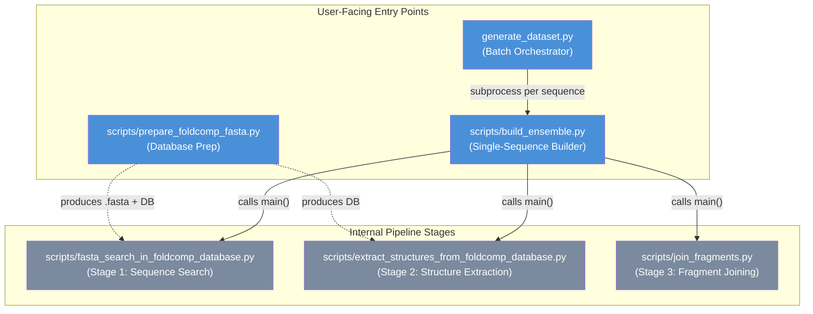

IDP-o exposes **six command-line interfaces** spanning a single batch orchestrator, one core pipeline entry point, three internal pipeline stages, and a database preparation utility. The two primary user-facing entry points are `generate_dataset.py` (batch processing) and `scripts/build_ensemble.py` (single-sequence ensemble construction), while the remaining scripts are invoked internally by the pipeline but can also be run independently for advanced workflows. Every interface uses Python's `argparse` with `ArgumentDefaultsHelpFormatter`, meaning `--help` output always includes default values. This reference documents all flags, their types, defaults, constraints, and inter-script configuration propagation.

Sources: [generate_dataset.py](/generate_dataset.py#L24-L59), [build_ensemble.py](/scripts/build_ensemble.py#L87-L143), [prepare_foldcomp_fasta.py](/scripts/prepare_foldcomp_fasta.py#L121-L128)

## Entry Point Hierarchy

The following diagram clarifies which scripts are directly invoked by the user versus those called internally by the pipeline. When using `generate_dataset.py`, most configuration is mediated through its own flags and propagated to `build_ensemble.py` via subprocess construction — only a subset of `build_ensemble.py` parameters are exposed at the batch level.



The **Docker container** sets `scripts/build_ensemble.py` as its `ENTRYPOINT`, so all Docker invocations pass flags directly to that script. The `PYTHONPATH` is set to `/IDP-o/` to enable internal module imports across the `scripts/` directory.

Sources: [Dockerfile](/Dockerfile#L1-L9), [build_ensemble.py](/scripts/build_ensemble.py#L25-L80)

## `generate_dataset.py` — Batch Orchestrator

This is the top-level script for generating ensembles across an entire dataset (CSV or FASTA). It iterates over input sequences, launching `build_ensemble.py` as a subprocess for each one. The critical design constraint is that **only a subset of `build_ensemble.py` parameters are propagated** from this level — advanced tuning of `--foldcomp_fasta`, `--foldcomp_db`, `--n_max_structures_per_fragment`, `--reduction_factor`, `--joins_to_attempt_per_pairing`, `--exclude_cis_omega`, and `--rmsd_sort` requires invoking `build_ensemble.py` directly.

| Flag | Short | Type | Default | Required | Description |
|------|-------|------|---------|----------|-------------|
| `--input` | `-i` | `str` | — | **Yes** | Input file path (`.csv` or `.fasta`) |
| `--outfolder` | `-o` | `str` | `./ensembles` | No | Output directory for generated ensembles |
| `--max_structures_in_ensemble` | `-n` | `int` | `0` | No | Frames per ensemble; `0` = dry run (no ensembles generated) |
| `--fragments_overlap` | | `int` | `1` | No | Overlapping residues between fragments |
| `--column_names` | | `str` | `seq_name,fasta` | No | Comma-separated column names in the CSV |
| `--shuffle` | | flag | `False` | No | Shuffle processing order (for parallelization) |
| `--format` | | `str` | `xtc` | No | Output format: `h5`, `xtc`, `pdb`, `pdb.gz`, `dcd` |
| `--overwrite` | | flag | `False` | No | Overwrite existing ensemble files |

> [!TIP]
> The `--max_structures_in_ensemble` default of `0` is intentionally a dry-run mode — the script logs a warning and exits without generating anything. You **must** set this to a positive integer to produce output.

**Input format handling**: When `--input` ends with `.fasta`, the parser reads `>`-prefixed headers as sequence names and the following lines as sequences. When it ends with `.csv`, only the columns specified by `--column_names` are loaded. Duplicated sequence names or sequences are dropped with a warning. The output file for each sequence is named `{seq_name}.{format}` within `--outfolder`.

**Subprocess propagation**: For each sequence, the script constructs a command invoking `build_ensemble.py` with `--sequence`, `--outpath`, `--scratch_folder` (set to `/tmp/tmp-{seq_name}`), `--max_structures_in_ensemble`, and conditionally `--overwrite`. No other `build_ensemble.py` parameters are forwarded, meaning the Foldcomp paths, reduction factor, join attempts, and quality filters all use their own defaults.

Sources: [generate_dataset.py](/generate_dataset.py#L67-L125)

## `scripts/build_ensemble.py` — Single-Sequence Ensemble Builder

This is the **core pipeline entry point** and the Docker `ENTRYPOINT`. It orchestrates all three pipeline stages — sequence search, structure extraction, and fragment joining — in sequence. It accepts the richest set of configuration flags and is the script you invoke directly for single-protein work or when you need fine-grained control over every pipeline parameter.

| Flag | Type | Default | Required | Description |
|------|------|---------|----------|-------------|
| `--sequence` | `str` | — | **Yes** | Amino acid sequence (single-letter code) |
| `--foldcomp_fasta` | `str` | `/data/afdb/afdb_uniprot_v4.fasta` | No | Offset-annotated FASTA for the Foldcomp database |
| `--foldcomp_db` | `str` | `/data/afdb/afdb_uniprot_v4` | No | Path to the Foldcomp database file |
| `--n_max_structures_per_fragment` | `int` | `1000` | No | Max structures extracted per fragment |
| `--outpath` | `str` | — | **Yes** | Output path; extension determines format (`.h5`, `.xtc`, `.dcd`, `.pdb`, `.pdb.gz`) |
| `--scratch_folder` | `str` | `/tmp` | No | Directory for intermediate files |
| `--reduction_factor` | `int` | `1` | No | Database search reduction (e.g., `10` = search 1/10th) |
| `--joins_to_attempt_per_pairing` | `int` | `500000` | No | Join attempts per fragment pair |
| `--max_structures_in_ensemble` | `int` | `100` | No | Maximum frames in the final ensemble |
| `--exclude_cis_omega` | flag | `False` | No | Exclude structures with cis-ω backbone angles |
| `--rmsd_sort` | flag | `False` | No | RMSD-sort and superpose frames for visualization |
| `--overwrite` | flag | `False` | No | Overwrite existing output file |

**Sequence validation**: The `main()` function validates that every character in `--sequence` belongs to the standard 20 amino acid alphabet (`ACDEFGHIKLMNPQRSTVWY`). Non-standard residues (including `B`, `Z`, `X`, `*`) raise a `ValueError`.

**Scratch directory structure**: The scratch folder receives two artifacts: a `byte_starts.pkl` file (search results from Stage 1) and a `fragment_ensembles/` subdirectory containing per-fragment `.h5` files from Stage 2. When `--exclude_cis_omega` is active, the fragment directory is suffixed with `-exclude_cis_omega` to avoid collision with unfiltered results.

Sources: [build_ensemble.py](/scripts/build_ensemble.py#L25-L80), [build_ensemble.py](/scripts/build_ensemble.py#L87-L166)

## `scripts/prepare_foldcomp_fasta.py` — Database Preparation Utility

This one-time setup script downloads a Foldcomp database, extracts its FASTA, and rewrites headers to contain byte offsets instead of protein labels — producing the specially formatted `.fasta` file that the search stage requires. It is the only script that does **not** participate in the ensemble generation pipeline itself.

| Flag | Type | Default | Required | Description |
|------|------|---------|----------|-------------|
| `--foldcomp-db` | `str` | `afdb_uniprot_v4` | No | Foldcomp database name (for `foldcomp.setup()`) |
| `--threads` | `int` | `8` | No | Threads for `foldcomp extract` |
| `--workdir` | `str` | `/data/foldcomp_db` | No | Working directory for download and extraction |

**Behavior details**: The script first changes into `--workdir`, then checks if the database file exists locally — if not, it calls `foldcomp.setup()` to download it (the `afdb_uniprot_v4` database is approximately 1.1 TB). It then computes a byte-offset map from the `.index` and `.lookup` sidecar files, extracts the raw FASTA using the `foldcomp` binary (auto-downloading the binary if not found on `PATH`), and finally rewrites the FASTA headers from `>protein_label` to `>byte_offset`.

> [!TIP]
> The `foldcomp` binary is auto-detected via `shutil.which()`, falling back to `./foldcomp` in the current directory, and finally auto-downloaded from `mmseqs.com` for Windows (x64), macOS (universal), and Linux (x86_64 / arm64). Ensure network access if the binary is not pre-installed.

Sources: [prepare_foldcomp_fasta.py](/scripts/prepare_foldcomp_fasta.py#L33-L149)

## `scripts/fasta_search_in_foldcomp_database.py` — Stage 1: Sequence Search

This GPU-accelerated stage searches the offset-annotated FASTA for all instances of each fragment sequence. It is invoked internally by `build_ensemble.py` but can also be run standalone for debugging or pre-computing search results.

| Flag | Type | Default | Required | Description |
|------|------|---------|----------|-------------|
| `--sequence` | `str` | — | **Yes** | Full protein sequence to fragment and search |
| `--foldcomp_fasta` | `str` | `/data/afdb_uniprot_v4.fasta` | No | Offset-annotated FASTA path |
| `--pkl_outpath` | `str` | — | **Yes** | Output `.pkl` path for search hit data |
| `--reduction_factor` | `int` | `1` | No | Proportion reduction (e.g., `10` = search 1/10th of DB) |

**Internal fragment generation**: The `main()` function fragments the input sequence using hardcoded parameters `overlap=2` and `seq_len=6` (producing 6-residue fragments with 2-residue overlap). These are not exposed as CLI flags. The `--reduction_factor` controls how much of the FASTA file is scanned — a value of `N` means only `1/N` of the file (by byte size) is searched, trading recall for speed.

**Output format**: The pickled output is a dictionary mapping each fragment string to a 3-tuple of NumPy arrays: `(hit_idxs, byte_starts, aa_start_index)`, where `byte_starts` are the byte offsets into the Foldcomp database file and `aa_start_index` is the residue index where the match begins within the hit protein.

Sources: [fasta_search_in_foldcomp_database.py](/scripts/fasta_search_in_foldcomp_database.py#L155-L193)

## `scripts/extract_structures_from_foldcomp_database.py` — Stage 2: Structure Extraction

This stage reads the search hits, seeks into the Foldcomp database, reconstructs 3D coordinates from compressed internal coordinate representations using JAX-compiled functions, and writes per-fragment HDF5 trajectory files.

| Flag | Type | Default | Required | Description |
|------|------|---------|----------|-------------|
| `--byte_starts_path` | `str` | `example/byte_starts.pkl` | **Yes** | Pickled search hits from Stage 1 |
| `--foldcomp_fasta` | `str` | `/data/afdb_uniprot_v4.fasta` | No | Offset-annotated FASTA path |
| `--foldcomp_db` | `str` | `/data/afdb_uniprot_v4` | No | Foldcomp database file path |
| `--outfolder` | `str` | — | **Yes** | Output directory for per-fragment `.h5` files |
| `--n_max_structures_per_fragment` | `int` | `1000` | No | Max structures to extract per fragment |
| `--exclude_cis_omega` | flag | `False` | No | Filter out structures with cis-ω angles (|ω| ≤ 90°) |

**Cis-omega filtering**: When `--exclude_cis_omega` is active, the extraction step checks each candidate structure's omega backbone angles. Structures where **all** omega angles satisfy `|ω| > 90°` (i.e., are trans-like) are retained; any structure with at least one cis-like omega is discarded. This is a conservative filter — it requires every omega in the fragment to be trans-like, not just the majority.

**JAX compilation**: The module sets `JAX_PLATFORMS=cpu` at import time, forcing all JAX computation onto CPU even if GPUs are available. This is intentional — Stage 2 is compute-light but memory-intensive, and the GPU is reserved for Stage 1's CuPy-based search.

Sources: [extract_structures_from_foldcomp_database.py](/scripts/extract_structures_from_foldcomp_database.py#L17-L18), [extract_structures_from_foldcomp_database.py](/scripts/extract_structures_from_foldcomp_database.py#L277-L325)

## `scripts/join_fragments.py` — Stage 3: Fragment Joining

This stage loads the per-fragment HDF5 files, performs hierarchical pairwise joining with overlap alignment and clash detection, and writes the final ensemble trajectory.

| Flag | Type | Default | Required | Description |
|------|------|---------|----------|-------------|
| `--sequence` | `str` | — | **Yes** | Full protein sequence |
| `--fragments_folder` | `str` | — | **Yes** | Directory containing per-fragment `.h5` files |
| `--outpath` | `str` | — | **Yes** | Output trajectory path |
| `--joins_to_attempt_per_pairing` | `int` | `500000` | No | Random join attempts per fragment pair |
| `--max_structures_in_ensemble` | `int` | `500000` | No | Maximum frames in the final ensemble |
| `--rmsd_sort` | flag | `False` | No | RMSD-sort and superpose frames |
| `--overwrite` | flag | `False` | No | Overwrite existing output file |

**Note on default divergence**: When invoked standalone, `--max_structures_in_ensemble` defaults to `500000`, but when called from `build_ensemble.py` it receives `100` as the default. This means the standalone default is effectively "keep all valid joins," while the pipeline default is much more selective. Be aware of this discrepancy when running Stage 3 independently.

**XLA memory configuration**: The module sets `XLA_PYTHON_CLIENT_MEM_FRACTION=.96` at import time, reserving 96% of available accelerator memory for JAX compilation. This is critical for the vectorized join operations and cannot be configured via CLI — it must be changed in source if needed.

**RMSD sorting**: When `--rmsd_sort` is active, the final trajectory is superposed to frame 0, then frames are reordered by greedy nearest-neighbor in RMSD space. This produces smoother visualizations but adds significant compute for large ensembles.

Sources: [join_fragments.py](/scripts/join_fragments.py#L22-L23), [join_fragments.py](/scripts/join_fragments.py#L323-L347)

## Environment Variables

The pipeline relies on two environment variables set at import time within the source code. These are **not** exposed as CLI flags and require source modification or Docker `ENV` overrides to change.

| Variable | Set In | Value | Purpose |
|----------|--------|-------|---------|
| `JAX_PLATFORMS` | `extract_structures_from_foldcomp_database.py` | `cpu` | Forces Stage 2 JAX computation onto CPU |
| `XLA_PYTHON_CLIENT_MEM_FRACTION` | `join_fragments.py` | `.96` | Reserves 96% of accelerator memory for Stage 3 |
| `PYTHONPATH` | `Dockerfile` | `/IDP-o/` | Enables cross-module imports in `scripts/` |

Sources: [extract_structures_from_foldcomp_database.py](/scripts/extract_structures_from_foldcomp_database.py#L17), [join_fragments.py](/scripts/join_fragments.py#L22), [Dockerfile](/Dockerfile#L6)

## Output Format Reference

The `--format` flag (in `generate_dataset.py`) and the `--outpath` extension (in `build_ensemble.py` and `join_fragments.py`) determine the output trajectory format. All formats include hydrogen atoms inferred by `nerfax.reduce_utils.reconstruct_from_mdtraj`.

| Format | Extension | Notes |
|--------|-----------|-------|
| HDF5 | `.h5` | MDTraj HDF5; native round-trip; recommended for large ensembles |
| XTC | `.xtc` | Gromacs XTC; companion `.pdb` topology file auto-generated |
| DCD | `.dcd` | CHARMM DCD; companion `.pdb` topology file auto-generated |
| PDB | `.pdb` | One PDB file per frame (multi-model) |
| Compressed PDB | `.pdb.gz` | Gzip-compressed multi-model PDB |

For XTC and DCD formats, `join_fragments.py` automatically saves a single-frame `.pdb` file alongside the trajectory to provide the topology reference required by downstream tools.

Sources: [join_fragments.py](/scripts/join_fragments.py#L318-L319), [generate_dataset.py](/generate_dataset.py#L52-L57)

## Configuration Propagation Map

When using `generate_dataset.py`, the following table shows exactly which `build_ensemble.py` parameters receive values from the orchestrator versus which fall through to their built-in defaults. This is essential for understanding which tuning knobs are available at each invocation level.

| `build_ensemble.py` Parameter | Set by `generate_dataset.py` | Value Source | Default if Not Propagated |
|-------------------------------|------------------------------|--------------|---------------------------|
| `--sequence` | ✅ Yes | Input CSV/FASTA row | — |
| `--outpath` | ✅ Yes | `{outfolder}/{seq_name}.{format}` | — |
| `--scratch_folder` | ✅ Yes | `/tmp/tmp-{seq_name}` | — |
| `--max_structures_in_ensemble` | ✅ Yes | `-n` flag value | — |
| `--overwrite` | ✅ Yes | `--overwrite` flag | — |
| `--foldcomp_fasta` | ❌ No | Built-in default | `/data/afdb/afdb_uniprot_v4.fasta` |
| `--foldcomp_db` | ❌ No | Built-in default | `/data/afdb/afdb_uniprot_v4` |
| `--n_max_structures_per_fragment` | ❌ No | Built-in default | `1000` |
| `--reduction_factor` | ❌ No | Built-in default | `1` |
| `--joins_to_attempt_per_pairing` | ❌ No | Built-in default | `500000` |
| `--exclude_cis_omega` | ❌ No | Built-in default | `False` |
| `--rmsd_sort` | ❌ No | Built-in default | `False` |

The six unpropagated parameters represent the **advanced tuning surface** — to control them, invoke `build_ensemble.py` directly (or via Docker) rather than through the batch orchestrator.

Sources: [generate_dataset.py](/generate_dataset.py#L103-L118), [build_ensemble.py](/scripts/build_ensemble.py#L87-L143)

## Docker Invocation Patterns

The Docker image uses `scripts/build_ensemble.py` as its `ENTRYPOINT`, so all flags after the image name map directly to that script's argument parser. The following patterns cover the most common workflows.

**Single-sequence ensemble generation** (GPU-accelerated search + CPU reconstruction):
```bash
docker run -v $(pwd):/data --gpus 1 \
  idp-o \
    --sequence DLIVERANDSANDRDANDCARLDANDMICHELEANDLDHIEANDFADIDANDSTEFANDANDISTVANANDALDERTANDDLIVERAGAINPLASDTHERS \
    --outpath /data/output/ensemble.xtc \
    --scratch_folder /data/output/scratch \
    --foldcomp_fasta /data/afdb_uniprot_v4.fasta \
    --foldcomp_db /data/afdb_uniprot_v4 \
    --n_max_structures_per_fragment 100 \
    --max_structures_in_ensemble 50
```

**Database preparation** (overrides ENTRYPOINT):
```bash
docker run -v $(pwd):/data --entrypoint python idp-o \
  /IDP-o/scripts/prepare_foldcomp_fasta.py --workdir /data
```

**Batch generation** (overrides ENTRYPOINT):
```bash
docker run -v $(pwd):/data --gpus 1 --entrypoint python idp-o \
  /IDP-o/generate_dataset.py \
    --input /data/sequences.csv \
    --outfolder /data/ensembles \
    --max_structures_in_ensemble 50 \
    --format xtc
```

Sources: [Dockerfile](/Dockerfile#L1-L9), [README.md](/README.md#L44-L52)

## Quick-Reference: All Flags Across All Scripts

For rapid lookup, the following consolidated table lists every CLI flag across all six scripts with its type and default value.

| Script | Flag | Type | Default | Required |
|--------|------|------|---------|----------|
| `generate_dataset.py` | `--input` / `-i` | `str` | — | Yes |
| `generate_dataset.py` | `--outfolder` / `-o` | `str` | `./ensembles` | No |
| `generate_dataset.py` | `--max_structures_in_ensemble` / `-n` | `int` | `0` | No |
| `generate_dataset.py` | `--fragments_overlap` | `int` | `1` | No |
| `generate_dataset.py` | `--column_names` | `str` | `seq_name,fasta` | No |
| `generate_dataset.py` | `--shuffle` | flag | `False` | No |
| `generate_dataset.py` | `--format` | `str` | `xtc` | No |
| `generate_dataset.py` | `--overwrite` | flag | `False` | No |
| `build_ensemble.py` | `--sequence` | `str` | — | Yes |
| `build_ensemble.py` | `--foldcomp_fasta` | `str` | `/data/afdb/afdb_uniprot_v4.fasta` | No |
| `build_ensemble.py` | `--foldcomp_db` | `str` | `/data/afdb/afdb_uniprot_v4` | No |
| `build_ensemble.py` | `--n_max_structures_per_fragment` | `int` | `1000` | No |
| `build_ensemble.py` | `--outpath` | `str` | — | Yes |
| `build_ensemble.py` | `--scratch_folder` | `str` | `/tmp` | No |
| `build_ensemble.py` | `--reduction_factor` | `int` | `1` | No |
| `build_ensemble.py` | `--joins_to_attempt_per_pairing` | `int` | `500000` | No |
| `build_ensemble.py` | `--max_structures_in_ensemble` | `int` | `100` | No |
| `build_ensemble.py` | `--exclude_cis_omega` | flag | `False` | No |
| `build_ensemble.py` | `--rmsd_sort` | flag | `False` | No |
| `build_ensemble.py` | `--overwrite` | flag | `False` | No |
| `prepare_foldcomp_fasta.py` | `--foldcomp-db` | `str` | `afdb_uniprot_v4` | No |
| `prepare_foldcomp_fasta.py` | `--threads` | `int` | `8` | No |
| `prepare_foldcomp_fasta.py` | `--workdir` | `str` | `/data/foldcomp_db` | No |
| `fasta_search_in_foldcomp_database.py` | `--sequence` | `str` | — | Yes |
| `fasta_search_in_foldcomp_database.py` | `--foldcomp_fasta` | `str` | `/data/afdb_uniprot_v4.fasta` | No |
| `fasta_search_in_foldcomp_database.py` | `--pkl_outpath` | `str` | — | Yes |
| `fasta_search_in_foldcomp_database.py` | `--reduction_factor` | `int` | `1` | No |
| `extract_structures_from_foldcomp_database.py` | `--byte_starts_path` | `str` | `example/byte_starts.pkl` | Yes |
| `extract_structures_from_foldcomp_database.py` | `--foldcomp_fasta` | `str` | `/data/afdb_uniprot_v4.fasta` | No |
| `extract_structures_from_foldcomp_database.py` | `--foldcomp_db` | `str` | `/data/afdb_uniprot_v4` | No |
| `extract_structures_from_foldcomp_database.py` | `--outfolder` | `str` | — | Yes |
| `extract_structures_from_foldcomp_database.py` | `--n_max_structures_per_fragment` | `int` | `1000` | No |
| `extract_structures_from_foldcomp_database.py` | `--exclude_cis_omega` | flag | `False` | No |
| `join_fragments.py` | `--sequence` | `str` | — | Yes |
| `join_fragments.py` | `--fragments_folder` | `str` | — | Yes |
| `join_fragments.py` | `--outpath` | `str` | — | Yes |
| `join_fragments.py` | `--joins_to_attempt_per_pairing` | `int` | `500000` | No |
| `join_fragments.py` | `--max_structures_in_ensemble` | `int` | `500000` | No |
| `join_fragments.py` | `--rmsd_sort` | flag | `False` | No |
| `join_fragments.py` | `--overwrite` | flag | `False` | No |

Sources: [generate_dataset.py](/generate_dataset.py#L24-L59), [build_ensemble.py](/scripts/build_ensemble.py#L87-L143), [prepare_foldcomp_fasta.py](/scripts/prepare_foldcomp_fasta.py#L121-L128), [fasta_search_in_foldcomp_database.py](/scripts/fasta_search_in_foldcomp_database.py#L168-L193), [extract_structures_from_foldcomp_database.py](/scripts/extract_structures_from_foldcomp_database.py#L277-L316), [join_fragments.py](/scripts/join_fragments.py#L323-L337)

## Next Steps

For the architectural rationale behind these parameters — particularly why fragment length is fixed at 6, overlap at 2, and how the hierarchical joining strategy determines `--joins_to_attempt_per_pairing` — see [Fragment Generation Strategy](5-fragment-generation-strategy) and [Hierarchical Fragment Joining](8-hierarchical-fragment-joining). For output format details and downstream consumption patterns, see [Output Formats and Downstream Use](12-output-formats-and-downstream-use).