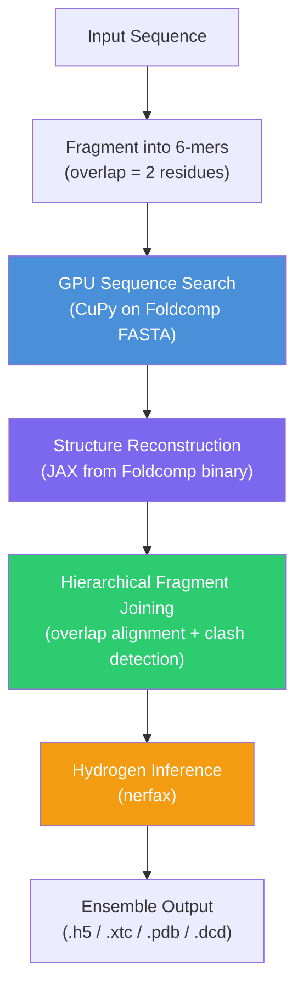

Get IDP-o running end-to-end in four steps: clone, build, prepare the database, and generate your first ensemble. This page walks you through each step with exact commands, explains every parameter you need, and points you toward deeper documentation when you're ready to go further.


## Prerequisites

Before you begin, verify your environment meets these requirements:

| Requirement | Details |
|---|---|
| **Docker** | Docker Engine 20+ with NVIDIA Container Toolkit installed |
| **GPU** | NVIDIA GPU with CUDA 12 support (required for GPU-accelerated sequence search via CuPy) |
| **Disk space** | ~1.1 TB for the `afdb_uniprot_v4` Foldcomp database (downloaded once) |
| **Platform** | Linux x86_64 (Docker image targets `linux/amd64`) |

The Docker image is built on `nvcr.io/nvidia/jax:24.10-py3`, which bundles JAX, CUDA 12, and Python 3 — so you do **not** need to install any Python dependencies on the host.

Sources: [Dockerfile](/Dockerfile#L1-L9), [README.md](/README.md#L1-L76)

## Quick Start Workflow

The four steps below form a linear pipeline from a fresh clone to a ready-to-use ensemble. Step 2 (database preparation) is a one-time cost; subsequent ensemble generations skip it entirely.


Sources: [README.md](/README.md#L16-L52), [scripts/build_ensemble.py](/scripts/build_ensemble.py#L73-L167)

## Step 1 — Clone & Build the Docker Image

Clone the repository and build the container. The `--platform=linux/amd64` flag ensures compatibility even on ARM-based Docker hosts (e.g., Apple Silicon with Rosetta):

```bash
# Clone the repository
git clone https://github.com/PeptoneLtd/IDP-o
cd IDP-o

# Build the Docker image
docker build --platform=linux/amd64 . -t idp-o
```

The build installs six runtime dependencies inside the container: **foldcomp** (database I/O), **tables** (HDF5 support), **cupy-cuda12x** (GPU sequence search), **hirola** (hash table for amino acid lookups), **pynmrstar** (NMR STAR format), **joblib** (parallelization), and **nerfax** (JAX-accelerated coordinate reconstruction). You never install these on the host — Docker handles everything.

Sources: [Dockerfile](/Dockerfile#L1-L9), [README.md](/README.md#L16-L21)

## Step 2 — Prepare the Foldcomp Database

IDP-o searches the **AlphaFoldDB** (distributed via Foldcomp) for structural fragments that match subsequences of your protein. The database ships as a compressed binary file, but IDP-o requires a companion FASTA file where each header encodes the **byte offset** into the Foldcomp database:

```
> {byte_offset_in_foldcomp_db}
{amino_acid_sequence}
```

A convenience script automates both the download and the FASTA generation:

```bash
docker run -v $(pwd):/data --entrypoint python idp-o \
  /IDP-o/scripts/prepare_foldcomp_fasta.py --workdir /data
```

This command performs three operations sequentially: (1) downloads the `afdb_uniprot_v4` Foldcomp database into your working directory (~1.1 TB), (2) extracts the raw FASTA using the Foldcomp binary, and (3) remaps each header to its byte offset in the database file, producing `afdb_uniprot_v4.fasta`. On subsequent runs, the script detects existing files and skips completed steps automatically.

> [!TIP]
> The `--workdir` flag controls where both the database and the FASTA are written. Mount that same directory (`-v $(pwd):/data`) in all future `docker run` calls so IDP-o can find the files.

Sources: [scripts/prepare_foldcomp_fasta.py](/scripts/prepare_foldcomp_fasta.py#L97-L150), [README.md](/README.md#L23-L37)

## Step 3 — Generate Your First Ensemble

With the database in place, generate an ensemble for a single protein sequence. The example below uses a 69-residue intrinsically disordered sequence:

```bash
docker run -v $(pwd):/data --gpus 1 \
  idp-o \
    --sequence DLIVERANDSANDRDANDCARLDANDMICHELEANDLDHIEANDFADIDANDSTEFANDANDISTVANANDALDERTANDDLIVERAGAINPLASDTHERS \
    --outpath /data/example/ensemble.h5 \
    --scratch_folder /data/example/ \
    --foldcomp_fasta /data/afdb_uniprot_v4.fasta \
    --foldcomp_db /data/afdb_uniprot_v4 \
    --n_max_structures_per_fragment 100
```

The `--gpus 1` flag exposes one NVIDIA GPU to the container for the CuPy-accelerated sequence search stage. The `--sequence` argument accepts a string of **standard 20 amino acids only** — non-standard residues cause a `ValueError`.

### Core Parameters

| Parameter | Required | Default | Description |
|---|---|---|---|
| `--sequence` | **Yes** | — | Target protein sequence (standard 20 amino acids) |
| `--outpath` | **Yes** | — | Output file path; extension determines format (`.h5`, `.xtc`, `.dcd`, `.pdb`, `.pdb.gz`) |
| `--scratch_folder` | No | `/tmp` | Directory for intermediate fragment `.h5` files |
| `--foldcomp_fasta` | No | `/data/afdb/afdb_uniprot_v4.fasta` | Offset-encoded FASTA from Step 2 |
| `--foldcomp_db` | No | `/data/afdb/afdb_uniprot_v4` | Path to the Foldcomp database binary |
| `--n_max_structures_per_fragment` | No | `1000` | Max structures to extract per 6-residue fragment from the database |
| `--max_structures_in_ensemble` | No | `100` | Number of structures in the final output ensemble |
| `--reduction_factor` | No | `1` | Proportion of the database to search (e.g., `10` = search 1/10th) |
| `--exclude_cis_omega` | No | `False` | Filter out structures with cis-ω backbone angles |
| `--rmsd_sort` | No | `False` | Sort output frames by RMSD proximity for smoother visualization |
| `--overwrite` | No | `False` | Overwrite an existing output file |

Sources: [scripts/build_ensemble.py](/scripts/build_ensemble.py#L115-L167), [README.md](/README.md#L39-L52)

### What Happens Inside

When you run the command above, three pipeline stages execute sequentially:



1. **Fragment + Search** — The sequence is split into overlapping 6-residue fragments (2-residue overlap). Each fragment is searched against the Foldcomp database using GPU-accelerated substring matching. Hits are recorded as byte offsets for direct database access.
2. **Extract + Reconstruct** — For each fragment, up to `n_max_structures_per_fragment` hits are loaded from the Foldcomp binary. JAX-compiled reconstruction functions decode the compressed internal coordinates (backbone angles, torsions, sidechain angles) into full 3D coordinates with all heavy atoms.
3. **Join + Output** — Fragment ensembles are merged hierarchically (power-of-two grouping) using overlap alignment and clash detection. Surviving structures receive inferred hydrogens and are written to the specified output format.

Sources: [scripts/build_ensemble.py](/scripts/build_ensemble.py#L34-L70), [scripts/fasta_search_in_foldcomp_database.py](/scripts/fasta_search_in_foldcomp_database.py#L37-L136), [scripts/extract_structures_from_foldcomp_database.py](/scripts/extract_structures_from_foldcomp_database.py#L200-L326), [scripts/join_fragments.py](/scripts/join_fragments.py#L286-L334)

## Step 4 — Inspect the Output

The ensemble is saved as a multi-frame trajectory. Here's how to read it with **MDTraj** (already available inside the container):

```python
import mdtraj as md

# Load the ensemble
t = md.load("example/ensemble.h5")

print(f"Frames:   {t.n_frames}")       # number of conformations
print(f"Residues: {t.n_residues}")     # should match input sequence length
print(f"Atoms:    {t.n_atoms}")        # heavy atoms + inferred hydrogens
```

### Supported Output Formats

| Format | Extension | Notes |
|---|---|---|
| HDF5 | `.h5` | Recommended; native MDTraj, fast random access |
| XTC | `.xtc` | GROMACS compressed trajectory; a companion `.pdb` topology file is auto-generated |
| DCD | `.dcd` | CHARMM/NAMD format; a companion `.pdb` topology file is auto-generated |
| PDB | `.pdb` | One multi-model PDB file |
| Compressed PDB | `.pdb.gz` | Gzip-compressed PDB |

Sources: [scripts/join_fragments.py](/scripts/join_fragments.py#L309-L319)

## Batch Dataset Generation

To process many sequences at once, use `generate_dataset.py` with a CSV or FASTA input file. The CSV must contain two columns (configurable via `--column_names`): one for the sequence name and one for the amino acid string.

```bash
docker run -v $(pwd):/data --gpus 1 --entrypoint python idp-o \
  /IDP-o/generate_dataset.py \
    --input /data/sequences.csv \
    --outfolder /data/ensembles/ \
    --max_structures_in_ensemble 100 \
    --format h5
```

### Batch Parameters

| Parameter | Default | Description |
|---|---|---|
| `--input` / `-i` | — | Input CSV or FASTA file (required) |
| `--outfolder` / `-o` | `./ensembles` | Output directory for ensemble files |
| `--max_structures_in_ensemble` / `-n` | `0` (no generation) | Number of frames per ensemble; must be > 0 to trigger generation |
| `--format` | `xtc` | Output format: `h5`, `xtc`, `pdb`, `pdb.gz`, `dcd` |
| `--shuffle` | `False` | Randomize processing order (useful for parallel runs) |
| `--overwrite` | `False` | Overwrite existing ensemble files |

> [!TIP]
> Set `-n` to a positive integer — the default of `0` is a safety guard that logs a warning and skips ensemble generation entirely. This lets you validate your input file before committing to a long compute run.

Sources: [generate_dataset.py](/generate_dataset.py#L24-L126)

## Troubleshooting

| Symptom | Cause | Fix |
|---|---|---|
| `ValueError: Input sequence contains invalid amino acid` | Non-standard residue in `--sequence` | Remove B, Z, X, or other non-standard codes; only the 20 standard amino acids are accepted |
| `ensemble file already exists` | Output path already has a file | Add `--overwrite` to your command |
| `mask is all zero, retrying` | Fragment join found no clash-free alignments | Increase `--n_max_structures_per_fragment` to broaden the fragment candidate pool |
| Docker build fails on ARM | Missing `--platform` flag | Use `docker build --platform=linux/amd64 . -t idp-o` |
| Slow first ensemble | JAX JIT compilation on first run | Subsequent ensembles in the same container reuse compiled kernels; the cold start is one-time |

Sources: [scripts/build_ensemble.py](/scripts/build_ensemble.py#L42-L48), [scripts/join_fragments.py](/scripts/join_fragments.py#L215-L223)

## Where to Go Next

Now that you've generated your first ensemble, explore the architecture and algorithms in depth:

1. **Database setup details** — [Foldcomp Database Setup](3-foldcomp-database-setup) covers advanced configuration, alternative databases, and disk-saving strategies.
2. **How it works** — [Architecture Overview](4-architecture-overview) explains the three-stage pipeline and data flow between scripts.
3. **Fragment strategy** — [Fragment Generation Strategy](5-fragment-generation-strategy) details the 6-mer overlap scheme and its mathematical justification.
4. **Output formats** — [Output Formats and Downstream Use](12-output-formats-and-downstream-use) shows how to feed ensembles into NMR, MD, or ML workflows.
5. **Full CLI reference** — [Command-Line Configuration Reference](13-command-line-configuration-reference) documents every flag with type, default, and effect.