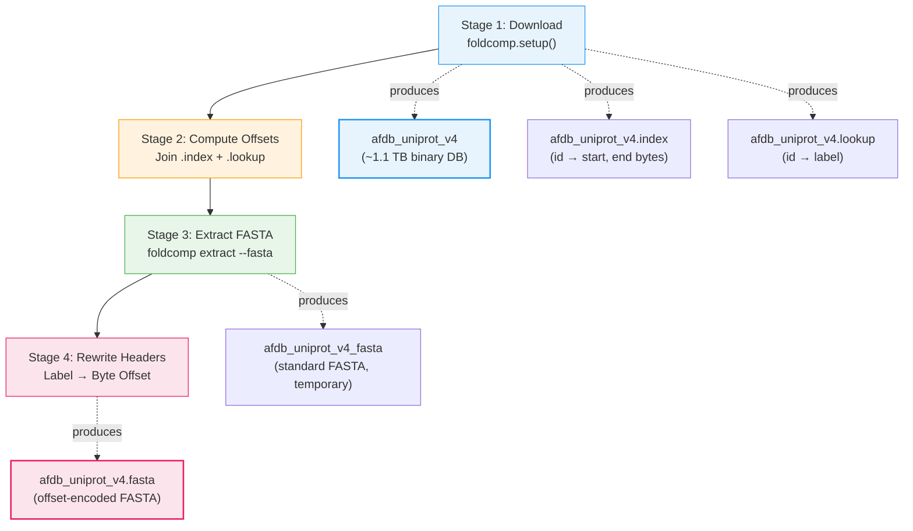

IDP-o relies on the **Foldcomp** compressed structure database — specifically the AlphaFold DB UniProt v4 release (`afdb_uniprot_v4`) — as its source of fragment-level structural templates. However, the database alone is not sufficient. IDP-o requires a **specially formatted FASTA file** where each header contains the byte offset of the corresponding entry in the raw Foldcomp database file. This offset-encoded FASTA is what enables the GPU-accelerated byte-level sequence search that drives the entire pipeline. This page walks through why this custom format exists, what the setup script produces, and how to run it.

Sources: [README.md](/README.md#L26-L42), [prepare_foldcomp_fasta.py](/scripts/prepare_foldcomp_fasta.py#L1-L30)

## Why a Custom FASTA Format?

The standard FASTA format uses descriptive headers (e.g., `>AF-Q9H2S5-F1-model_v4`), which are human-readable but computationally opaque. IDP-o's search engine (`fasta_search_in_foldcomp_database.py`) scans the FASTA file at the **raw byte level** using GPU-accelerated pattern matching via CuPy. When a fragment sequence is found, the engine must immediately know **where in the Foldcomp database binary file** that structure's compressed data resides — without a secondary lookup step. By embedding the byte offset directly in the FASTA header, the search engine can map a sequence hit to a database seek position in a single pass, eliminating an entire join operation from the hot path.

The resulting format looks like this:

```
>677
LPYPAHLEILVQTLRYWIRDVSSL
>14402
MKVILLFVGLSF...
```

Here, `677` means the Foldcomp database entry for `LPYPAHLEILVQTLRYWIRDVSSL` begins at **byte 677** in the `afdb_uniprot_v4` binary file. The downstream structure extractor opens the database file, seeks to that byte position, and reads the compressed backbone and sidechain data directly.

Sources: [fasta_search_in_foldcomp_database.py](/scripts/fasta_search_in_foldcomp_database.py#L40-L63), [extract_structures_from_foldcomp_database.py](/scripts/extract_structures_from_foldcomp_database.py#L83-L103)

## Setup Pipeline Overview

The preparation script `prepare_foldcomp_fasta.py` executes a four-stage pipeline that transforms the raw Foldcomp distribution into the two artifacts IDP-o requires:



Each stage is **idempotent** — the script checks for existing artifacts and skips completed stages, making it safe to re-run after an interruption.

Sources: [prepare_foldcomp_fasta.py](/scripts/prepare_foldcomp_fasta.py#L120-L150)

## Stage Details

### Stage 1 — Database Download

The script calls `foldcomp.setup("afdb_uniprot_v4")`, which downloads the official Foldcomp database from the Foldcomp distribution servers. This produces the core binary database file alongside its companion `.index` and `.lookup` tab-separated files. The download is approximately **1.1 TB** and is the most time-consuming stage. If the database file already exists locally, the download is skipped entirely.

Sources: [prepare_foldcomp_fasta.py](/scripts/prepare_foldcomp_fasta.py#L133-L137)

### Stage 2 — Offset Map Computation

This stage builds the critical mapping from **protein label → byte offset** by joining two Foldcomp auxiliary files:

| File | Columns | Purpose |
|------|---------|---------|
| `afdb_uniprot_v4.index` | `id`, `start`, `end` | Maps internal numeric ID to byte range in the DB binary |
| `afdb_uniprot_v4.lookup` | `id`, `label`, `other` | Maps internal numeric ID to human-readable label (e.g., UniProt accession) |

The join proceeds as: `lookup.join(index)` on the shared `id` column, then re-indexes by `label` and extracts the `start` column into a dictionary. This produces a `dict[str, int]` where each key is a protein label and each value is its byte start position in the database file.

Sources: [prepare_foldcomp_fasta.py](/scripts/prepare_foldcomp_fasta.py#L33-L49)

### Stage 3 — FASTA Extraction

The script invokes the **foldcomp CLI binary** with the `extract --fasta` subcommand to decompress all sequences from the database into a standard FASTA file (`afdb_uniprot_v4_fasta`). If the `foldcomp` binary is not found on `PATH` or in the current directory, the script **automatically downloads** the appropriate platform binary:

| Platform | Architecture | Download URL Pattern |
|----------|-------------|---------------------|
| Linux | x86_64 | `foldcomp-linux-x86_64.tar.gz` |
| Linux | arm64 | `foldcomp-linux-arm64.tar.gz` |
| macOS | universal | `foldcomp-macos-universal.tar.gz` |
| Windows | x64 | `foldcomp-windows-x64.zip` |

The extracted FASTA uses standard headers (protein labels), which is the input for Stage 4's rewriting step. If the `_fasta` file already exists, extraction is skipped.

Sources: [prepare_foldcomp_fasta.py](/scripts/prepare_foldcomp_fasta.py#L52-L103)

### Stage 4 — Header Rewriting

The final stage reads the standard FASTA from Stage 3 line-by-line and rewrites it to the output file (`afdb_uniprot_v4.fasta`). For each header line, the protein label is looked up in the offset map from Stage 2, and the label is replaced with its corresponding byte offset. Sequence lines are passed through unchanged. The result is the offset-encoded FASTA that IDP-o's search engine consumes.

Sources: [prepare_foldcomp_fasta.py](/scripts/prepare_foldcomp_fasta.py#L106-L117)

## Running the Setup

### Quick Command

The recommended approach uses the IDP-o Docker image, which already includes the `foldcomp` Python package and all dependencies:

```bash
docker run -v $(pwd):/data \
  --entrypoint python idp-o \
  /IDP-o/scripts/prepare_foldcomp_fasta.py \
  --workdir /data
```

This downloads the database into the current working directory and produces both required artifacts.

Sources: [README.md](/README.md#L34-L42)

### CLI Parameters

| Parameter | Default | Description |
|-----------|---------|-------------|
| `--foldcomp-db` | `afdb_uniprot_v4` | Name of the Foldcomp database to download and process |
| `--threads` | `8` | Number of threads for the `foldcomp extract` operation |
| `--workdir` | `/data/foldcomp_db` | Working directory for all downloaded and generated files |

Sources: [prepare_foldcomp_fasta.py](/scripts/prepare_foldcomp_fasta.py#L120-L128)

### Custom Database Names

If you have a different Foldcomp database (e.g., a custom subset), specify its name via `--foldcomp-db`. The script expects `foldcomp.setup()` to be able to download it, and the resulting files will follow the naming pattern `{db_name}` and `{db_name}.fasta`.

### Disk Space and Time Estimates

| Stage | Disk Space | Typical Duration |
|-------|-----------|-----------------|
| Database download | ~1.1 TB | Hours (network-dependent) |
| Offset map computation | ~negligible (in-memory) | Minutes |
| FASTA extraction | ~tens of GB (temporary) | Tens of minutes |
| Header rewriting | ~tens of GB (output FASTA) | Minutes |
| **Total** | **~1.1 TB+** | **Hours** |

The temporary `_fasta` file from Stage 3 occupies the same order of magnitude as the final `.fasta` output. You may safely delete `afdb_uniprot_v4_fasta` after the script completes — only the binary database (`afdb_uniprot_v4`) and the offset-encoded FASTA (`afdb_uniprot_v4.fasta`) are required at runtime.

> [!TIP]
> Plan for at least **1.5 TB** of free disk space to accommodate the database, intermediate, and output files simultaneously. The script's idempotent design means you can safely interrupt and resume — completed stages are detected and skipped on re-run.

Sources: [prepare_foldcomp_fasta.py](/scripts/prepare_foldcomp_fasta.py#L133-L149), [README.md](/README.md#L34-L42)

## Output Artifacts and Their Downstream Use

After setup completes, two files are consumed by the IDP-o pipeline:

| Artifact | Consumer | Purpose |
|----------|----------|---------|
| `afdb_uniprot_v4` (binary DB) | `extract_structures_from_foldcomp_database.py` | Source of compressed backbone/sidechain coordinates; entries are accessed by byte-offset seek |
| `afdb_uniprot_v4.fasta` (offset FASTA) | `fasta_search_in_foldcomp_database.py` | GPU-accelerated byte-level search surface; headers encode byte offsets for direct DB seeks |

When invoking the ensemble builder, both paths must be provided:

```bash
docker run -v $(pwd):/data --gpus 1 idp-o \
  --sequence YOUR_SEQUENCE \
  --outpath /data/output/ensemble.h5 \
  --scratch_folder /data/output/ \
  --foldcomp_fasta /data/afdb_uniprot_v4.fasta \
  --foldcomp_db /data/afdb_uniprot_v4 \
  --n_max_structures_per_fragment 100
```

Sources: [build_ensemble.py](/scripts/build_ensemble.py#L91-L108), [README.md](/README.md#L44-L54)

## Verifying Your Setup

You can confirm the setup succeeded by checking for the two required artifacts and inspect the offset encoding:

```bash
# Verify both files exist
ls -lh afdb_uniprot_v4 afdb_uniprot_v4.fasta

# Inspect first few entries of the offset-encoded FASTA
head -4 afdb_uniprot_v4.fasta
```

Expected output should show numeric headers followed by amino acid sequences — **not** protein names or accessions:

```
>0
MEN...
>577
MKL...
```

If headers contain alphabetic identifiers (e.g., `>AF-Q9H2S5-F1`), Stage 4 did not complete correctly. Re-run the script — it will skip Stages 1–3 and only re-execute the header rewriting.

Sources: [prepare_foldcomp_fasta.py](/scripts/prepare_foldcomp_fasta.py#L106-L117)

## Next Steps

With the Foldcomp database and offset-encoded FASTA in place, you're ready to run the IDP-o pipeline. The next page provides a bird's-eye view of the architecture, while subsequent deep dives cover each pipeline stage in detail:

- **[Architecture Overview](4-architecture-overview)** — understand how the database artifacts flow through the three-stage pipeline
- **[GPU-Accelerated Sequence Search](6-gpu-accelerated-sequence-search)** — how the offset-encoded FASTA enables byte-level fragment matching
- **[Structure Reconstruction from Foldcomp](7-structure-reconstruction-from-foldcomp)** — how byte offsets are used to decompress and reconstruct 3D coordinates