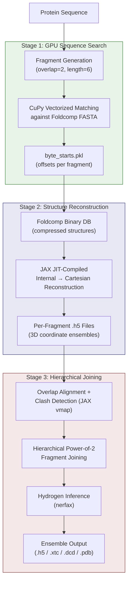
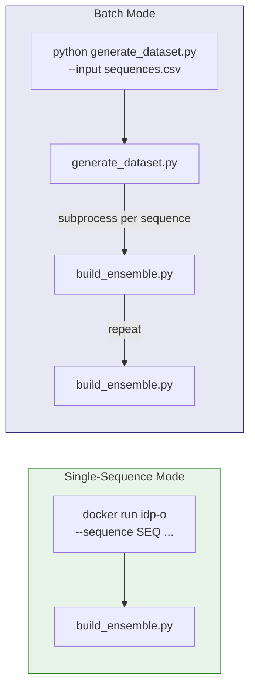

IDP-o is a **fragment-based ensemble generator** for intrinsically disordered proteins (IDPs). Its architecture follows a deterministic three-stage pipeline — **Search → Reconstruct → Join** — that transforms a single amino acid sequence into a diverse ensemble of 3D structural configurations, complete with inferred hydrogens. The system is engineered around two key performance principles: GPU-accelerated subsequence matching via CuPy, and JAX-compiled vectorized coordinate reconstruction and fragment joining. This page maps the complete architectural topology: entry points, data flow, stage responsibilities, and the technology stack that binds them together.


Sources: [README.md](/README.md#L1-L11), [Dockerfile](/Dockerfile#L1-L9)

## Project Structure

The repository is compact by design — a single orchestrator script, three pipeline stage modules, one batch wrapper, and one database preparation utility. All pipeline logic lives under `scripts/`, with `generate_dataset.py` serving as a thin batch driver at the repository root.

```
IDP-o/
├── Dockerfile                          # NVIDIA JAX base image, entrypoint → build_ensemble.py
├── generate_dataset.py                 # Batch wrapper: iterates CSV/FASTA → calls build_ensemble.py
├── scripts/
│   ├── build_ensemble.py               # Pipeline orchestrator (entry point)
│   ├── fasta_search_in_foldcomp_database.py   # Stage 1: GPU-accelerated sequence search
│   ├── extract_structures_from_foldcomp_database.py  # Stage 2: JAX structure reconstruction
│   ├── join_fragments.py               # Stage 3: hierarchical fragment joining
│   └── prepare_foldcomp_fasta.py       # Pre-processing: builds offset-annotated FASTA
└── assets/
    └── idp-o.png                       # Workflow diagram
```

Sources: [Dockerfile](/Dockerfile#L1-L9), [generate_dataset.py](/generate_dataset.py#L1-L20), [scripts/build_ensemble.py](/scripts/build_ensemble.py#L15-L23)

## Pipeline Architecture

The core pipeline is orchestrated by `build_ensemble.py`, which executes three stages in strict sequential order. Each stage produces a well-defined intermediate artifact consumed by the next stage. The pipeline is stateless between runs — all intermediates are written to a scratch folder and the final ensemble is written to the specified output path.



The orchestrator's `main()` function encodes this exact call sequence: it first validates the input sequence against standard amino acids, then invokes each stage module's `main()` in order — `fasta_search_in_foldcomp_database.main()`, `extract_structures_from_foldcomp_database.main()`, and `join_fragments.main()` — passing the outputs of each stage as inputs to the next.

Sources: [scripts/build_ensemble.py](/scripts/build_ensemble.py#L25-L80)

## Stage Responsibilities

Each pipeline stage has a sharply defined contract. The table below summarizes the input/output contract and the dominant computational technology for each stage.

| Stage | Module | Input | Output | Core Technology | Computational Character |
|-------|--------|-------|--------|-----------------|----------------------|
| **1. Sequence Search** | `fasta_search_in_foldcomp_database` | Protein sequence + foldcomp FASTA | `byte_starts.pkl` (hit offsets per fragment) | **CuPy** (GPU) | Embarrassingly parallel substring matching across ~1.1 TB FASTA |
| **2. Structure Reconstruction** | `extract_structures_from_foldcomp_database` | Hit offsets + foldcomp binary DB | Per-fragment `.h5` files (3D ensembles) | **JAX** `jit` + `vmap` | JIT-compiled internal→Cartesian coordinate reconstruction |
| **3. Fragment Joining** | `join_fragments` | Per-fragment `.h5` ensembles + sequence | Final ensemble file (h5/xtc/dcd/pdb) | **JAX** `vmap` + `lax.scan` | Vectorized alignment, clash detection, hierarchical reduction |

Sources: [scripts/fasta_search_in_foldcomp_database.py](/scripts/fasta_search_in_foldcomp_database.py#L40-L144), [scripts/extract_structures_from_foldcomp_database.py](/scripts/extract_structures_from_foldcomp_database.py#L240-L268), [scripts/join_fragments.py](/scripts/join_fragments.py#L195-L249)

## Data Flow and Intermediate Artifacts

Understanding the data contracts between stages is essential for debugging and for potential integration with external tools. The pipeline produces two intermediate artifacts on disk:

**Fragment generation** is the first operation, performed inside `fasta_search_in_foldcomp_database.main()`. Given a protein sequence, it generates overlapping 6-residue fragments with a 2-residue overlap using the `generate_fragments()` function. For a sequence of length *L*, this produces approximately ⌈(*L* − 6) / (6 − 2)⌉ + 1 fragments. The final fragment may be shorter than 6 residues depending on sequence length.

**Stage 1 → Stage 2 contract**: The pickle file `byte_starts.pkl` contains a dictionary keyed by fragment sequence string, where each value is a 3-tuple of NumPy arrays — `(hit_idxs, byte_starts, aa_start_index)`. These three arrays jointly specify: the byte position of each hit in the FASTA file, the byte offset of the corresponding entry in the foldcomp binary database, and the residue index within that database entry where the fragment match begins.

**Stage 2 → Stage 3 contract**: Each fragment's structural ensemble is written as an mdtraj HDF5 file (`{fragment_sequence}.h5`) into the scratch fragments directory. These files contain the full 3D coordinates (backbone + sidechain) for all reconstructed structures matching that fragment.

**Stage 3 → Output**: The final joined ensemble is written via mdtraj to the user-specified output path. Hydrogen atoms are inferred by `nerfax.reduce_utils.reconstruct_from_mdtraj` before writing. For trajectory formats (.xtc, .dcd), a companion .pdb file containing the first frame is also emitted for topology reference.

Sources: [scripts/fasta_search_in_foldcomp_database.py](/scripts/fasta_search_in_foldcomp_database.py#L147-L164), [scripts/extract_structures_from_foldcomp_database.py](/scripts/extract_structures_from_foldcomp_database.py#L271-L274), [scripts/join_fragments.py](/scripts/join_fragments.py#L277-L320)

## Technology Stack and Runtime Environment

IDP-o runs inside a Docker container built from NVIDIA's JAX base image (`nvcr.io/nvidia/jax:24.10-py3`), ensuring GPU access for both CuPy and JAX computations. The container's entrypoint is `build_ensemble.py`, making the pipeline directly invocable via `docker run`.

| Layer | Technology | Role in Pipeline |
|-------|-----------|-----------------|
| **GPU Compute** | CuPy (CUDA 12.x) | Stage 1: vectorized byte-level sequence matching on GPU |
| **Autodiff/Vectorization** | JAX (XLA compiler) | Stages 2–3: JIT-compiled reconstruction, `vmap`-ed alignment & clash detection |
| **Structure DB** | foldcomp (~0.1.0) | Compressed AlphaFold DB storage and binary format parsing |
| **Coordinate Math** | nerfax | Internal→Cartesian reconstruction, sidechain placement, hydrogen inference, topology building |
| **Trajectory I/O** | mdtraj | Reading/writing .h5, .xtc, .dcd, .pdb formats; topology management |
| **Hash Table** | hirola (~0.3.0) | Fast amino acid lookup during reconstruction |
| **Parallelism** | joblib (~1.5.2) | Available for batch-level parallelism in dataset generation |
| **NMR Star** | pynmrstar (~3.3.6) | Downstream NMR format compatibility |

> [!TIP]
> The `XLA_PYTHON_CLIENT_MEM_FRACTION=".96"` environment variable set in `join_fragments.py` reserves 96% of GPU memory for JAX, which is critical for the vectorized joining stage. If you encounter OOM errors during joining, reducing `--joins_to_attempt_per_pairing` is more effective than adjusting this fraction.

Sources: [Dockerfile](/Dockerfile#L1-L3), [scripts/join_fragments.py](/scripts/join_fragments.py#L22-L23)

## Entry Points and Execution Modes

IDP-o supports two distinct execution modes, each with its own entry point:

**Single-sequence mode** — invoked directly through the Docker container (entrypoint: `build_ensemble.py`). This is the primary mode for generating an ensemble for one protein sequence at a time. All pipeline parameters are exposed as CLI arguments.

**Batch mode** — invoked via `generate_dataset.py`, which reads a CSV or FASTA file containing multiple sequences and iterates over them, calling `build_ensemble.py` as a subprocess for each. It supports shuffled generation order for parallelization across independent runs, deduplication of input sequences, and configurable output formats. Error handling is per-sequence: failures are logged to a companion `.txt` file without halting the entire batch.



Sources: [scripts/build_ensemble.py](/scripts/build_ensemble.py#L83-L166), [generate_dataset.py](/generate_dataset.py#L89-L125)

## Pre-Processing: Foldcomp Database Preparation

Before the pipeline can run, the foldcomp database must be prepared in a specific format. The `prepare_foldcomp_fasta.py` script automates this: it downloads the `afdb_uniprot_v4` foldcomp database (~1.1 TB), extracts its FASTA representation using the foldcomp binary, and rewrites the FASTA headers to contain the **byte offset** of each entry in the compressed binary database file rather than the sequence label. This offset-annotated FASTA is what Stage 1 searches against — the byte offsets discovered during search are used directly by Stage 2 to seek into the binary database and extract structural data without any index lookup overhead.

Sources: [scripts/prepare_foldcomp_fasta.py](/scripts/prepare_foldcomp_fasta.py#L33-L149)

## Architectural Constraints and Design Rationale

Several architectural decisions are hardcoded and worth understanding explicitly:

**Fragment overlap is fixed at 2 residues.** The `join_fragments.py` module contains `overlap = 2` as a hardcoded assertion inside both `pre_join_fragments()` and `_join_fragments()`. This overlap defines the "peptide bond" region used for alignment when joining adjacent fragments — the two overlapping residues provide four backbone atoms (N, CA, C, O) that serve as the alignment reference.

**Fragment length defaults to 6 residues** but the final fragment may be shorter. This value balances search specificity (longer fragments have fewer database hits) against coverage (shorter fragments are more likely to find matches in the database).

**Hierarchical joining uses a power-of-2 reduction.** The `build_ensemble()` function decomposes the number of fragments into a sum of powers of two, joins pairs within each power-of-2 subset hierarchically (log₂ rounds per subset), then linearly joins the subset results. This strategy minimizes the total number of joining operations while keeping intermediate ensemble sizes manageable.

**RMSD threshold for valid joins is 0.6 Å** (hardcoded as `rmsds < 0.06` in nm, since mdtraj uses nanometers internally). Pairs exceeding this threshold or exhibiting steric clashes (any non-bonded interatomic distance < 1.0 Å) are rejected.

> [!TIP]
> The hierarchical joining strategy means that ensemble diversity is highest for the initial fragments and progressively narrows as fragments are joined, since each joining step filters out configurations that fail alignment or clash checks. This is by design — it naturally produces ensembles that are structurally plausible at both local and global scales.

Sources: [scripts/join_fragments.py](/scripts/join_fragments.py#L76-L123), [scripts/join_fragments.py](/scripts/join_fragments.py#L195-L249), [scripts/fasta_search_in_foldcomp_database.py](/scripts/fasta_search_in_foldcomp_database.py#L147-L152)

## Where to Go Next

The architecture overview establishes the pipeline's shape. The following pages descend into each stage's implementation detail and the algorithms that power them:

- **[Fragment Generation Strategy](5-fragment-generation-strategy)** — how sequences are decomposed into overlapping fragments and why 6/2 is the default
- **[GPU-Accelerated Sequence Search](6-gpu-accelerated-sequence-search)** — Stage 1 internals: CuPy byte-level matching and chunk processing
- **[Structure Reconstruction from Foldcomp](7-structure-reconstruction-from-foldcomp)** — Stage 2 internals: foldcomp binary format parsing and JAX coordinate reconstruction
- **[Hierarchical Fragment Joining](8-hierarchical-fragment-joining)** — Stage 3 internals: alignment, clash detection, and the power-of-2 reduction strategy