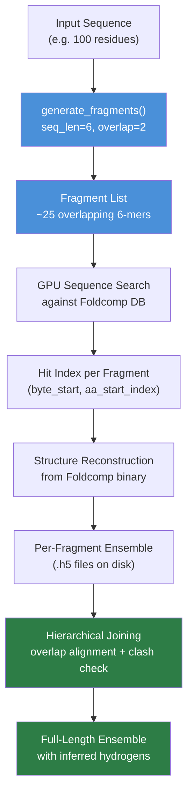

IDP-o's core innovation is a **fragment-based decomposition** of intrinsically disordered protein (IDP) sequences into short overlapping sub-sequences, each of which is independently resolved against a massive structural database (AlphaFold DB via Foldcomp). These fragment-level structural ensembles are then hierarchically reassembled under geometric constraints — overlap alignment and clash rejection — to produce a full-length conformational ensemble. This page explains the *strategy* by which a protein sequence is cut into fragments, why those parameters were chosen, and how the fragment vocabulary feeds the downstream pipeline.

Sources: [README.md](/README.md#L8-L8), [fasta_search_in_foldcomp_database.py](/scripts/fasta_search_in_foldcomp_database.py#L147-L152)

## Sequence Decomposition into Overlapping Fragments

The fragment generation function `generate_fragments` implements a **fixed-length sliding window with configurable overlap**. Given a protein sequence *s*, a fragment length `seq_len`, and an overlap `overlap`, the stride (shift) between successive fragment start positions is:

> **shift = seq_len − overlap**

Each fragment is extracted as `s[i × shift : i × shift + seq_len]` for incrementing *i*, and the process continues until the entire sequence is covered. The number of fragments is determined by `((len(s) − seq_len) // shift) + 2`, with two edge-case corrections: (1) the **final fragment may be shorter** than `seq_len` — it simply takes whatever residues remain, and (2) if the last fragment degenerates to exactly the overlap length, it is **removed** since it carries no unique residue information.

Sources: [fasta_search_in_foldcomp_database.py](/scripts/fasta_search_in_foldcomp_database.py#L147-L152)

### Default Parameters and Rationale

| Parameter | Default | Role |
|-----------|---------|------|
| `seq_len` | 6 | Fragment length in residues |
| `overlap` | 2 | Shared residues between consecutive fragments |
| `shift` | 4 (derived) | Stride between fragment start positions |

The **6-residue fragment length** strikes a balance between two competing demands. Shorter fragments (e.g., 3–4 residues) would produce excessive combinatorial explosion during the joining stage, while longer fragments (e.g., 10+ residues) would yield too few hits in the Foldcomp database — particularly for disordered sequences whose local structure is under-represented in AlphaFold DB. The **2-residue overlap** is the minimum that provides sufficient geometric constraint for robust pairwise alignment during fragment joining (the overlap must span at least one complete peptide bond, which requires ≥ 2 residues for backbone N–CA–C–O registration).

Sources: [fasta_search_in_foldcomp_database.py](/scripts/fasta_search_in_foldcomp_database.py#L155-L156), [join_fragments.py](/scripts/join_fragments.py#L76-L77), [join_fragments.py](/scripts/join_fragments.py#L286-L287)

### Worked Example

Consider the sequence `DLIVERANDSANDR` (14 residues). With `seq_len=6` and `overlap=2`:

| Fragment Index | Start | End | Subsequence | Overlap with Previous |
|:-:|:-:|:-:|:--|:--|
| 0 | 0 | 6 | `DLIVER` | — |
| 1 | 4 | 10 | `ERANDS` | `ER` |
| 2 | 8 | 14 | `NDSANDR` | `ND` |

Fragment 2 is only 6 residues (exact fit). If the sequence were 15 residues long, the final fragment would be 7 residues — the algorithm gracefully handles this asymmetry. The overlap residues (`ER`, `ND`) serve as the **geometric stitching region** during hierarchical joining.

Sources: [fasta_search_in_foldcomp_database.py](/scripts/fasta_search_in_foldcomp_database.py#L147-L152)

### Fragment Count Formula

For a sequence of length *L* with fragment length *F* and overlap *O*, the number of fragments *N* is approximately:

> **N ≈ ⌈(L − O) / (F − O)⌉**

This means a 100-residue IDP produces ~25 fragments, each of which is independently searched against the ~200 million structures in the Foldcomp database. The fragment count directly controls the depth of the hierarchical joining tree (see [Hierarchical Fragment Joining](8-hierarchical-fragment-joining)).

Sources: [fasta_search_in_foldcomp_database.py](/scripts/fasta_search_in_foldcomp_database.py#L147-L152)

## From Fragments to Structural Ensembles

Once the sequence is decomposed, each fragment follows a three-stage path through the pipeline before joining can occur. The diagram below shows how the fragment vocabulary produced by `generate_fragments` flows into the downstream stages:

**Stage 1 — Sequence Search**: Each fragment string is scanned against the specially-formatted Foldcomp FASTA using GPU-accelerated exact matching (CuPy). The search returns the byte offset in the Foldcomp database and the residue index within each hit protein where the fragment match begins. This is detailed in [GPU-Accelerated Sequence Search](6-gpu-accelerated-sequence-search).

**Stage 2 — Structure Reconstruction**: For each fragment, up to `n_max_structures_per_fragment` hits are loaded from the Foldcomp binary database. Internal coordinates (backbone angles, torsions, sidechain angles) are decoded and converted to Cartesian coordinates via JAX-compiled reconstruction functions. Optionally, structures with *cis*-ω peptide bonds are excluded. This is covered in [Structure Reconstruction from Foldcomp](7-structure-reconstruction-from-foldcomp).

**Stage 3 — Hierarchical Joining**: Fragment ensembles are reassembled into a full-length ensemble using a divide-and-conquer tree that performs pairwise overlap alignment and clash detection at each level. This is the subject of [Hierarchical Fragment Joining](8-hierarchical-fragment-joining).

Sources: [build_ensemble.py](/scripts/build_ensemble.py#L60-L80), [fasta_search_in_foldcomp_database.py](/scripts/fasta_search_in_foldcomp_database.py#L40-L144), [extract_structures_from_foldcomp_database.py](/scripts/extract_structures_from_foldcomp_database.py#L240-L268)

## Overlap as Geometric Constraint

The 2-residue overlap is not merely a bookkeeping convention — it is the **geometric anchor** that makes fragment joining well-posed. During pairwise joining, the overlap region provides two complete backbone units (each comprising N, Cα, C, O atoms), which is sufficient to compute a unique rigid-body alignment between the left and right fragment via SVD decomposition.

The alignment procedure extracts the **trailing overlap** from the left fragment and the **leading overlap** from the right fragment, then:

1. **Affine alignment** — An SVD-based optimal rotation and translation is computed to superimpose the right fragment's overlap atoms onto the left fragment's overlap atoms
2. **RMSD validation** — The root-mean-square deviation of the overlap is checked against a threshold of **0.06 nm (0.6 Å)**; pairs exceeding this are rejected
3. **Clash detection** — After alignment, all inter-atomic distances in the merged structure are checked; any non-bonded pair closer than **0.1 nm** triggers rejection

These thresholds are hard-coded and reflect the physical tolerances of peptide bond geometry: a 0.6 Å RMSD over 2 residues indicates the two fragments agree on local backbone conformation, while the 0.1 nm clash cutoff prevents steric violations that would be physically unrealistic.

Sources: [join_fragments.py](/scripts/join_fragments.py#L38-L50), [join_fragments.py](/scripts/join_fragments.py#L96-L123), [join_fragments.py](/scripts/join_fragments.py#L112-L119)

> [!TIP]
> The overlap of 2 residues is explicitly asserted and assumed throughout the codebase — the `pre_join_fragments` function hard-codes `overlap = 2` regardless of input, and the `_join_fragments` function extracts backbone indices as `bb_indices[indexing].ravel()[2:-2]` where the `[2:-2]` slicing selects the (C, O) atoms of the left overlap residue and the (N, Cα) atoms of the right overlap residue — the peptide bond junction. Changing the overlap would require coordinated changes to this slicing logic.

## Fragment Vocabulary and Database Coverage

The fragment strategy implicitly defines a **vocabulary problem**: each 6-residue fragment must have sufficient structural representatives in the AlphaFold DB to populate a meaningful ensemble. This is why IDP-o uses the full `afdb_uniprot_v4` database (~200 million structures, ~1.1 TB compressed) rather than a smaller curated set.

For **ordered regions**, most 6-mers will have abundant hits (thousands to millions of structures). For **disordered regions**, coverage is sparser because AlphaFold DB is biased toward well-folded proteins. The `n_max_structures_per_fragment` parameter (default 1000 in the build script) caps the ensemble size per fragment — when a fragment has more hits than this limit, structures are randomly subsampled to control memory and compute costs during joining.

| Fragment Type | Typical Hit Count | Ensemble Behavior |
|---------------|-------------------|-------------------|
| Well-structured 6-mer | 10³ – 10⁶+ | Subsampled to `n_max_structures_per_fragment` |
| Partially disordered 6-mer | 10² – 10³ | Fully retained |
| Rarely observed 6-mer | < 10² | May produce sparse ensembles |
| No hits found | 0 | Pipeline will fail for this fragment |

The `reduction_factor` parameter provides a debug/performance knob that proportionally reduces the fraction of the database searched — a value of 10 means only one-tenth of the FASTA is scanned, trading coverage for speed.

Sources: [extract_structures_from_foldcomp_database.py](/scripts/extract_structures_from_foldcomp_database.py#L252-L256), [fasta_search_in_foldcomp_database.py](/scripts/fasta_search_in_foldcomp_database.py#L64-L65), [build_ensemble.py](/scripts/build_ensemble.py#L125-L127)

## End-to-End Fragment Flow in the Pipeline

The `build_ensemble.py` script orchestrates the complete fragment lifecycle. The fragment generation parameters (`overlap=2`, `seq_len=6`) are set in the `join_fragments.main` entry point and propagated to `generate_fragments` at the start of the joining stage. The following table summarizes how each pipeline stage interacts with the fragment decomposition:

| Pipeline Stage | Script | Fragment Interaction |
|----------------|--------|---------------------|
| Sequence Search | `fasta_search_in_foldcomp_database.py` | Calls `generate_fragments()` to produce the fragment list; searches each fragment against Foldcomp FASTA |
| Structure Extraction | `extract_structures_from_foldcomp_database.py` | Reads hit indices per fragment; reconstructs 3D coordinates; saves per-fragment `.h5` ensembles |
| Fragment Joining | `join_fragments.py` | Calls `generate_fragments()` again to reconstruct fragment list; loads per-fragment `.h5` files; performs hierarchical joining |

Note that `generate_fragments()` is called **twice** — once during search (to determine which fragments to look up) and once during joining (to reconstruct the fragment ordering for hierarchical assembly). This is a stateless design: the fragment list is always derived from the input sequence and the fixed parameters, avoiding any need to serialize the fragment list itself.

Sources: [build_ensemble.py](/scripts/build_ensemble.py#L60-L80), [join_fragments.py](/scripts/join_fragments.py#L286-L287)

> [!TIP]
> The `generate_dataset.py` wrapper exposes `--fragments_overlap` as a configurable parameter (default 1), but this value is **not propagated** to `build_ensemble.py` in the current code — the ensemble builder always uses the hard-coded default of `overlap=2`. The `--fragments_overlap` parameter in `generate_dataset.py` appears to be a placeholder for future configurability.

## Design Trade-offs

The fragment generation strategy embodies several deliberate trade-offs that are worth understanding when interpreting ensemble outputs:

**Fixed vs. adaptive fragment length** — IDP-o uses a fixed 6-residue window. An alternative design would use variable-length fragments adapted to local disorder propensity (e.g., longer fragments for helical regions, shorter for highly disordered regions). The fixed-length approach simplifies the pipeline and ensures uniform overlap geometry, but may under-represent local structural preferences in semi-ordered regions.

**Exact vs. approximate sequence search** — Fragments are matched by exact substring search in the Foldcomp FASTA. No sequence similarity or fuzzy matching is performed. This means a fragment with a single rare mutation may return zero hits even if a close homolog exists in the database. The trade-off favors speed (GPU exact matching is extremely fast) over sensitivity.

**Overlap size vs. joining flexibility** — A larger overlap (e.g., 3–4 residues) would provide more geometric constraints and potentially higher-quality joins, but would also reduce the stride between fragments, increasing the number of fragments and thus the depth of the joining tree. The 2-residue overlap is the minimum viable choice and maximizes computational efficiency.

Sources: [fasta_search_in_foldcomp_database.py](/scripts/fasta_search_in_foldcomp_database.py#L147-L152), [join_fragments.py](/scripts/join_fragments.py#L76-L77)

## Where to Go Next

The fragment generation strategy sets the stage for every downstream computation. To understand how fragments are searched against the database, see [GPU-Accelerated Sequence Search](6-gpu-accelerated-sequence-search). To understand how 3D coordinates are recovered from Foldcomp binary data, see [Structure Reconstruction from Foldcomp](7-structure-reconstruction-from-foldcomp). To understand how fragment ensembles are stitched together under geometric constraints, see [Hierarchical Fragment Joining](8-hierarchical-fragment-joining). For the mathematical details of overlap alignment and clash detection, see [Overlap Alignment and Clash Detection](9-overlap-alignment-and-clash-detection).