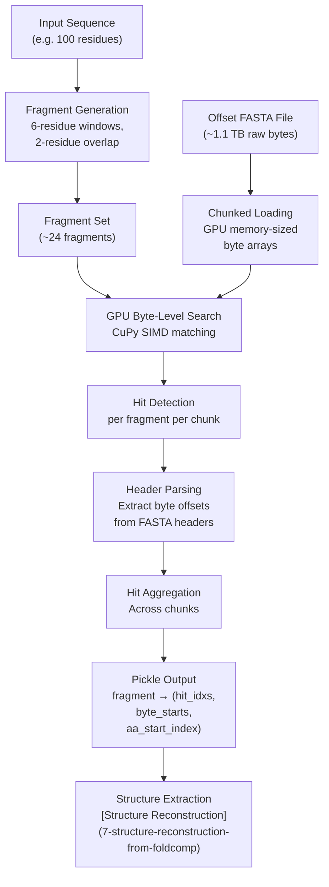

The GPU-accelerated sequence search is the first computational stage in the IDP-o pipeline, responsible for locating short protein fragments within a massive Foldcomp structure database. It transforms a full-length protein sequence into a set of overlapping 6-residue fragments, then uses **CuPy-based CUDA parallelism** to perform byte-level pattern matching directly against the raw bytes of a specially formatted FASTA file — achieving search throughput that would be impractical on CPU alone. The output is a dictionary of hit locations that enables downstream structure extraction at precise byte offsets within the compressed Foldcomp database, without ever decompressing the full archive.

Sources: [fasta_search_in_foldcomp_database.py](/scripts/fasta_search_in_foldcomp_database.py#L1-L194), [build_ensemble.py](/scripts/build_ensemble.py#L60-L61)

## Algorithm Architecture

The search operates on a fundamental insight: rather than parsing a FASTA file into a sequence database and performing BLAST-style alignment, it treats the file as a **flat byte array** and performs exact substring matching at the raw byte level. This eliminates all parsing overhead and maps naturally to GPU-wide SIMD execution. The specially formatted FASTA file — produced by [Foldcomp Database Setup](3-foldcomp-database-setup) — encodes the byte offset of each entry in the Foldcomp database directly into the FASTA header, so that a single search pass yields both the sequence match and the structural data location.



Sources: [fasta_search_in_foldcomp_database.py](/scripts/fasta_search_in_foldcomp_database.py#L40-L144), [fasta_search_in_foldcomp_database.py](/scripts/fasta_search_in_foldcomp_database.py#L147-L152)

## Fragment Generation Strategy

The input protein sequence is decomposed into overlapping 6-residue fragments via `generate_fragments`, which implements a sliding window with configurable overlap. With the default parameters (`seq_len=6`, `overlap=2`), each fragment shares 2 residues with its neighbor, ensuring structural continuity when fragments are later reassembled by [Hierarchical Fragment Joining](8-hierarchical-fragment-joining). The shift between consecutive fragment start positions is `seq_len - overlap = 4` residues, yielding approximately `⌈(N - 6) / 4⌉ + 2` fragments for a sequence of length N. A terminal fragment whose length equals the overlap size is discarded, since it carries no independent structural information beyond what the preceding fragment already encodes.

Sources: [fasta_search_in_foldcomp_database.py](/scripts/fasta_search_in_foldcomp_database.py#L147-L152)

## Byte-Level GPU Matching: `extract_all_byte_starts`

This is the computational core of the search stage. The function processes the offset FASTA file in **chunks** sized to fit within GPU memory (default: 320 MB), performing three operations per chunk for each fragment simultaneously.

### Chunk Loading and Header Indexing

Each chunk is read as raw bytes via `f.read(chunk_size)` and immediately cast to a CuPy `uint8` array — no string parsing occurs. The positions of all `>` characters (FASTA headers) are located in a single GPU pass using `cp.flatnonzero`, producing the `start_bytes` index that partitions the byte stream into sequence records. The final chunk is zero-padded to a multiple of 8 bytes, satisfying GPU memory alignment requirements.

Sources: [fasta_search_in_foldcomp_database.py](/scripts/fasta_search_in_foldcomp_database.py#L64-L86)

### Exact Substring Matching via Boolean Convolution

For each fragment, the encoded sequence (also `uint8`) is matched against the chunk through a **parallel element-wise comparison across all positions simultaneously**. A boolean accumulator `energies` is initialized to all-true, then each residue position `j` in the fragment narrows the accumulator with an AND-reduction:

```python
energies &= indexs[j : chunk_size - (ncoeff - j)] == sequence_encoded[j]
```

This evaluates to `True` only at byte positions where **every residue in the fragment matches contiguously** — an O(L × C) operation where L is fragment length and C is chunk size, executed entirely on GPU with no branching or loop overhead. The `flatnonzero` of the resulting boolean mask yields the hit positions within the chunk.

Sources: [fasta_search_in_foldcomp_database.py](/scripts/fasta_search_in_foldcomp_database.py#L88-L99)

### Offset Extraction and Amino Acid Indexing

For each hit, the preceding FASTA header is identified via `searchsorted` on the `start_bytes` array. The numeric byte offset stored in that header (e.g., `>677`) is decoded from its ASCII digit representation using a vectorized base-10 decomposition: the digit characters are masked, shifted by their positional power of 10, and summed — all on GPU. Simultaneously, the **amino acid start index** within the matched sequence is computed as the offset from the header's `>` sign, accounting for the variable-length byte offset string. This three-part tuple — `(hit_idxs, byte_starts, aa_start_index)` — is transferred back to CPU via `.get()` and stored per fragment per chunk.

Sources: [fasta_search_in_detail_from_foldcomp_database.py](/scripts/fasta_search_in_foldcomp_database.py#L101-L121)

### Cross-Chunk Aggregation

Hits where a fragment sequence straddles a chunk boundary are **intentionally dropped** (line 102: `hit_idxs = hit_idxs[hit_idxs > start_bytes[0]]`). This is a deliberate design choice: partial matches across chunk boundaries would require cross-chunk coordination that defeats the embarrassingly-parallel chunk processing model. After all chunks are processed, hits for each fragment are concatenated across chunks via `np.concatenate`, with empty arrays substituted for fragments that produced no hits in a given chunk. The result is a dictionary mapping each fragment string to a 3-tuple of concatenated NumPy arrays.

Sources: [fasta_search_in_foldcomp_database.py](/scripts/fasta_search_in_foldcomp_database.py#L101-L143)

## CuPy vs. NumPy: Why GPU Acceleration Matters

The entire matching pipeline is implemented in CuPy — a drop-in GPU replacement for NumPy — because the search operates on the **raw bytes of a ~1.1 TB FASTA file**. On CPU, the element-wise comparison loop for a single 6-residue fragment across a 320 MB chunk would require ~2.4 billion comparisons, repeated for each of the ~24 fragments. CuPy executes these as massively parallel CUDA kernels, exploiting the GPU's thousands of cores and coalesced memory access patterns. The only CPU-GPU transfers occur at the boundary: chunk bytes are uploaded once, and the final hit tuples (typically tiny — a few hundred entries) are downloaded via `.get()`.

| Aspect | CPU (NumPy) | GPU (CuPy) |
|--------|-------------|------------|
| Comparison execution | Sequential per fragment position | Massively parallel across all positions |
| Memory model | Host RAM, no alignment constraint | Device VRAM, 8-byte aligned chunks |
| Data transfer | None (native) | Upload chunk once, download hits only |
| Throughput bottleneck | Single-core scalar ops | Saturated memory bandwidth |
| Typical chunk processing | Minutes per fragment | Sub-second per fragment |

Sources: [fasta_search_in_foldcomp_database.py](/scripts/fasta_search_in_foldcomp_database.py#L20-L21), [Dockerfile](/Dockerfile#L1-L3)

## Output Format and Pipeline Integration

The search stage outputs a **pickle file** containing a dictionary keyed by fragment string, with each value being a 3-tuple of `np.int64` arrays:

| Tuple Index | Name | Meaning |
|-------------|------|---------|
| 0 | `hit_idxs` | Byte position in the FASTA file where the match begins |
| 1 | `byte_starts` | Byte offset in the Foldcomp database file where the matching entry's structural data begins |
| 2 | `aa_start_index` | Residue index within the matched database sequence where the fragment match starts (enables sub-extraction of specific residue ranges) |

This pickle file is consumed directly by the [Structure Reconstruction from Foldcomp](7-structure-reconstruction-from-foldcomp) stage, which uses `byte_starts` to seek into the compressed Foldcomp database and `aa_start_index` to extract only the relevant residue subrange — avoiding decompression of the entire entry. The orchestration is handled by `build_ensemble.py`, which calls the search, extraction, and joining stages in sequence.

Sources: [fasta_search_in_foldcomp_database.py](/scripts/fasta_search_in_foldcomp_database.py#L155-L164), [build_ensemble.py](/scripts/build_ensemble.py#L60-L61)

## Configuration Parameters

The search stage exposes two parameters that control the search scope and precision:

| Parameter | CLI Flag | Default | Effect |
|-----------|----------|---------|--------|
| `chunk_size` | — | 320,000,000 bytes | GPU memory chunk size. Auto-reduced when the file is smaller than one chunk, rounded down to a multiple of 8. Not exposed via CLI. |
| `reduction_factor` | `--reduction_factor` | 1 | Divisor applied to the file size estimate. A value of 10 searches only ~1/10th of the database — useful for rapid iteration during development or when search completeness is not required. |
| `overlap` | — | 2 | Overlapping residues between consecutive fragments. Hard-coded to 2 throughout the pipeline. Not exposed via CLI. |
| `seq_len` | — | 6 | Fragment length in residues. Not exposed via CLI — altering this would require corresponding changes in [Overlap Alignment and Clash Detection](9-overlap-alignment-and-clash-detection). |

> [!TIP]
> The `reduction_factor` parameter does **not** subsample the sequences — it subsamples the **byte range** of the FASTA file. This means a reduction factor of 10 doesn't search every 10th sequence; it searches the first 1/10th of the file by byte offset. For statistically uniform sampling, this is acceptable since the AlphaFoldDB entries are not ordered by sequence content.

Sources: [fasta_search_in_foldcomp_database.py](/scripts/fasta_search_in_foldcomp_database.py#L40-L46), [fasta_search_in_foldcomp_database.py](/scripts/fasta_search_in_foldcomp_database.py#L167-L193)

## Runtime Environment

The search stage requires a CUDA-capable GPU with the CuPy CUDA 12x runtime, as specified in the Dockerfile base image `nvcr.io/nvidia/jax:24.10-py3` and the `cupy-cuda12x~=13.6.0` dependency. The entire IDP-o pipeline is orchestrated through this Docker image, which bundles both the CuPy-based search and the JAX-based downstream computation within a single container. The search is invoked as the first step of `build_ensemble.py`, writing its pickle output to a scratch directory before control passes to structure extraction.
