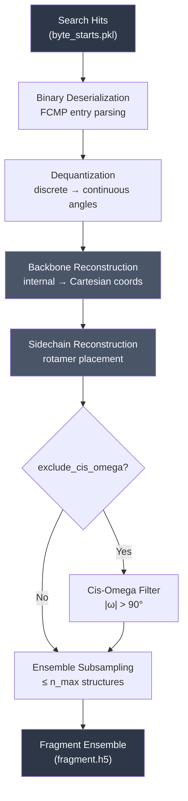
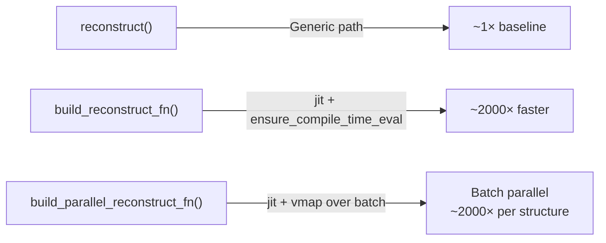
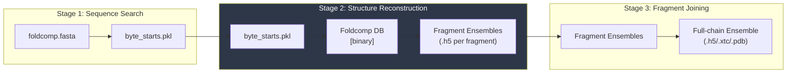

The **Structure Reconstruction** stage is the computational heart of IDP-o: it transforms compressed Foldcomp database entries—stored as quantized internal coordinates—back into full 3D Cartesian atomic coordinates. This stage sits between the [GPU-Accelerated Sequence Search](6-gpu-accelerated-sequence-search) (which identifies fragment hits and their byte positions) and the [Hierarchical Fragment Joining](8-hierarchical-fragment-joining) (which stitches overlapping fragment ensembles into a complete chain). The entire reconstruction pipeline is implemented in `extract_structures_from_foldcomp_database.py` and orchestrated by `build_ensemble.py`, which calls it as the second of three sequential stages.

Sources: [extract_structures_from_foldcomp_database.py](/scripts/extract_structures_from_foldcomp_database.py#L1-L326), [build_ensemble.py](/scripts/build_ensemble.py#L60-L70)

## Architectural Overview

The reconstruction stage decomposes into four tightly coupled phases: **binary deserialization** (parsing the Foldcomp FCMP entry format), **dequantization** (converting discrete integer codes back to continuous angles in radians), **backbone reconstruction** (sequential internal-to-Cartesian coordinate transformation via Nerfax), and **sidechain reconstruction** (placing sidechain atoms relative to the reconstructed backbone). The entire pipeline is JAX-accelerated, with a JIT-compiled specialization path that can achieve up to ~2000× speedup for repeated reconstructions of the same amino acid sequence.



Sources: [extract_structures_from_foldcomp_database.py](/scripts/extract_structures_from_foldcomp_database.py#L217-L268)

## Foldcomp Binary Format — FCMP Entry Layout

Each protein structure in the Foldcomp database is stored as a single FCMP entry. The reconstruction stage must navigate this binary layout with byte-precise offsets derived from the search hit metadata (`fasta_byte_start`, `byte_start`, `aa_start_index`). The entry begins with a `b"FCMP"` magic tag, followed by header fields that encode the residue count, anchor points, and—critically—the **discretizer matrix** that governs dequantization.

| Field | Offset (relative) | Size | Type | Description |
|---|---|---|---|---|
| Magic tag | `byte_start` | 4 B | `@4s` | Must equal `b"FCMP"` |
| `nResidue` | `+4` | 2 B | `H` (uint16) | Total residues in entry |
| `nAnchor` | `+12` | 1 B | `B` (uint8) | Number of anchor points |
| `lenTitle` | `+24` | 4 B | `I` (uint32) | Title string length |
| Discretizers | `+28` | 48 B | `float32[2,6]` | Min values + configuration scales |
| Backbone data | `+89 + 40·nAnchor + lenTitle` | 8·nRes B | `uint8[nRes, 8]` | Packed angles/torsions per residue |
| Sidechain data | After backbone | Variable | `uint8[]` | Per-residue sidechain angles |

The backbone data section starts at a computed offset: `byte_start + 89 + 40 * nAnchor + lenTitle`. The first 8 bytes of the backbone section are dummy padding; actual per-residue data follows at `(l - 1) * 8` bytes from that start, where `l` is the residue start index of the fragment hit.

Sources: [extract_structures_from_foldcomp_database.py](/scripts/extract_structures_from_foldcomp_database.py#L83-L103)

## Binary Deserialization — Bitwise Backbone Decoding

The `load_backbone_data` function performs a **bitwise unpacking** of 8 bytes per residue into six internal coordinate values and one amino acid identifier. Each residue's 8-byte row is first upcast to `uint16` to enable 12-bit field extraction. The most significant 5 bits of byte 0 encode the amino acid index (`(d[:,0] & 0xF8) >> 3`). The remaining bits are reassembled across byte boundaries into three 12-bit torsion/angle values (omega, psi, phi) through shift-and-mask operations, while the last three bytes provide the bond angles (n_ca_c, ca_c_n, c_n_ca) directly.

```python
# Amino acid from top 5 bits
aas = (d[:, 0] & 0xF8) >> 3
# 12-bit reconstruction across byte boundaries
d[:, 0] = ((d[:, 0] & 0x0007) << 8) | (d[:, 1] & 0x00FF)   # omega
d[:, 1] = ((d[:, 2] & 0x00FF) << 4) | (d[:, 3] & 0x00FF) >> 4  # psi
d[:, 2] = ((d[:, 3] & 0x000F) << 8) | (d[:, 4] & 0x00FF)   # phi
# Reorder to canonical: [phi, psi, omega, n_ca_c_angle, ca_c_n_angle, c_n_ca_angle]
mainChainAnglesTorsions = d[:, [2, 1, 0, 7, 5, 6]]
```

The column reordering `d[:, [2, 1, 0, 7, 5, 6]]` maps from the storage layout `(omega, psi, phi, ..., ca_c_n, c_n_ca, n_ca_c)` to the canonical internal-coordinate ordering `(phi, psi, omega, n_ca_c_angle, ca_c_n_angle, c_n_ca_angle)` expected by the downstream reconstruction functions.

Sources: [extract_structures_from_foldcomp_database.py](/scripts/extract_structures_from_foldcomp_database.py#L66-L77)

## Dequantization — From Discrete Codes to Radians

The discretized integer values must be **linearly dequantized** back to continuous angles using the per-entry discretizer matrix. This 2×6 `float32` matrix contains min values (`mins`) and configuration scales (`conf_fs`), one pair per internal coordinate channel. The dequantization formula applied in `reconstruct_backbone` is:

```
continuous = (discrete × conf_fs + mins) × (π / 180)
```

The multiplication by `π/180` converts from degrees to radians. After dequantization, the angles undergo two further transformations before coordinate reconstruction: the **torsion reordering** `[..., [1, 2, 0]]` reorganizes from `(phi, psi, omega)` to `(psi, omega, phi)` to match the N→CA→C chain-walk convention, and the **bond angle complement** `π - angle` is applied, accounting for the historical SCNet convention where stored angles are supplementary to the internal coordinate bond angles.

Sources: [extract_structures_from_foldcomp_database.py](/scripts/extract_structures_from_foldcomp_database.py#L137-L163)

## Backbone Reconstruction — Internal-to-Cartesian Transformation

With dequantized and reordered angles, torsions, and the fixed backbone bond lengths from `BACKBONE_BOND_LENGTHS`, the `reconstruct_backbone` function performs **sequential internal-to-Cartesian coordinate reconstruction**. Three initial anchor positions are placed at `[-1, -1, 0], [-1, 0, 0], [0, 0, 0]` in 3D space, and the `reconstruct_from_internal_coordinates_pure_sequential` function from Nerfax walks along the chain, placing each successive atom using the N-CA-C peptide backbone geometry defined by the bond lengths, bond angles, and dihedral torsions. The output `bb_pos` contains the full backbone Cartesian coordinates (N, CA, C, O) for every residue in the fragment.

Sources: [extract_structures_from_foldcomp_database.py](/scripts/extract_structures_from_foldcomp_database.py#L137-L163)

## Sidechain Reconstruction

The `reconstruct` function extends backbone reconstruction with **sidechain atom placement** via `reconstruct_sidechains` from Nerfax. Sidechain data is loaded separately from the Foldcomp entry: each residue's sidechain is encoded as a variable number of `uint8` values, where the count per residue is determined by the amino acid type through the `AA_N_SC_ATOMS` lookup table. A prefix cumulative sum over `AA_N_SC_ATOMS` values computes byte offsets into the sidechain data section, enabling selective extraction of only the fragment's residues rather than the entire entry. The sidechain angles are then used to place rotamers relative to their reconstructed backbone anchors.

Sources: [extract_structures_from_foldcomp_database.py](/scripts/extract_structures_from_foldcomp_database.py#L116-L134), [extract_structures_from_foldcomp_database.py](/scripts/extract_structures_from_foldcomp_database.py#L166-L169)

## JAX JIT Compilation — Sequence-Specialized Reconstruction

The most significant performance optimization in this stage is the **JAX JIT-compiled specialization** via `build_reconstruct_fn`. Rather than reconstructing structures one at a time through the generic `reconstruct` path, this function captures the amino acid sequence as a compile-time constant using `jax.ensure_compile_time_eval()`, producing a specialized XLA-compiled function that eliminates all amino-acid-dependent branching at runtime.



The `build_parallel_reconstruct_fn` variant wraps `reconstruct` in `vmap` with `in_axes=(0, 0, None, 0)`—batching over discretizers, backbone angles, and sidechain angles while keeping the amino acid array constant (since all structures in a fragment ensemble share the same sequence). This batch-vmapped function is then JIT-compiled, enabling the entire ensemble reconstruction for a fragment to execute as a single XLA-compiled computation.

> [!TIP]
> JAX is explicitly forced onto the CPU backend (`os.environ["JAX_PLATFORMS"] = "cpu"`) at module import time. The GPU is reserved for the preceding sequence search stage, and reconstruction is compute-bound in a way that benefits more from XLA's CPU compilation and memory locality than from GPU transfer overhead.

Sources: [extract_structures_from_foldcomp_database.py](/scripts/extract_structures_from_foldcomp_database.py#L15-L17), [extract_structures_from_foldcomp_database.py](/scripts/extract_structures_from_foldcomp_database.py#L189-L206)

## Cis-Omega Filtering

The optional `--exclude_cis_omega` flag filters out structures with **cis peptide bonds**, which are rare in natural proteins (< 0.1% of non-proline peptide bonds). The filter operates on the dequantized omega dihedral angle before full reconstruction: structures are retained only if **all** omega angles in the fragment satisfy `|ω| > 90°` (i.e., all peptide bonds are in the trans conformation). This filter is applied inside `extract_data` at the raw angle level, avoiding the computational cost of full coordinate reconstruction for structures that would be discarded.

Sources: [extract_structures_from_foldcomp_database.py](/scripts/extract_structures_from_foldcomp_database.py#L230-L235)

## Orchestration — `compute_ensembles` and `extract_data`

The top-level `compute_ensembles` function drives the full per-fragment pipeline. For each fragment key in the search results dictionary, it: (1) reads the fragment ensemble from the Foldcomp database via `extract_data`, which iterates over all hits `(fasta_byte_start, byte_start, aa_start_index)` and loads reconstruction data for the residue range `[l, l+nres)`, stacking results via `join_list_of_identical_pytrees`; (2) subsamples if the number of structures exceeds `n_max_structures_per_fragment` using random index selection; (3) reconstructs the full ensemble in one batched call via the JIT-compiled `build_parallel_reconstruct_fn`; and (4) converts the coordinates from Ångströms to nanometers (÷10.0) and saves the trajectory as an HDF5 file using mdtraj, with topology built from the fragment sequence via `build_mdtraj_top`.

| Step | Function | Key Operation |
|---|---|---|
| 1 | `extract_data` | Load & stack reconstruction data from all hits |
| 2 | Random subsampling | Cap to `n_max_structures_per_fragment` |
| 3 | `build_parallel_reconstruct_fn` → `jit_fn(...)` | Batch-reconstruct all structures |
| 4 | `md.Trajectory(...)` + `.save_hdf5(...)` | Serialize to HDF5 with mdtraj topology |

Sources: [extract_structures_from_foldcomp_database.py](/scripts/extract_structures_from_foldcomp_database.py#L217-L268)

## CLI Interface

The script is invoked as a standalone command after the search stage has produced `byte_starts.pkl`:

```bash
python3 scripts/extract_structures_from_foldcomp_database.py \
  --byte_starts_path /tmp/byte_starts.pkl \
  --foldcomp_fasta /data/afdb_uniprot_v4.fasta \
  --foldcomp_db /data/afdb_uniprot_v4 \
  --outfolder /tmp/fragment_ensembles \
  --n_max_structures_per_fragment 1000 \
  --exclude_cis_omega
```

| Argument | Default | Description |
|---|---|---|
| `--byte_starts_path` | (required) | Pickle file from search stage with hit metadata |
| `--foldcomp_fasta` | `/data/afdb_uniprot_v4.fasta` | Offset-annotated FASTA for the Foldcomp database |
| `--foldcomp_db` | `/data/afdb_uniprot_v4` | Path to the binary Foldcomp database file |
| `--outfolder` | (required) | Output directory for per-fragment `.h5` ensemble files |
| `--n_max_structures_per_fragment` | `1000` | Maximum structures to extract per fragment |
| `--exclude_cis_omega` | `False` | Exclude structures with cis peptide bonds |

When invoked through `build_ensemble.py`, these arguments are populated automatically from the ensemble builder's CLI arguments, and the stage runs as the second step between `fasta_search_in_foldcomp_database.main()` and `join_fragments.main()`.

Sources: [extract_structures_from_foldcomp_database.py](/scripts/extract_structures_from_foldcomp_database.py#L277-L326), [build_ensemble.py](/scripts/build_ensemble.py#L60-L70)

## Data Flow Across Pipeline Stages



The reconstruction stage consumes the `byte_starts.pkl` pickle file produced by [GPU-Accelerated Sequence Search](6-gpu-accelerated-sequence-search), which maps each fragment sequence to a tuple of three arrays: `hit_idxs` (byte positions in the FASTA file), `byte_starts` (byte positions in the Foldcomp database), and `aa_start_index` (residue offset within the matched entry). It produces one `.h5` file per fragment containing an mdtraj-compatible trajectory of all reconstructed conformations, which is then consumed by [Hierarchical Fragment Joining](8-hierarchical-fragment-joining).

> [!TIP]
> The `join_list_of_identical_pytrees` utility function uses JAX's pytree flattening/unflattening to stack heterogeneous reconstruction data tuples across multiple hits into batched arrays. This enables the subsequent single-call batched JIT reconstruction, which is far more efficient than per-structure reconstruction loops.

Sources: [extract_structures_from_foldcomp_database.py](/scripts/extract_structures_from_foldcomp_database.py#L209-L214), [extract_structures_from_foldcomp_database.py](/scripts/extract_structures_from_foldcomp_database.py#L240-L268)

## Next Steps

With fragment ensembles reconstructed and saved as `.h5` files, the pipeline proceeds to [Hierarchical Fragment Joining](8-hierarchical-fragment-joining), where overlapping fragment pairs are aligned on their shared residues, validated for steric clashes, and progressively merged into a complete-chain ensemble. For the full end-to-end invocation, see [Quick Start](2-quick-start); for parameter tuning of the reconstruction stage specifically, consult [Command-Line Configuration Reference](13-command-line-configuration-reference).