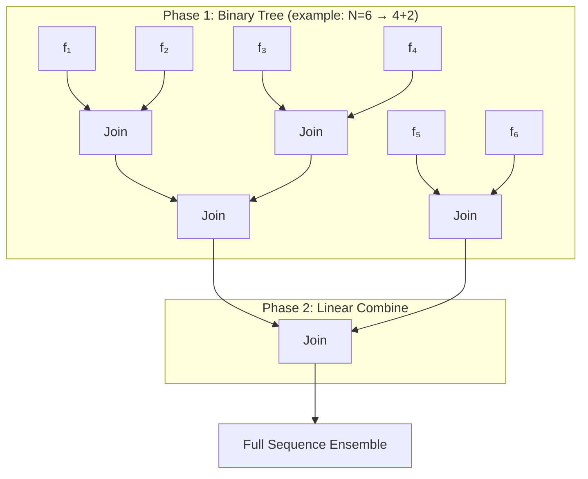

The hierarchical fragment joining stage is the combinatorial core of the IDP-o pipeline — it transforms per-fragment structural ensembles (reconstructed from Foldcomp) into a globally consistent ensemble for the full target sequence. Rather than joining fragments linearly from left to right, the system decomposes the fragment list into **power-of-two segments**, joins each segment via a **balanced binary tree**, then **linearly combines** the resulting super-fragments. This hierarchy minimizes the accumulation of alignment error and distributes clash probability more evenly across the join graph, producing ensembles with superior structural coherence compared to naïve sequential joining.

## From Fragments to Full Sequence

The joining process operates on the output of the fragment generation strategy, which partitions a target sequence of length *L* into overlapping fragments of `seq_len=6` residues with an `overlap=2` residue window. With a stride of 4 (`seq_len - overlap`), a sequence of length *L* yields approximately ⌈(*L* − 4) / 4⌉ + 1 fragments. Each fragment carries an ensemble of conformations (coordinates, backbone indices, and uniform or derived probability weights) loaded from per-fragment `.h5` files produced by [Structure Reconstruction from Foldcomp](7-structure-reconstruction-from-foldcomp).

The `generate_fragments` function implements this partitioning: it shifts a sliding window by `seq_len - overlap` residues at each step, ensuring every adjacent pair shares exactly 2 residues in common — the **join interface** upon which structural alignment is performed. A degenerate trailing fragment of length equal to the overlap is discarded, since it carries no new structural information.

Sources: [fasta_search_in_foldcomp_database.py](/scripts/fasta_search_in_foldcomp_database.py#L147-L152), [join_fragments.py](/scripts/join_fragments.py#L286-L288)

## The Pairwise Join: Alignment, Validation, and Acceptance

At the atomic level, every join in the hierarchy is a **pairwise operation** combining a left fragment *l* and a right fragment *r* that share a 2-residue overlap. The `join_fragments` function orchestrates this as a Monte Carlo-style sampling procedure:

1. **Weighted conformation sampling** — `n` conformation indices are drawn independently from each fragment's ensemble according to their probability distributions (`lprobs`, `rprobs`), producing `n` candidate left-right pairs.
2. **Vectorized alignment and validation** — for each pair, the right fragment is superimposed onto the left via the overlap backbone atoms, then the merged structure is checked for steric clashes.
3. **Filtering** — only pairs satisfying both an **RMSD threshold** (< 0.06 nm = 0.6 Å on the overlap backbone) and a **clash-free condition** survive the filter mask.
4. **Retry with resampling** — if no valid pairs are found, new random indices are drawn up to 5 attempts before falling back to a single random selection.

The number of samples `n` is rounded up to a multiple of the chunk size, which is itself computed from a memory-budget heuristic: `batch_size = target_GB / (1e-5 × nres²)`, where `nres` is the total number of residues in the joined sequence. This ensures GPU memory utilization stays within the 96% XLA allocation cap set at module import.

Sources: [join_fragments.py](/scripts/join_fragments.py#L147-L192)

### Overlap Alignment via SVD

The alignment of the right fragment onto the left is performed by `affine_alignment`, which computes the **optimal rigid-body transformation** (rotation + translation) minimizing RMSD between the two overlap regions. This is the classical Kabsch algorithm implemented in JAX:

- **Center** both coordinate sets by subtracting their centroids.
- **Compute** the cross-covariance matrix *R* = (*x* − *x̄*)T(*y* − *ȳ*).
- **Decompose** *R* via SVD: *R* = *USV*T.
- **Correct** for reflection: if det(*UV*T) < 0, flip the sign of the last row of *V*T.
- **Compose** the rotation *Q* = *UV*T.

The `align` function then applies this transformation to the entire mobile (right) coordinate set, not just the overlap — this is what positions the non-overlapping portion of the right fragment correctly in the merged frame.

Sources: [join_fragments.py](/scripts/join_fragments.py#L38-L57)

### Clash Detection

After alignment, the merged coordinate array is tested by `check_interactions`, which computes the full pairwise distance matrix and flags any non-bonded atom pair closer than `cutoff=0.1` nm (1.0 Å). Bonded pairs (from the mdtraj topology) are excluded from the check. The function returns a boolean mask over upper-triangular pairs, and `_join_fragments` reduces this to a single `no_clash_mask = ~mask.any()` per candidate. This extremely tight cutoff filters out only the most severe steric violations — appropriate for the intrinsically disordered context where moderate van der Waals overlap is expected and tolerable.

Sources: [join_fragments.py](/scripts/join_fragments.py#L60-L69), [join_fragments.py](/scripts/join_fragments.py#L112-L123)

### The Core Join Kernel

The `_join_fragments` function is the JAX-compiled inner loop that processes a single pair of sampled conformations. Its logic is:

- Extract the **overlap backbone atom indices** from each fragment: for the left fragment, the last `overlap=2` residues supply their `(C, O)` atoms; for the right, the first 2 residues supply `(N, CA)`. These four atoms per side (8 total) form the peptide bond join interface.
- **Vectorize** over the batch via `vmap(align_and_validate)`, producing aligned positions, clash masks, and RMSDs for all `n` candidates simultaneously.
- **Combine** the quality criteria: `mask = (rmsds < 0.06) & no_clash_mask`.

The `static_context` tuple `(lhs, rhs)` marks the atom index boundary between the left and right fragments in the merged coordinate array — `lhs` is the first atom index after the left fragment's contribution, `rhs` is the first atom index of the right fragment's non-overlap region. The merged position array is constructed as `concat([lpos[:lhs], rpos_aligned[rhs:]])`, discarding the redundant overlap coordinates from the right fragment.

Sources: [join_fragments.py](/scripts/join_fragments.py#L96-L123)

## Hierarchical Joining Strategy

The `build_ensemble` function implements the **hierarchical decomposition** that distinguishes IDP-o's joining from simple left-to-right accumulation. The algorithm proceeds in two phases:

**Phase 1 — Power-of-two binary tree joins.** The fragment count *N* is decomposed into its binary representation (up to 16 bits). Each set bit at position *k* produces a segment of 2*k* fragments. Within each segment, joining proceeds in ⌊log₂(segment_size)⌋ rounds: in round *i*, adjacent pairs from round *i*−1 are joined pairwise, halving the number of super-fragments each round until a single super-fragment remains. Smaller segments are joined first (the `segments[::-1]` reversal), which ensures that the join tree is balanced within each power-of-two block.

**Phase 2 — Linear combination of super-fragments.** The super-fragments from each power-of-two segment are joined sequentially from left to right. This phase is only needed when *N* is not itself a power of two.

For the example above with 6 fragments, the 4-fragment segment is joined in a balanced tree (2 rounds), the 2-fragment segment in one round, and the two resulting super-fragments are combined linearly.

> [!TIP]
> The binary decomposition ensures that the maximum depth of any join chain is ⌊log₂(N)⌋ + (number_of_set_bits − 1), compared to N−1 for naïve linear joining. This dramatically reduces cumulative alignment error propagation.

Sources: [join_fragments.py](/scripts/join_fragments.py#L195-L249)

### Probability Propagation

After each successful join, the resulting super-fragment is stored in the shared `data` dictionary with **product probabilities** derived from the source conformation indices. The `get_probs` function computes the inverse-frequency weight for each unique conformation index in the source array (implementing importance weighting for non-uniform fragment ensembles), and the joined ensemble's probability is the element-wise product of the left and right source probabilities via `jax.tree.map(jnp.multiply, ...)`. This ensures that conformations drawn from high-probability regions of both fragments are favored in the joined ensemble.

Sources: [join_fragments.py](/scripts/join_fragments.py#L126-L129), [join_fragments.py](/scripts/join_fragments.py#L218-L223)

### Memory Management

GPU device memory is reclaimed aggressively between hierarchy levels. Once a join round completes (when `i > 1`), all `jax.Array` objects from two levels prior are explicitly deleted via `.delete()`. This is critical because the coordinate arrays for intermediate super-fragments grow proportionally to the number of residues, and without cleanup the device would exhaust its 96% allocation well before the final join. The XLA backend's `live_buffers()` are also purged at the start of the `main` function before any joining begins.

Sources: [join_fragments.py](/scripts/join_fragments.py#L228-L234), [join_fragments.py](/scripts/join_fragments.py#L289-L292)

## JAX Vectorization and Chunked Execution

The `jit_chunked_vmap` function is the bridge between JAX's compile-time vectorization and runtime memory constraints. Rather than applying `vmap` across the full batch of `n` candidates (which would materialize an *n × n_atoms × 3* coordinate tensor and an *n × n_atoms × n_atoms* distance tensor simultaneously), it reshapes the input arrays into chunks of `chunk_size`, then uses `jax.lax.scan` to iterate over chunks sequentially within a single compiled computation. This preserves the performance benefits of XLA optimization within each chunk while keeping peak memory bounded by the chunk size rather than the total batch size.

The chunk size is determined by the `batch_size` lambda, which targets approximately 10 GB of device memory and scales inversely with the square of the residue count (reflecting the *O(n²)* cost of the pairwise distance computation in `check_interactions`).

Sources: [join_fragments.py](/scripts/join_fragments.py#L132-L144), [join_fragments.py](/scripts/join_fragments.py#L150-L151)

## Post-Join Processing: RMSD Sorting and Hydrogen Insertion

After the full ensemble is assembled, two optional transformations are applied:

1. **RMSD-based trajectory sorting** — when `--rmsd_sort` is enabled, `sort_trajectory` superposes all frames to frame 0, computes the full RMSD matrix, then orders frames by greedy nearest-neighbor in RMSD space. This produces a trajectory that varies smoothly frame-to-frame, which is essential for visual inspection in molecular viewers.

2. **Hydrogen atom insertion** — the `infer_and_insert_hydrogens` function from `nerfax.reduce_utils` reconstructs hydrogen atom positions from the heavy-atom backbone and sidechain coordinates, producing a complete all-atom trajectory suitable for downstream MD or analysis workflows.

Sources: [join_fragments.py](/scripts/join_fragments.py#L252-L274), [join_fragments.py](/scripts/join_fragments.py#L308-L319)

## Command-Line Interface

The `join_fragments.py` script exposes the following arguments for controlling the joining process:

| Argument | Type | Default | Description |
|---|---|---|---|
| `--sequence` | str | *(required)* | Target amino acid sequence |
| `--fragments_folder` | str | *(required)* | Path to per-fragment `.h5` ensemble files |
| `--outpath` | str | *(required)* | Output trajectory path (`.h5`, `.xtc`, `.dcd`, `.pdb`) |
| `--joins_to_attempt_per_pairing` | int | 500000 | Number of candidate conformation pairs to sample per join |
| `--max_structures_in_ensemble` | int | 500000 | Maximum number of conformations in the final output ensemble |
| `--rmsd_sort` | flag | False | Sort trajectory by RMSD for smooth visualization |
| `--overwrite` | flag | False | Overwrite existing output file |

Note that `join_fragments.py` is typically invoked indirectly through `build_ensemble.py`, which orchestrates the full pipeline (search → extract → join). The standalone invocation is useful when fragment ensembles have already been extracted and only the joining step needs to be rerun or tuned.

Sources: [join_fragments.py](/scripts/join_fragments.py#L323-L347), [build_ensemble.py](/scripts/build_ensemble.py#L71-L80)

## Architectural Summary

The following table summarizes the key computational components and their roles within the hierarchical joining stage:

| Component | Role | Complexity Class |
|---|---|---|
| `affine_alignment` | Optimal rigid-body superposition via SVD | *O(n)* per alignment |
| `align` | Apply rotation/translation to full mobile coords | *O(n)* per alignment |
| `check_interactions` | Pairwise steric clash detection | *O(n²)* per candidate |
| `_join_fragments` | Vectorized align + validate + filter | *O(batch × n²)* |
| `jit_chunked_vmap` | Memory-batched XLA-compiled scan | *O((n/chunks) × chunk × n²)* |
| `join_fragments` | Sample, join, retry loop for one pair | *O(attempts × n_joins × nres²)* |
| `build_ensemble` | Hierarchical tree + linear combine | *O(log N)* depth of joins |

> [!TIP]
> The 2-residue overlap is hardcoded throughout the pipeline (`overlap = 2` in both `pre_join_fragments` and `_join_fragments`). Modifying this value requires coordinated changes to `generate_fragments`, the backbone index extraction logic, and the overlap atom selection in `_join_fragments` — it is not a simple parameter change.

The hierarchical fragment joining stage produces the complete conformational ensemble that feeds into [JAX Vectorized Ensemble Computation](10-jax-vectorized-ensemble-computation) for downstream analysis. For a deeper treatment of the alignment mathematics and clash criteria, see [Overlap Alignment and Clash Detection](9-overlap-alignment-and-clash-detection). To understand how this stage fits into the full pipeline orchestration, consult [Architecture Overview](4-architecture-overview).