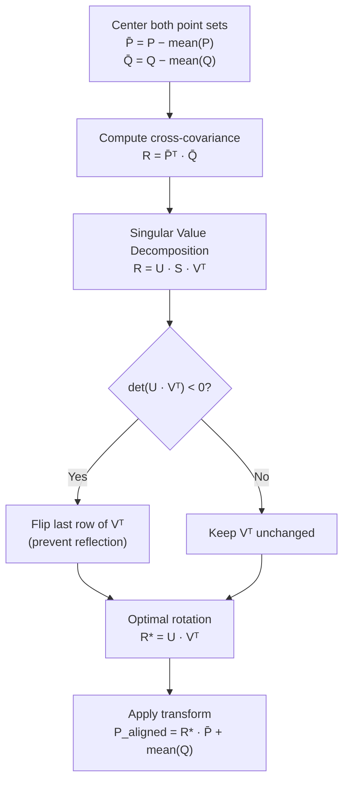
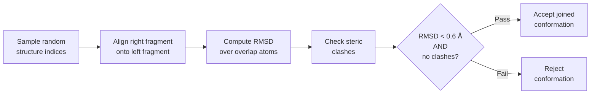

When two structural fragments share a common residue sequence, their 3D coordinates almost never agree — the fragments originate from different database entries with different backbone conformations. The **overlap alignment** algorithm resolves this by computing the rigid-body transformation that best superimposes the shared backbone atoms, while **clash detection** rejects any resulting conformation where non-bonded atoms are driven into physically impossible proximity. Together, these two gates form the quality filter at the core of IDP-o's fragment joining pipeline, deciding which candidate joins survive into the final ensemble.

## The Overlap Region: Peptide-Bond Anchoring

IDP-o fragments each have a length of 6 residues with a **2-residue overlap** between adjacent fragments. This overlap is not arbitrary — it provides just enough backbone atoms to uniquely determine the relative orientation of two fragments. The `generate_fragments` function produces fragments by shifting a window of `seq_len=6` along the sequence with a stride of `seq_len - overlap = 4`, so that each pair of consecutive fragments shares residues at positions `[i-2, i-1]` and `[i-2, i-1]` respectively.

```python
fragments = [s[i * shift : i * shift + seq_len] for i in range((len(s) - seq_len) // shift + 2)]
```

The assertion `l[-overlap:] == r[:overlap]` in `pre_join_fragments` guarantees that the overlapping residues match at the sequence level before any structural comparison is attempted. The merged sequence is then constructed as `l + r[overlap:]`, avoiding duplication of the shared residues.

Sources: [fasta_search_in_foldcomp_database.py](scripts/fasta_search_in_foldcomp_database.py#L146-L150), [join_fragments.py](scripts/join_fragments.py#L88-L93)

## Selecting Alignment Anchor Atoms

Rather than aligning on all 8 backbone atoms (N, CA, C, O × 2 residues) in the overlap, IDP-o selects a **4-atom subset** that straddles the peptide bond between the two overlap residues:

| Fragment | Overlap Residues | `.ravel()` (8 atoms) | `[2:-2]` slice (4 atoms) |
|----------|-----------------|----------------------|---------------------------|
| Left (last 2 residues) | i−1, i | N,CA,C,O,N,CA,C,O | **C**₍ᵢ₋₁₎, **O**₍ᵢ₋₁₎, **N**₍ᵢ₎, **CA**₍ᵢ₎ |
| Right (first 2 residues) | i−1, i | N,CA,C,O,N,CA,C,O | **C**₍ᵢ₋₁₎, **O**₍ᵢ₋₁₎, **N**₍ᵢ₎, **CA**₍ᵢ₎ |

```python
l_indices, r_indices = (
    bb_indices[indexing].ravel()[2:-2]  # (C, O)_i, (N, CA)_(iplus1), join on peptide bond
    for bb_indices, indexing in [
        (l_bb_indices, jnp.arange(-overlap, 0)),
        (r_bb_indices, jnp.arange(overlap)),
    ]
)
```

This is a deliberate design choice: the C–N peptide bond is the most geometrically constrained feature of the polypeptide backbone (partial double-bond character restricts rotation around it). By anchoring the alignment on the atoms flanking this bond — C and O of the upstream residue, N and CA of the downstream residue — the algorithm targets the most physically informative reference frame. Dropping the outer atoms (N, CA of the upstream residue and C, O of the downstream residue) avoids diluting the alignment signal with atoms that are more conformationally variable.

> [!TIP]
> The `[2:-2]` slice is not trimming outliers — it is extracting the 4 atoms that physically define the peptide-bond junction. This is why the overlap must be exactly 2 residues: fewer residues would not provide enough backbone atoms to anchor the alignment.

Sources: [join_fragments.py](scripts/join_fragments.py#L106-L115)

## Kabsch Alignment: The Affine Registration

The `affine_alignment` function implements the **Kabsch algorithm** — the closed-form solution for the optimal rotation matrix that minimizes the RMSD between two paired point sets. Given a mobile point set **P** and a reference point set **Q**, the algorithm proceeds in three stages:



**Step 1 — Centering:** Both point sets are translated so that their centroids lie at the origin. The translation vectors are `translation_geom = geom.mean(0)` and `translation_ref_geom = ref_geom.mean(0)`. Centering decouples the rotational and translational components of the alignment, reducing the problem to a pure rotation.

**Step 2 — Cross-covariance and SVD:** The 3×3 cross-covariance matrix `R = (P − P̄)ᵀ · (Q − Q̄)` encodes the rotational relationship between the two point sets. Its singular value decomposition `R = U · S · Vᵀ` factorizes this relationship into orthogonal matrices U and V that span the rotational degrees of freedom.

**Step 3 — Reflection handling:** If `det(U · Vᵀ) < 0`, the decomposition has produced an improper rotation (a reflection). The algorithm corrects this by negating the last row of Vᵀ, ensuring the resulting rotation is proper (det = +1). Without this correction, pathological input geometries could produce mirrored coordinates.

**Step 4 — Transform application:** The `align` function assembles the full affine transform. The mobile structure is centered (`mobile_pos - pre_trans`), rotated via Einstein summation (`jnp.einsum("ij,bj", rot, ...)`), then translated to the reference centroid (`+ post_trans`). The einsum notation efficiently applies the 3×3 rotation matrix to every atom in the structure in a single vectorized operation.

```python
def align(mobile_pos, ref_pos, mobile_indices, ref_indices):
    l_bb, r_bb = ref_pos[ref_indices], mobile_pos[mobile_indices]
    rot, pre_trans, post_trans = affine_alignment(r_bb, l_bb)
    mobile_pos_aligned = jnp.einsum("ij,bj", rot, mobile_pos - pre_trans) + post_trans
    return mobile_pos_aligned
```

Sources: [join_fragments.py](scripts/join_fragments.py#L35-L50), [join_fragments.py](scripts/join_fragments.py#L52-L57)

## Clash Detection: Steric Violation Filtering

After alignment, the merged structure may contain atoms that were pushed into physically impossible proximity — a **steric clash**. The `check_interactions` function detects these violations through exhaustive pairwise distance computation:

```python
def check_interactions(xyz, bonds=None, cutoff=0.1):
    distances = jnp.sqrt(((xyz[:, None] - xyz[None, :]) ** 2).sum(-1))
    mask = distances < cutoff
    mask = mask.at[tuple(bonds.T)].set(False)   # exclude bonded pairs
    mask = jnp.triu(mask, k=1)                   # upper triangle only (j > i)
    return mask
```

The algorithm operates in three passes:

| Pass | Operation | Rationale |
|------|-----------|-----------|
| **Distance matrix** | `√(Σ(xᵢ - xⱼ)²)` for all pairs | Complete pairwise distance field |
| **Bond exclusion** | Set `mask[bonded_pairs] = False` | Bonded atoms are expected to be close; they must not trigger violations |
| **Upper triangle** | `jnp.triu(mask, k=1)` | Each pair appears once; avoids double-counting and excludes self-distances (k=1 skips diagonal) |

The **cutoff of 0.1 nm (1.0 Å)** is well below the van der Waals radii of any atom pair. At this threshold, a flagged interaction does not represent a marginal steric overlap — it signals a catastrophic geometric violation where two non-bonded atoms occupy nearly the same point in space. Such configurations are physically impossible and must be rejected.

The bond table is derived from MDTraj's `top.create_standard_bonds()`, which generates standard covalent bonds for the merged topology. This ensures that legitimate 1–2 and 1–3 bonded interactions (which naturally have short distances) are never misidentified as clashes.

Sources: [join_fragments.py](scripts/join_fragments.py#L60-L68), [join_fragments.py](scripts/join_fragments.py#L88-L97)

## The Combined Validation Gate

The `_join_fragments` function unifies alignment and clash detection into a single vectorized validation pipeline. For each candidate pair of fragment structures drawn from the left and right ensembles, it performs four operations in sequence:



```python
def align_and_validate(rpos, lpos, r_indices, l_indices):
    rpos_aligned = align(rpos, lpos, r_indices, l_indices)
    rmsd = compute_rmsd(rpos_aligned[r_indices], lpos[l_indices])
    pos = jnp.concatenate([lpos[:lhs], rpos_aligned[rhs:]])
    mask = check_interactions(pos, bonds)
    no_clash_mask = ~mask.any()
    return pos, no_clash_mask, rmsd
```

**Alignment** produces the optimally superimposed right fragment. **RMSD** is computed over the 4 peptide-bond anchor atoms to quantify residual misalignment — even after optimal rotation, the two fragments' overlap atoms will not perfectly coincide because they come from different database structures with different backbone conformations. **Structure assembly** concatenates the left fragment's atoms up to the overlap boundary (`lpos[:lhs]`) with the aligned right fragment's atoms beyond the overlap (`rpos_aligned[rhs:]`), producing the full merged coordinate array. **Clash detection** then scans this merged structure for steric violations.

The final acceptance mask requires **both** criteria to be satisfied simultaneously:

```python
mask = (rmsds < 0.06) & no_clash_mask  # 0.6 Angstrom RMSD threshold
```

| Criterion | Threshold | Physical Interpretation |
|-----------|-----------|------------------------|
| Overlap RMSD | < 0.06 nm (0.6 Å) | Backbone atoms at the junction agree to sub-Ångström precision |
| No steric clash | 0 non-bonded pairs < 0.1 nm | No catastrophic atomic overlaps exist in the merged structure |

The 0.6 Å RMSD threshold is exceptionally stringent. For reference, the typical coordinate uncertainty in X-ray crystallography at 2.0 Å resolution is ~0.2 Å, and NMR ensemble members routinely differ by 1–2 Å RMSD on local backbone segments. The tight threshold ensures that only joins where the two fragments are nearly indistinguishable in the overlap region are accepted, preserving local structural integrity at the junction.

> [!TIP]
> When no candidate pairs pass both filters after 5 retry attempts with different random samples, the algorithm falls back to accepting a single random join (with a logged warning). This prevents pipeline failure for sequences where the fragment database provides only poorly overlapping structures.

Sources: [join_fragments.py](scripts/join_fragments.py#L100-L127)

## JAX Vectorization: Batch Validation at Scale

The validation gate is executed not once but **tens to hundreds of thousands of times** per fragment pair — the `joins_to_attempt_per_pairing` parameter defaults to 500,000. This is made feasible by JAX's `vmap`, which transforms the per-pair `align_and_validate` function into a batched operation that runs on GPU in a single compiled XLA kernel:

```python
pos, no_clash_mask, rmsds = vmap(align_and_validate, in_axes=(0, 0, None, None))(
    rpos, lpos, r_indices, l_indices
)
```

The `in_axes=(0, 0, None, None)` specification indicates that `rpos` and `lpos` are batched along their first axis (different structure samples), while `r_indices` and `l_indices` are shared constants (the same overlap atoms are used for all pairs). This avoids redundant index computation and reduces memory traffic.

To prevent GPU out-of-memory errors on large merged structures, the `jit_chunked_vmap` function decomposes the full batch into chunks sized according to an estimated memory budget:

```python
batch_size = lambda nres, target=10: target / (1e-5 * (nres**2))  # target in GB
```

The O(n²) scaling accounts for the pairwise distance matrix in `check_interactions`, which dominates memory usage. Each chunk is processed via `jax.lax.scan`, and the results are reassembled into a flat output array. This ensures that the algorithm scales to arbitrarily long sequences without exceeding available GPU memory.

Sources: [join_fragments.py](scripts/join_fragments.py#L123-L126), [join_fragments.py](scripts/join_fragments.py#L140-L156), [join_fragments.py](scripts/join_fragments.py#L158-L197)

## Probability-Weighted Sampling and Retry Logic

Not all structure candidates in a fragment ensemble are equally likely. The `join_fragments` function uses **probability-weighted random sampling** to preferentially select structures with higher statistical weight when drawing candidate pairs for joining:

```python
random_indices = tuple(
    random.choice(key, jnp.arange(len(pos)), shape=(n,), p=probs)
    for key, pos, probs in ((lkey, lpos, lprobs), (rkey, rpos, rprobs))
)
```

The probability vectors (`probs`) are derived from the frequency of each structure's source fragment in the database — structures that appear as hits in multiple database entries receive higher weight via the `get_probs` function, which computes inverse-count weights from unique value frequencies. After each successful join, the output ensemble's probabilities are set to the element-wise product of the source fragment probabilities, propagating statistical confidence through the hierarchical joining process.

If the combined RMSD + clash filter rejects all candidates in a batch, the algorithm resamples with a new PRNG key up to **5 attempts** before falling back to a single random join. This graceful degradation ensures that even sequences with sparse or low-quality database coverage produce an ensemble rather than failing entirely.

Sources: [join_fragments.py](scripts/join_fragments.py#L158-L197), [join_fragments.py](scripts/join_fragments.py#L130-L138)

## Algorithmic Complexity and Performance Profile

The computational cost of the overlap alignment and clash detection pipeline is dominated by two operations per candidate pair:

| Operation | Complexity per pair | Notes |
|-----------|-------------------|-------|
| Kabsch alignment (SVD) | O(1) | Fixed 4×3 point sets → 3×3 SVD |
| RMSD computation | O(1) | Fixed 4 overlap atoms |
| Pairwise distance matrix | O(n²) | n = total atoms in merged structure |
| Bond exclusion | O(b) | b = number of bonds |

The **O(n²) distance matrix** is the bottleneck, which is why the chunk size formula scales inversely with n². For a typical IDP of 100 residues (~1,600 heavy atoms before hydrogen inference), the distance matrix requires ~20M entries — well within GPU memory for batch sizes of ~400 candidates per chunk. The entire validation pipeline for 500,000 candidates compiles to a single XLA kernel that executes in seconds on a modern GPU.

Sources: [join_fragments.py](scripts/join_fragments.py#L60-L68), [join_fragments.py](scripts/join_fragments.py#L159-L162)

---

Understanding how fragments are geometrically validated is essential context for the next algorithm in the pipeline: [JAX Vectorized Ensemble Computation](10-jax-vectorized-ensemble-computation) covers how the full ensemble is assembled and stored after all joins have been filtered. For the upstream mechanism that produces the fragment pairs entering this algorithm, see [Hierarchical Fragment Joining](8-hierarchical-fragment-joining).