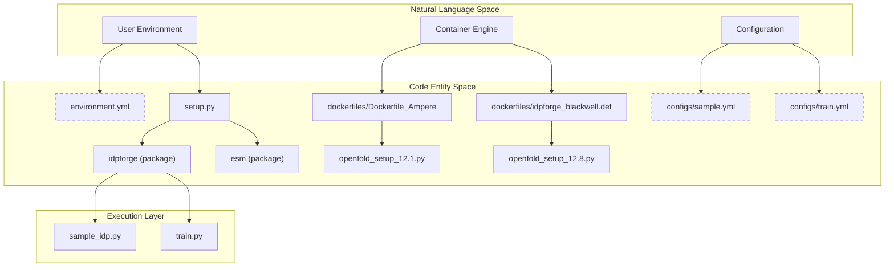
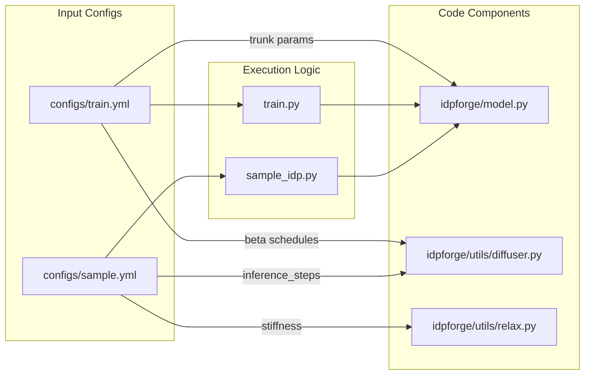

# Getting Started: Installation & Configuration

Relevant source files

The following files were used as context for generating this wiki page:

- [README.md](README.md)
- [configs/sample.yml](configs/sample.yml)
- [configs/train.yml](configs/train.yml)
- [dockerfiles/Dockerfile_Ampere](dockerfiles/Dockerfile_Ampere)
- [dockerfiles/Dockerfile_Blackwell](dockerfiles/Dockerfile_Blackwell)
- [dockerfiles/env.yml](dockerfiles/env.yml)
- [dockerfiles/idpforge_ampere.def](dockerfiles/idpforge_ampere.def)
- [dockerfiles/idpforge_blackwell.def](dockerfiles/idpforge_blackwell.def)
- [dockerfiles/openfold_setup_12.1.py](dockerfiles/openfold_setup_12.1.py)
- [dockerfiles/openfold_setup_12.8.py](dockerfiles/openfold_setup_12.8.py)
- [environment.yml](environment.yml)
- [setup.py](setup.py)

This page provides a technical guide for setting up the IDPForge environment. IDPForge requires a specific stack of machine learning libraries (PyTorch, PyTorch Lightning), molecular dynamics tools (OpenMM, MDTraj), and bioinformatics utilities (OpenFold, ESM2).

## Environment Setup Strategies

IDPForge supports two primary installation paths depending on the target hardware (Ampere vs. Blackwell architectures) and the deployment environment (Local vs. HPC).

### 1. Conda/Mamba Installation
The primary method uses `environment.yml` to resolve dependencies. The project explicitly pins `pip==25.2` as newer versions may cause installation conflicts with specific ML components [dockerfiles/Dockerfile_Ampere:25-27]().

| Component | Default (Ampere/Older) | Alternative (Blackwell/Newer) |
| :--- | :--- | :--- |
| **CUDA Toolkit** | 12.1 | 12.8 |
| **PyTorch** | 2.5.1 | 2.7.1 |
| **Python** | 3.10 | 3.10 |

**Key Dependencies:**
*   **ML Core:** `torch`, `pytorch-lightning`, `einops`, `ml-collections` [environment.yml:62-75]().
*   **Bioinformatics:** `hmmer`, `hhsuite`, `mmseqs2`, `pdb-tools` [environment.yml:48-52]().
*   **Simulation/Structure:** `openmm`, `pdbfixer`, `mdtraj`, `biopython` [environment.yml:39-45]().

**Installation Workflow:**
1. Create environment: `conda env create -f environment.yml` [README.md:26]().
2. Install IDPForge as an editable module: `pip install -e .` [README.md:40]().
3. Setup OpenFold (see below).

### 2. OpenFold Integration
IDPForge relies on OpenFold for its structure module kernels. Because OpenFold requires custom CUDA kernel compilation, IDPForge provides specialized setup scripts to ensure compatibility with modern CUDA versions.

**OpenFold Setup Procedure:**
1. Clone OpenFold into the same parent directory as IDPForge [README.md:49-53]().
2. Download `stereo_chemical_props.txt` into `openfold/openfold/resources` [README.md:61-65]().
3. Replace `openfold/setup.py` with the versioned script from IDPForge:
    *   For CUDA 12.1: `dockerfiles/openfold_setup_12.1.py` [dockerfiles/openfold_setup_12.1.py:1-114]().
    *   For CUDA 12.8: `dockerfiles/openfold_setup_12.8.py` [dockerfiles/openfold_setup_12.8.py:1-116]().
4. Install with build isolation disabled: `pip install -e . --no-build-isolation` [README.md:94]().

**Sources:** [README.md:13-97](), [environment.yml:1-82](), [setup.py:1-23](), [dockerfiles/openfold_setup_12.1.py:1-114](), [dockerfiles/openfold_setup_12.8.py:1-116]()

---

## Containerized Deployment

For reproducible environments, IDPForge provides both Dockerfiles and Apptainer (Singularity) definition files. These containers bundle the environment, including the complex OpenFold kernel compilation.

### System Architecture Diagram: Installation & Runtime
This diagram maps the high-level installation components to their respective code entities and file locations.

**Sources:** [README.md:212-220](), [dockerfiles/Dockerfile_Ampere:1-63](), [dockerfiles/idpforge_ampere.def:1-120](), [setup.py:12-12]()

---

## Configuration Files

IDPForge uses YAML configuration files to manage model hyperparameters, diffusion schedules, and data paths.

### 1. Training Configuration (`configs/train.yml`)
Controls the neural network architecture and the training loop parameters.

*   **Diffusion Schedule:** Defines the linear noise schedule for both Euclidean (coordinates) and Torsional (angles) space via `euclid_b0/bT` and `torsion_b0/bT` [configs/train.yml:57-60]().
*   **Loss Weights:** Balances FAPE (Frame Aligned Point Error), distance, angular, and violation losses [configs/train.yml:31-35]().
*   **Model Architecture:** Configures the `trunk` (number of blocks, state dimensions) and the `structure_module` (IPA heads, transition layers) [configs/train.yml:69-93]().

### 2. Inference Configuration (`configs/sample.yml`)
Controls the generation of protein ensembles.

*   **Inference Steps:** `n_tsteps_inf` (often set to 40) defines the number of reverse diffusion steps [configs/sample.yml:45]().
*   **Potential Guidance:** The `potential` flag enables gradient-based guidance during sampling (e.g., using PRE or FRET data) [configs/sample.yml:34-38]().
*   **Relaxation:** Parameters for the AMBER force field relaxation post-sampling, including `tolerance` and `stiffness` [configs/sample.yml:51-56]().

### Configuration Data Flow
The following diagram illustrates how configuration entities interact with the sampling and training scripts.

**Sources:** [configs/train.yml:1-93](), [configs/sample.yml:1-56](), [train.py:1-46](), [sample_idp.py:1-42]()

---

## External Data & Weights

IDPForge requires pre-computed files and model weights that are not stored in the repository due to size.

1.  **Model Weights:** `weights/mdl.ckpt` should be placed in the repository root [README.md:204]().
2.  **IGSO3 Cache:** `data/diff_igso3.pkl` is required for rotational diffusion calculations [configs/train.yml:29]().
3.  **Fragment Library:** `data/example_data.pkl` provides the secondary structure fragments used during sampling [configs/sample.yml:42]().

**Sources:** [README.md:200-205](), [configs/sample.yml:42-42](), [configs/train.yml:29-29]()

---