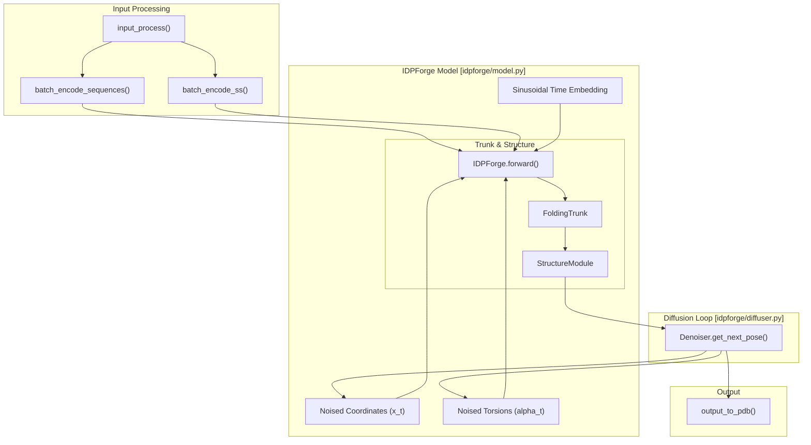
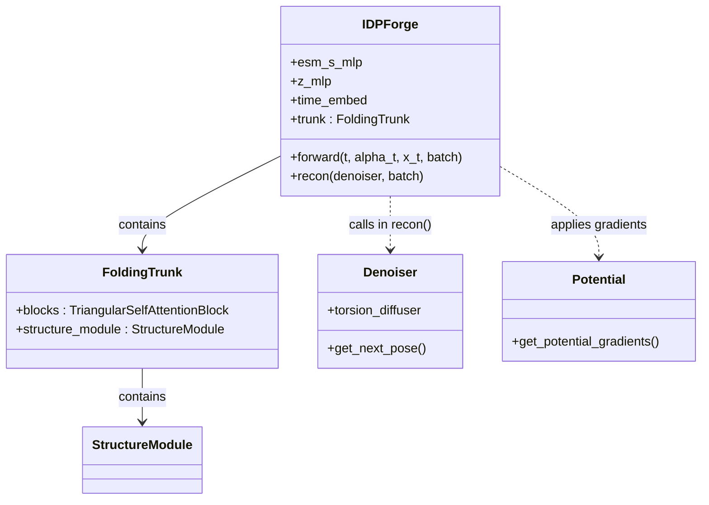

# IDPForge Core Model Architecture

Relevant source files

The following files were used as context for generating this wiki page:

- [README.md](README.md)
- [configs/sample.yml](configs/sample.yml)
- [idpforge/esm_wrapper.py](idpforge/esm_wrapper.py)
- [idpforge/model.py](idpforge/model.py)

IDPForge is a transformer-based protein language diffusion model designed to generate all-atom ensembles of Intrinsically Disordered Proteins (IDPs) and Intrinsically Disordered Regions (IDRs) [README.md:1-4](). The architecture integrates the structural reasoning capabilities of ESMFold with a diffusion framework to model the conformational flexibility inherent in disordered proteins.

### System Overview Diagram

The following diagram illustrates the high-level data flow between the core components of the IDPForge system.

**Sources:** [idpforge/model.py:36-153](), [idpforge/misc.py:21-21](), [README.md:1-4]()

---

### Core Components

#### 1. Neural Network Architecture (Trunk & Structure Module)
The `IDPForge` class [idpforge/model.py:36-38]() serves as the central neural network. It utilizes an ESM2-based `FoldingTrunk` [idpforge/model.py:69-69]() to process sequence and pairwise information. Unlike standard folding models, IDPForge incorporates:
*   **Time Embeddings:** Sinusoidal embeddings that inform the model of the current diffusion step [idpforge/model.py:59-61]().
*   **Secondary Structure Encoding:** Explicit embeddings for secondary structure types (e.g., Helix, Sheet, Coil) to bias the ensemble generation [idpforge/model.py:67-67]().
*   **IPA Structure Module:** An Invariant Point Attention (IPA) module that predicts 3D coordinates and torsion angles [configs/sample.yml:18-30]().

For details, see [Model Architecture: Trunk, Structure Module & ESM Integration](#2.1).

#### 2. Diffusion Process & IGSO3 Utilities
IDPForge treats protein conformation generation as a reverse diffusion task. The `Diffuser` and `Denoiser` classes manage the transition from high-entropy (noisy) states to structured ensembles.
*   **Euclidean Diffusion:** Applied to backbone $C\alpha$ coordinates.
*   **Torsional Diffusion:** Applied to protein backbone and sidechain dihedral angles using IGSO3 rotational distributions to maintain proper geometry [idpforge/model.py:194-196]().

For details, see [Diffusion Process: Diffuser, Denoiser & IGSO3 Utilities](#2.2).

#### 3. Input Processing & Secondary Structure Assignment
Before reaching the model, raw protein sequences and secondary structure strings are transformed into tensors via `input_process()` [idpforge/model.py:21-21](). This stage handles:
*   **Ramachandran Assignment:** Converting $(\phi, \psi)$ angles into discrete secondary structure labels using `assign_rama`.
*   **Chimeric Handling:** Managing residue index offsets for IDRs grafted onto folded domains.

For details, see [Input Processing & Secondary Structure Encoding](#2.3).

#### 4. Experimental Guidance Potentials
During the reverse diffusion sampling loop (`recon`), the model can be guided by experimental data [idpforge/model.py:190-192](). The `Potential` system allows the integration of:
*   **Radius of Gyration (RoG):** Compacting or expanding the ensemble.
*   **PRE/FRET:** Distance restraints derived from Paramagnetic Relaxation Enhancement or Förster Resonance Energy Transfer.
*   **J-Couplings:** NMR-derived local geometry restraints.

For details, see [Experimental Guidance Potentials](#2.4).

---

### Architecture-Code Mapping

This diagram maps specific codebase entities to their functional roles within the architecture.

**Sources:** [idpforge/model.py:36-70](), [idpforge/model.py:156-196](), [configs/sample.yml:1-33]()

### Summary Table: Core Parameters

| Component | Key Class/Function | Config Section | Purpose |
| :--- | :--- | :--- | :--- |
| **Trunk** | `FoldingTrunk` | `model.trunk` | Processes sequence/pairwise states [idpforge/model.py:69]() |
| **IPA** | `StructureModule` | `model.trunk.structure_module` | Predicts 3D frames and angles [configs/sample.yml:18]() |
| **Diffusion** | `Denoiser` | `diffuse` | Handles noise schedules and sampling [idpforge/model.py:194]() |
| **Input** | `input_process` | N/A | Tensorizes sequence and SS data [idpforge/model.py:21]() |
| **Guidance** | `Potential` | `potential_cfg` | Injects experimental constraints [idpforge/model.py:190]() |

**Sources:** [idpforge/model.py:21-70](), [configs/sample.yml:1-50]()

---