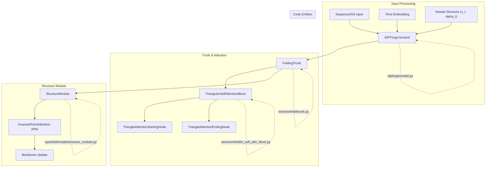
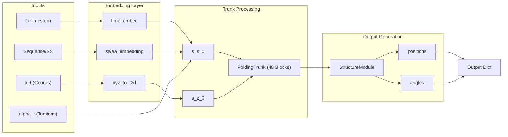

# Model Architecture: Trunk, Structure Module & ESM Integration

<details>
<summary>Relevant source files</summary>

The following files were used as context for generating this wiki page:

- [esm/axial_attention.py](esm/axial_attention.py)
- [esm/esm2.py](esm/esm2.py)
- [esm/esmfold/categorical_mixture.py](esm/esmfold/categorical_mixture.py)
- [esm/esmfold/misc.py](esm/esmfold/misc.py)
- [esm/esmfold/tri_self_attn_block.py](esm/esmfold/tri_self_attn_block.py)
- [esm/esmfold/trunk.py](esm/esmfold/trunk.py)
- [esm/modules.py](esm/modules.py)
- [esm/multihead_attention.py](esm/multihead_attention.py)
- [esm/rotary_embedding.py](esm/rotary_embedding.py)
- [idpforge/esm_wrapper.py](idpforge/esm_wrapper.py)
- [idpforge/model.py](idpforge/model.py)

</details>


The IDPForge model is a deep neural network designed for the generation of intrinsically disordered protein (IDP) ensembles. It leverages a modified version of the **ESMFold** architecture, integrating a diffusion-based approach to structural prediction. The model combines large-scale protein language model (ESM-2) embeddings with a geometry-aware folding trunk and an Invariant Point Attention (IPA) structure module.

## Core Architecture Overview

The model, defined in `IDPForge` [idpforge/model.py:36-69](), processes sequence, secondary structure, and noised structural features through a series of specialized modules to predict denoised backbone coordinates and torsion angles.

### System Mapping: Conceptual to Code

The following diagram bridges high-level architectural components to their specific implementations within the `idpforge` and `esm` namespaces.

**Diagram: IDPForge Entity Mapping**

**Sources:** [idpforge/model.py:36-70](), [esm/esmfold/trunk.py:113-150](), [esm/esmfold/tri_self_attn_block.py:26-106]()

---

## Input Embeddings & Feature Fusion

The `forward` pass [idpforge/model.py:79-153]() begins by fusing multiple information streams into a single-representation state ($s$) and a pairwise-representation state ($z$).

### 1. Sinusoidal Time Embedding
To inform the network of the current diffusion progress, the timestep $t$ is converted into a vector using a fixed sinusoidal embedding [idpforge/model.py:59-61](). This embedding is concatenated with the noised torsion features `alpha_t` [idpforge/model.py:110-111]().

### 2. Sequence and Secondary Structure (SS) Encodings
IDPForge extends the standard ESMFold input by explicitly embedding secondary structure labels.
*   **AA Embedding:** Encodes the primary sequence [idpforge/model.py:68]().
*   **SS Embedding:** Encodes 3-state or 8-state secondary structure definitions [idpforge/model.py:67]().
*   **Feature Fusion:** The time-torsion vector is projected via `esm_s_mlp` and summed with the AA and SS embeddings to form the initial sequence state `s_s_0` [idpforge/model.py:112-114]().

### 3. Geometry Encoding (xyz_to_t2d)
The noised Cartesian coordinates $x_t$ are converted into pairwise distances and orientations using `xyz_to_t2d` [idpforge/model.py:118-119](). This geometric information is projected via `z_mlp` to form the initial pairwise state `s_z_0` [idpforge/model.py:51-56]().

**Sources:** [idpforge/model.py:51-68](), [idpforge/model.py:110-120]()

---

## The Folding Trunk

The `FoldingTrunk` [esm/esmfold/trunk.py:113]() is the computational engine of the model, consisting of 48 blocks (by default) of `TriangularSelfAttentionBlock`.

### Triangular Self-Attention Block
Each block updates the sequence and pairwise states through a series of specialized attention mechanisms:
1.  **Sequence-to-Pair Communication:** Sequence information is projected into the pairwise space [esm/esmfold/tri_self_attn_block.py:142]().
2.  **Pair-to-Sequence Communication:** Pairwise features act as a bias for sequence self-attention [esm/esmfold/tri_self_attn_block.py:133-137]().
3.  **Triangular Multiplicative Updates:** Updates edges $(i, j)$ based on triangles $(i, j, k)$ using incoming and outgoing edges [esm/esmfold/tri_self_attn_block.py:146-151]().
4.  **Triangular Attention:** Attention mechanisms that respect the triangle inequality, operating on rows (`TriangleAttentionStartingNode`) and columns (`TriangleAttentionEndingNode`) [esm/esmfold/tri_self_attn_block.py:153-164]().

### Recycling Mechanism
The trunk supports iterative refinement through "recycling." The outputs from a previous pass (sequence state, pairwise state, and a distogram of predicted positions) are normalized and added back to the initial embeddings for the next iteration [idpforge/model.py:121-129]().

**Sources:** [esm/esmfold/tri_self_attn_block.py:132-169](), [esm/esmfold/trunk.py:183-205](), [idpforge/model.py:121-133]()

---

## Structure Module & IPA

The final stage of the network is the `StructureModule` [esm/esmfold/trunk.py:147](), which transforms the abstract latent representations into physical 3D coordinates.

### Invariant Point Attention (IPA)
The core of the Structure Module is **Invariant Point Attention**. Unlike standard attention, IPA is invariant to the global rotation and translation of the protein frames. It operates by:
*   Maintaining a "backbone frame" (rotation matrix and translation vector) for each residue.
*   Performing attention in local coordinate systems.
*   Updating frames iteratively through a dedicated transition layer.

### Torsion Prediction
In addition to Cartesian coordinates, the model predicts torsion angles ($\phi, \psi, \omega$ and sidechain $\chi$ angles). These are output as `angles` and `unnormalized_angles` in the final structure dictionary [idpforge/model.py:141-142]().

**Sources:** [esm/esmfold/trunk.py:18-34](), [idpforge/model.py:134-145]()

---

## Data Flow: Forward Pass

The data flow within `IDPForge.forward` is summarized below, illustrating the transition from noised inputs to predicted structural frames.

**Diagram: IDPForge Forward Data Flow**

**Sources:** [idpforge/model.py:79-153](), [esm/esmfold/trunk.py:160-205]()

---

## Implementation Details

### Sinusoidal Embedding
The time embedding is initialized using a fixed sinusoidal pattern and is not updated during training:
```python
self.time_embed = nn.Embedding(n_tsteps, cfg.t_embed_dim)
self.time_embed.weight.data = sinusoidal_embedding(n_tsteps, cfg.t_embed_dim)
self.time_embed.requires_grad_(False)
```
[idpforge/model.py:59-61]()

### ESM Integration
While IDPForge can utilize pre-computed ESM-2 embeddings, the `ESM_preprocess` class in `idpforge/esm_wrapper.py` handles the conversion between OpenFold/AlphaFold residue indexing and the ESM-2 alphabet [idpforge/esm_wrapper.py:34-43](). It specifically adds `<bos>` and `<eos>` tokens required by the language model [idpforge/esm_wrapper.py:54-62]().

**Sources:** [idpforge/model.py:59-61](), [idpforge/esm_wrapper.py:34-98]()

---