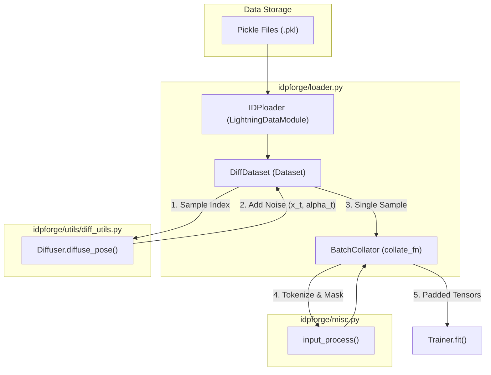

# Training Entrypoint & Data Loading

<details>
<summary>Relevant source files</summary>

The following files were used as context for generating this wiki page:

- [configs/train.yml](configs/train.yml)
- [idpforge/loader.py](idpforge/loader.py)
- [train.py](train.py)

</details>


This section documents the training infrastructure of IDPForge, focusing on the `train.py` entrypoint and the data pipeline implemented in `idpforge/loader.py`. The pipeline handles the ingestion of protein conformational ensembles, applies diffusion noise in both Euclidean and torsional spaces, and batches the resulting data for the neural network.

## Training Entrypoint

The training process is orchestrated by `train.py`, which utilizes **PyTorch Lightning** to manage the training loop, checkpointing, and logging [train.py:14-17](). It serves as the bridge between the configuration files, the data loading module, and the model wrapper.

### Initialization and Configuration
The script begins by initializing the `Diffuser` and `Denoiser` objects using parameters defined in the `diffuse` section of the configuration YAML [train.py:25-28](). These objects define the noise schedules for Euclidean coordinates and torsion angles.

The training configuration (typically `configs/train.yml`) specifies critical hyperparameters:
*   **Data Paths**: Locations for training and validation pickle files [configs/train.yml:9-12]().
*   **Batch Sizes**: Separate sizes for training and validation [configs/train.yml:13-14]().
*   **Trainer Settings**: Gradient clipping, accumulation, and hardware acceleration (GPU) [configs/train.yml:23-27]().
*   **Loss Weights**: Balancing factors for FAPE, distance, angular, and violation losses [configs/train.yml:31-35]().

### Checkpointing and Callbacks
`train.py` implements several `ModelCheckpoint` strategies to ensure robust training recovery and model selection:
1.  **Best 5**: Saves the top 5 models based on `val_loss` [train.py:59-67]().
2.  **Latest 10**: Keeps the 10 most recent checkpoints for resume capability [train.py:70-78]().
3.  **Periodic**: Saves a checkpoint every 10 epochs regardless of performance [train.py:81-86]().

Sources: [train.py:21-118](), [configs/train.yml:1-60]()

## Data Loading Architecture

The data loading system is built around the `IDPloader` (a `LightningDataModule`), which manages the `DiffDataset` and `BatchCollator`.

### Data Flow Overview

The following diagram illustrates how raw protein data is transformed into diffused training batches.

**Training Data Flow: From Pickle to Batch**

Sources: [idpforge/loader.py:18-144](), [train.py:29-36]()

### DiffDataset Implementation
The `DiffDataset` class is responsible for loading the ground truth coordinates, sequences, and secondary structure (SS) labels. Its primary role is to apply the diffusion process to each sample during the `__getitem__` call [idpforge/loader.py:62-99]().

*   **Noise Injection**: It calls `diffuse_pose()` from the `Diffuser` to generate noisy coordinates (`x_t`) and noisy torsion angles (`alpha_t`) [idpforge/loader.py:63-64]().
*   **Time-Step Sampling**: During training, a time-step $T$ is sampled using a weighted distribution where later time-steps (more noise) are prioritized [idpforge/loader.py:67-68]().
*   **Torsion & Frame Calculation**: It calculates the ground truth dihedral angles (omega, phi, psi, chi) and transforms them into local reference frames using `torsion_angles_to_frames` [idpforge/loader.py:75-86]().

### BatchCollator and Input Processing
Because protein sequences vary in length, the `BatchCollator` handles padding and tensor alignment. It utilizes `input_process()` from `idpforge/misc.py` to convert raw sequence strings and SS strings into numerical embeddings and generate attention masks [idpforge/loader.py:24-29]().

Key outputs of the collator include:
*   `sequence`: Padded token IDs for the ESM2 trunk.
*   `ss`: Padded secondary structure encodings.
*   `x_t` / `alpha_t`: Noisy Euclidean and torsional inputs for the denoiser.
*   `T`: The diffusion time-step, broadcasted across the residue dimension [idpforge/loader.py:40-41]().

Sources: [idpforge/loader.py:18-45](), [idpforge/loader.py:48-100]()

## Code Entity Mapping

This diagram maps the conceptual training stages to the specific classes and functions in the codebase.

**System Entity Mapping**
```mermaid
classDiagram
    class "train.py" {
        +main(args)
        +Trainer trainer
    }
    class "IDPloader" {
        +setup(stage)
        +train_dataloader()
        +val_dataloader()
    }
    class "DiffDataset" {
        +__getitem__(idx)
        +Diffuser template_diffuser
    }
    class "BatchCollator" {
        +__call__(batch)
    }
    class "Diffuser" {
        +diffuse_pose(coords, seq)
    }
    class "IDPForgeWrapper" {
        +training_step(batch)
        +calc_loss(batch, pred)
    }

    "train.py" --> "IDPloader" : initializes
    "train.py" --> "IDPForgeWrapper" : wraps model
    "IDPloader" --> "DiffDataset" : creates
    "IDPloader" --> "BatchCollator" : uses for DataLoader
    "DiffDataset" --> "Diffuser" : applies noise
    "IDPForgeWrapper" ..> "BatchCollator" : consumes output
```
Sources: [train.py:21-39](), [idpforge/loader.py:18-102](), [idpforge/utils/diff_utils.py:14-15]()

## Training Data Format
The training data is stored as pickle files containing four main components:
1.  **SS**: Secondary structure labels (strings or integer encodings).
2.  **Sequence**: Amino acid sequences.
3.  **Coords**: Ground truth atomic coordinates (typically $N, CA, C, O, CB$).
4.  **RGs**: (Optional) Radius of Gyration values for validation metrics.

These are loaded into `DiffDataset` as a list of tuples or dictionaries [idpforge/loader.py:126-128]().

Sources: [idpforge/loader.py:49-56](), [idpforge/loader.py:121-131]()

---