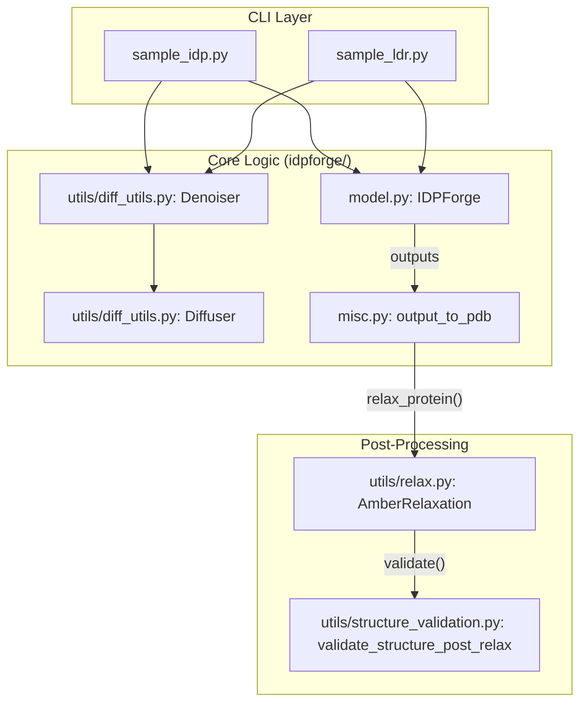
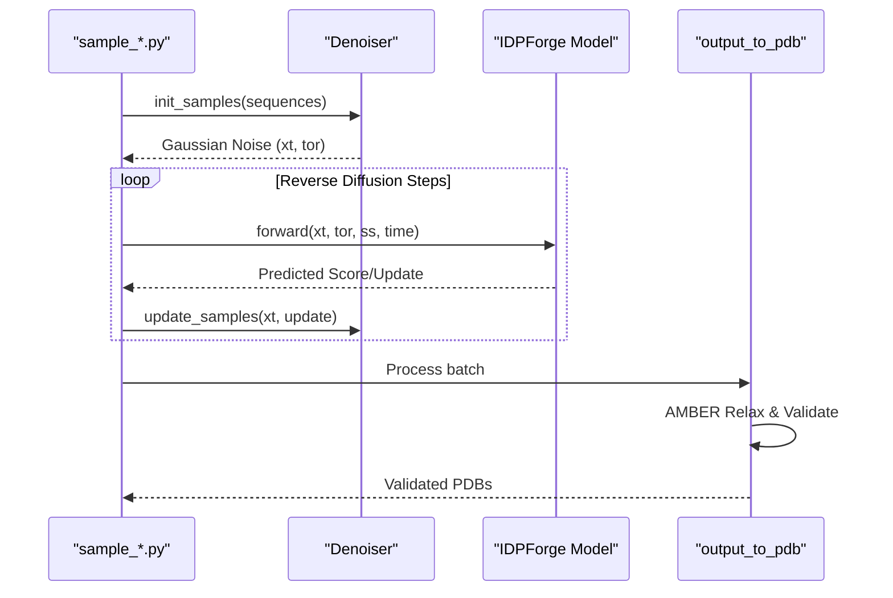

# Inference: Generating Protein Ensembles

Relevant source files

The following files were used as context for generating this wiki page:

- [idpforge/misc.py](idpforge/misc.py)
- [sample_idp.py](sample_idp.py)
- [sample_ldr.py](sample_ldr.py)

Inference in IDPForge is the process of generating structural ensembles for intrinsically disordered proteins (IDPs) or intrinsically disordered regions (IDRs) within a folded context. The system uses a reverse diffusion process guided by secondary structure predictions and optional experimental constraints.

The inference pipeline is split into two primary entry points: `sample_idp.py` for standalone disordered sequences and `sample_ldr.py` for disordered regions connected to static folded domains. Both scripts utilize the `IDPForge` model and the `Denoiser`/`Diffuser` framework to iteratively refine protein coordinates from noise.

### Inference Architecture Overview

The following diagram illustrates the relationship between the high-level inference scripts and the underlying code entities that drive the sampling process.

**Sampling System Bridge**

**Sources:** [sample_idp.py:16-21](), [sample_ldr.py:19-23](), [idpforge/misc.py:119-135]()

---

### Sampling Modes

#### 1. Full IDP Sampling
This mode is used when the entire protein sequence is considered disordered. The `sample_idp.py` script takes a raw amino acid sequence and generates an ensemble by sampling secondary structure configurations from a database and diffusing coordinates in a global Euclidean space.

For details on CLI arguments, secondary structure lookup, and potential-guided sampling, see **[Sampling Full IDPs (sample_idp.py)](#4.1)**.

**Sources:** [sample_idp.py:27-29](), [sample_idp.py:88-104]()

#### 2. IDRs in Folded Context (LDR)
The "Local Disordered Region" (LDR) mode is designed for chimeric proteins where one or more IDRs are grafted onto a folded template (e.g., AlphaFold2 predicted domains). The `sample_ldr.py` script uses a `.npz` template to define fixed coordinates and masks, ensuring the generated IDRs are physically consistent with the folded domains.

For details on template tiling, junction gates, and bfloat16 inference, see **[Sampling IDRs in Folded Context (sample_ldr.py)](#4.2)**.

**Sources:** [sample_ldr.py:30-37](), [sample_ldr.py:72-75]()

---

### The Sampling Lifecycle

Regardless of the mode, the generation process follows a standardized lifecycle managed by the `Denoiser` class [idpforge/utils/diff_utils.py:47]().

**Inference Data Flow**

**Sources:** [sample_idp.py:141-169](), [sample_ldr.py:170-200](), [idpforge/misc.py:119-135]()

---

### Key Components

| Component | Code Entity | Description |
| :--- | :--- | :--- |
| **Denoiser** | `Denoiser` [idpforge/utils/diff_utils.py:47]() | Manages the inference schedule and iterative updates of $x_t$. |
| **SS Encoding** | `batch_encode_ss` [idpforge/misc.py:75]() | Converts string-based secondary structure (H, E, C) into model tokens. |
| **Output Handler** | `output_to_pdb` [idpforge/misc.py:119]() | Orchestrates the transition from raw model tensors to relaxed PDB files. |
| **Template Prep** | `mk_ldr_template.py` | Utility to create the `.npz` files required for LDR sampling. |

---

### Post-Generation Pipeline

Generated conformers are not immediately saved as final results. They must pass through a rigorous quality control pipeline to ensure biological relevance:

1.  **Backbone Continuity Check:** A pre-relaxation filter that ensures $C\alpha-C\alpha$ distances are within physical limits [idpforge/misc.py:198-201]().
2.  **AMBER Relaxation:** The `relax_protein` function uses OpenMM to resolve steric clashes while maintaining the model's predicted topology [idpforge/misc.py:122]().
3.  **Structural Validation:** A final suite of checks for chirality, bond lengths, and knotting [idpforge/misc.py:132]().

For details on the relaxation and validation logic, see **[Post-Generation Processing: Relaxation, Repair & Validation](#4.4)**.

**Sources:** [idpforge/misc.py:136-160](), [sample_ldr.py:100-108]()

---

### Child Pages
*   **[Sampling Full IDPs (sample_idp.py)](#4.1)**: Standalone IDP generation and experimental guidance.
*   **[Sampling IDRs in Folded Context (sample_ldr.py)](#4.2)**: Template-based sampling for chimeric proteins.
*   **[Template Preparation Utilities](#4.3)**: Creating `.npz` templates from PDB structures.
*   **[Post-Generation Processing: Relaxation, Repair & Validation](#4.4)**: The AMBER and validation quality gate.

---