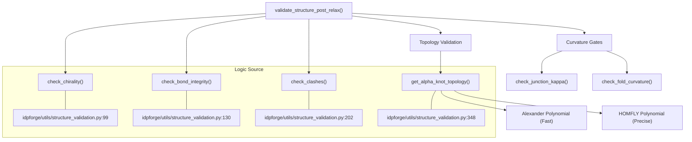
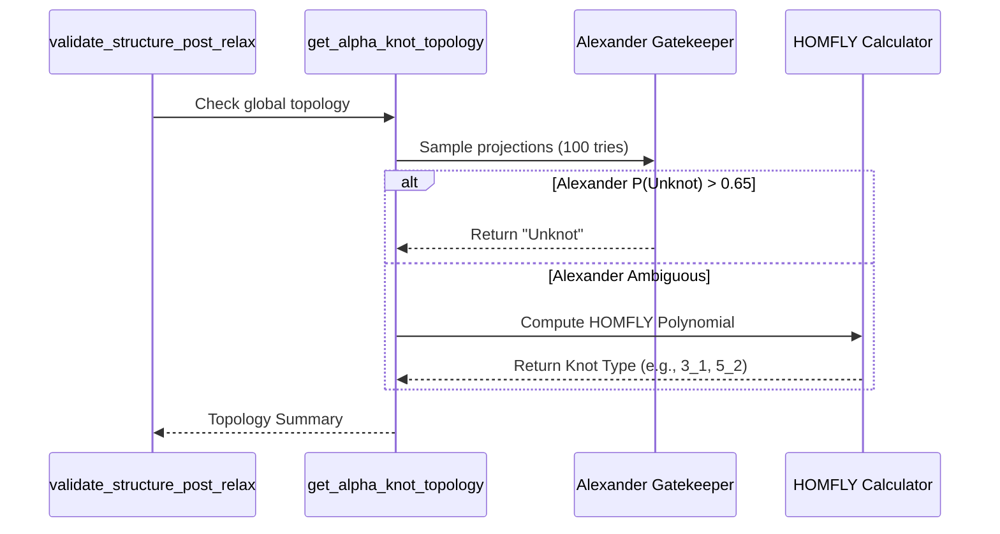

# Structural Validation Suite

Relevant source files

The following files were used as context for generating this wiki page:

- [idpforge/utils/structure_validation.py](idpforge/utils/structure_validation.py)

The Structural Validation Suite, primarily implemented in `idpforge/utils/structure_validation.py`, provides a comprehensive set of geometric and topological checks to ensure the physical viability of generated protein ensembles. It is executed as a post-generation quality gate, particularly within the AlphaFlex pipeline's ensemble assembly stage.

## Core Validation Workflow

The primary entry point for validation is `validate_structure_post_relax()`. This function orchestrates a series of checks ranging from basic chemical integrity to complex knot topology analysis.

### Data Flow and Initialization
The suite accepts an OpenMM `Topology` and `Positions` object. It converts these to high-precision `float64` NumPy arrays to avoid rounding errors during geometric calculations [idpforge/utils/structure_validation.py:89-94]().

### Validation Sequence
1.  **Chirality Check**: Ensures all non-glycine residues maintain L-amino acid stereochemistry [idpforge/utils/structure_validation.py:99-100]().
2.  **Bond Integrity**: Uses a graph-based comparison to detect broken covalent bonds [idpforge/utils/structure_validation.py:130-131]().
3.  **Clash Detection**: Identifies steric overlaps between non-bonded heavy atoms [idpforge/utils/structure_validation.py:202-203]().
4.  **Topology (Knot) Analysis**: Employs a hybrid Alexander-HOMFLY polynomial approach to classify the global and domain-specific fold topology [idpforge/utils/structure_validation.py:348-350]().
5.  **Curvature Gating**: Measures the geometric strain at junction points and within folded domains [idpforge/utils/structure_validation.py:449-450]().

**Sources:** [idpforge/utils/structure_validation.py:89-203](), [idpforge/utils/structure_validation.py:348-450]()

---

## Geometric Integrity Checks

### Chirality Validation
The `check_chirality()` function validates the $C_\alpha$ stereocenter. For each residue (excluding Glycine), it calculates the **scalar triple product** of the vectors from $C_\alpha$ to $N$, $C$, and $C_\beta$ [idpforge/utils/structure_validation.py:109-114]().
*   **Threshold**: A volume $< 1.0 \text{ \AA}^3$ is flagged as a violation (D-amino acid or distorted planar geometry) [idpforge/utils/structure_validation.py:116-118]().

### Bond Integrity
`check_bond_integrity()` performs an atom-name-agnostic graph comparison. It builds an "expected" bond graph from the topology and an "observed" graph based on a distance cutoff (default 2.0 \AA) [idpforge/utils/structure_validation.py:121-122](), [idpforge/utils/structure_validation.py:166](). If the degree sequences of these graphs do not match, the residue is flagged for broken covalent bonds [idpforge/utils/structure_validation.py:170-175]().

### Steric Clash Detection
Clashes are detected using a `cKDTree` for efficient neighbor searching [idpforge/utils/structure_validation.py:214]().
*   **Radius**: The system uses VDW radii (C: 1.70, N: 1.55, O: 1.52, S: 1.80) [idpforge/utils/structure_validation.py:20]().
*   **Gate**: A clash is defined as two non-bonded heavy atoms closer than $0.7 \times (\text{vdw}_1 + \text{vdw}_2)$ [idpforge/utils/structure_validation.py:216]().

**Sources:** [idpforge/utils/structure_validation.py:19-20](), [idpforge/utils/structure_validation.py:99-186](), [idpforge/utils/structure_validation.py:202-225]()

---

## AlphaKnot2 Hybrid Topology Classification

The suite implements a robust topology engine in `get_alpha_knot_topology()` to prevent the generation of spurious knots in IDRs or the loss of native knots in folded domains.

### The Hybrid Approach
1.  **Alexander Polynomial**: A fast, probabilistic check (`ALEXANDER_TRIES = 100`) acts as a gatekeeper [idpforge/utils/structure_validation.py:23-25](). If the Alexander polynomial indicates an unknot with high probability, the structure is cleared quickly.
2.  **HOMFLY Polynomial**: If the Alexander check is ambiguous or indicates a knot, the system invokes the `pyknotid` library to calculate the HOMFLY polynomial, which is a more powerful topological invariant [idpforge/utils/structure_validation.py:382-390]().

### Domain-Specific Validation
The function `validate_per_domain_knots()` compares the observed topology of specific residue ranges against an expected `knot_screening.json` specification [idpforge/utils/structure_validation.py:47-69](), [idpforge/utils/structure_validation.py:421-425](). This ensures that if a protein is known to be a 3_1 knot (trefoil), the generated ensemble preserves that specific topology [idpforge/utils/structure_validation.py:435-440]().

**Sources:** [idpforge/utils/structure_validation.py:22-44](), [idpforge/utils/structure_validation.py:348-440]()

---

## Curvature and Junction Gates

To prevent unphysical "kinks" at the transition between folded domains and disordered linkers, the suite applies curvature constraints.

### Junction Kappa
`check_junction_kappa()` calculates the local curvature ($\kappa$) at the junction points defined in the graft specification. It uses a sliding window (default 20 residues) to compute the angle between segments [idpforge/utils/structure_validation.py:33](), [idpforge/utils/structure_validation.py:449-455]().

### Fold Curvature
`check_fold_curvature()` ensures that the internal geometry of the folded domains has not been distorted during the diffusion or relaxation process [idpforge/utils/structure_validation.py:476-480](). It computes the mean curvature of the $C_\alpha$ trace within the domain and flags structures exceeding the `fold_kappa_max` threshold [idpforge/utils/structure_validation.py:490-495]().

| Gate | Function | Threshold Parameter | Purpose |
| :--- | :--- | :--- | :--- |
| **Junction** | `check_junction_kappa` | `junction_kappa_max` | Prevents sharp V-shaped kinks at IDR-Folded interfaces. |
| **Fold** | `check_fold_curvature` | `fold_kappa_max` | Detects global deformation of folded templates. |
| **Knot** | `validate_per_domain_knots` | `knot_screening.json` | Ensures topological consistency with native state. |

**Sources:** [idpforge/utils/structure_validation.py:33](), [idpforge/utils/structure_validation.py:449-500]()

---