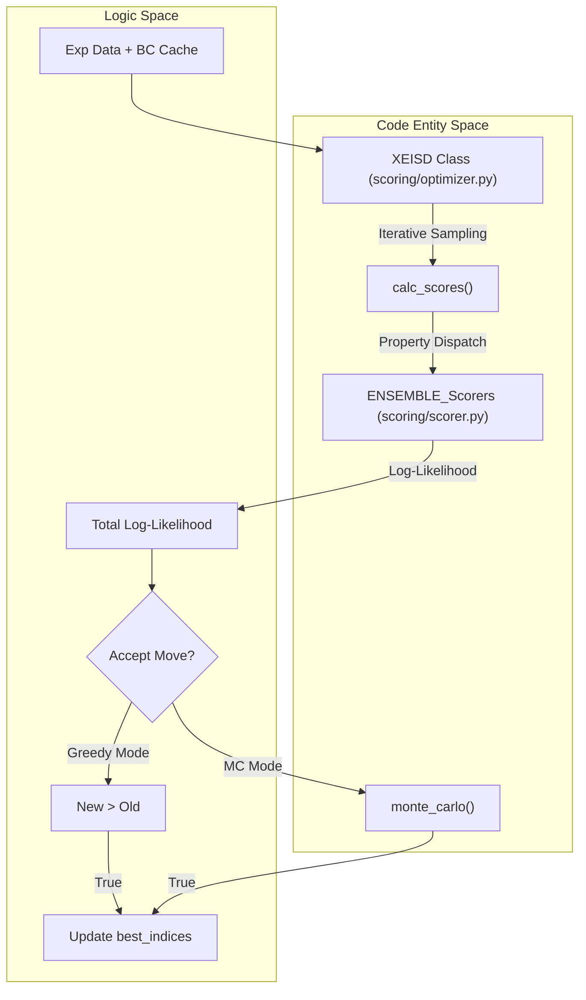
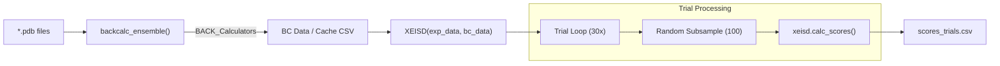

# X-EISD Scoring, Optimization & Normalization

Relevant source files

The following files were used as context for generating this wiki page:

- [score_ensemble.py](score_ensemble.py)
- [scoring/normalize.py](scoring/normalize.py)
- [scoring/optimizer.py](scoring/optimizer.py)
- [scoring/rg.py](scoring/rg.py)
- [scoring/scorer.py](scoring/scorer.py)

The X-EISD (Experimental Enhanced Information for Structural Distributions) module provides the framework for evaluating generated protein ensembles against experimental data. It implements maximum log-likelihood scoring for multiple experimental observables, provides utilities for ensemble optimization via Monte Carlo sampling, and includes a normalization pipeline for benchmarking against alternative structural models.

## X-EISD Scoring Framework

The scoring system calculates the agreement between back-calculated values from the generated ensemble and experimental data. It accounts for both experimental uncertainty and back-calculation error using a maximum log-likelihood approach.

### Key Scoring Components
The `ENSEMBLE_Scorers` dictionary in `scoring/scorer.py` dispatches specific scoring functions for different data types:
*   **Chemical Shifts (`cs`)**: Uses `cs_score_ensemble` to compare predicted shifts against experimental values, accounting for atom-specific back-calculation sigmas [scoring/scorer.py:41-53]().
*   **J-Couplings (`jc`)**: Uses `jc_score_ensemble` to solve for Karplus parameters ($A, B, C$) that maximize the likelihood of the observed couplings [scoring/scorer.py:88-100]().
*   **Distances (NOE/PRE)**: Uses `dist_score_ensemble` which performs $r^{-6}$ averaging over the ensemble before calculating the log-likelihood [scoring/scorer.py:103-118]().
*   **Generic (smFRET)**: Uses `generic_score_ensemble` for simple value-to-value comparison [scoring/scorer.py:121-129]().

### Mathematical Implementation
The core likelihood calculation relies on two primary functions:
1.  `calc_opt_params`: Calculates the optimal parameters that maximize the likelihood given experimental and back-calculation uncertainties [scoring/scorer.py:6-15]().
2.  `normal_loglike`: Computes the log-probability under a normal distribution, with stability handling for zero-sigma cases [scoring/scorer.py:18-32]().

**Sources:** [scoring/scorer.py:1-135]()

---

## Ensemble Optimization

The `XEISD` class in `scoring/optimizer.py` provides an API for both scoring static ensembles and optimizing sub-ensembles from a larger pool of generated conformers.

### The XEISD Class
The class is initialized with experimental data and pre-calculated back-calculation data [scoring/optimizer.py:20-29]().
*   `calc_scores(dtypes, indices)`: Computes MAE and X-EISD scores for a specific subset of the conformer pool defined by `indices` [scoring/optimizer.py:46-66]().
*   `optimize(...)`: Performs a stochastic search to find a sub-ensemble of size `ens_size` that maximizes the total log-likelihood across requested properties [scoring/optimizer.py:68-107]().

### Optimization Algorithms
The `optimize` method supports two modes:
1.  **Greedy (`max`)**: Only accepts moves that strictly increase the total score [scoring/optimizer.py:96-97]().
2.  **Metropolis-Hastings (`mc`)**: Uses the `monte_carlo` function to accept moves based on a temperature parameter `beta` [scoring/optimizer.py:8-17, 98-99]().

### Optimization Data Flow
The following diagram bridges the logical optimization flow to the code entities.

**Diagram: X-EISD Optimization Loop**

**Sources:** [scoring/optimizer.py:1-107](), [scoring/scorer.py:132-135]()

---

## Radius of Gyration (Rg) Calculation

The `scoring/rg.py` module handles the calculation of mass-weighted Radius of Gyration for ensembles. This is specifically used for the $\%\left|dRg\right|/Rg$ metric in benchmarking.

*   **Atomic Masses**: Defined in `ATOMIC_MASS` (C:12, O:16, N:14, S:32, H:1) [scoring/rg.py:20]().
*   **Mass-Weighted Rg**: Implemented in `calc_rg(pdb_path)`, which calculates the center of mass (CM) and then the mass-weighted root-mean-square deviation from that center [scoring/rg.py:59-69]().
*   **Trial Sampling**: The `process_one` function generates `rg_trials.csv` by calculating the mean Rg over 30 trials of 100-conformer random subsamples [scoring/rg.py:94-120]().

**Sources:** [scoring/rg.py:1-134]()

---

## The score_ensemble.py CLI

`score_ensemble.py` is the main entry point for scoring generated PDBs. It supports several operational modes.

### Operational Modes
1.  **Default Benchmark Mode**: Performs 30 trials of 100-conformer random subsampling with replacement, reporting mean and standard deviation of MAE and log-likelihood [score_ensemble.py:4-6, 84-85]().
2.  **All-Conformer Mode (`--all`)**: Scores the entire pool of PDBs in a single pass [score_ensemble.py:7, 78-82]().
3.  **Rg Mode (`--rg`)**: Triggers the Rg calculation pipeline to generate `rg_trials.csv` [score_ensemble.py:8-9, 132-134]().
4.  **Normalization Mode (`--normalize`)**: Aggregates scores across different methods to build benchmark tables [score_ensemble.py:10, 130-131]().

### Data Flow for Scoring
The CLI manages the lifecycle from PDB files to final CSV scores.

**Diagram: score_ensemble.py Data Flow**

**Sources:** [score_ensemble.py:1-110](), [scoring/calculator.py:21]()

---

## Normalization & Benchmarking

The `scoring/normalize.py` module implements the cross-method normalization defined in the IDPForge benchmarking protocol.

### Normalization Logic
*   **Canonical Sets**: `derive_canonical_sets` identifies which proteins have which experimental data types available [scoring/normalize.py:15-32]().
*   **Equation S11**: Implemented in `normalize_per_protein`. It scales scores such that $X_{norm} = (X - X_{min}) / (X_{max} - X_{min})$ per protein across all compared methods [scoring/normalize.py:61-71]().
*   **Aggregation**:
    *   NOE and PRE scores are summed into a single "NOE/PRE" category [scoring/normalize.py:114-121]().
    *   The "Total" score is an aggregate of all available observables normalized per protein [scoring/normalize.py:135-149]().
    *   `chi2_CS` is calculated as the mean over trials of the per-shift $\chi^2$ [scoring/normalize.py:154-162]().

### Output Tables
The `run` function generates a summary `pd.DataFrame` containing normalized scores for CS, JC, NOE/PRE, FRET, and Total, alongside the $\chi^2_{CS}$ and $\%\left|dRg\right|/Rg$ metrics [scoring/normalize.py:128-132, 149-162]().

**Sources:** [scoring/normalize.py:1-162]()

---