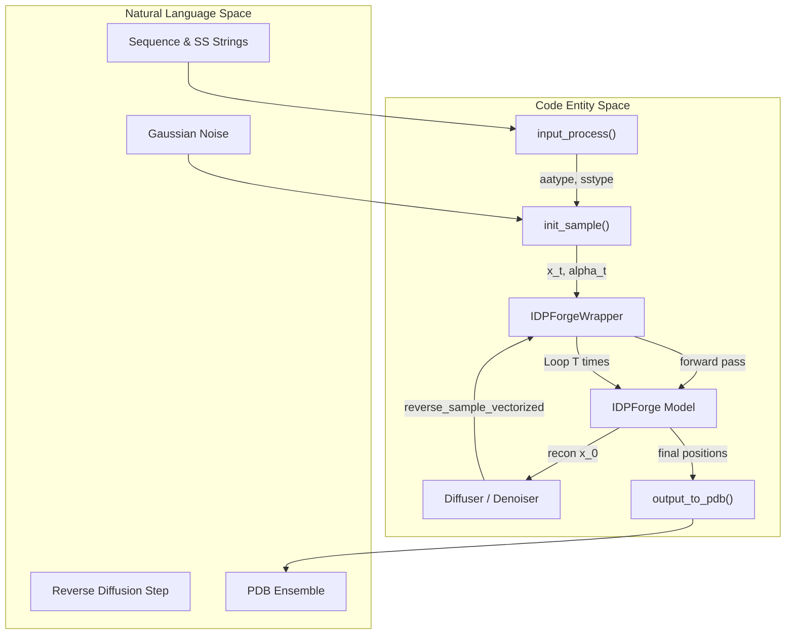
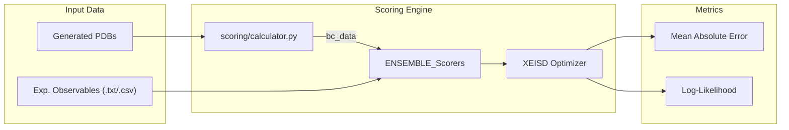

# Glossary

Relevant source files

The following files were used as context for generating this wiki page:

- [AlphaFlex/Data_Inputs/knot_screening.json](AlphaFlex/Data_Inputs/knot_screening.json)
- [AlphaFlex/README.md](AlphaFlex/README.md)
- [README.md](README.md)
- [configs/sample.yml](configs/sample.yml)
- [idpforge/loss.py](idpforge/loss.py)
- [idpforge/misc.py](idpforge/misc.py)
- [idpforge/utils/diff_utils.py](idpforge/utils/diff_utils.py)
- [idpforge/utils/potential.py](idpforge/utils/potential.py)
- [idpforge/utils/pre_relax.py](idpforge/utils/pre_relax.py)
- [idpforge/utils/structure_validation.py](idpforge/utils/structure_validation.py)
- [idpforge/utils/validation_metrics.py](idpforge/utils/validation_metrics.py)
- [idpforge/wrapper.py](idpforge/wrapper.py)
- [scoring/scorer.py](scoring/scorer.py)

This page provides technical definitions for domain-specific terminology, architectural components, and implementation details within the **IDPForge** and **AlphaFlex** frameworks.

## Core Concepts

### Intrinsically Disordered Proteins (IDP)
Proteins that lack a fixed or ordered three-dimensional structure under physiological conditions. IDPForge models these as ensembles of conformers rather than a single static structure [README.md:1-3]().

### Intrinsically Disordered Regions (IDR)
Specific segments within a protein that are disordered, often flanking or connecting folded domains. AlphaFlex categorizes these based on their structural context:
*   **Tail**: An IDR located at the N- or C-terminus of a protein, adjacent to one folded domain [AlphaFlex/README.md:53-54]().
*   **Linker**: An IDR that connects two folded domains [AlphaFlex/README.md:53-54]().
*   **Loop**: An IDR that exists within a single folded domain [AlphaFlex/README.md:53-54]().

### Conformational Ensemble
 A collection of structural models representing the dynamic landscape of an IDP. IDPForge generates these ensembles using a diffusion-based generative process [README.md:1-3]().

---

## Architectural Components

### IDPForge Trunk & Structure Module
The neural network architecture is encapsulated in the `IDPForge` class [idpforge/wrapper.py:21-25](). It integrates an ESM2-based trunk with a structure module derived from ESMFold/OpenFold.
*   **Self-Conditioning**: A technique where the model's previous prediction at $t+1$ is fed back as an input at step $t$ to improve structural consistency [idpforge/wrapper.py:65-68](), [configs/sample.yml:8]().
*   **IPA (Invariant Point Attention)**: The mechanism used in the structure module to update residue frames and positions while maintaining rotational and translational invariance [configs/sample.yml:21-25]().

### Diffuser and Denoiser
The diffusion framework manages the transition from noise to structured coordinates.
*   **IGSO(3)**: Isotropic Gaussian on the Special Orthogonal group. Used for diffusing and denoising residue orientations (rotations) [idpforge/utils/diff_utils.py:16-17](), [idpforge/utils/diff_utils.py:149-152]().
*   **Linear Beta Schedule**: A noise schedule where the variance $\beta$ increases linearly over time steps $T$ [idpforge/utils/diff_utils.py:56-61]().

### Secondary Structure (SS) Encoding
Secondary structure information is treated as a primary input feature.
*   **sstype_order**: A mapping of SS characters (H=Helix, E=Strand, C=Coil) to numerical tokens [idpforge/misc.py:24-27]().
*   **assign_rama**: A utility that assigns SS labels based on Ramachandran torsion angles [idpforge/misc.py:28](), [idpforge/misc.py:61-63]().
*   **Coil Sampling**: The process of randomly assigning specific torsion-based coil subtypes to "C" regions to increase ensemble diversity [idpforge/misc.py:64-67]().

**Sources:** [idpforge/wrapper.py:17-36](), [idpforge/misc.py:55-73](), [idpforge/utils/diff_utils.py:56-76](), [configs/sample.yml:1-33]().

---

## Data Flow & System Interaction

The following diagram maps the high-level generation concepts to specific code entities and data structures.

### Diagram 1: Conformer Generation Data Flow
"Reverse Diffusion Loop" to "Code Entity Space"

**Sources:** [idpforge/misc.py:99-117](), [idpforge/misc.py:119-140](), [idpforge/wrapper.py:56-83](), [idpforge/utils/diff_utils.py:126-160](), [idpforge/utils/diff_utils.py:187-200]().

---

## Structural Validation & Constraints

### Knot Screening
A quality gate used in AlphaFlex to ensure generated conformers match the expected topology of their folded domains.
*   **knot_screening.json**: A database containing pre-calculated knot types (e.g., Unknot, $3_1$) for UniProt entries [AlphaFlex/Data_Inputs/knot_screening.json:1-20]().
*   **AlphaKnot2 Hybrid**: A validation logic using Alexander and HOMFLY polynomials to classify protein topology [idpforge/utils/structure_validation.py:22-28]().

### Structural Violations
Calculated during training and inference to penalize unphysical structures.
*   **FAPE (Frame Aligned Point Error)**: Measures the error in atom positions relative to residue frames [idpforge/loss.py:30-39]().
*   **Connectivity Loss**: A penalty applied if $C\alpha-C\alpha$ distances exceed physical limits (~3.8 Å) [idpforge/loss.py:135-137]().
*   **Chirality Check**: A check using the scalar triple product of $N, C, C\alpha, C\beta$ to ensure L-amino acid stereochemistry [idpforge/utils/structure_validation.py:99-119]().

**Sources:** [idpforge/loss.py:42-89](), [idpforge/utils/structure_validation.py:39-69](), [idpforge/utils/structure_validation.py:99-130](), [AlphaFlex/Data_Inputs/knot_screening.json:1-80]().

---

## Scoring & Experimental Guidance

### X-EISD (Experimental Ensemble Inference)
A maximum log-likelihood framework used to score ensembles against experimental data [scoring/scorer.py:1-2]().
*   **Back-Calculators**: Functions that convert 3D coordinates into observable properties like $R_g$ (Radius of Gyration), Chemical Shifts, or FRET efficiencies [idpforge/utils/validation_metrics.py:4-29]().
*   **Potential Guidance**: The integration of experimental data as a gradient-based energy term during reverse diffusion to bias the ensemble toward experimental agreement [configs/sample.yml:34-40]().

### Diagram 2: Ensemble Scoring Pipeline
"Experimental Validation" to "Code Entity Space"

**Sources:** [scoring/scorer.py:132-135](), [idpforge/utils/validation_metrics.py:32-53](), [idpforge/loss.py:124-130]().

---

## Table of Technical Abbreviations

| Abbreviation | Full Term | Definition | Code Pointer |
| :--- | :--- | :--- | :--- |
| **SS** | Secondary Structure | Helix (H), Sheet (E), or Coil (C) labels. | `idpforge/misc.py:24` |
| **IPA** | Invariant Point Attention | Attention mechanism for structural updates. | `configs/sample.yml:21` |
| **FAPE** | Frame Aligned Point Error | Loss function for structural alignment. | `idpforge/loss.py:8` |
| **IGSO3** | Isotropic Gaussian on SO(3) | Rotational diffusion distribution. | `idpforge/utils/igso3_utils.py` |
| **LDR** | Long Disordered Region | Disordered segments within a folded context. | `AlphaFlex/README.md:86` |
| **X-EISD** | Experimental EISD | Maximum log-likelihood ensemble scoring. | `scoring/scorer.py:1` |
| **EMA** | Exponential Moving Average | Model weight smoothing during training. | `idpforge/wrapper.py:27` |

**Sources:** [idpforge/misc.py:24-27](), [idpforge/loss.py:8](), [idpforge/wrapper.py:27](), [scoring/scorer.py:1](), [AlphaFlex/README.md:86-88]().