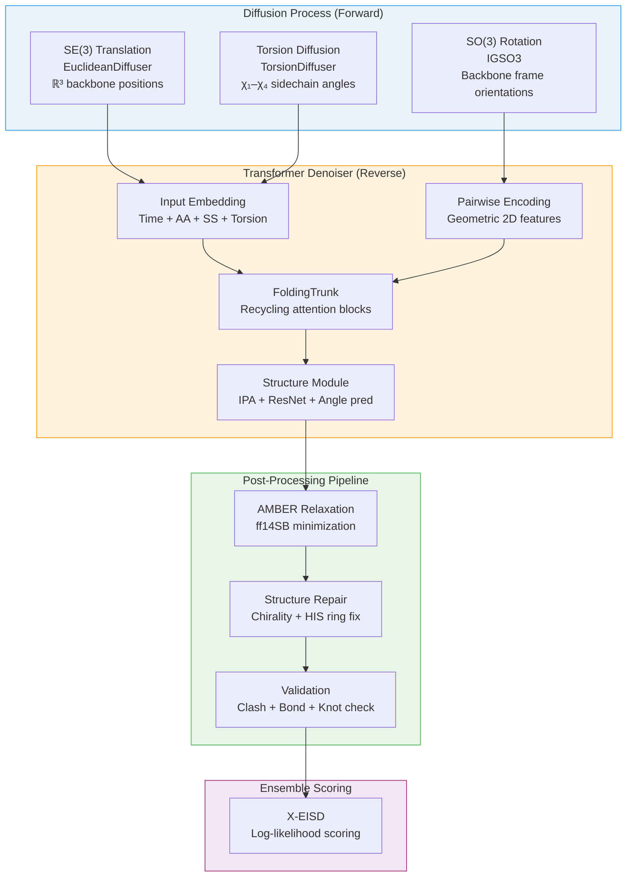

**IDPForge** (Intrinsically Disordered Protein, FOlded and disordered Region GEnerator) is a transformer-based protein language diffusion model that generates all-atom structural ensembles of intrinsically disordered proteins (IDPs) and intrinsically disordered regions (IDRs) that maintain their folded domains. It operates by jointly diffusing backbone translations in **ℝ³**, backbone rotations in **SO(3)** via the IGSO(3) distribution, and sidechain torsion angles — then learning to denoise this composite structure with a recycling transformer network adapted from ESMFold. The result is a physics-validated, experimentally-guidable ensemble of conformers that captures the conformational heterogeneity intrinsic to disordered sequences.

Sources: [README.md](/README.md#L1-L5), [setup.py](/setup.py#L1-L23)

## Why IDPForge?

Traditional structure prediction tools like AlphaFold2 and ESMFold excel at folded proteins but produce single static structures that misrepresent disordered regions — often collapsing them into low-confidence, non-physical conformations. IDPForge addresses this fundamental gap by treating disorder as a **distribution over structures** rather than a single prediction. It generates diverse, physically plausible conformers that collectively represent the conformational ensemble of a disordered protein or region, enabling downstream biophysical analysis, experimental validation, and ensemble reweighting.

The following table summarizes IDPForge's positioning relative to related tools:

| Capability | AlphaFold2 / ESMFold | RFdiffusion | **IDPForge** |
|---|---|---|---|
| Folded structure prediction | ✅ | ✅ | ✅ (template-fixed) |
| IDP/IDR ensemble generation | ❌ | ❌ | ✅ |
| SE(3) backbone diffusion | ❌ | ✅ | ✅ |
| SO(3) IGSO(3) rotational diffusion | ❌ | Partial | ✅ |
| Torsion angle diffusion | ❌ | ❌ | ✅ |
| Experimental guidance (PRE, Rg) | ❌ | ❌ | ✅ |
| Folded-domain preservation | N/A | ❌ | ✅ |
| AMBER relaxation + repair | ❌ | ❌ | ✅ |
| X-EISD ensemble scoring | ❌ | ❌ | ✅ |

Sources: [README.md](/README.md#L1-L5), [idpforge/model.py](/idpforge/model.py#L1-L50)

## Architecture at a Glance

IDPForge's architecture threads together three diffusion processes, a recycling transformer denoiser, and a multi-stage post-processing pipeline into a unified generation workflow:



Sources: [idpforge/utils/diff_utils.py](/idpforge/utils/diff_utils.py#L400-L599), [idpforge/model.py](/idpforge/model.py#L53-L130)

## Core Model: The IDPForge Transformer

The `IDPForge` module is the central neural network that predicts clean structures from noised inputs. Its forward pass constructs a **single-sequence representation** `s_s_0` by summing three embedding streams — sinusoidal **timestep embeddings**, **amino acid type** embeddings, and **secondary structure** embeddings — then feeds these through an MLP into the trunk's sequence state dimension. A **pairwise representation** `s_z_0` is built from geometric 2D features (distance and angle bins) derived from the noised backbone coordinates `x_t`. Both representations pass through the `FoldingTrunk`, which applies alternating triangular self-attention and transition blocks with optional **recycling** (up to 3 iterations by default). The trunk's structure module then produces SE(3) frames, sidechain frames, and torsion angles via Invariant Point Attention (IPA).

> [!TIP]
> During inference, the `recon` method iterates backward from timestep T→0, calling `forward` at each step and delegating coordinate/torsion updates to the `Denoiser`. When a **folded template** is provided, residues in the folded mask are pinned to timestep 0 at every reverse step — this is how IDPForge preserves folded domain geometry while sampling only disordered regions.

Sources: [idpforge/model.py](/idpforge/model.py#L53-L200), [idpforge/model.py](/idpforge/model.py#L130-L283)

## The Three Diffusion Processes

IDPForge diffuses protein structure along three complementary channels, each with its own noise schedule and reverse-time denoising formula:

| Diffusion Space | Class | Forward Process | Reverse Update | Key Parameters |
|---|---|---|---|---|
| **ℝ³ Translations** | `EuclideanDiffuser` | Linear β-schedule on Cα positions | Analytic Gaussian transition `μ(x_t, x̂_0, t)` | `euclid_b0=0.01`, `euclid_bT=0.06` |
| **SO(3) Rotations** | `IGSO3` | Sample from IGSO(3) at increasing σ(t) | Score-based reverse SDE on SO(3) tangent space | `min_b=1.5`, `max_b=2.5`, cached CDF |
| **Torsion Angles** | `TorsionDiffuser` | Linear β-schedule on χ₁–χ₄ in [−π, π) | Wrapped Gaussian with analytic μ, σ | `torsion_b0=0.01`, `torsion_bT=0.06` |

The `Diffuser` class orchestrates all three: given a clean pose, it returns a trajectory of diffused backbone coordinates `[T, L, 5, 3]`, rigid frames `[T, L, 4, 4]`, and torsion encodings `[T, L, 4, 2]` (sin/cos pairs). The `Denoiser` class handles the reverse direction, combining the model's predicted `x̂_0` with the current `x_t` using the analytic posterior for translations and torsions, and the IGSO(3) score approximation for rotations.

Sources: [idpforge/utils/diff_utils.py](/idpforge/utils/diff_utils.py#L1-L200), [idpforge/utils/diff_utils.py](/idpforge/utils/diff_utils.py#L200-L400)

## Two Sampling Modes

IDPForge provides two distinct sampling entry points that reflect the two fundamental use cases:

**Fully Disordered Proteins** (`sample_idp.py`) — Given a bare amino acid sequence, generates a complete IDP ensemble from scratch. Secondary structure annotations are either fetched from a pre-built database or defaulted to all-coil. The entire chain is diffused and denoised with no template constraints.

**IDRs with Folded Domains** (`sample_ldr.py`) — Given a pre-built `.npz` template (created by `mk_ldr_template.py`), samples only the disordered region while keeping folded residues fixed. The template supplies frozen backbone coordinates, torsion angles, and a binary mask. At each reverse timestep, masked residues are reset to their template values (timestep 0), ensuring the folded domain remains unperturbed. This mode also supports attention chunking for long sequences and coordinate offsets for multi-conformer templates.

Sources: [sample_idp.py](/sample_idp.py#L1-L80), [sample_ldr.py](/sample_ldr.py#L1-L100)

## Post-Processing and Validation

Raw diffusion outputs undergo a rigorous three-phase pipeline before being admitted into the final ensemble:

1. **AMBER Relaxation** — Energy minimization with the ff14SB force field. Folded-domain residues are harmonically restrained; IDR residues and junctions relax freely. Configurable via `max_iterations`, `stiffness`, and `tolerance` in `configs/sample.yml`.
2. **Repair** — Detects and corrects D-amino acid chirality inversions and broken histidine ring bonds introduced during relaxation. Repaired structures are re-relaxed.
3. **Validation** — Unified checks for chirality integrity, bond lengths/angles, clash scores (with adaptive smart thresholds), and backbone topology via knot detection. Only structures passing all checks are renamed to `N_validated.pdb`.

This loop (Generate → Relax → Repair → Validate) repeats until the target conformer count is reached, with state persisted for recovery from interruptions.

Sources: [README.md](/README.md#L268-L290), [configs/sample.yml](/configs/sample.yml#L42-L57)

## Ensemble Scoring with X-EISD

The `score_ensemble.py` script and the `scoring/` module provide integrated X-EISD (Experimental Inferential Structure Determination) ensemble scoring. Given an ensemble of PDB structures and experimental data, it back-calculates observables and reports per-property MAE and X-EISD log-likelihood:

| Observable | Flag | Back-Calculation Method | External Dependency |
|---|---|---|---|
| J-couplings | `--jc` | Karplus equation | None (Biopython) |
| NOE distances | `--noe` | Inverse 6th power average | None |
| PRE distances | `--pre` | Inverse 6th power average | None |
| smFRET | `--fret` | Inter-dye distance | None |
| Chemical shifts | `--cs` | UCBShift (CSpred) | Separate conda env |

The default benchmark protocol runs 30 trials of 100-conformer subsamples, producing `scores_trials.csv`. The `--normalize` flag aggregates cross-method comparison tables.

Sources: [README.md](/README.md#L330-L380), [scoring/scorer.py](/scoring/scorer.py#L1-L136)

## AlphaFlex Pipeline

The `AlphaFlex/` directory provides an end-to-end automated pipeline (AFX-IDPForge) for batch-processing proteins from the AlphaFold2 database:

| Step | Script | Function |
|---|---|---|
| 1 | `Step_1_case_label.py` | Classify each IDR as Tail, Linker, or Loop; assign category labels |
| 1B | `Step_1B_subset_label.py` | Filter proteins by length, IDR type counts, and IDR length ranges |
| 2 | `Step_2_mk_ldr_template.py` | Build per-IDR templates (frozen fold + dynamic IDR placement) |
| 3 | `Step_3_sample_conformer.py` | Generate validated conformers per IDR via the diffusion loop |
| 4 | `Step_4_ldr_stitch.py` | Monte Carlo stitch multi-IDR proteins; minimize and validate |

Step 4's Monte Carlo stitching is particularly noteworthy for multi-IDR proteins: it sequentially grafts sampled IDR conformers onto folded domains by aligning overlapping junction residues, then performs full-structure AMBER minimization with restraints on folded regions.

Sources: [AlphaFlex/README.md](/AlphaFlex/README.md#L1-L80), [AlphaFlex/README.md](/AlphaFlex/README.md#L80-L146)

## Project Structure

```
IDPForge/
├── idpforge/                     # Core library
│   ├── model.py                  # IDPForge transformer network
│   ├── wrapper.py                # PyTorch Lightning training wrapper
│   ├── loader.py                 # Diffusion dataset & data module
│   ├── loss.py                   # FAPE, torsion, distance, violation losses
│   ├── esm_wrapper.py            # ESM2 embedding integration
│   ├── misc.py                   # I/O utilities (PDB output, input processing)
│   └── utils/
│       ├── diff_utils.py         # Diffuser, Denoiser, EuclideanDiffuser, IGSO3, TorsionDiffuser
│       ├── igso3_utils.py        # IGSO(3) numerical computation & Exp map
│       ├── tensor_utils.py       # Geometric tensor ops (dihedrals, t2d, alignment)
│       ├── potential.py          # Experimental guidance potentials (PRE, Rg)
│       ├── pre_relax.py          # Pre-relaxation repair
│       ├── relax.py              # AMBER relaxation engine
│       ├── structure_repair.py   # D-amino acid & HIS ring repair
│       ├── structure_validation.py  # Unified validation checks
│       └── validation_metrics.py # Rg and per-group distance metrics
├── esm/                          # Refactored ESM2 modules (attention, trunk)
├── scoring/                      # X-EISD ensemble scoring modules
├── AlphaFlex/                    # Automated AFX-IDPForge pipeline (Steps 1–4)
├── configs/
│   ├── sample.yml                # Sampling configuration
│   └── train.yml                 # Training configuration
├── dockerfiles/                  # Docker & Apptainer recipes (Ampere/Blackwell)
├── sample_idp.py                 # Entry point: fully disordered protein sampling
├── sample_ldr.py                 # Entry point: IDR with folded template sampling
├── mk_ldr_template.py            # Template builder for IDR sampling
├── mk_flex_template.py           # Template builder for linker IDR sampling
├── score_ensemble.py             # X-EISD ensemble scoring entry point
├── train.py                      # Training entry point
├── environment.yml               # Conda environment specification
└── setup.py                      # Package installation (v1.1.0)
```

Sources: [setup.py](/setup.py#L1-L23), [idpforge/model.py](/idpforge/model.py#L1-L50)

## Training Overview

Training uses PyTorch Lightning with the `IDPForgeWrapper`, which wraps the core model with an **Exponential Moving Average (EMA)** of parameters (decay=0.99), an **AlphaFold-style learning rate scheduler** with warmup and step decay, and a composite loss function. The data pipeline (`IDPloader`) loads pickled structure datasets, applies the full forward diffusion at training time, and samples timesteps with a linear weighting that emphasizes later (noisier) steps. Self-conditioning is applied stochastically: with 50% probability, the model's own prediction at timestep t+1 is fed as an additional input at timestep t. The composite training loss combines **FAPE** (frame-aligned point error), **angular** (torsion), **distance** (Cβ–Cβ), and **violation** terms, with distance and violation losses activated only after configurable epoch thresholds.

Sources: [train.py](/train.py#L1-L80), [idpforge/wrapper.py](/idpforge/wrapper.py#L1-L100), [idpforge/loss.py](/idpforge/loss.py#L1-L70)

> [!TIP]
> Model weights and example data are distributed via Figshare. The released checkpoint uses EMA weights (`pl_sd["ema"]["params"]`), not the raw training weights. When loading, the `openfold` version is checked to handle a key renaming (`points.` → `points.linear.`) introduced in openfold v2+.

Sources: [README.md](/README.md#L200-L210), [sample_idp.py](/sample_idp.py#L40-L55)

## Where to Go Next

The documentation is organized to build understanding progressively — from getting the software running, through the mathematical and architectural foundations, to practical usage and advanced features:

1. **[Quick Start](2-quick-start)** — Install IDPForge, download weights, and generate your first IDP ensemble
2. **[Docker and HPC Setup](3-docker-and-hpc-setup)** — Containerized deployment for reproducibility and cluster environments
3. **[Architecture Overview](4-architecture-overview)** — Detailed walkthrough of how all modules connect
4. **[IDPForge Transformer Network](5-idpforge-transformer-network)** — The denoiser network architecture in depth
5. **[SE(3) Backbone Diffusion](6-se-3-backbone-diffusion)** — Translation diffusion on ℝ³
6. **[SO(3) Rotational Diffusion](7-so-3-rotational-diffusion)** — IGSO(3) score-based diffusion on backbone frames
7. **[Torsion Angle Diffusion](8-torsion-angle-diffusion)** — Sidechain χ-angle noising and denoising
8. **[IDP Sampling (Fully Disordered)](12-idp-sampling-fully-disordered)** — Complete usage guide for `sample_idp.py`
9. **[IDR Sampling with Folded Templates](13-idr-sampling-with-folded-templates)** — Using `sample_ldr.py` and template preparation
10. **[AlphaFlex Workflow Overview](18-alphaflex-workflow-overview)** — The automated AFX-IDPForge pipeline
