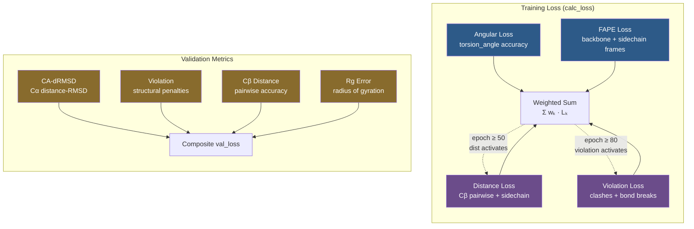

IDPForge trains a denoising network that must simultaneously recover **backbone geometry**, **sidechain conformations**, **pairwise distances**, and **torsion angles** from noisy inputs. The loss system is a **multi-term composite** with epoch-dependent scheduling, secondary-structure-aware weighting, and separate training/validation pipelines — all orchestrated through a single [`calc_loss`](idpforge/loss.py#L42-L89) entry point.

## Architecture of the Loss System

The training loss aggregates four independently weighted terms, each targeting a distinct structural aspect of the predicted conformer. A dedicated validation pipeline evaluates complementary metrics that are not differentiable or are too expensive for gradient-based optimization.



> [!TIP]
> Epoch-gated losses (`dist` at epoch 50, `violation` at epoch 80) implement a **curriculum learning** strategy: the model first learns coarse frame alignment and torsion recovery, then refines pairwise distances, and finally enforces steric feasibility — avoiding conflicting gradients early in training.

Sources: [loss.py](idpforge/loss.py#L42-L89), [wrapper.py](idpforge/wrapper.py#L56-L83)

## Loss Term Reference

| Loss Term | Weight Key | Default Weight | Target | Epoch Gate | Differentiable |
|-----------|-----------|----------------|--------|------------|----------------|
| **Angular** | `angular` | 0.1 | Torsion angle prediction | — (always on) | Yes |
| **FAPE** | `fape` | 1.0 | Backbone + sidechain frame alignment | — (always on) | Yes |
| **Distance** | `dist` | 0.005 | Cβ pairwise + sidechain distances | `start_epoch: 50` | Yes |
| **Violation** | `violation` | 0.01 | Steric clashes + bond violations | `start_epoch: 80` | Yes |

Sources: [train.yml](configs/train.yml#L31-L45), [loss.py](idpforge/loss.py#L42-L89)

## Angular Loss

The angular loss operates on the **7 torsion angle channels** (ω, φ, ψ, χ₁–χ₄), measuring the discrepancy between predicted and ground-truth torsion vectors in S¹-representation (sin, cos pairs). It is the **only loss active from epoch zero**, making it the primary signal for early torsion recovery.

$$L_{\text{angular}} = \frac{\sum \|\hat{\alpha}_{\text{norm}} - \alpha_{\text{true}}\| \cdot m}{\sum m} + 0.02 \cdot \text{mean}(|\|\hat{\alpha}\| - 1|)$$

The first term penalizes the deviation of **normalized** predicted angles from ground truth, masked by `torsion_mask` (which covers backbone angles ω/φ/ψ for all residues and chi angles only where the residue type permits them). The second term is a **regularizer** that penalizes deviations from unit norm in the **unnormalized** angle predictions, ensuring the network produces well-formed (sin, cos) pairs before normalization. The 0.02 coefficient keeps this regularization subordinate to the primary angular error.

The torsion mask is constructed by concatenating three copies of the atom-existence mask (for backbone ω, φ, ψ) with the product of `get_chi_mask(aatype)` and the atom-existence mask (for sidechain χ₁–χ₄), ensuring that only physically meaningful angles contribute.

Sources: [loss.py](idpforge/loss.py#L159-L164), [loss.py](idpforge/loss.py#L44-L52)

## FAPE Loss (Frame Aligned Point Error)

The FAPE loss is the **highest-weighted term** (default weight = 1.0) and combines backbone frame alignment with sidechain atom superposition. It operates on the SE(3) rigid frames predicted by the structure module.

**Backbone FAPE** is delegated to OpenFold's [`backbone_loss`](idpforge/loss.py#L6-L12), which computes the Frame Aligned Point Error over the full diffusion trajectory. It compares predicted backbone rigid transforms (rotation + translation per residue) against ground-truth frames, with optional L1 clamping. The clamp configuration (`use_clamp: 0.5`, `clamp_distance: 10`) caps the per-pair distance error at 10Å, preventing outlier frame pairs from dominating the gradient. This is CA-only — only the Cα frame alignment is considered.

**Sidechain FAPE** extends the frame comparison to sidechain atoms (first 9 atom positions per residue in the atom14 representation). It uses [`compute_fape`](idpforge/loss.py#L6-L12) from OpenFold, comparing predicted sidechain frames against ground-truth rigid transforms shifted by one position (the `[..., 1:, :, :]` indexing skips the backbone frame at position 0). No clamping is applied to the sidechain term.

The combined FAPE loss is: $L_{\text{fape}} = (L_{\text{backbone}} + L_{\text{sidechain}})^2$. The outer **squaring** amplifies the gradient signal when the total error is large (early training) and attenuates it as predictions improve (late training), acting as a soft curriculum on frame quality.

Sources: [loss.py](idpforge/loss.py#L54-L68), [train.yml](configs/train.yml#L36-L38)

## Distance Loss

The distance loss is **epoch-gated** (default `start_epoch: 50`) and enforces pairwise inter-residue distance accuracy. It has two sub-components operating on different atom sets and with asymmetric clamping for loops versus structured regions.

### Cβ Distance Loss

The primary distance term [`cb_dist_loss`](idpforge/loss.py#L124-L145) computes all-pairs Cβ–Cβ distances (using pseudo-β: Cα for glycine, Cβ otherwise) for both prediction and ground truth, then applies **directional clamping**:

- **Loop regions** (sstype ≥ 2): `error = clamp(true_d − pred_d, min=ε, max=loop_clamp)` — this penalizes **under-prediction** of distances (collapsed structures) while tolerating expansion, reflecting the physical reality that IDP ensembles favor extended conformations.
- **Structured regions** (sstype < 2, i.e. helices/sheets): `sec_error = clamp(pred_d − true_d, min=ε, max=loop_clamp)` — this penalizes **over-prediction** of distances (over-expansion), preventing structured elements from being pulled apart.

Both terms use **squared error** normalized by the number of valid residue pairs, with explicit `.clamp(min=1.0)` guards on the denominator to prevent division-by-zero when all-coil IDP batches contain no structured residues.

### CA Connectivity Loss

Embedded within `cb_dist_loss`, [`ca_connectivity_loss`](idpforge/loss.py#L166-L174) enforces **peptide bond geometry** by penalizing deviations of sequential Cα–Cα distances from the ideal value (3.8025Å from OpenFold's `ca_ca` constant). This prevents backbone breaks during denoising — a critical constraint for chain continuity.

### Sidechain Distance Loss

When `loss_cfg["dist"]["sidechain"] > 0`, a secondary [`dist_loss`](idpforge/loss.py#L147-L156) term is applied to the first 9 atom positions per residue. This computes **symmetric** clamped distance errors (clamping both over- and under-prediction to `[-clamp, +clamp]`), normalized by the valid atom-pair count.

Sources: [loss.py](idpforge/loss.py#L124-L156), [train.yml](configs/train.yml#L39-L43)

## Violation Loss

The violation loss is the **last term to activate** (default `start_epoch: 80`) and penalizes **physically impossible** structures. It delegates to OpenFold's [`find_structural_violations`](idpforge/loss.py#L6-L12), which detects:

- **Bond length violations** — deviations from ideal inter-atomic bond lengths
- **Clash violations** — atoms closer than their combined van der Waals radii

The violations are computed against the final predicted positions (`positions[-1]`) with a tolerance of 5 atoms for both between- and within-residue checks. The resulting [`violation_loss`](idpforge/loss.py#L6-L12) produces a scalar penalty weighted by the atom-existence mask.

By delaying this loss until late in training, the model is free to produce intermediate structures that violate steric constraints (which is expected during early denoising), then progressively learns to resolve them as the distance and FAPE losses have already established approximately correct global geometry.

Sources: [loss.py](idpforge/loss.py#L176-L181), [train.yml](configs/train.yml#L44-L45)

## SE(3) Frame Loss (MSE Frame Loss)

The [`mse_frame_loss`](idpforge/loss.py#L93-L121) function, based on RFdiffusion, provides an alternative SE(3)-equivariant frame comparison that combines **translation error** and **rotation error** into a single metric. Unlike FAPE (which operates in local frames), this loss works in the **globally aligned** frame:

1. **Kabsch alignment** — the target frames are aligned to the predicted frames via [`align_rigids`](idpforge/utils/tensor_utils.py#L274-L324), which computes the optimal rotation using SVD of the cross-covariance matrix of centered translations, with a handedness correction.
2. **Translation error** — $\sqrt{\sum (t_{\text{pred}} - t_{\text{true}})^2 + \epsilon}$, optionally L1-clamped, then divided by `length_scale=10`.
3. **Rotation error** — computed as $\|I - R_{\text{pred}}^{-1} \cdot R_{\text{true}}\|_F^2$, measuring deviation from identity.
4. **Combined** — $L = (L_{\text{trans}} + 0.5 \cdot L_{\text{rot}}) \cdot \text{mask}$, normalized by the number of valid frames.

> [!TIP]
> The `w_rot=0.5` default downweights rotation error relative to translation because small angular deviations compound through the chain — a 1° rotation error at residue *i* produces an increasingly large positional error at residue *i+k*. Equal weighting would double-count this effect.

Sources: [loss.py](idpforge/loss.py#L93-L121), [tensor_utils.py](idpforge/utils/tensor_utils.py#L274-L324)

## Validation Metrics

The validation pipeline in [`IDPForgeWrapper.validation_step`](idpforge/wrapper.py#L85-L125) uses **EMA weights** (swapped in before validation and restored after) and evaluates a distinct set of metrics with independently configurable weights:

| Metric | Default Val Weight | Description |
|--------|-------------------|-------------|
| `ca_drmsd` | 0.1 | Cα distance-RMSD (OpenFold's `drmsd`) — rotation-invariant structure comparison |
| `violation` | 0.0 | Same structural violation loss as training (disabled by default in val) |
| `dist` | 0.05 | Cβ pairwise distance loss (requires `compute_cb_dist: true`) |
| `rg_error` | 1.0 | Radius of gyration distribution error per sequence group (requires `compute_rg: true`) |

The **Rg metric** is particularly important for IDP validation. [`rg_metrics`](idpforge/loss.py#L183-L187) groups predicted conformers by sequence identity, computes the mean predicted Rg per group via [`calc_rg_with_mask`](idpforge/utils/validation_metrics.py#L4-L29), and returns the mean absolute difference against experimental Rg values. This directly measures whether the sampled ensemble reproduces the experimental hydrodynamic radius.

Sources: [wrapper.py](idpforge/wrapper.py#L85-L125), [validation_metrics.py](idpforge/utils/validation_metrics.py#L4-L53), [train.yml](configs/train.yml#L47-L53)

## Loss Orchestration in Training

The [`training_step`](idpforge/wrapper.py#L56-L83) in `IDPForgeWrapper` applies two key augmentation strategies before loss computation:

- **Secondary structure dropout** — with 20% probability, the SS labels are replaced with all-mask tokens (`sstype = 7`), forcing the model to denoise without SS guidance and improving robustness for sequences lacking SS annotations.
- **Self-conditioning** — with 50% probability (when `self_condition: true` and the timestep is not at the end of the trajectory), the model receives its own one-step-ahead prediction as additional input, following the self-conditioning paradigm from diffusion models.

The composite loss is computed as:

$$L_{\text{total}} = \sum_{k \in \{\text{angular, fape, dist, violation}\}} w_k \cdot L_k$$

where each $L_k$ is only included if its weight is positive **and** its epoch gate is satisfied. The per-term losses are logged individually (`train_angular`, `train_fape`, etc.) alongside the total, enabling fine-grained training diagnostics in TensorBoard.

Sources: [wrapper.py](idpforge/wrapper.py#L56-L83), [train.yml](configs/train.yml#L31-L45)

## Configuration Reference

All loss weights and sub-parameters live under `training.loss` in the training YAML:

```yaml
training:
  loss:
    weights:
      fape: 1          # Backbone + sidechain frame alignment
      dist: 0.005      # Pairwise distance accuracy
      angular: 0.1     # Torsion angle prediction
      violation: 0.01  # Steric feasibility
    fape:
      use_clamp: 0.5       # Whether to use clamped FAPE
      clamp_distance: 10   # L1 clamp distance (Å)
    dist:
      start_epoch: 50      # Epoch to begin distance loss
      loop_clamp: 10       # Loop region distance clamp (Å)
      sidechain: 0         # Sidechain distance weight (0 = disabled)
      sidechain_clamp: 8   # Sidechain distance clamp (Å)
    violation_cfg:
      start_epoch: 80      # Epoch to begin violation loss
```

The validation loss weights are configured separately under `validation.loss_weights` and are combined as a simple weighted sum (no epoch gating).

Sources: [train.yml](configs/train.yml#L30-L53)

---

**Next steps**: To understand how noised training targets are constructed for these losses, see [Data Loading and Noising](11-data-loading-and-noising). For the training loop and optimizer configuration, see [Training Workflow and Configuration](9-training-workflow-and-configuration).