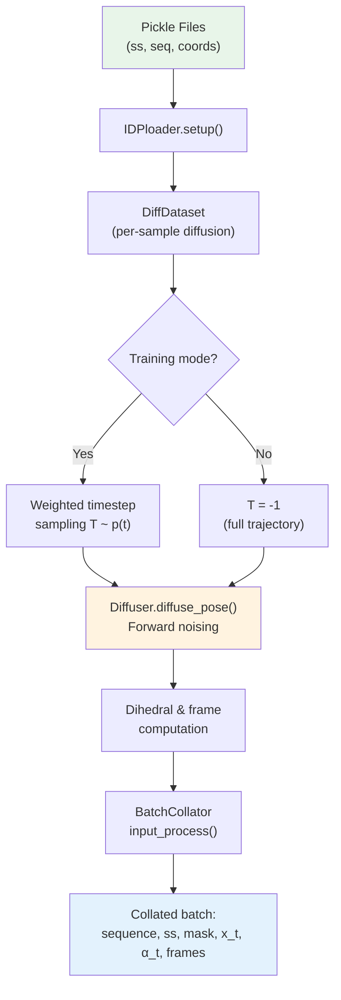

IDPForge's training data pipeline couples **structured protein data loading** with a **three-factor forward diffusion process** that jointly noises backbone translations (ℝ³), backbone rotations (SO(3)), and sidechain torsion angles. This pipeline transforms static conformer ensembles into time-indexed noisy training pairs, producing the `(x_t, α_t) → (x_{t+1}, α_{t+1})` supervision signal that drives the denoising network.

## Data Format and Preparation

Training data is stored as Python pickle files containing three parallel lists: **secondary structure encodings**, **amino acid sequences**, and **heavy-atom coordinates** (N, CA, C, O, CB, … up to 9 atoms per residue). The `IDPloader.setup()` method unpickles these files and passes the unpacked tuples directly into `DiffDataset` constructors. Multiple pickle paths can be specified for both training and validation splits, which are merged via `ConcatDataset`.

The standard preparation workflow parses PDB conformers (e.g., from IDPConformerGenerator), computes Ramachandran-assigned secondary structure, and serializes the result:

| List Index | Content | Shape per Entry | Description |
|---|---|---|---|
| `data[0]` | Secondary structure | `str` (e.g., `"HHPPCCCLL"`) | H=helix, E=sheet, P=pre-pro, A=αR, B=βR, C=coil, L=left-handed |
| `data[1]` | Amino acid sequence | `str` (e.g., `"MAGKPL"`) | Single-letter residue codes |
| `data[2]` | Coordinates | `(N_res, 9, 3)` | Heavy-atom positions in N,CA,C,O,CB,… order |

Secondary structure encoding uses 8 discrete types `["H", "E", "P", "A", "B", "C", "L", "-"]`, where coil residues are further subdivided by Ramachandran basin assignment (α-region → A, β-region → B, left-handed → L, other coil → C). When backbone torsions are unavailable, coil types are sampled from a fixed prior `{A: 0.3, B: 0.5, L: 0.1, C: 0.1}`.

Sources: [loader.py](idpforge/loader.py#L117-L133), [definitions.py](idpforge/utils/definitions.py#L9-L14), [README.md](data/README.md#L9-L39)

## Pipeline Architecture

The data pipeline is organized as a `LightningDataModule` that composes dataset construction, per-sample forward diffusion, and batch collation into a single streaming workflow:



The `IDPloader` class orchestrates this pipeline. During `setup("fit")`, it loads all training and validation pickle files, wrapping each in a `DiffDataset` that carries the shared `Diffuser` instance. The `train_dataloader()` returns a `DataLoader` with shuffling, pinned memory, and the custom `BatchCollator`; the `val_dataloader()` disables shuffling but retains the same collation logic.

Sources: [loader.py](idpforge/loader.py#L102-L143), [train.py](train.py#L25-L36)

## Forward Diffusion: Three-Factor Noising

The core of the data pipeline is `Diffuser.diffuse_pose()`, which applies **three independent forward diffusion processes** to a protein structure, producing a complete noisy trajectory from t=0 (clean) to t=T (maximally noised):

### 1. SO(3) Backbone Rotation Diffusion

The `IGSO3` diffuser perturbs backbone rotation frames by sampling from the Isotropic Gaussian distribution on SO(3). For each timestep t ∈ {1, …, T}, rotation vectors are sampled via the inverse CDF of the IGSO(3) marginal distribution over rotation angles ω. The sampled rotations are applied to the local backbone frames (N-CA-C), keeping Cα positions fixed:

```
R_perturbed = R_sampled · R_true
x_perturbed = R_sampled · (x - Cα) + Cα
```

The IGSO(3) discretization is precomputed via `calculate_igso3()`, which tabulates CDF values, score norms, and expected score norms over a grid of (σ, ω) pairs. This cache can be persisted as `diff_igso3.pkl` to avoid recomputation across runs.

### 2. ℝ³ Backbone Translation Diffusion

The `EuclideanDiffuser` adds Gaussian noise to Cα coordinates under a **linear variance schedule** β(t) that interpolates from `euclid_b0` to `euclid_bT`. At each step, the noising kernel produces:

```
mean = √(1 - β_t) · Cα_t
var  = β_t · I₃
Cα_{t+1} ~ N(mean, var)
```

The displacement δ is applied uniformly to all backbone atoms of each residue, and the cumulative sum of per-step deltas yields the full translational trajectory. Coordinates are scaled by `crd_scale=0.25` before noising to improve numerical conditioning.

### 3. Torsion Angle Diffusion

The `TorsionDiffuser` applies wrapped Gaussian noise to the four sidechain χ angles under its own linear β schedule (`tor_b0` → `tor_bT`). Sampling is performed in angle space with `wrap_rad` to keep values in [-π, π), and an `exists_mask` zeroes undefined χ angles (e.g., χ2 for alanine) to -π. The final output is converted to the (sin, cos) unit circle representation used by the network.

### Composition in `diffuse_pose()`

All three diffusers operate independently and their outputs are composed: the SO(3)-perturbed frames receive the cumulative translational displacement, yielding the final diffused backbone coordinates `diffused_BB` of shape `(T+1, L, 5, 3)`. Rigid-body transforms `(T+1, L, 4, 4)` are assembled from the rotation matrices and perturbed Cα positions. Torsion trajectories are returned in `(sin, cos)` form as `(T+1, L, 4, 2)`.

Sources: [diff_utils.py](idpforge/utils/diff_utils.py#L491-L570), [diff_utils.py](idpforge/utils/diff_utils.py#L205-L254), [diff_utils.py](idpforge/utils/diff_utils.py#L303-L451), [diff_utils.py](idpforge/utils/diff_utils.py#L257-L299)

## Noise Schedule Configuration

The diffusion schedule is controlled by six parameters in the `diffuse` section of the training configuration:

| Parameter | Default | Range | Controls |
|---|---|---|---|
| `n_tsteps` | 200 | 50–500 | Number of forward diffusion timesteps T |
| `n_tsteps_inf` | 40 | 10–100 | Number of reverse (inference) steps for `Denoiser` |
| `euclid_b0` | 0.01 | 0.001–0.05 | Initial β for translational noise (low → gentle start) |
| `euclid_bT` | 0.08 | 0.04–0.15 | Final β for translational noise (high → strong corruption) |
| `torsion_b0` | 0.01 | 0.001–0.05 | Initial β for torsion noise |
| `torsion_bT` | 0.06 | 0.03–0.10 | Final β for torsion noise |

The `linear_beta_schedule` function rescales `b0` and `bT` by `T/200` (normalizing to a 200-step reference), then linearly interpolates. This ensures that increasing T adds granularity without changing the total noise injected. The SO(3) schedule uses a quadratic σ(t) = `min_sigma + t·min_b + t²·(max_b - min_b)/2`, which provides finer control over the rotation noise growth rate.

Sources: [diff_utils.py](idpforge/utils/diff_utils.py#L56-L76), [train.yml](configs/train.yml#L54-L60)

## Per-Sample Data Generation: `DiffDataset.__getitem__`

Each training sample undergoes the following transformation when indexed from the dataset:

**Step 1 — Full forward diffusion**: `diffuse_pose()` produces the complete trajectory `(crd, R, tor)` of shape `(T+1, L, 5, 3)`, `(T+1, L, 4, 4)`, `(T+1, L, 4, 2)`.

**Step 2 — Timestep sampling** (training only): A timestep T is sampled from a **linear weighting** `p(t) ∝ t`, which biases training toward later (more noised) timesteps where the model must recover more information. This weighting scheme counters the natural imbalance where early timesteps dominate the loss due to larger signal-to-noise ratios.

**Step 3 — Current and next state extraction**: The noisy state at time T, `x_t = crd[T, :, :5]` (5 backbone atoms: N, CA, C, O, CB), and `α_t = tor[T]` are extracted. For training, the next-cleaner state `x_{t+1}` and `α_{t+1}` are also retrieved (clamped to T if t+1 exceeds the trajectory).

**Step 4 — Backbone dihedral computation**: From the clean (t=0) structure, the four backbone dihedral angles (ω, φ, ψ, and the negated openfold ψ convention) are computed using `get_dih()`, yielding an `(L, 7, 2)` tensor in (sin, cos) form. The remaining 3 slots carry the sidechain χ angles from `tor[0]`.

**Step 5 — Sidechain frame assembly**: The `torsion_angles_to_frames()` function composes residue-specific default frames (`restype_rigid_group_default_frame`) with the backbone rigid transform and the computed torsion angles, producing `(L, 7, 4, 4)` homogeneous transform matrices for all 7 torsion-driven frames per residue.

Sources: [loader.py](idpforge/loader.py#L62-L99), [diff_utils.py](idpforge/utils/diff_utils.py#L519-L570)

## Batch Collation and Input Processing

The `BatchCollator` transforms a list of per-sample dictionaries into a batched tensor dictionary suitable for the transformer network. It delegates sequence and secondary-structure encoding to `input_process()`, which:

1. **Encodes amino acid sequences** via `batch_encode_sequences()` (from ESMFold), producing integer token tensors with chain linker padding (25 glycine residues by default).
2. **Encodes secondary structure** via `batch_encode_ss()`, converting SS strings to integer tokens with matching chain linker padding (25 coil residues).
3. **Validates alignment** between amino acid and secondary structure masks via `assert torch.equal(aa_mask, ss_mask)`.
4. **Handles residue indices**, defaulting to ESMFold-computed indices unless explicitly provided.

Dense tensors (coordinates, torsions, frames, noisy states) are collated via `collate_dense_tensors()`, which pads variable-length sequences to the batch maximum length with zeros. The timestep `T` is broadcast across the sequence dimension for positional compatibility with the network. For validation samples carrying radius-of-gyration targets, the `rg` field is stacked into a float tensor.

The final collated batch dictionary contains:

| Key | Shape | Description |
|---|---|---|
| `sequence` | `(B, L)` | Integer amino acid tokens |
| `ss` | `(B, L)` | Integer secondary structure tokens |
| `mask` | `(B, L)` | Boolean valid-residue mask |
| `resi` | `(B, L)` | Residue index (with chain offset) |
| `coord` | `(B, L, 9, 3)` | Clean full-atom coordinates |
| `torsion` | `(B, L, 7, 2)` | All 7 torsion angles (sin, cos) |
| `frame` | `(B, L, 7, 4, 4)` | Sidechain rigid frames |
| `x_t` | `(B, L, 5, 3)` | Noised backbone at timestep T |
| `alpha_t` | `(B, L, 4, 2)` | Noised sidechain torsions at T |
| `T` | `(B, L)` | Timestep (broadcast) — training only |
| `x_t+1` | `(B, L, 5, 3)` | Next-cleaner backbone — training only |
| `alpha_t+1` | `(B, L, 4, 2)` | Next-cleaner torsions — training only |
| `rg` | `(B,)` | Radius of gyration target — validation only |

Sources: [loader.py](idpforge/loader.py#L18-L45), [misc.py](idpforge/misc.py#L99-L116)

> [!TIP]
> When preparing training data, ensure coordinates include exactly 9 atoms per residue (N, CA, C, O, CB, + up to 4 sidechain heavy atoms). The `process_pdb()` utility in `np_utils` handles atom reordering to the OpenFold atom14 convention, but the pickle must slice to `[:, :9]` since the loader expects this fixed width.

> [!TIP]
> The linear timestep weighting `p(t) ∝ t` in `DiffDataset.__getitem__` is critical for IDP training: because disordered proteins have less structural signal to recover at early timesteps, uniform weighting would cause the loss to be dominated by nearly-trivial denoising tasks. The upward bias forces the model to practice recovering highly corrupted structures.

## Connecting to Training and Inference

The `Diffuser` instance created during training setup is shared across all `DiffDataset` objects, ensuring consistent noise schedules. The complementary `Denoiser` class (used during sampling) wraps the same `Diffuser` and implements the reverse step via `get_next_pose()`, which aligns the predicted clean structure to the current noisy state (Kabsch alignment), then independently reverses translations, rotations, and torsions using their respective backward transition kernels. The number of inference steps `n_tsteps_inf` is typically much smaller than `n_tsteps` (40 vs. 200 by default), leveraging the learned denoising network to take larger reverse steps.

For next steps, see [Loss Functions](10-loss-functions) for how the training pairs are consumed, [SE(3) Backbone Diffusion](6-se-3-backbone-diffusion) and [SO(3) Rotational Diffusion](7-so-3-rotational-diffusion) for the mathematical foundations, and [IDP Sampling (Fully Disordered)](12-idp-sampling-fully-disordered) for the reverse pipeline.
