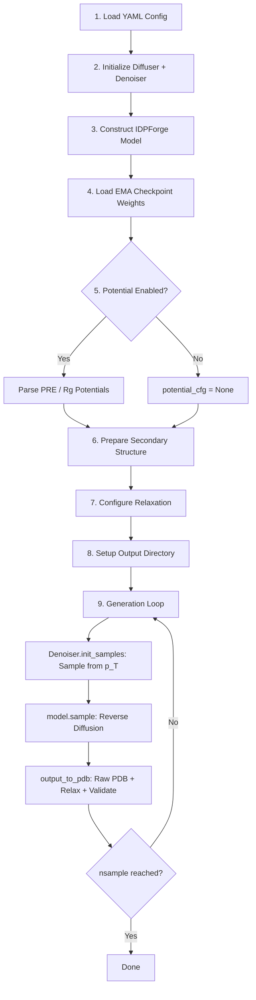

IDPForge's fully disordered sampling pipeline generates structural ensembles for **intrinsically disordered proteins (IDPs)** — sequences with no stable folded core. The pipeline orchestrates a reverse diffusion process across three coupled manifolds — Euclidean translations, SO(3) backbone rotations, and torsion angles — driven by the IDPForge transformer network, with optional experimental guidance potentials and full AMBER relaxation + validation post-processing.

## Pipeline Architecture

The end-to-end workflow is launched by `sample_idp.py` and proceeds through nine logically distinct stages. Each stage is a checkpoint-resumable operation: the generation loop re-counts existing validated PDB files on disk before each batch, so interrupted runs continue seamlessly.



The loop in step 9 is the computational core: it repeatedly samples initial noise, runs the full reverse-diffusion trajectory, and writes validated conformers until the target `nsample` count is satisfied.

Sources: [sample_idp.py](/sample_idp.py#L27-L170)

## Entry Point and CLI Interface

The `sample_idp.py` script exposes a minimal CLI optimized for single-sequence IDP ensemble generation:

| Argument | Type | Default | Description |
|----------|------|---------|-------------|
| `seq` | positional | — | Amino acid sequence (one-letter code) |
| `ckpt_path` | positional | — | Path to EMA checkpoint `.ckpt` |
| `output_dir` | positional | — | Output directory for PDB files |
| `sample_cfg` | positional | — | Path to sampling YAML config |
| `--batch` | int | 32 | Conformers generated per GPU forward pass |
| `--nconf` | int | 100 | Total number of conformers to generate |
| `--cuda` | flag | off | Enable CUDA acceleration |
| `--ss_db` | str | None | Override config's `data_path` for SS database |
| `--no_relax` | flag | off | Skip AMBER relaxation (output raw PDBs only) |
| `--verbose` | flag | off | Print structural validation details per conformer |

**Usage example:**
```bash
python sample_idp.py \
    "MDSKSSSKKSKDRSKYKDRSKYKDRSKYK" \
    checkpoints/idpforge_ema.ckpt \
    output/synuclein_ensemble/ \
    configs/sample.yml \
    --batch 32 --nconf 200 --cuda --verbose
```

Sources: [sample_idp.py](/sample_idp.py#L172-L193)

## Diffusion Initialization: Diffuser and Denoiser

The `Diffuser` class composes three independent diffusion processes that act on different geometric degrees of freedom. The `Denoiser` class wraps the `Diffuser` and provides the reverse-step logic needed at inference time.

### Diffuser: Three-Manifold Forward Process

The `Diffuser.__init__` instantiates three sub-diffusers from the YAML `diffuse` section:

| Sub-Diffuser | Class | Manifold | Config Keys |
|--------------|-------|----------|-------------|
| **Backbone rotations** | `IGSO3` | SO(3) | `n_tsteps` (implicit) |
| **Cα translations** | `EuclideanDiffuser` | ℝ³ | `euclid_b0`, `euclid_bT` |
| **Sidechain torsions** | `TorsionDiffuser` | [−π, π)⁴ | `torsion_b0`, `torsion_bT` |

Both `EuclideanDiffuser` and `TorsionDiffuser` use a **linear beta schedule** `β(t) = linspace(b₀, b_T, T+1)`, scaled by `T/steps` to ensure variance accumulation is independent of discretization. The `IGSO3` class pre-computes a discretized IGSO(3) density table via `calculate_igso3()` and caches it for the reverse sampling step.

### Denoiser: Reverse Step Orchestration

The `Denoiser` pre-computes the cumulative alpha-bar schedules `ᾱ(t) = ∏(1 − β(s))` for both translation and torsion channels. These schedules are consumed by `get_next_pose()`, which performs a single reverse-diffusion step:

1. **Kabsch alignment** — align predicted x̂₀ to current x_t via `align_coords()` so that subsequent deltas are computed in a consistent frame
2. **Cα translation update** — `get_next_ca()` computes the analytical posterior mean μ(x_t, x̂₀, t) and samples from the Gaussian reverse kernel
3. **Backbone frame update** — `get_next_frames()` uses the IGSO(3) score-based reverse sample to rotate each residue frame from R_t toward R̂₀
4. **Torsion angle update** — `get_next_chi_angles()` applies the same Gaussian reverse kernel on the wrapped torsion angles, respecting per-residue `torsion_mask` (Gly, Ala have no χ angles)

Sources: [idpforge/utils/diff_utils.py](/idpforge/utils/diff_utils.py#L491-L685), [configs/sample.yml](/configs/sample.yml#L43-L50)

## Noise Initialization: Sampling from p(x_T)

Before reverse diffusion begins, each conformer must be initialized from the terminal noise distribution p(x_T). The `Denoiser.init_samples()` method calls `init_sample()` per sequence, which performs three independent draws:

- **Translations**: Each residue's Cα is placed at a Gaussian-offset position `N(0, 1/crd_scale)` in ℝ³, with `crd_scale = 0.25` (effectively spreading residues over ~4 Å standard deviation)
- **Rotations**: Rotation vectors are sampled from IGSO(3) at the maximum noise level t = T via `so3_diffuser.sample_vec()`, then applied to ideal backbone atom positions (N, Cα, C, O, Cβ)
- **Torsions**: Four χ angles per residue are drawn from `N(0,1)` wrapped to [−π, π), then converted to sin/cos representation

This produces fully decorrelated atom positions — the maximum-entropy starting state from which the denoising network progressively refines structure.

Sources: [idpforge/utils/diff_utils.py](/idpforge/utils/diff_utils.py#L187-L202), [idpforge/utils/diff_utils.py](/idpforge/utils/diff_utils.py#L609-L619)

## Reverse Diffusion: The `recon()` Loop

The `IDPForge.recon()` method implements the core reverse-diffusion trajectory. Starting from the noise samples at t = T, it iterates backward through discretized timesteps to t = 0:

```python
for t in range(n_tsteps - 1, end_tsteps, -int(n_tsteps / inf_tsteps)):
```

This means with `n_tsteps = 200` and `inference_steps = 40`, the step size is `200/40 = 5`, yielding 40 denoising iterations. At each step:

1. **Network prediction** — `self.forward()` receives the current noised coordinates x_t, torsion features α_t, timestep index t, amino acid embeddings, and secondary structure embeddings, then predicts the denoised structure x̂₀
2. **Potential guidance** — if experimental potentials are active, gradient-based corrections are applied: `p_x0 += clamp(∇V · scaler(t+1), max=grad_clip)`
3. **Reverse step** — `denoiser.get_next_pose()` transitions from x_t → x_{t-1} using the analytical posterior conditioned on x̂₀
4. **Self-conditioning** — if `self_condition: true` (default), the previous output is fed back as `prev_outputs` for the next step, enabling iterative refinement

The **self-conditioning** mechanism is critical for IDP sampling quality: by recycling the previous denoised prediction as an additional input signal, the network can correct errors accumulated across diffusion steps, producing more physically realistic backbone geometries for highly flexible chains.

Sources: [idpforge/model.py](/idpforge/model.py#L155-L208)

## Model Forward Pass: Input Embedding and Trunk

The `IDPForge.forward()` method constructs the per-residue and pairwise input representations that feed into the `FoldingTrunk`:

**Per-residue sequence state** `s_s_0` combines three additive signals:
- **Timestep embedding**: `time_embed(t)` — a frozen sinusoidal positional encoding of the diffusion timestep, projected through `esm_s_mlp`
- **Torsion features**: `α_t` reshaped to 8 dimensions (4 χ angles × sin/cos), concatenated with the timestep embedding before the MLP
- **Amino acid embedding**: `aa_embedding(aa_idx)` — learned residue-type vectors
- **Secondary structure embedding**: `ss_embedding(ss_idx)` — learned SS-type vectors (H, E, C, etc.)

**Pairwise state** `s_z_0` is initialized from the **2D distance/angle features** `xyz_to_t2d(x_t)`, which bins the pairwise Cα distances and inter-residue angles from the noised coordinates into a discrete histogram, then projects through `z_mlp`.

On recycle iterations (self-conditioning), the previous cycle's `s_s`, `s_z`, and distogram are added via learned normalization layers before entering the trunk.

Sources: [idpforge/model.py](/idpforge/model.py#L79-L153)

## Secondary Structure Sampling

For fully disordered IDPs, there is no single ground-truth secondary structure assignment. The pipeline addresses this by **sampling diverse SS strings** from a structural database:

1. A pickle database containing (secondary_structure, sequence) pairs is loaded into a `DataFrame`
2. `fetch_sec_from_seq()` fragments the query sequence into overlapping 1–5 mers (weighted by `xmer_prob = [1,1,3,3,1]`)
3. For each fragment, the database is queried for observed SS annotations and one is sampled proportional to its occurrence frequency
4. This produces `nsample × 2` SS strings — more than needed to ensure diversity across the ensemble

Each batch then draws SS strings via `random.sample(ss, chunk)`, ensuring every conformer in a batch receives a distinct local-structure bias. This diversity is essential: the SS conditioning tells the network whether a local segment should be helical, extended, or coil-like, and varying it across samples is what generates conformational heterogeneity.

If the database lookup fails (e.g., sequence contains rare residues), the pipeline gracefully falls back to all-coil annotations `"C" * seq_len`.

Sources: [idpforge/utils/prep_sec.py](/idpforge/utils/prep_sec.py#L30-L62), [sample_idp.py](/sample_idp.py#L88-L108)

## Experimental Guidance Potentials

When `potential: true` in the config, the reverse diffusion process is augmented with gradient-based guidance from experimental observables. The `sample_idp.py` main function parses the `potential_cfg` section and constructs a `potential_cfg` dict consumed by `model.initialize_potential()`.

### Available Potential Types

| Key | Class | Experimental Data | Guidance Mechanism |
|-----|-------|-------------------|-------------------|
| `pre` | `Contact` | PRE distance bounds | Harmonic penalty on pairwise Cα distances |
| `rg` | `RoG` | Ensemble-averaged Rg | Squared deviation from target radius of gyration |

The **timescale** parameter controls how strongly potentials influence early vs. late diffusion steps via a decay function (`constant`, `linear`, or `quadratic`). The **grad_clip** parameter prevents unstable updates by clamping the potential gradient magnitude.

For fully disordered sampling, PRE-derived contact restraints are the most commonly used potential, as NMR PRE measurements directly probe long-range distances in disordered states. The `Contact` potential implements a differentiable harmonic upper/lower bound on Cα–Cα distances, with stochastic masking (`exp_mask_p`) to prevent overfitting to any single restraint.

Sources: [sample_idp.py](/sample_idp.py#L63-L86), [idpforge/utils/potential.py](/idpforge/utils/potential.py#L15-L98)

## Output, Relaxation, and Validation

The `output_to_pdb()` function handles the full post-processing pipeline for each generated batch:

1. **atom14 → atom37 conversion** using OpenFold's `atom14_to_atom37()`
2. **NaN coordinate filter** — conformers with any NaN atom positions are silently discarded
3. **Backbone continuity check** — `check_backbone_continuity()` verifies Cα–Cα distances along the chain and at IDR–fold junctions (relevant when this function is reused for IDR sampling)
4. **Raw PDB write** — conformers passing filters are written as `{idx}_raw.pdb`

If relaxation is enabled (the default), each raw PDB undergoes:
5. **AMBER relaxation** via `relax_protein()` with configurable `max_iterations`, `tolerance`, `stiffness`, and `max_outer_iterations`
6. **Structural repair** — chirality correction (`repair_chirality()`) and histidine naming fixes (`fix_histidine_naming()`), with re-relaxation if any repairs were applied
7. **Full structural validation** — `validate_structure_post_relax()` checks chirality, bond integrity, steric clashes, and knot topology
8. **Validated PDB** — passing conformers are renamed `{idx}_validated.pdb` and wrapped in a `MODEL/ENDMDL` block; failing conformers are deleted

The generation loop counts only `*_validated.pdb` files (or `*_raw.pdb` if `--no_relax`), ensuring the target `nsample` refers to the number of **structurally valid** conformers in the final ensemble.

Sources: [idpforge/misc.py](/idpforge/misc.py#L119-L470), [configs/sample.yml](/configs/sample.yml#L51-L57)

## Generation Loop and Resumability

The outer generation loop in `sample_idp.py` is designed for robustness on long-running ensemble jobs:

```python
while current_count < nsample:
    chunk = min(batch_size, nsample - current_count)
    ...
    current_count = count_done()  # re-count files on disk
```

Key resumability features:
- **File-based progress tracking** — `count_done()` globes the output directory for validated PDBs, so progress survives process kills
- **Gap-free indexing** — `next_available_idx()` finds the smallest unused integer index, preventing filename collisions after partial runs
- **Memory cleanup** — `gc.collect()` and `torch.cuda.empty_cache()` are called after each batch to prevent GPU memory fragmentation
- **Batch sizing** — the final batch is sized to exactly fill the remaining quota (`min(batch_size, nsample - current_count)`), avoiding overgeneration

Sources: [sample_idp.py](/sample_idp.py#L141-L170)

## Configuration Reference

The `configs/sample.yml` file controls all sampling hyperparameters. The table below documents each parameter with its role in the IDP sampling pipeline:

| Section | Parameter | Default | Role |
|---------|-----------|---------|------|
| `model` | `t_embed_dim` | 32 | Dimensionality of sinusoidal timestep embedding |
| `model` | `self_condition` | true | Enable self-conditioning (recycle previous output) |
| `model.trunk` | `num_blocks` | 2 | Number of Evoformer blocks in the trunk |
| `model.trunk` | `max_recycles` | 3 | Recycle iterations within the trunk per diffusion step |
| `model.trunk.structure_module` | `no_blocks` | 4 | Structure module IPA blocks |
| `model.trunk.structure_module` | `no_heads_ipa` | 8 | Invariant point attention heads |
| `diffuse` | `n_tsteps` | 200 | Total diffusion timesteps T |
| `diffuse` | `inference_steps` | 40 | Number of reverse-diffusion steps (step size = T/inf_steps) |
| `diffuse` | `euclid_b0` / `euclid_bT` | 0.01 / 0.06 | Linear β schedule endpoints for Cα translation |
| `diffuse` | `torsion_b0` / `torsion_bT` | 0.01 / 0.06 | Linear β schedule endpoints for sidechain torsions |
| `potential` | — | false | Enable/disable experimental guidance |
| `potential_cfg.pre` | `exp_path` | — | Path to PRE experimental restraint file |
| `potential_cfg.pre` | `exp_mask_p` | 0.8 | Stochastic masking probability for PRE restraints |
| `potential_cfg` | `timescale` | 10 | Potential strength scaling factor |
| `potential_cfg` | `grad_clip` | 0.1 | Maximum potential gradient magnitude |
| `sec_path` | — | null | Override SS file (null = sample from database) |
| `data_path` | — | `data/example_data.pkl` | Path to SS database pickle |
| `relax` | `max_iterations` | 0 | AMBER max iterations (0 = L-BFGS default) |
| `relax` | `tolerance` | 10.0 | Convergence tolerance |
| `relax` | `stiffness` | 10.0 | Restraint stiffness |
| `relax` | `max_outer_iterations` | 20 | Outer iteration limit for staged relaxation |

Sources: [configs/sample.yml](/configs/sample.yml#L1-L57)

## Comparison: IDP vs. IDR Sampling

The fully disordered IDP pipeline (`sample_idp.py`) differs from the IDR-with-template pipeline (`sample_ldr.py`) in several fundamental ways:

| Aspect | IDP Sampling (Fully Disordered) | IDR Sampling (With Folded Template) |
|--------|--------------------------------|-------------------------------------|
| **Input** | Sequence only | Sequence + folded template coordinates |
| **Noise initialization** | All residues sampled from p(x_T) | Template residues fixed at native coords; IDR residues noised |
| **Diffusion mask** | All residues diffuse freely | `motif_mask` freezes template positions |
| **Secondary structure** | Sampled from database per conformer | Derived from template + database for IDR segments |
| **Kabsch alignment** | Global alignment to x_t | Partial alignment anchored on motif |
| **Typical use case** | α-synuclein, tau, Sic1 ensembles | p53 TAD, CBP IDR with folded domain |

> [!TIP]
> For best IDP ensemble quality, increase `inference_steps` beyond the default 40 — values of 60–80 provide smoother denoising trajectories for long disordered chains (>100 residues), at the cost of ~1.5–2× slower generation.

> [!TIP]
> When using PRE-based potentials, set `exp_mask_p` between 0.5–0.8 to prevent the guidance from over-constraining the ensemble. Too much restraint enforcement produces artificially compact conformers that do not represent the true disordered state.

Sources: [sample_idp.py](/sample_idp.py#L27-L193), [idpforge/utils/diff_utils.py](/idpforge/utils/diff_utils.py#L622-L684)

## Next Steps

- For sampling **intrinsically disordered regions attached to folded domains**, see [IDR Sampling with Folded Templates](13-idr-sampling-with-folded-templates)
- For detailed configuration of **PRE, Rg, and other experimental restraints**, see [Experimental Guidance Potentials](14-experimental-guidance-potentials)
- For understanding the **AMBER relaxation and structural validation** applied to each conformer, see [AMBER Relaxation and Repair](15-amber-relaxation-and-repair)
- For the **mathematical foundations** of the three coupled diffusion processes, see [SE(3) Backbone Diffusion](6-se-3-backbone-diffusion) and [SO(3) Rotational Diffusion](7-so-3-rotational-diffusion)