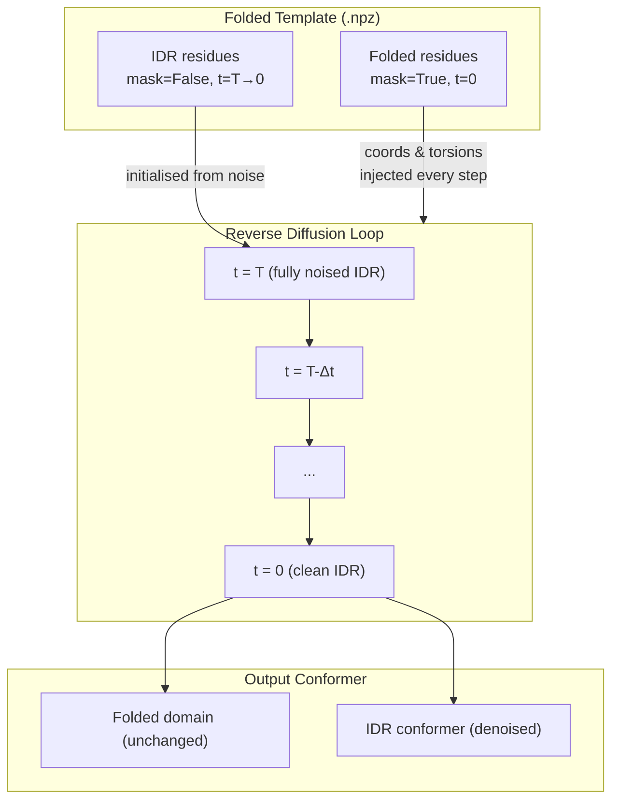
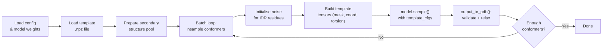
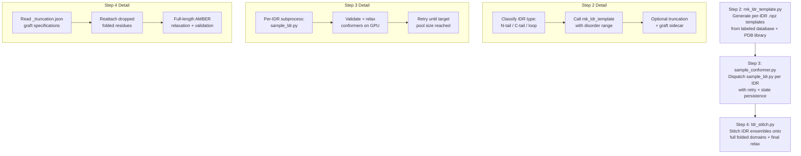

IDR sampling with folded templates is the core inference mode of IDPForge for proteins that contain **both** structured domains and intrinsically disordered regions (IDRs). Unlike [IDP Sampling (Fully Disordered)](12-idp-sampling-fully-disordered), which diffuses the entire chain from noise, this mode **pins the folded backbone as a fixed template** and only denoises the disordered residues—producing ensembles where IDR conformers remain physically anchored to their native structured context. The workflow spans two stages: **template preparation** (`mk_ldr_template.py`) and **template-conditioned diffusion** (`sample_ldr.py`), with the AlphaFlex pipeline (Steps 2–4) providing a production-scale orchestrator.

Sources: [sample_ldr.py](/sample_ldr.py#L1-L31), [mk_ldr_template.py](/mk_ldr_template.py#L1-L27)

## How Template Conditioning Works

The fundamental mechanism is **per-residue timestep masking** inside the `IDPForge.recon()` method. During the reverse diffusion loop, for each timestep the model checks whether a `template_cfg` dictionary was provided. If so, it:

1. **Sets the diffusion timestep to 0** for every residue where `template_cfg["mask"]` is `True` (folded residues), signaling "this residue is already at the clean data distribution—do not denoise it."
2. **Overwrites the noised coordinates** `x_t` with the template's ground-truth backbone coordinates for masked residues.
3. **Overwrites the noised torsion angles** `alpha_t` with the template's ground-truth torsion vectors for masked residues.

This means the forward pass receives **mixed signals**: folded residues at timestep 0 (fully clean), IDR residues at the current diffusion timestep (noised). The network's structure module then predicts clean coordinates for the full chain, but only the IDR residues are updated by the denoiser's `get_next_pose()` step—the folded residues are frozen via `motiff_mask`.



> [!TIP]
> The template mask is a **boolean array** over residues: `True` = folded (pinned), `False` = disordered (diffused). This is stored in the `.npz` template file under the key `"mask"` and loaded directly by `sample_ldr.py` at inference time.

Sources: [idpforge/model.py](/idpforge/model.py#L155-L208), [idpforge/model.py](/idpforge/model.py#L211-L256)

## Template Preparation: `mk_ldr_template.py`

Before sampling can begin, the folded PDB structure must be converted into a **template `.npz` file** containing all fields the diffusion model needs. The `mk_ldr_template.py` script performs this conversion through the following pipeline:

| Stage | Operation | Output Field |
|-------|-----------|--------------|
| Parse PDB | Extract coordinates + sequence via `process_pdb()` | `coord` (L×37×3) |
| Torsion encoding | Compute χ angles → sin/cos vectorisation | `torsion` (L×4×2) |
| Secondary structure | DSSP (H/E) + Ramachandran basin assignment for coils | `sec` (string) |
| Mask construction | `True` for folded, `False` for residues in `--disorder_domain` | `mask` (L, bool) |
| Seed generation | Sample IDR cloud centres on spheres around the fold | `coord_offset` (N×3) |

### Anchor Geometry and Seed Placement

The script classifies the IDR topology into three geometries based on its position relative to the folded domain:

| Geometry | Condition | Anchor Point |
|----------|-----------|--------------|
| **N-terminal tail** | `start_idx == 0` | Cα of first folded residue (`end_idx + 1`) |
| **C-terminal tail** | `end_idx == L - 1` | Cα of last folded residue (`start_idx - 1`) |
| **Internal loop** | Otherwise | Midpoint of the two flanking Cαs |

The coordinates are **centred on the anchor point** (subtracted in-place), and the folded domain Cαs form an **exclusion surface**. Seed points for the IDR cloud centre are sampled on spheres within the **absolute seed-distance band** `[seed_floor, seed_ceiling]` Å from the origin, with a **power-law skew** controlled by `--seed_skew`:

- **`seed_skew = 0`**: All seeds at the floor (6.46 Å, empirically optimal for single-step sampling)
- **`seed_skew = 0.5`**: Uniform across the band
- **`seed_skew = 1`**: All seeds at the ceiling (9.12 Å)
- **Default 0.3**: Concentrated near the floor while retaining ensemble breadth

Any seed that falls within `--min_fold_dist` of a folded Cα is **rejected** (fold keep-out zone), preventing the IDR cloud from overlapping the structured domain.

Sources: [mk_ldr_template.py](/mk_ldr_template.py#L128-L271), [mk_ldr_template.py](/mk_ldr_template.py#L40-L56)

### Truncation for Large Systems

IDPForge is in-distribution only for systems ≤ ~200 residues. When the combined IDR + folded domain exceeds this, `--max_residues` triggers the `_truncate_to_size()` function, which:

1. **Keeps the full IDR** and a symmetric budget of junction-adjacent folded residues (floored at 10 per side).
2. **Drops distant folded residues** from the template, storing a **graft specification** (`graft_offset`, `graft_idr_ranges`, `graft_fold_range`) in the `.npz` file.
3. `sample_ldr.py` auto-emits a `_truncation.json` sidecar at generation time, which [Monte Carlo Stitching and Assembly](20-monte-carlo-stitching-and-assembly) uses in Step 4 to graft the full folded domain back onto each conformer.

Alternatively, `--fold_per_side` explicitly sets the number of folded residues kept per junction (e.g., `--fold_per_side 50` → IDR + 50 folded residues), ignoring the budget arithmetic.

Sources: [mk_ldr_template.py](/mk_ldr_template.py#L59-L125), [sample_ldr.py](/sample_ldr.py#L114-L134)

### Step-2 Continuation for Very Large IDRs

When a single IDR exceeds the in-distribution ceiling even with maximal truncation, the **Step-2 continuation** mechanism splits the IDR into two fragments:

| Fragment | Role | Direction |
|----------|------|-----------|
| **A** (existing conformer) | Pinned pseudo-fold for fragment B | — |
| **B** (new tail) | Newly diffused IDR block | `--append_seq` (C-term) or `--prepend_seq` (N-term) |

The conformer from Step A is loaded, its sequence extended with zero-coordinated placeholder residues for fragment B, and the IDR mask is set to only cover the new range. The resulting template carries a `step2_a_conformer` tag so that Step 4 can chain the assembly: `fold ← A ← B`.

Sources: [mk_ldr_template.py](/mk_ldr_template.py#L146-L168), [mk_ldr_template.py](/mk_ldr_template.py#L259-L269), [sample_ldr.py](/sample_ldr.py#L136-L148)

## Sampling: `sample_ldr.py`

The main sampling script orchestrates the full inference pipeline from template loading through conformer output:



### Template Tensor Construction

At each batch iteration, the template dictionary is built from the `.npz` data:

```python
template = {k: torch.tensor(np.tile(v[None, ...], (chunk,) + (1,) * len(v.shape)),
    device=model.device, dtype=torch.long if k=="mask" else torch.float)
    for k, v in fold_data.items() if k in ["torsion", "mask"]}
```

Coordinates receive special handling: if `coord_offset` exists (multiple seed points), a **random subset** of offsets is selected per batch and subtracted from the template coordinates, placing each sample's IDR cloud at a different seed location. This is the mechanism by which **ensemble diversity** is injected—each conformer starts from a different spatial position relative to the fold.

Sources: [sample_ldr.py](/sample_ldr.py#L33-L109), [sample_ldr.py](/sample_ldr.py#L170-L224)

### Secondary Structure Combination

The secondary structure for each sample is a **hybrid** of the template's folded SS and a sampled IDR SS:

```python
def combine_sec(fold_ss, idr_ss, mask):
    return "".join(fold_ss[i] if m else idr_ss[i] for i, m in enumerate(mask))
```

The IDR SS strings are drawn from either a **pre-computed database** (`--ss_db`), a flat file (`sec_path`), or default to all-coil (`"C" * L`). This ensures the diffusion model receives physically plausible secondary structure signals for the disordered region while preserving the ground-truth assignment for the folded domain.

Sources: [sample_ldr.py](/sample_ldr.py#L30-L96)

### Relaxation with Fold Restraints

When relaxation is enabled (the default), `sample_ldr.py` configures the AMBER relaxation to **restrain the folded domain** while allowing the IDR to minimise freely:

```python
relax_config["exclude_residues"] = np.where(~fold_data["mask"])[0].tolist()
```

This passes the indices of all disordered residues as `exclude_residues`, meaning the positional restraint is **not applied** to the IDR—the folded backbone remains locked while the IDR side chains and backbone are energy-minimised.

Sources: [sample_ldr.py](/sample_ldr.py#L99-L108)

## Junction Quality Gates

Two optional filters reject conformers with physically implausible junction geometry—where the IDR meets the folded domain:

| Gate | Flag | Metric | Rejects When |
|------|------|--------|--------------|
| **Fold curvature** | `--fold_curv_ratio` | Ratio of junction-adjacent fold curvature in the conformer vs. template | Conformer's curvature falls below the threshold fraction of the template's curvature (fold straightened) |
| **Junction kappa** | `--junction_kappa` | Mean backbone curvature κ (Å⁻¹) of the last ~20 IDR residues at the junction | κ falls below threshold (IDR pulled taut to reach the anchor) |

The fold curvature window (default 15 residues into the fold from each junction) and both thresholds default to 0.0 (disabled). Setting `--fold_curv_ratio 0.8`, for example, discards any conformer where the folded domain's junction-adjacent curvature drops below 80% of the template's value—a **rigid-motion invariant** measure that replaces folded-lDDT for template quality assessment.

Sources: [sample_ldr.py](/sample_ldr.py#L202-L218), [sample_ldr.py](/sample_ldr.py#L248-L255)

## Topological Constraints: Knot Screening

For proteins with non-trivial topology, `--expected_knot_type` accepts a **per-domain JSON specification** of the expected knot type:

```json
[
  {"range": [65, 280], "knot": null},
  {"range": [320, 450], "knot": "3_1"}
]
```

This allows different domains to have different topological constraints—e.g., one domain must be unknotted while another must be a trefoil (3₁). Conformers that violate the specified topology are rejected during validation. Omitting the flag applies the legacy full-chain unknot baseline.

Sources: [sample_ldr.py](/sample_ldr.py#L256-L279)

## AlphaFlex Pipeline Integration

The AlphaFlex pipeline automates the full IDR sampling workflow at proteome scale through three sequential steps:



**Step 2** (`AlphaFlex/Step_2_mk_ldr_template.py`) iterates over the labeled protein database, classifies each IDR by topology (N-terminal tail, C-terminal tail, internal loop), and calls `mk_ldr_template.py` via subprocess for each. Category 0 (fully disordered) proteins are diverted to a separate IDP list for [IDP Sampling (Fully Disordered)](12-idp-sampling-fully-disordered).

**Step 3** (`AlphaFlex/Step_3_sample_conformer.py`) manages the GPU-bound sampling phase. For each IDR it dispatches `sample_ldr.py` with retry logic and persistent state (`.step3_state.json`), accumulating conformers until the target pool size is reached. Knot specifications are automatically filtered to the truncation window and renumbered.

**Step 4** (`AlphaFlex/Step_4_ldr_stitch.py`) performs the final assembly: reading `_truncation.json` sidecars to graft dropped folded residues back onto conformers, running full-length AMBER relaxation with fold restraints, validating structure integrity, and writing final ensemble PDBs.

Sources: [AlphaFlex/Step_2_mk_ldr_template.py](/AlphaFlex/Step_2_mk_ldr_template.py#L1-L200), [AlphaFlex/Step_3_sample_conformer.py](/AlphaFlex/Step_3_sample_conformer.py#L84-L142), [AlphaFlex/Step_4_ldr_stitch.py](/AlphaFlex/Step_4_ldr_stitch.py#L1-L116)

## CLI Reference

### `mk_ldr_template.py`

| Argument | Type | Default | Description |
|----------|------|---------|-------------|
| `input` | pos | — | Input PDB file |
| `disorder_domain` | pos | — | Residue range (1-indexed, inclusive), e.g. `38-129` |
| `output` | pos | — | Output `.npz` path |
| `--nconf` | int | 400 | Number of seed points to sample |
| `--seed_skew` | float | 0.3 | Power-law skew for seed distances (0=floor, 1=ceiling) |
| `--seed_floor` | float | 6.46 | Minimum seed distance (Å) |
| `--seed_ceiling` | float | 9.12 | Maximum seed distance (Å) |
| `--min_fold_dist` | float | 6.46 | Keep-out radius around folded Cαs (Å) |
| `--variant_seq` | str | None | Override IDR amino acid identities |
| `--max_residues` | int | None | Hard cap on total system size |
| `--fold_per_side` | int | None | Exact folded residues per junction (overrides budget) |
| `--append_seq` | str | None | Step-2: C-terminal IDR tail to append |
| `--prepend_seq` | str | None | Step-2: N-terminal IDR block to prepend |

### `sample_ldr.py`

| Argument | Type | Default | Description |
|----------|------|---------|-------------|
| `ckpt_path` | pos | — | Model checkpoint path |
| `fold_input` | pos | — | Template `.npz` file |
| `out_dir` | pos | — | Output directory |
| `sample_cfg` | pos | — | Sampling YAML config |
| `--batch` | int | 32 | Batch size per diffusion round |
| `--nconf` | int | 100 | Target number of conformers |
| `--attention_chunk` | int | None | Chunk size for memory-efficient attention |
| `--cuda` | flag | False | Use GPU |
| `--ss_db` | str | None | Secondary structure database (pickle) |
| `--no_relax` | flag | False | Skip relaxation (output raw PDBs) |
| `--fold_curv_ratio` | float | 0.0 | Fold curvature rejection threshold |
| `--fold_curv_window` | int | 15 | Residues into fold for curvature averaging |
| `--junction_kappa` | float | 0.0 | Junction tautness rejection threshold (Å⁻¹) |
| `--expected_knot_type` | str | None | Per-domain knot spec (JSON) |

Sources: [mk_ldr_template.py](/mk_ldr_template.py#L274-L351), [sample_ldr.py](/sample_ldr.py#L233-L292)

## Typical Usage Workflow

The minimal two-command workflow for a protein with a folded domain (residues 16–230) and an N-terminal IDR (residues 1–15):

```bash
# Step 1: Prepare the template
python mk_ldr_template.py folded.pdb 1-15 template.npz --nconf 400

# Step 2: Sample conformers
python sample_ldr.py checkpoint.pt template.npz output_dir/ configs/sample.yml \
    --nconf 200 --batch 32 --cuda --ss_db sec_db.pkl
```

For larger systems exceeding ~200 residues, add truncation:

```bash
python mk_ldr_template.py folded.pdb 1-15 template.npz --nconf 400 --max_residues 200
```

And for very large IDRs requiring two-step continuation:

```bash
# Fragment A: first 100 IDR residues
python mk_ldr_template.py folded.pdb 1-100 fragment_a.npz --max_residues 200

# Sample fragment A conformers...
python sample_ldr.py ckpt.pt fragment_a.npz pool_a/ configs/sample.yml --nconf 200 --cuda

# Fragment B: remaining IDR residues appended to a fragment A conformer
python mk_ldr_template.py pool_a/1_validated.pdb 101-150 fragment_b.npz \
    --append_seq $(python -c "print('G'*50)") --max_residues 200

# Sample fragment B conformers...
python sample_ldr.py ckpt.pt fragment_b.npz pool_b/ configs/sample.yml --nconf 200 --cuda
```

> [!TIP]
> Each seed point in the template produces conformers at a **different spatial offset** relative to the fold. The `--nconf` in `mk_ldr_template.py` should be ≥ the `--nconf` in `sample_ldr.py` to ensure every batch has a unique offset. If `coord_offset` is exhausted, offsets are tiled (reused), which reduces spatial diversity.

Sources: [sample_ldr.py](/sample_ldr.py#L186-L190), [mk_ldr_template.py](/mk_ldr_template.py#L230-L237)

## What Comes Next

Once conformers are generated and validated, the natural next steps are:

- Apply **experimental guidance potentials** to bias the ensemble toward NMR/SAXS/FRET data: [Experimental Guidance Potentials](14-experimental-guidance-potentials)
- Run **X-EISD scoring** to select maximally consistent sub-ensembles: [X-EISD Ensemble Scoring](17-x-eisd-ensemble-scoring)
- For truncated templates, complete the **graft-and-stitch** workflow: [Monte Carlo Stitching and Assembly](20-monte-carlo-stitching-and-assembly)