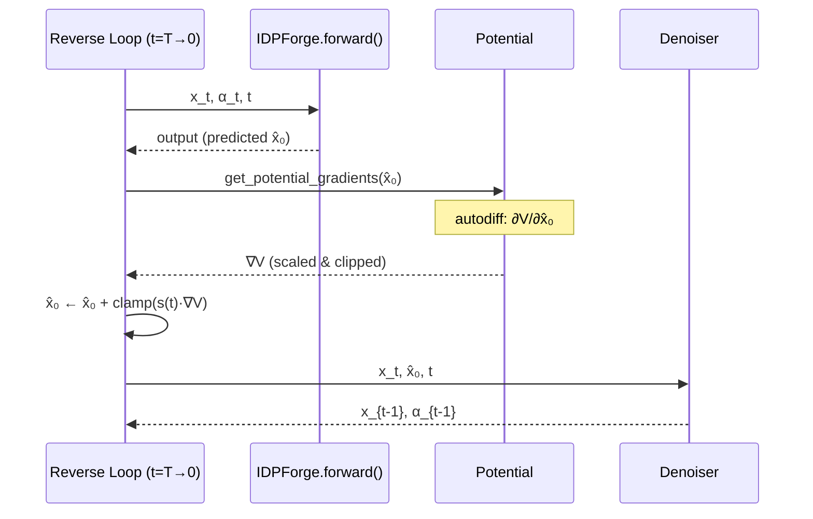

IDPForge integrates **differentiable experimental restraint potentials** directly into the reverse diffusion trajectory, enabling structure sampling that is physically consistent with NMR, FRET, and SAXS observables. Rather than post-hoc filtering, these potentials exert gradient-based steering at every denoising timestep—biasing the model's $\hat{x}_0$ prediction toward conformations that satisfy experimental constraints before the next reverse step is committed. This mechanism produces ensembles that are both diffusion-model-plausible and experimentally validated by construction.

Sources: [potential.py](idpforge/utils/potential.py#L1-L170), [model.py](idpforge/model.py#L155-L269)

## Architectural Integration into Reverse Diffusion

The guidance potentials operate within the `IDPForge.recon()` reverse-diffusion loop. At each timestep $t$, the model predicts the denoised structure $\hat{x}_0$. If a potential is active, its gradient $\nabla_{\hat{x}_0} V(\hat{x}_0)$ is computed via autodiff, scaled by a time-dependent function, clipped for stability, and **added to $\hat{x}_0$** before the denoiser computes the next step $x_{t-1}$. This means the potential does not modify the noise schedule or the network weights—it merely redirects the trajectory of each sample through conformational space.



The critical code path lives in `recon()`: after the forward pass produces `p_x0`, the potential gradient is computed and applied if a potential exists, then the modified `p_x0` is passed to `denoiser.get_next_pose()`.

Sources: [model.py](idpforge/model.py#L187-L202)

## Potential Classes and Physical Formulations

All potentials inherit from the `Potential` base class, which defines two contracts: `compute(xyz)` returns a scalar value to be **maximized** (i.e., negative loss), and `get_potential_gradients(xyz)` enables autograd through `compute` and handles gradient broadcasting from Cα to all five backbone atoms.

Sources: [potential.py](idpforge/utils/potential.py#L15-L53)

### Radius of Gyration (RoG)

| Attribute | Detail |
|-----------|--------|
| **Key** | `rg` |
| **Observable** | Ensemble-average $R_g$ from SAXS |
| **Input** | `target`: desired $R_g$ value (Å) |
| **Formula** | $V = -\frac{1}{2}(R_g - R_g^{\text{target}})^2$ where $R_g = \sqrt{\sum_i \|\mathbf{r}_i^{\text{Cα}} - \bar{\mathbf{r}}^{\text{Cα}}\|^2}$ |
| **Gradient atoms** | Cα only (broadcast to all backbone) |

The RoG potential provides a global constraint on chain compactness. A **single scalar** $R_g^{\text{target}}$ from SAXS experiments directly shapes the ensemble's overall dimension, making it the simplest yet often most impactful restraint for disordered proteins.

Sources: [potential.py](idpforge/utils/potential.py#L56-L67)

### Contact (PRE / NOE Distance Bounds)

| Attribute | Detail |
|-----------|--------|
| **Key** | `contact` |
| **Observable** | Paramagnetic relaxation enhancement (PRE) or NOE upper/lower distance bounds |
| **Input** | `contact_bounds`: array `[L, L, 2]` — lower and upper distance limits; `exp_mask_p`: stochastic mask probability |
| **Formula** | $V = -\sum_{i,j} m_{ij} \left[\text{clamp}(d_{ij}^{\text{lo}} - \bar{d}_{ij})^2 + \text{clamp}(\bar{d}_{ij} - d_{ij}^{\text{hi}})^2\right]$ where $\bar{d}_{ij} = \left(\frac{1}{L}\sum_b (d_{ij}^{(b)} + \epsilon)^{-6}\right)^{-1/6}$ is a power-mean over the batch |
| **Gradient atoms** | Cα only (broadcast) |

The **power-mean aggregation** ($p = -6$ harmonic-like) is differentiable and avoids the discontinuity of `min` operations, inspired by the PLUMED COORDINATION collective variable. The stochastic mask `exp_mask_p` randomly drops restraints at each gradient computation, which injects conformational diversity and prevents the ensemble from collapsing onto a single structure that minimizes all restraints simultaneously—a crucial property for IDP ensembles where heterogeneity is physically meaningful.

Sources: [potential.py](idpforge/utils/potential.py#L70-L98)

### FRET Efficiency (Efret)

| Attribute | Detail |
|-----------|--------|
| **Key** | `fret` |
| **Observable** | smFRET efficiency $E$ |
| **Input** | `exp_val`: array `[L, L, 2]` — channel 0 = target efficiency, channel 1 = Förster radius $R_0$; `exp_mask_p`: stochastic mask probability |
| **Formula** | $V = -\sum_{i,j} m_{ij} \left| \bar{E}_{ij} - E_{ij}^{\text{target}} \right|$ where $E_{ij}^{(b)} = \frac{1}{1 + (d_{ij}^{(b)} / R_0)^6}$ and $\bar{E}_{ij} = \frac{1}{B}\sum_b E_{ij}^{(b)}$ |
| **Gradient atoms** | Cα only (broadcast) |

The FRET potential uses the canonical **Förster equation** to convert inter-residue distances into transfer efficiencies. The $R_0$ (Förster radius) per restraint pair is stored in channel 1 of `exp_val`, allowing different dye-pair $R_0$ values within the same experiment. The absolute-difference loss (rather than squared) provides robustness to outlier efficiencies.

Sources: [potential.py](idpforge/utils/potential.py#L101-L123)

### J-Coupling (JCoup)

| Attribute | Detail |
|-----------|--------|
| **Key** | `jcoup` |
| **Observable** | ${}^3J_{\text{HN-Hα}}$ vicinal scalar couplings |
| **Input** | `exp_val`: array `[L-1]` — target $J$ values per residue; `exp_mask_p`: stochastic mask probability |
| **Formula** | $V = -\frac{1}{2}\sum_i m_i (J_i^{\text{calc}} - J_i^{\text{target}})^2$ where $J_i^{\text{calc}} = 6.51\cos^2(\phi_i - 60°) - 1.76\cos(\phi_i - 60°) + 1.6$ (Karplus equation) |
| **Gradient atoms** | Backbone N–Cα–C (true dihedral gradient) |

The J-coupling potential is architecturally distinct: it computes gradients on **true backbone atoms** (N, Cα, C) rather than Cα alone, because the dihedral angle $\phi$ depends on the precise geometry of consecutive residues. The Karplus relation maps backbone torsions to observable couplings, and the gradient flows through `get_dih()` which computes exact dihedral angles from four sequential backbone atoms.

Sources: [potential.py](idpforge/utils/potential.py#L126-L148), [tensor_utils.py](idpforge/utils/tensor_utils.py#L86-L113)

### Composite Multiple Potential

| Attribute | Detail |
|-----------|--------|
| **Key** | `multiple` |
| **Purpose** | Weighted combination of arbitrary potentials |
| **Formula** | $V = \frac{1}{\sum_k w_k} \sum_k w_k \cdot V_k(\mathbf{x})$ |

When the configuration specifies more than one potential type, `initialize_potential()` automatically constructs a `Multiple` potential that evaluates each sub-potential independently and returns their **weighted sum**, normalized by total weight. This enables simultaneous restraint from, e.g., PRE distances and Rg.

Sources: [potential.py](idpforge/utils/potential.py#L151-L169), [model.py](idpforge/model.py#L258-L269)

## Gradient Computation and Safety Mechanisms

The `get_potential_gradients()` method in the base `Potential` class implements a carefully designed autodiff pipeline with three safety mechanisms:

1. **Gradient broadcasting**: If gradients are zero on atoms beyond Cα (indices 2–4), the Cα gradient is tiled across all five backbone atom positions `[N, Cα, C, O, Cβ]`. This ensures the denoiser receives well-formed gradient tensors even for distance-based potentials that only sense Cα positions.

2. **NaN detection and zeroing**: Any NaN values in the Cα gradient channel trigger a warning and are replaced with zero. The full gradient tensor is then swept for remaining NaNs. This guards against numerical instabilities in the `Contact` potential's power-mean computation at very short distances.

3. **Gradient clipping**: Applied externally in `recon()` via `torch.clamp(x_grad * scaler, max=potential_grad_clip)`, preventing excessively large gradient steps that would destabilize the reverse diffusion trajectory. The default clip value is `0.1`.

Sources: [potential.py](idpforge/utils/potential.py#L33-L53), [model.py](idpforge/model.py#L190-L192)

## Time-Dependent Potential Scaling

The potential's influence is modulated by a **time-dependent scaling function** $s(t)$, controlled by the `timescale` and `time_schedule` configuration parameters. Three schedules are available:

| Schedule | Formula | Behavior |
|----------|---------|----------|
| `constant` | $s(t) = \lambda$ | Full restraint strength at all timesteps |
| `linear` | $s(t) = \frac{t}{T} \cdot \lambda$ | Ramps from zero (at $t=0$, final structure) to full (at $t=T$, pure noise) |
| `quadratic` | $s(t) = \frac{t^2}{T^2} \cdot \lambda$ | Slow ramp-up; restraint dominates only at early (noisy) steps |

The **linear** schedule is the default and most physically motivated: at early reverse-diffusion steps (high $t$, near noise), the model's $\hat{x}_0$ prediction is unreliable, so a strong experimental gradient provides valuable structural information. As the structure crystallizes at low $t$, the model's own learned prior becomes more trustworthy, and the experimental gradient naturally recedes. The `timescale` parameter $\lambda$ controls the overall magnitude.

Sources: [model.py](idpforge/model.py#L258-L265)

## Experimental Data Formats and Parsing

### PRE / NOE Contact Data

Contact restraints are read from CSV files with columns: `index, res1, atom1, res2, atom2, dist_value, lower, upper`. The `get_contact_map()` parser converts this into a symmetric `[L, L, 2]` array where channel 0 stores the lower bound ($d_{\text{value}} - \text{lower}$) and channel 1 stores the upper bound ($d_{\text{value}} + \text{upper}$). Residue indices are **1-based** in the CSV and converted to 0-based internally.

Example entries from `sic1_pre_exp.txt`:
```
index,res1,atom1,res2,atom2,dist_value,lower,upper
1,1,CA,3,H,10.79,5.0,5.0
```
This specifies that the distance between residue 1 Cα and residue 3 H should fall within 5.79–15.79 Å.

### J-Coupling Data

J-coupling values are read from CSV files with columns: `resnum, value`. The `get_jcoup_array()` parser produces a `[L-1]` array indexed by residue (0-based, offset by `resnum - 2`).

### FRET Efficiency Data

FRET data uses CSV with columns: `res1, res2, value, scale`, where `value` is the target efficiency $E$ and `scale` is the Förster radius $R_0$. The `get_efret_array()` parser produces a symmetric `[L, L, 2]` array.

Sources: [np_utils.py](idpforge/utils/np_utils.py#L42-L71), [sic1_pre_exp.txt](data/sic1_pre_exp.txt#L1-L5)

## Configuration and Activation

Potentials are configured under the `potential_cfg` key in the sampling YAML. The top-level `potential: true` flag must be set to activate them. The `sample_idp.py` script parses the configuration and constructs a `potential_cfg` dictionary that is passed to `model.sample()`.

```yaml
# configs/sample.yml — example configuration
potential: true
potential_cfg:
  pre:                              # PRE distance restraints
    exp_path: data/sic1_pre_exp.txt # path to PRE CSV
    exp_mask_p: 0.8                 # stochastic mask probability
    weight: 1.0                     # potential weight (for Multiple)
  rg:                               # Radius of gyration
    ens_avg: 25.4                   # target Rg in Å
    weight: 1.0
  timescale: 10                     # overall scaling magnitude λ
  grad_clip: 0.1                    # gradient clip threshold
```

The configuration parser in `sample_idp.py` recognizes the keys `pre`/`noe` (mapped to `contact`), and `rg`. Each key's sub-dictionary is forwarded to the corresponding potential constructor.

Sources: [sample_idp.py](sample_idp.py#L64-L86), [sample.yml](configs/sample.yml#L34-L40)

### Full Parameter Reference

| Parameter | Location | Type | Default | Description |
|-----------|----------|------|---------|-------------|
| `potential` | top-level | bool | `false` | Master switch for guidance potentials |
| `potential_cfg.pre.exp_path` | under `potential_cfg` | str | — | Path to PRE/NOE CSV file |
| `potential_cfg.pre.exp_mask_p` | under `potential_cfg` | float | `1.0` | Probability of retaining each restraint per gradient step |
| `potential_cfg.pre.weight` | under `potential_cfg` | float | `1.0` | Weight for `Multiple` composite |
| `potential_cfg.rg.ens_avg` | under `potential_cfg` | float | — | Target ensemble-average $R_g$ (Å) |
| `potential_cfg.rg.weight` | under `potential_cfg` | float | `1.0` | Weight for `Multiple` composite |
| `potential_cfg.timescale` | under `potential_cfg` | float | — | Scaling magnitude $\lambda$ for $s(t)$ |
| `potential_cfg.grad_clip` | under `potential_cfg` | float | — | Max absolute gradient per atom per step |

> [!TIP]
> When combining PRE and Rg potentials, set `exp_mask_p` to 0.7–0.9 rather than 1.0. The stochastic masking prevents the ensemble from over-converging to a single restraint-satisfying conformation—essential for capturing the intrinsic heterogeneity of IDPs. Values below ~0.5 risk producing structures that violate too many restraints.

Sources: [sample_idp.py](sample_idp.py#L64-L86), [configs/sample.yml](configs/sample.yml#L34-L40)

## Potential Registry and Extensibility

The `Potentials` dictionary serves as a **named registry** mapping string keys to potential classes:

```python
Potentials = {
    "rg":      RoG,
    "contact": Contact,
    "jcoup":   JCoup,
    "fret":    Efret,
    "multiple": Multiple,
}
```

To add a custom potential: (1) subclass `Potential`, (2) implement `compute(self, xyz)` returning a scalar to maximize, and (3) register it in the `Potentials` dict. The `get_potential_gradients()` base-class method handles autodiff, broadcasting, and NaN safety automatically—no override is needed unless your potential requires gradients on atoms beyond the standard Cα-broadcast pattern.

Sources: [potential.py](idpforge/utils/potential.py#L162-L168)

## Interaction with the Forward Pass

When a potential is active, the `use_potential=True` flag is passed to `IDPForge.forward()`, which activates the `pseudo_beta` mode in `xyz_to_c6d()`. This causes the pairwise distance representation to use **generated Cβ positions** (computed from N, Cα, C geometry) rather than the potentially unreliable Cβ from the noised coordinates. This ensures the model's internal distance representation is geometrically consistent when experimental gradients are steering the structure.

Sources: [model.py](idpforge/model.py#L181-L186), [tensor_utils.py](idpforge/utils/tensor_utils.py#L169-L176)

## Practical Guidance for Ensemble Generation

| Scenario | Recommended Potentials | Key Settings |
|----------|----------------------|--------------|
| SAXS-only | `rg` | `timescale: 5–15`, `time_schedule: linear` |
| PRE-available | `contact` + `rg` | `exp_mask_p: 0.8`, `timescale: 10` |
| PRE + smFRET | `contact` + `fret` + `rg` | Weight FRET lower (0.5) if PRE density is high |
| J-coupling rich | `jcoup` + `contact` | `time_schedule: quadratic` for gradual torsion steering |
| Sparse restraints | Any single | Increase `timescale` (15–20) for stronger guidance |

> [!TIP]
> Start with `potential: false` to generate an unguided ensemble, then measure its $R_g$ distribution and PRE violations. Use the observed deviation to calibrate `timescale`—if the unguided ensemble already partially satisfies restraints, a lower `timescale` (3–5) suffices. If violations are severe, increase to 10–20. Always validate the final ensemble with [X-EISD Ensemble Scoring](17-x-eisd-ensemble-scoring) to confirm that the guided ensemble improves the integrated score over the unguided baseline.

Sources: [model.py](idpforge/model.py#L258-L269), [sample_idp.py](sample_idp.py#L64-L86)

## Next Steps

- See [IDP Sampling (Fully Disordered)](12-idp-sampling-fully-disordered) for the complete sampling workflow that invokes these potentials.
- See [X-EISD Ensemble Scoring](17-x-eisd-ensemble-scoring) for quantitative validation of guided ensembles against experimental data.
- See [Configuration Reference](22-configuration-reference) for the full YAML schema including all potential parameters.