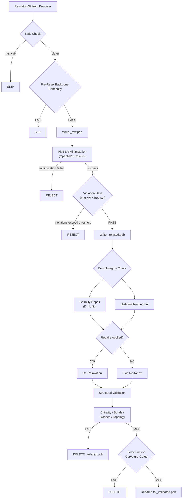

IDPForge's AMBER Relaxation and Repair pipeline transforms raw diffusion outputs into physically plausible protein conformers through a three-phase protocol: **pre-relaxation screening**, **AMBER energy minimization**, and **structural repair with re-relaxation**. This pipeline is the critical bridge between the denoiser's atom37 coordinate predictions and the validated ensemble members that enter downstream scoring—every conformer must survive a cascade of geometric and stereochemical gates before earning a `_validated.pdb` suffix.

## Pipeline Architecture

The full pipeline executes as a sequential gate chain inside `output_to_pdb`, where each stage can reject a conformer before the next stage runs. Conformers that pass all gates are renamed from `_relaxed.pdb` to `_validated.pdb` and stamped as clean MODEL blocks for downstream consumption.



Sources: [misc.py](/idpforge/misc.py#L119-L470), [relax.py](/idpforge/utils/relax.py#L21-L92)

## Phase 1: Pre-Relaxation Screening

Before investing in expensive AMBER minimization, IDPForge applies a lightweight **backbone continuity filter** that catches geometrically impossible diffusion outputs early. The check walks every consecutive CA–CA pair along the chain and verifies the distance falls within one of two thresholds:

| Bond Type | CA–CA Threshold (Å) | Rationale |
|-----------|---------------------|-----------|
| **Backbone** (both residues same domain) | 9.12 | Tolerance for disordered backbone stretch |
| **Junction** (residues straddle fold/IDR boundary) | 6.46 | Tighter tolerance at the ordered–disordered interface |

A bond is classified as a junction when `viol_mask[i] ≠ viol_mask[i+1]`—that is, when the two adjacent residues belong to different domains (folded vs. IDR). Conformers failing any bond are silently discarded before PDB serialization, saving significant compute.

Sources: [pre_relax.py](/idpforge/utils/pre_relax.py#L1-L30), [misc.py](/idpforge/misc.py#L198-L237)

## Phase 2: AMBER Minimization and Violation Gating

### Energy Minimization

The core relaxation delegates to OpenFold's `AmberRelaxation` class, which wraps OpenMM with the AMBER ff14SB force field. The minimizer is configured through the `relax` section of the sampling YAML:

| Parameter | Default | Purpose |
|-----------|---------|---------|
| `max_iterations` | 0 | Inner L-BFGS iteration cap (0 = OpenMM default) |
| `tolerance` | 10.0 | Energy convergence tolerance (kJ/mol) |
| `stiffness` | 10.0 | Positional restraint strength on folded residues |
| `max_outer_iterations` | 20 | Outer iteration limit for the restraint schedule |
| `exclude_residues` | `[]` | Residue indices excluded from positional restraints (populated at runtime from `~mask`) |

The critical design choice is the **positional restraint asymmetry**: folded-domain residues are held near their template coordinates by harmonic restraints (controlled by `stiffness`), while IDR residues (listed in `exclude_residues`) are free to move during minimization. This preserves the experimentally determined fold while allowing the disordered region to relax into a low-energy conformation.

Sources: [relax.py](/idpforge/utils/relax.py#L21-L42), [sample.yml](/configs/sample.yml#L51-L57), [sample_ldr.py](/idpforge/../sample_ldr.py#L99-L108)

### Violation Gates

After minimization, `relax_protein` applies two acceptance gates over the **free residue set** (IDR + junctions, defined by `viol_mask`):

**Ring-residue gate.** Aromatic residues (F, Y, W, H, P) are checked for steric violations. If the fraction of violated ring residues exceeds `viol_threshold` (default 2%), the conformer is rejected. This catches cases where AMBER could not resolve ring clashes—common at fold/IDR junctions where backbone strain propagates into sidechain geometry.

**Free-set violation gate.** The total violation count and fraction across all free residues are checked against both a fractional threshold and an absolute cap: `viol_cap = max(4, ⌈viol_threshold × n_free⌉)`. A conformer is rejected if either `viol_frac > viol_threshold` or `viol_total > viol_cap`. The dual criterion prevents a single bad residue from slipping through when the chain is long.

```python
# Dual rejection criterion from relax.py
viol_cap = max(4, int(np.ceil(viol_threshold * n_free)))
if viol_frac > viol_threshold or viol_total > viol_cap:
    # REJECT
```

Sources: [relax.py](/idpforge/utils/relax.py#L44-L76)

## Phase 3: Structural Repair

Even when AMBER minimization succeeds, two classes of systematic artifacts can survive: **D-amino acid chirality flips** and **histidine imidazole ring atom renaming**. Both are repaired in-place on the `_relaxed.pdb` file, and any repair triggers a mandatory re-relaxation to ensure the corrected geometry remains energy-consistent.

### Chirality Repair: D→L Isomer Reflection

AMBER's OpenMM backend can occasionally produce D-amino acid configurations, particularly for residues near high-strain junctions. The repair algorithm:

1. **Detection** uses the scalar triple product `vol = (v_N × v_C) · v_CB` computed from the N→CA, C→CA, and CB→CA vectors. Residues where `vol < 1.0` are flagged as D-isomers (the threshold of 1.0 rather than 0.0 provides margin for near-planar distortions). This mirrors the same check in `check_chirality` from `structure_validation.py`.
2. **Repair** reflects every **sidechain atom** across the N-CA-C plane. Backbone atoms (N, H, CA, HA2, HA3, C, O, OXT) are left untouched. The reflection formula for a sidechain atom at position `p` is: `p' = CA + v − 2(v·n̂)n̂`, where `v = p − CA` and `n̂` is the unit normal to the N-CA-C plane.

> [!TIP]
> The chirality repair reflects the full sidechain, not just CB. Partial reflection (CB-only) would leave CG, CD, etc. in the D-configuration, causing bond-length artifacts in subsequent re-relaxation.

Sources: [structure_repair.py](/idpforge/utils/structure_repair.py#L35-L153)

### Histidine Imidazole Ring Naming Repair

AMBER relaxation can scramble atom identities within the HIS imidazole ring (CG, ND1, CE1, NE2, CD2 and their hydrogens), especially at the HID/HIE/HIP protonation boundary. The repair is purely **geometric**—no chemical inference is needed:

1. **Find CG** as the sidechain atom closest to CB (~1.51 Å expected).
2. **Trace the five-membered ring** via bond-distance adjacency: atoms within 1.25–1.45 Å of each other form ring edges. A deterministic walk from CG constructs the ring order.
3. **Determine ring direction** by counting hydrogen neighbors per ring atom. The hydrogen-count pattern uniquely identifies the protonation state and orientation:
   - HID forward: `[1, 1, 0, 1]` (ND1 protonated)
   - HIE forward: `[0, 1, 1, 1]` (NE2 protonated)
   - HIP forward: `[1, 1, 1, 1]` (both protonated; CG–ND1 distance ~1.38 Å vs CG–CD2 ~1.35 Å breaks the tie)
4. **Reassign atom names** in the PDB file and rewrite the element column.

Sources: [structure_repair.py](/idpforge/utils/structure_repair.py#L156-L358)

## Repair-Triggered Re-Relaxation

When either `repair_chirality` or `fix_histidine_naming` makes corrections, the `needs_rerelax` flag is set and the conformer undergoes a second AMBER minimization pass. The re-relaxation workflow:

1. Reload the repaired PDB via `from_pdb_string`.
2. Delete the existing `_relaxed.pdb`.
3. Run `relax_protein` again with the same configuration (stiffness, exclude_residues, violation thresholds).
4. If re-relaxation fails or the violation gate rejects, the conformer is discarded entirely.

This two-pass protocol (relax → repair → re-relax) ensures that chirality flips and HIS renaming don't introduce new steric clashes or bond distortions that would only appear after the geometric correction.

Sources: [misc.py](/idpforge/misc.py#L308-L357), [relax_raw.py](/relax_raw.py#L127-L166)

## Standalone Relaxation: `relax_raw.py`

For post-hoc processing of existing raw PDB files, the `relax_raw.py` script provides the same relaxation and optional validation pipeline outside the sampling loop:

```bash
# Basic relaxation only
python relax_raw.py ./raw_conformers template.npz configs/sample.yml --cuda

# Full relax + repair + validate
python relax_raw.py ./raw_conformers template.npz configs/sample.yml \
    --cuda --validate --verbose

# Custom output directory
python relax_raw.py ./raw_conformers template.npz configs/sample.yml \
    --cuda --output_dir ./relaxed_conformers
```

The script loads the fold mask from the template `.npz` file (where `True` = folded, `False` = IDR), derives `exclude_residues` from `~mask`, and processes all `*_raw.pdb` files in sorted numerical order. With `--validate`, it runs the full repair + validation chain and produces `_validated.pdb` files for conformers that pass all gates.

Sources: [relax_raw.py](/relax_raw.py#L1-L232)

## File Lifecycle Summary

The pipeline produces a deterministic file naming convention that tracks each conformer's progress through the gates:

| Stage | Filename Pattern | Condition |
|-------|-----------------|-----------|
| Raw diffusion output | `{n}_raw.pdb` | Written after pre-relax screening passes |
| After AMBER relaxation | `{n}_relaxed.pdb` | Written if minimization + violation gate pass |
| After full validation | `{n}_validated.pdb` | Renamed from `_relaxed` if all gates pass |

Conformers that fail at any gate have their intermediate file deleted. The `_validated.pdb` suffix is the **contract** that downstream consumers ([X-EISD Ensemble Scoring](17-x-eisd-ensemble-scoring), AlphaFlex stitching) rely on—it guarantees the conformer has survived the complete geometric, stereochemical, and topological validation chain.

> [!TIP]
> When using `--no_relax` in `sample_ldr.py`, the search pattern switches from `*_validated.pdb` to `*_raw.pdb`. Downstream scripts that glob for `*_validated.pdb` will find zero files—always pair `--no_relax` with a subsequent `relax_raw.py --validate` run.

Sources: [misc.py](/idpforge/misc.py#L451-L465), [sample_ldr.py](/sample_ldr.py#L100-L108)

## Next Steps

The validated conformers produced by this pipeline become the input to the [Structure Validation Pipeline](16-structure-validation-pipeline) (which provides the detailed four-axis validation logic) and ultimately feed into [X-EISD Ensemble Scoring](17-x-eisd-ensemble-scoring) for experimental reweighting.