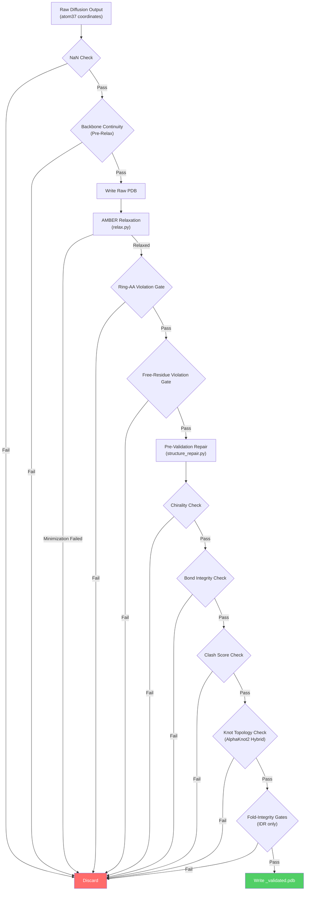
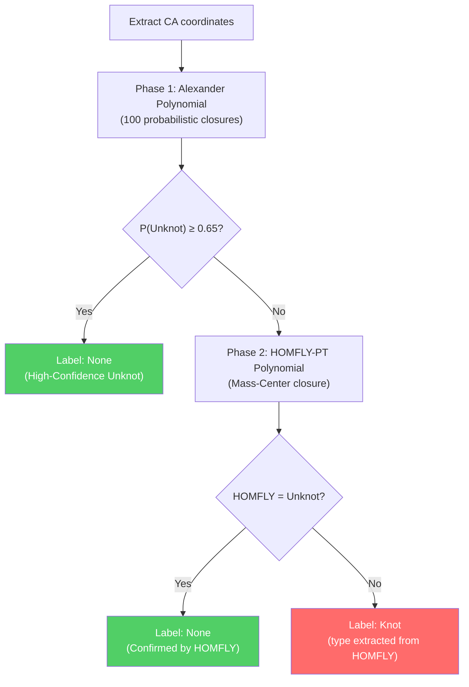

The Structure Validation Pipeline is IDPForge's multi-stage quality gate that transforms raw diffusion outputs into physically credible protein conformers. It operates as a **four-phase filter cascade** — pre-relaxation screening, AMBER relaxation with violation gates, structural validation, and optional fold-integrity gates — each stage progressively eliminating geometrically or topologically defective structures. The pipeline is not a single function but an orchestrated workflow embedded in the sampling loop, where conformers that fail any gate are silently discarded and replaced by new diffusion samples until the target ensemble size is reached.

Sources: [structure_validation.py](idpforge/utils/structure_validation.py#L1-L725), [misc.py](idpforge/misc.py#L119-L200)

## Pipeline Architecture

The validation pipeline executes as a sequential gate chain within `output_to_pdb`, the central orchestrator called by both [IDP Sampling (Fully Disordered)](12-idp-sampling-fully-disordered) and [IDR Sampling with Folded Templates](13-idr-sampling-with-folded-templates). Each gate can reject a conformer early (fail-fast), preventing wasted computation on structures that are already unsalvageable. The diagram below shows the complete flow from raw diffusion output to validated PDB:



The fail-fast behavior is controlled by the `full_report` parameter in `validate_structure_post_relax`. When `full_report=False` (the default), the function returns immediately upon the first failure, producing a minimal diagnostic. When `full_report=True`, all checks run to completion and the info dict contains results for every gate regardless of intermediate failures.

Sources: [structure_validation.py](idpforge/utils/structure_validation.py#L583-L724), [misc.py](idpforge/misc.py#L119-L200)

## Phase 1: Pre-Relaxation Screening

Before any expensive AMBER minimization, a lightweight **backbone continuity filter** rejects conformers with broken peptide chains. This check operates directly on the CA-CA distances from the diffusion output, requiring no PDB I/O or OpenMM topology construction.

The function `check_backbone_continuity` distinguishes two distance thresholds:

| Segment Type | Threshold | Rationale |
|---|---|---|
| **Junction** (IDR↔Folded boundary) | 6.46 Å | Looser: the IDR-to-folded anchor transition is inherently flexible |
| **Backbone** (within same domain) | 9.12 Å | Stricter: consecutive CA atoms within a continuous domain should be close |

A junction is identified wherever adjacent residues differ in their violation mask (i.e., one is in the folded domain and the other in the IDR). Non-sequential residue indices (gaps in `residue_index`) are skipped. The function returns a boolean pass/fail alongside per-bond details for debugging.

Sources: [pre_relax.py](idpforge/utils/pre_relax.py#L1-L30)

## Phase 2: AMBER Relaxation and Violation Gates

After passing pre-relaxation screening, the raw coordinates are written to a PDB file and submitted to OpenMM's AMBER relaxation. The relaxation step itself is documented in [AMBER Relaxation and Repair](15-amber-relaxation-and-repair); here we focus on the **acceptance gates** that the relaxed structure must satisfy.

### Ring-Amino-Acid Violation Gate

Ring-containing residues (F, Y, W, H, P) are geometrically constrained — AMBER cannot freely rotate their planar groups. If too many ring residues remain violated after minimization, the conformer is rejected:

```
ring_violated / n_ring_total > viol_threshold  →  REJECT
```

The default `viol_threshold` is 0.02 (2%), meaning even a few distorted ring residues trigger rejection. This gate catches cases where the diffusion output placed side chains in sterically impossible configurations that relaxation cannot resolve.

### Free-Residue Violation Gate

The "free" residue set is the union of the IDR and junction residues (i.e., everything not positionally restrained during relaxation). Two conditions must both hold:

| Condition | Formula | Purpose |
|---|---|---|
| **Fraction gate** | `viol_frac ≤ viol_threshold` | Global quality: few residues remain distorted |
| **Count cap** | `viol_total ≤ max(4, ⌈threshold × n_free⌉)` | Absolute cap prevents large IDRs from passing with many small violations |

Sources: [relax.py](idpforge/utils/relax.py#L21-L92)

## Phase 3: Post-Relaxation Structural Validation

The core validation function `validate_structure_post_relax` runs four independent checks on the relaxed OpenMM topology and positions. Each check is timed independently, and results are accumulated into an info dictionary.

### Chirality Check

The chirality check detects **D-amino acids** — residues where the side chain has been reflected across the N–CA–C backbone plane. For each non-glycine residue, it computes the **scalar triple product** of the vectors from CA to N, C, and CB:

$$V = (\vec{v_N} \times \vec{v_C}) \cdot \vec{v_{CB}}$$

| Volume | Classification | Action |
|---|---|---|
| V ≥ 1.0 | L-amino acid (correct) | Pass |
| 0 < V < 1.0 | Planar/Distorted | Flag as issue |
| V < 0 | D-amino acid (inverted) | Flag as issue |

Glycine is exempted (achiral). A volume threshold of 1.0 (rather than 0.0) provides a safety margin against near-planar distortions that, while technically L-configured, indicate severe geometric stress.

Sources: [structure_validation.py](idpforge/utils/structure_validation.py#L99-L119)

### Bond Integrity Check

The bond integrity check operates in two modes — **intra-residue** and **inter-residue** — using a geometry/graph hybrid approach that is atom-name agnostic:

**Intra-residue**: For each residue, the check compares the *expected* heavy-atom bond degree sequence (from the OpenMM topology graph) against the *observed* degree sequence (from distance-based neighbor counting with a 2.0 Å covalent cutoff). If the sorted degree sequences disagree and the observed graph has fewer bonds or disconnected atoms, the residue is flagged. Specific stretched bonds are identified by measuring distances along the topology's explicit bond edges.

**Inter-residue**: Each heavy-atom bond that crosses residue boundaries is checked directly: if the inter-atomic distance exceeds the `threshold` (default 2.2 Å), the bond is reported as broken with the measured distance.

This dual strategy catches both *graph topology changes* (atoms disconnected by large displacements) and *specific bond stretches* (known bonds whose lengths exceed physical limits).

Sources: [structure_validation.py](idpforge/utils/structure_validation.py#L121-L207)

### Clash Score Check

The clash detection uses a **cKDTree-accelerated backbone-backbone overlap** calculation. Only N, CA, and C atoms are considered, using element-specific van der Waals radii:

| Element | VdW Radius (Å) |
|---|---|
| C | 1.70 |
| N | 1.55 |
| O | 1.52 |
| S | 1.80 |
| P | 1.80 |
| H | 1.20 |

The tree queries all pairs within 4.0 Å and filters them through three exclusion rules applied in sequence:

1. **Chain/bond exclusion**: Adjacent residues (|Δres_id| ≤ 1) on the same chain are excluded — their close contact is the expected peptide backbone
2. **Domain logic** (IDR mode): When `idr_start` and `idr_end` are provided, pairs where *both* atoms lie in the folded domain are excluded — only IDR-involved clashes are penalized, since folded-domain contacts are expected
3. **Overlap calculation**: `overlap = (r_i + r_j) - distance`; flagged when `overlap ≥ overlap_cutoff` (default 0.4 Å)

The final clash score is normalized as `(clash_count / n_backbone_atoms) × 1000`, and the conformer passes if the score is at or below `strict_clash_threshold` (default 10.0).

Sources: [structure_validation.py](idpforge/utils/structure_validation.py#L209-L269)

### Knot Topology Check (AlphaKnot2 Hybrid)

The topology check uses a **two-phase Alexander→HOMFLY hybrid** classifier that balances speed against rigor. The pipeline supports both **global** (full-chain) and **per-domain** knot classification, selected by whether `expected_knot_type` is a list of domain specs or a single value.



**Phase 1 — Alexander polynomial** is computed with 100 probabilistic closures (`ALEXANDER_TRIES = 100`). If the probability of unknot exceeds `ALPHAKNOT_P_UNKNOT_MAX = 0.65`, the structure is classified as unknotted with high confidence and HOMFLY is skipped entirely, saving significant compute.

**Phase 2 — HOMFLY-PT polynomial** is invoked only when the Alexander result is ambiguous (the "gray zone" where P(Unknot) < 0.65). HOMFLY-PT is a more powerful knot invariant that can distinguish knot types the Alexander polynomial cannot. It uses `Closure.MASS_CENTER` for deterministic closure.

**Per-domain classification** is triggered when `expected_knot_type` is a list of domain specifications (loaded from `knot_screening.json`). Each domain's CA coordinates are extracted and classified independently. A conformer passes if every domain's detected knot type matches its expected type (where `null`/`None` means unknot).

Sources: [structure_validation.py](idpforge/utils/structure_validation.py#L274-L452), [structure_validation.py](idpforge/utils/structure_validation.py#L636-L707)

### Composite Validation Result

The main entry point `validate_structure_post_relax` orchestrates all four checks and produces a composite result:

```python
all_pass, info = validate_structure_post_relax(
    topology, positions, pdb_path="",
    strict_clash_threshold=10.0,
    idr_start=None, idr_end=None,
    expected_knot_type=None,
    full_report=False
)
```

| Return Value | Type | Description |
|---|---|---|
| `all_pass` | `bool` | `True` only if all four gates pass |
| `info["chirality_pass"]` | `bool` | No D-amino acids detected |
| `info["bonds_pass"]` | `bool` | No broken intra/inter-residue bonds |
| `info["clash_pass"]` | `bool` | Clash score ≤ threshold |
| `info["knot_pass"]` | `bool` | Topology matches expectation |
| `info["reason"]` | `str` | `"OK"` if all pass; comma-separated failure labels otherwise |

Each check's runtime is recorded in `info` (e.g., `Time_Chirality_s`, `Time_Bonds_s`, `Time_Clashes_s`, `Time_Knots_s`), enabling performance profiling of the validation pipeline.

Sources: [structure_validation.py](idpforge/utils/structure_validation.py#L583-L724)

## Phase 4: Fold-Integrity Gates (IDR Sampling Only)

For [IDR Sampling with Folded Templates](13-idr-sampling-with-folded-templates), two additional geometric gates protect the structural integrity of the folded domain and its junctions with the IDR. These gates are **superposition-free** — they operate entirely on intrinsic geometric quantities (curvature, distance matrices) that are invariant to rigid-body motions, avoiding the fragility of RMSD-based thresholds.

### Junction Curvature Gate

The junction curvature gate rejects conformers where the IDR has been **pulled taut** to reach the folded anchor — a common failure mode where the diffusion process stretches the IDR into an unnaturally straight bridge. It computes discrete backbone curvature κ per residue:

$$\kappa_i = \frac{2 \sin(\theta_i / 2)}{|\mathbf{r}_{i+1} - \mathbf{r}_{i-1}|}$$

where θ_i is the angle at CA_i between the incoming and outgoing CA–CA vectors. CA–CA distances exceeding 4.5 Å are treated as chain breaks and excluded. The gate examines a window of 20 residues on the IDR side of each junction and requires the mean curvature to meet a minimum threshold (`junction_kappa`, default 0.0 = disabled).

Sources: [structure_validation.py](idpforge/utils/structure_validation.py#L488-L530)

### Fold Curvature Gate

The fold curvature gate rejects conformers where junction-adjacent **folded residues** have been straightened — indicating the IDR sampling has distorted the fixed template. For each junction, it compares the mean curvature in a window (default 15 residues) of the model against the reference template:

$$\frac{\bar{\kappa}_{\text{model}}}{\bar{\kappa}_{\text{ref}}} \geq \texttt{fold\_curv\_ratio}$$

The gate is only applied when the reference curvature in the window exceeds `min_ref_kappa` (0.03 Å⁻¹), avoiding penalization of naturally straight template regions. This ratio-based criterion is rigid-motion invariant and directly measures whether the fold has been flattened relative to its native geometry.

Sources: [structure_validation.py](idpforge/utils/structure_validation.py#L533-L576)

### Folded CA-lDDT Gate

A superposition-free **CA-lDDT quality gate** assesses local distance accuracy over the folded region. For all residue pairs within an inclusion radius (15 Å) in the reference, it computes the fraction of pairs where the distance difference falls within multiple thresholds (0.5, 1.0, 2.0, 4.0 Å). The lDDT score is the mean across these thresholds, and the conformer passes if the score meets the configured `threshold`.

Sources: [structure_validation.py](idpforge/utils/structure_validation.py#L458-L485)

## Pre-Validation Structural Repair

Before the post-relaxation validation checks run, two repair operations are applied to fix common AMBER relaxation artifacts:

### Chirality Repair

When `check_chirality` detects D-amino acids, `repair_chirality` reflects all sidechain atoms across the **N–CA–C plane** to restore the L-isomer geometry. The reflection is computed as:

$$\mathbf{p}_{\text{new}} = \mathbf{CA} + \vec{v} - 2(\vec{v} \cdot \hat{n})\hat{n}$$

where **v** is the vector from CA to the sidechain atom and **n̂** is the unit normal of the N–CA–C plane. Backbone atoms (N, H, CA, HA2, HA3, C, O, OXT) are held fixed during reflection. The repair operates by direct PDB line editing, avoiding a full write-parse cycle.

Sources: [structure_repair.py](idpforge/utils/structure_repair.py#L35-L153)

### Histidine Ring Naming Repair

AMBER relaxation can **scramble atom identities** within the histidine imidazole ring, swapping heavy-atom and hydrogen labels (e.g., ND1↔CD2). The `fix_histidine_naming` function reassigns atom names based purely on spatial geometry through a five-step algorithm:

1. **Find CG**: the sidechain atom closest to CB (~1.51 Å)
2. **Trace the five-membered ring** via bond-distance adjacency (1.25–1.45 Å bonds)
3. **Count hydrogen neighbors** per ring atom (N–H bonds ≤ 1.15 Å)
4. **Determine ring direction** from the hydrogen-count pattern (HID: [1,1,0,1], HIE: [0,1,1,1], HIP: [1,1,1,1])
5. **Rewrite PDB atom names** and element symbols for all mismatched ring atoms and their hydrogens

Sources: [structure_repair.py](idpforge/utils/structure_repair.py#L156-L358)

## Validation Metrics

The `validation_metrics` module provides ensemble-level quality metrics used by the [X-EISD Ensemble Scoring](17-x-eisd-ensemble-scoring) pipeline:

| Function | Input | Output | Description |
|---|---|---|---|
| `calc_rg_with_mask` | CA coords `[batch, nres, 3]`, mask `[batch, nres]` | Rg `[batch]` | Radius of gyration over valid (masked) residues |
| `rg_dist_per_group` | Predicted coords, true Rg values, sequences, mask | Scalar | Mean absolute Rg divergence grouped by sequence identity |

These metrics enable comparison of predicted ensemble properties against experimental observables without requiring residue-level alignment.

Sources: [validation_metrics.py](idpforge/utils/validation_metrics.py#L1-L54)

## Integration with Sampling Loops

The validation pipeline is embedded in the `output_to_pdb` function, which is the single exit point from the diffusion model into the filesystem. Both sampling scripts call it identically:

```python
# In sample_idp.py — fully disordered proteins
output_to_pdb(outputs, relax=relax_opts,
    save_path=abs_output_dir, counter=start_idx,
    counter_cap=nsample, verbose=verbose)

# In sample_ldr.py — IDR with folded template
output_to_pdb(outputs, relax=relax_opts,
    save_path=abs_output_dir, counter=start_idx,
    counter_cap=nsample, viol_mask=~fold_data["mask"],
    fold_ref_ca=fold_ref_ca, fold_mask=fold_data["mask"],
    fold_curv_ratio=fold_curv_ratio,
    fold_curv_window=fold_curv_window,
    junction_kappa=junction_kappa,
    expected_knot_type=expected_knot_type)
```

The sampling loop continues until `count_done()` — the number of `*_validated.pdb` files on disk — reaches the target `nsample`. Rejected conformers are simply not written, and the loop generates new diffusion samples to replace them. The `*_raw.pdb` files (written before relaxation) are retained for debugging, while only `*_validated.pdb` files count toward the ensemble target.

> [!TIP]
> The validation pipeline is designed as a **reject-only filter** — it never modifies conformers in-place (except for the pre-validation chirality and histidine repairs). This means the acceptance rate directly controls sampling efficiency: if too many conformers are rejected, increase `nsample` or loosen thresholds rather than attempting to patch individual structures.

> [!TIP]
> When sampling IDRs with knotted folded domains, always provide `--expected_knot_type` as a per-domain JSON spec. Without it, the legacy full-chain unknot baseline will reject any conformer where the entire chain (including the knot) is not globally unknotted — incorrectly discarding valid structures with native knots.

Sources: [sample_idp.py](sample_idp.py#L158-L160), [sample_ldr.py](sample_ldr.py#L207-L218)

## Gate Configuration Summary

| Gate | Parameter | Default | Scope | Disable By |
|---|---|---|---|---|
| NaN coordinates | — | Always on | Both | Cannot disable |
| Backbone continuity | — | Always on | Both | `--no_relax` (skips entirely) |
| Ring-AA violation | `viol_threshold` | 0.02 | Both | Set threshold to 1.0 |
| Free-residue violation | `viol_threshold` | 0.02 | Both | Set threshold to 1.0 |
| Chirality | — | Always on | Both | Cannot disable |
| Bond integrity | `threshold` | 2.2 Å | Both | Cannot disable |
| Clash score | `strict_clash_threshold` | 10.0 | Both | Set to ∞ |
| Knot topology | `expected_knot_type` | None (global unknot) | Both | Pass `[]` (empty list) |
| Junction curvature | `--junction_kappa` | 0.0 (off) | IDR only | Leave at 0.0 |
| Fold curvature | `--fold_curv_ratio` | 0.0 (off) | IDR only | Leave at 0.0 |
| Folded CA-lDDT | `threshold` | Config-dependent | IDR only | Set to 0.0 |

Sources: [structure_validation.py](idpforge/utils/structure_validation.py#L583-L590), [sample_ldr.py](sample_ldr.py#L248-L261)

## Next Steps

After validation, accepted conformers proceed to ensemble-level quality assessment:

- **[X-EISD Ensemble Scoring](17-x-eisd-ensemble-scoring)**: Score and rank the validated ensemble against experimental data using Bayesian integration
- **[AMBER Relaxation and Repair](15-amber-relaxation-and-repair)**: Deeper details on the AMBER minimization configuration and restraint strategies that precede validation
- **[Configuration Reference](22-configuration-reference)**: Complete parameter specifications for all validation thresholds