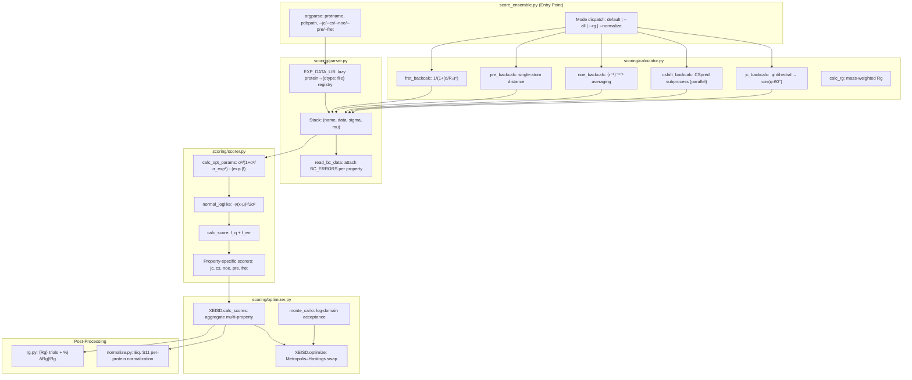
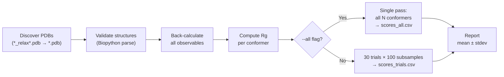

**X-EISD** (Cross-Ensemble Information Score Difference) is IDPForge's maximum log-likelihood framework for scoring intrinsically disordered protein ensembles against experimental observables. It back-calculates NMR and FRET observables from PDB structures, analytically optimizes error-model parameters per property, and computes ensemble-level log-likelihoods that enable rigorous, cross-method benchmarking of conformational ensembles. The pipeline supports five observable types—**J-couplings**, **chemical shifts**, **NOE distances**, **PRE distances**, and **FRET efficiencies**—and provides both a stochastic sub-sampling protocol (30 trials × 100 conformers) and deterministic single-pass scoring, with optional Monte Carlo ensemble optimization and Eq. S11 cross-method normalization for publication-ready benchmark tables.

Sources: [score_ensemble.py](/score_ensemble.py#L1-L171), [scoring/scorer.py](/scoring/scorer.py#L1-L136)

## Architecture Overview

The scoring system is organized as a layered pipeline within the `scoring/` package, with [score_ensemble.py](/score_ensemble.py) serving as the CLI entry point. Each module owns a distinct computational responsibility: **parser** resolves experimental data and back-calculation uncertainties, **calculator** forward-models observables from 3D structures, **scorer** computes per-property log-likelihoods with analytically optimal error parameters, **optimizer** orchestrates multi-property scoring and optional Metropolis–Hastings ensemble selection, and **normalize**/**rg** produce cross-method benchmark tables and radius-of-gyration statistics.



Sources: [score_ensemble.py](/score_ensemble.py#L1-L171), [scoring/parser.py](/scoring/parser.py#L1-L81), [scoring/calculator.py](/scoring/calculator.py#L1-L250), [scoring/scorer.py](/scoring/scorer.py#L1-L136), [scoring/optimizer.py](/scoring/optimizer.py#L1-L108)

## The X-EISD Scoring Model

The core insight behind X-EISD is that **back-calculated observables from an ensemble carry two independent sources of uncertainty**: the intrinsic back-calculation error (σ_bc) from the forward model, and the experimental measurement error (σ_exp). Rather than treating these as fixed weights, X-EISD analytically derives **optimal latent correction parameters** that maximize the joint log-likelihood of both error models simultaneously. For a generic observable with ensemble-averaged back-calculation β, experimental value μ_exp, and correction parameter θ, the score decomposes as:

**log P = log N(θ; 0, σ_bc) + log N(μ_exp − θ − β; 0, σ_exp)**

The optimal θ* is found in closed form as `θ* = (σ²_bc / σ²_exp) · (μ_exp − β) / (1 + σ²_bc/σ²_exp)`, which reduces to the experimental residual when back-calculation is much more precise than experiment (σ_bc ≪ σ_exp), and to zero when the opposite holds. This Bayesian treatment avoids arbitrary weighting between data sources and yields a principled, additive log-likelihood across all observables.

Sources: [scoring/scorer.py](/scoring/scorer.py#L6-L46)

### Property-Specific Scoring Functions

Each experimental observable type requires a tailored scoring function due to differences in how ensemble averaging is performed and how the error model is parameterized:

| Observable | Ensemble Average | Error Parameters | Scoring Function |
|---|---|---|---|
| **J-couplings (JC)** | ⟨cos(φ−60°)⟩, ⟨cos²(φ−60°)⟩ | A, B, C with fixed μ, σ from Karplus calibration | `jc_score_ensemble` — 3D quadratic solve for (A\*, B\*, C\*) |
| **Chemical shifts (CS)** | ⟨δ_atom⟩ per atom type | Per-atom σ_bc (C: 1.31, CA: 0.97, N: 2.16, …) | `cs_score_ensemble` — per-shift θ\*, with χ² diagnostics |
| **NOE distances** | ⟨r⁻⁶⟩⁻¹ᐟ⁶ (r⁻⁶-weighted) | σ_bc = 0.01 Å | `dist_score_ensemble` — asymmetric bounds (upper/lower) |
| **PRE distances** | Single-atom distance | σ_bc = 0.001 Å | `dist_score_ensemble` — shared with NOE |
| **FRET efficiency** | ⟨1/(1+(d/R₀)⁶)⟩ | σ_bc = 0.0074 | `generic_score_ensemble` — standard Gaussian |

For **J-couplings**, the Karplus relation J = A·cos²(φ−60°) + B·cos(φ−60°) + C makes the log-likelihood a function of three Karplus parameters (A, B, C) rather than a single correction parameter. The optimizer solves a 3×3 linear system per coupling to find the jointly optimal (A\*, B\*, C\*), then evaluates the sum of four Gaussian log-likelihoods: one for each Karplus parameter's deviation from its calibrated mean, plus the experimental residual. For **NOE/PRE distances**, the scoring accounts for asymmetric experimental bounds by computing the minimum absolute error across three trial deviations (center, upper-bound, lower-bound).

Sources: [scoring/scorer.py](/scoring/scorer.py#L48-L136), [scoring/parser.py](/scoring/parser.py#L15-L22)

## Back-Calculation Engine

The back-calculation layer transforms PDB coordinates into predicted experimental observables. Each function operates over the full ensemble of structures and returns a matrix of shape `(n_conformers, n_observations)` that feeds into the scorer.

**J-coupling back-calculation** extracts the backbone φ dihedral angle at each residue specified in the experimental data file, then computes cos(φ − 60°) as the Karplus-relevant quantity. This uses Biopython's `calc_dihedral` on the C(i−1)–N(i)–CA(i)–C(i) atoms. **NOE distance back-calculation** computes the r⁻⁶-weighted ensemble average ⟨r⁻⁶⟩⁻¹ᐟ⁶ across all atom-pair assignments for each NOE, handling ambiguous assignments (e.g., HB2/HB3 → CB) via the `hydrogen_abbrev` and `heavy_atom_hydrogen` lookup tables. **PRE back-calculation** uses the same `_dist_backcalc` infrastructure but takes only the first atom-pair distance (no r⁻⁶ averaging). **FRET back-calculation** computes the Förster efficiency 1/(1+(d/R₀)⁶) for each labeled residue pair using the per-pair scale factor R₀ from the experimental data.

**Chemical shift back-calculation** is the most computationally expensive step and runs **CSpred (UCBShift) as an external subprocess** with up to 8 parallel workers via `ProcessPoolExecutor`. The subprocess isolation (configurable via `CSPRED_PYTHON` and `CSPRED_PATH` environment variables) accommodates CSpred's separate Python environment. Results are cached to `{property}_cache.csv` to avoid re-computation on subsequent runs.

Sources: [scoring/calculator.py](/scoring/calculator.py#L1-L250)

### Hydrogen-Atom Mapping

When experimental data references hydrogen atoms that are absent from relaxed PDB structures, the calculator falls back to heavy-atom proxies via two mapping dictionaries. The `hydrogen_abbrev` dictionary expands grouped hydrogen names (e.g., `HB → [HB2, HB3]` for ALA, `HD → [HD11, HD12, HD13, HD21, HD22, HD23]` for LEU) across all 20 amino acids. The `heavy_atom_hydrogen` dictionary maps hydrogen groups to their parent heavy atoms (e.g., `HB → [CB]`, `HD → [CD1, CD2]` for PHE) for the `--heavy-atom-substitute` mode. Both dictionaries are essential for accurate NOE/PRE back-calculation on AMBER-relaxed structures where explicit hydrogens may be stripped.

Sources: [scoring/calculator.py](/scoring/calculator.py#L58-L117)

## Experimental Data Registry

The `parser` module manages the interface between raw experimental data files and the scoring pipeline. The **`EXP_DATA_LIB`** singleton is a lazy-initialized dictionary mapping protein names to `{data_type: file_path}`. It discovers experimental files under the `$IDPFORGE_EXP_DATA` directory (default `Data/exp/`) following the naming convention `{protein}_{type}_exp.txt`. Each file is a CSV with columns specific to its observable type (e.g., `resnum, value, error` for JC; `res1, atom1, res2, atom2, dist_value, lower, upper` for PRE/NOE; `resnum, atomname, value, error` for CS; `res1, res2, scale` for FRET).

The **`read_bc_data`** function wraps raw back-calculation output into a `Stack` object that carries the computed data matrix alongside property-specific back-calculation uncertainties from the `BC_ERRORS` dictionary. For J-couplings, this includes both σ values (√0.14, √0.03, √0.08 for Karplus A, B, C) and μ values (6.51, −1.76, 1.6). For chemical shifts, the uncertainty is a per-atom-type dictionary (C: 1.31, CA: 0.97, H: 0.38, N: 2.16, etc.) derived from UCBShift validation statistics.

Sources: [scoring/parser.py](/scoring/parser.py#L1-L81)

## The XEISD Optimizer Class

The `XEISD` class in [optimizer.py](/scoring/optimizer.py) is the central orchestrator that aggregates per-property scores and optionally performs **Metropolis–Hastings ensemble optimization**. It is initialized with the full experimental data dictionary and the pre-computed back-calculation `Stack` objects, then exposes two primary methods:

**`calc_scores(dtypes, indices)`** evaluates the log-likelihood for a specific ensemble subset defined by `indices`. For each requested data type, it dispatches to the corresponding function in `ENSEMBLE_Scorers`, collecting both the MAE (mean absolute error) and the total log-likelihood score. For chemical shifts specifically, it additionally computes per-atom-type MAE, per-atom-type χ², and the overall χ²_CS diagnostic (Eq. 12 in the supplementary information): `χ² = (1/N) Σ (δ_exp − δ_bc)² / σ²_bc,atom`.

**`optimize(opt_props, ens_size, beta, ...)`** performs stochastic ensemble selection via single-structure swaps with Metropolis acceptance. Starting from a random initial ensemble of `ens_size` conformers, each iteration (default: 5 × pool_size) randomly replaces one conformer with another from the full pool, accepts the swap if the total log-likelihood improves (greedy mode, `opt_type='max'`) or with Metropolis probability `min(1, exp(β · Δ_score))` (Monte Carlo mode, `opt_type='mc'`). The `monte_carlo` helper implements **log-domain acceptance** to avoid overflow when probabilities exceed floating-point range, falling back to `exp(β · Δ_score)` comparison when both old and new probabilities are finite. The optimizer tracks visited configurations in `self.visited` to avoid redundant recomputation and returns the best-scoring ensemble indices, their per-property scores, and per-conformer statistics (mean and std of total score across all visits).

Sources: [scoring/optimizer.py](/scoring/optimizer.py#L1-L108)

## Ensemble Scoring Protocol

The default scoring protocol in `main()` implements the benchmark-standard procedure: **30 independent trials of 100-conformer random subsamples** drawn with replacement from the full pool of relaxed PDB structures. This stochastic evaluation accounts for the dependence of ensemble-averaged observables on the specific conformer selection, yielding mean and standard deviation statistics that quantify ensemble reproducibility.



The pipeline discovers PDB files by searching for `*_relax*.pdb` first (post-[AMBER Relaxation](15-amber-relaxation-and-repair) structures), then falling back to `traj_pdbs/*_relax*.pdb`, then `*.pdb`. Invalid structures (those failing Biopython parsing or with empty chain A) are filtered out with warnings. Chemical shift back-calculations are cached to `cs_cache.csv` and restored on subsequent runs to avoid the expensive CSpred subprocess. Each trial produces a row in the output CSV with columns `{prop}_mae`, `{prop}_score` for each observable type, plus `rg` (mean ensemble Rg) and detailed CS diagnostics (`cs_{atom}_mae`, `cs_{atom}_chi2`, `cs_chi2`).

Sources: [score_ensemble.py](/score_ensemble.py#L44-L121)

### CLI Reference

| Flag | Description |
|---|---|
| `protname pdbpath` | Protein name (must match `EXP_DATA_LIB` key) and path to PDB directory |
| `--jc / --cs / --noe / --pre / --fret` | Select observable types to score (any combination) |
| `--all` | Score every conformer in a single pass → `scores_all.csv` |
| `--ens-size N` | Subsample size per trial (default: 100) |
| `--trials N` | Number of random subsamples (default: 30) |
| `--force` | Re-score even if output CSV exists |
| `--normalize` | Build Eq. S11 cross-method benchmark table from existing scores |
| `--rg` | Compute per-ensemble Rg → `rg_trials.csv` |
| `--ens-base DIR` | Base directory with `{method}/{protein}/` hierarchy (for `--normalize`/`--rg`) |
| `--score-file FILE` | Per-protein score CSV to aggregate (default: `scores_trials.csv`) |
| `--exclude-methods M1,M2` | Drop specific method directories from the benchmark |
| `--proteins P1,P2` | Restrict to a protein subset |
| `--rg-json FILE` | Experimental Rg JSON for `%|ΔRg|/Rg` column |
| `--exp-dir DIR` | Override experimental data directory |

Sources: [score_ensemble.py](/score_ensemble.py#L124-L171)

## Cross-Method Benchmark Normalization

The `--normalize` mode produces the paper-style benchmark table (Eq. S11) that enables fair comparison across ensemble generation methods. It operates on a directory hierarchy `{ens_base}/{method}/{protein}/{score_file}` where each method directory (e.g., `idpforge`, `flexserv`, `md`) contains per-protein subdirectories with pre-computed `scores_trials.csv` files.

The normalization proceeds in three stages. First, **canonical protein sets** are derived for each observable category by scanning the experimental data directory: CS, JC, NOE, PRE, FRET, and the merged NOE/PRE union. Second, **raw score tables** (method × protein) are built by extracting the mean log-likelihood per category from each method's score CSVs. NOE and PRE scores are summed into a single NOE/PRE column. Third, **per-protein min-max normalization** is applied: `X_norm = (X − X_min) / (X_max − X_min)`, where X_min and X_max are computed across methods for each protein independently, ensuring that differences in score ranges across proteins do not dominate the aggregate ranking.

The output benchmark table includes seven columns: **Total** (normalized aggregate of CS + JC + NOE/PRE per protein, then averaged), **CS**, **JC**, **NOE/PRE** (individual category means), **FRET** (shown separately since few proteins have FRET data), **χ²_CS** (mean chemical shift χ² per method, lower is better), and **%|ΔRg|/Rg** (flat-bottom Rg deviation with tolerance σ_rg: `max(|Rg − Rg_exp| − σ_rg, 0) / Rg_exp × 100`). All intermediate tables (raw, normalized, per-category) are saved as CSVs for downstream analysis.

Sources: [scoring/normalize.py](/scoring/normalize.py#L1-L208)

## Radius of Gyration Pipeline

The `--rg` mode computes mass-weighted Rg for all atoms (including hydrogens) of chain A across the method/protein ensemble hierarchy. It supports both the trial-based protocol (30 trials × 100 subsamples → `rg_trials.csv`) and per-frame computation (`--all` → `rg.csv`). The implementation uses a pure-Python PDB parser (no Biopython dependency) for speed, extracting coordinates directly from ATOM/HETATM records with element identification from the PDB element column (positions 77–78) or the first alphabetic character in the atom name.

A critical design choice is the **deterministic seed per (method, protein) pair**, computed as `SHA1("{method}/{protein}")[:8]` interpreted as a hex integer. This ensures that repeated runs produce identical Rg trial statistics for the same ensemble, enabling reproducible benchmark tables without storing the random indices. The frame discovery logic searches subdirectories in priority order (`_relaxed`, `traj_pdbs`, `trajs`) with filename patterns (`frame_*.pdb`, `*_validated.pdb`, `*_relaxed.pdb`, `*_relax.pdb`, `*_raw.pdb`, `conformer_*.pdb`), matching the diverse output conventions of different ensemble generators.

Sources: [scoring/rg.py](/scoring/rg.py#L1-L135)

> [!TIP]
> When scoring large ensembles, chemical shift back-calculation dominates runtime. Ensure `CSPRED_PYTHON` and `CSPRED_PATH` are set correctly, and rely on the `cs_cache.csv` mechanism—once computed, shifts are restored from cache on subsequent runs without invoking CSpred.

> [!TIP]
> The `--normalize` flag does not re-score ensembles; it only aggregates existing `scores_trials.csv` files. Run the default scoring mode for each method/protein combination first, then invoke `--normalize` once with `--ens-base` pointing to the root of your multi-method directory hierarchy.

## Module Interaction Diagram

```mermaid
classDiagram
    class Stack {
        +name: str
        +data: ndarray
        +sigma: dict|float
        +mu: dict|None
        +add(new_stack)
    }

    class XEISD {
        +exp_data: dict
        +bc_data: dict
        +pool_size: int
        +visited: dict
        +calc_scores(dtypes, indices) dict
        +optimize(opt_props, ens_size, beta) tuple
    }

    class BACK_Calculators {
        <<registry>>
        jc: jc_backcalc
        cs: cshift_backcalc
        noe: noe_backcalc
        pre: pre_backcalc
        fret: fret_backcalc
    }

    class ENSEMBLE_Scorers {
        <<registry>>
        jc: jc_score_ensemble
        cs: cs_score_ensemble
        noe: dist_score_ensemble
        pre: dist_score_ensemble
        fret: generic_score_ensemble
    }

    class EXP_DATA_LIB {
        <<lazy singleton>>
        protein → {dtype: filepath}
    }

    BACK_Calculators --> Stack : produces
    EXP_DATA_LIB --> XEISD : feeds
    Stack --> XEISD : initialized with
    ENSEMBLE_Scorers --> XEISD : dispatched by
    XEISD ..> Stack : reads bc_data
```

Sources: [scoring/parser.py](/scoring/parser.py#L24-L81), [scoring/calculator.py](/scoring/calculator.py#L243-L250), [scoring/scorer.py](/scoring/scorer.py#L127-L136), [scoring/optimizer.py](/scoring/optimizer.py#L21-L108)

## Data Flow: End-to-End Example

Consider scoring the α-synuclein (asyn) ensemble with PRE data. The CLI invocation `python score_ensemble.py asyn ./output/asyn --pre` triggers the following flow:

1. **Data resolution**: `EXP_DATA_LIB["asyn"]` lazily scans `Data/exp/asyn/` and discovers `asyn_pre_exp.txt` containing spin-label distance measurements with columns `index, res1, atom1, res2, atom2, dist_value, lower, upper`.
2. **Structure discovery**: PDBs are found via `glob("./output/asyn/*_relax*.pdb")`, invalid structures are pruned.
3. **Back-calculation**: `pre_backcalc` computes single-atom distances for each (res1, atom1)–(res2, atom2) pair across all conformers, substituting heavy atoms for hydrogens when needed (e.g., H → N for backbone amides).
4. **Stack construction**: `read_bc_data` wraps the distance matrix with σ_bc = 0.001 Å into a `Stack("pre", data, sigma=0.001)`.
5. **Trial scoring**: For each of 30 trials, 100 conformer indices are sampled; `dist_score_ensemble` computes the optimal correction parameters, evaluates the log-likelihood, and calculates MAE with asymmetric bounds.
6. **Output**: `scores_trials.csv` with columns `pre_mae, pre_score, rg`, plus console summary of mean ± stdev.

Sources: [score_ensemble.py](/score_ensemble.py#L44-L121), [scoring/calculator.py](/scoring/calculator.py#L155-L198), [data/asyn_pre_exp.txt](/data/asyn_pre_exp.txt#L1-L10)

## Integration with Downstream Pipelines

The X-EISD scoring module connects naturally with other IDPForge post-processing stages. Ensembles produced by [IDP Sampling](12-idp-sampling-fully-disordered) or [IDR Sampling](13-idr-sampling-with-folded-templates) should first undergo [AMBER Relaxation and Repair](15-amber-relaxation-and-repair) (producing `*_relax*.pdb` files) and optionally [Structure Validation](16-structure-validation-pipeline) (producing `*_validated.pdb` files) before scoring—back-calculation accuracy depends on physically realistic geometries. The `--normalize` workflow assumes a directory structure organized by generation method, enabling direct comparison of IDPForge ensembles against MD trajectories, FlexServ outputs, or other generators within the same benchmark framework.