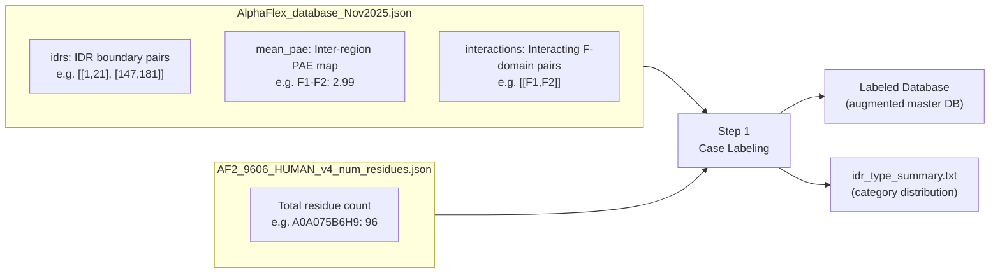
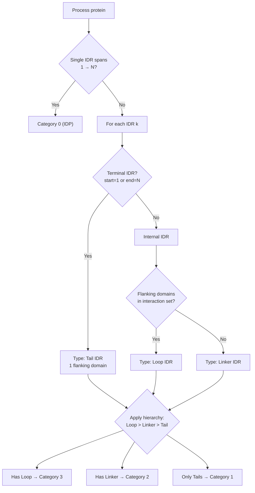

The AlphaFlex pipeline's entry point is a **topological classification system** that categorizes every human protein into one of four hierarchical categories based on the spatial arrangement and interaction context of its intrinsically disordered regions (IDRs). This classification, implemented in `Step_1_case_label.py`, transforms raw AlphaFold2-derived annotation data into a labeled database that drives all downstream template generation, conformer sampling, and stitching decisions. The subsequent `Step_1B_subset_label.py` then provides powerful filtering capabilities to carve out targeted protein subsets for batch processing. Together, these two scripts form the classification and selection gateway of the entire AFX-IDPForge pipeline.

Sources: [Step_1_case_label.py](/AlphaFlex/Step_1_case_label.py#L1-L10), [Step_1B_subset_label.py](/AlphaFlex/Step_1B_subset_label.py#L1-L7)

## The Four-Category Taxonomy

The classification system assigns each protein to exactly one category based on a **priority hierarchy** that reflects increasing structural complexity. A protein containing any Loop IDR is automatically Category 3, even if it also contains Tails or Linkers—this is by design, because Loop IDRs between interacting domains impose the strictest geometric constraints during conformer assembly and require the most sophisticated stitching strategies.

| Category | Name | Definition | IDR Topology | Downstream Template Strategy |
|----------|------|------------|--------------|------------------------------|
| **0** | **IDP** | Fully disordered—no folded domains exist | Single IDR spanning residues 1 → N | Full diffusion via `sample_idp.py` (no folded scaffold) |
| **1** | **Tails** | Folded domain(s) with only terminal IDRs | One or both termini are disordered; no internal IDRs | Static template via `mk_ldr_template.py` (frozen folded core) |
| **2** | **Linkers** | Internal IDRs between non-interacting folded domains | At least one internal IDR where flanking F-domains are non-interacting (PAE ≥ 15Å) | Flexible template via `mk_flex_template.py` (mobile domain objects) |
| **3** | **Loops** | Internal IDRs between interacting folded domains | At least one internal IDR where flanking F-domains interact (PAE < 15Å) | Static template via `mk_ldr_template.py` (interacting domains held rigid) |

The critical distinction between Category 2 (Linkers) and Category 3 (Loops) lies in whether the folded domains flanking an internal IDR **interact**. This is determined from the `interactions` field in the master database, which records pairs of folded domains whose mean Predicted Aligned Error (PAE) falls below 15 Ångströms—indicating they form a stable structural unit. When flanking domains interact, the IDR forms a **Loop** that bridges a compact structural unit and must be modeled with both domains held rigid. When they do not interact, the IDR forms a **Linker** connecting independently mobile domains that can be repositioned during template generation.

Sources: [Step_1_case_label.py](/AlphaFlex/Step_1_case_label.py#L4-L9), [AlphaFlex/README.md](/AlphaFlex/README.md#L49-L62)

## Input Data Architecture

The classification engine consumes two pre-built JSON databases derived from the AlphaFold2 9606 Human v4 predictions:



The **master database** (`AlphaFlex_database_Nov2025.json`) is keyed by UniProt accession and contains three fields per protein: `idrs` (an ordered list of `[start, end]` residue pairs defining each disordered segment), `mean_pae` (a dictionary of mean PAE values between all region pairs—folded and disordered), and `interactions` (a list of folded domain pairs where the inter-domain PAE is below 15 Å, signaling structural interaction). The **length reference** (`AF2_9606_HUMAN_v4_num_residues.json`) maps each UniProt ID to its total residue count, which is essential for detecting N/C-terminal IDRs and full-IDP cases.

> [!TIP]
> The `interactions` field is the sole determinant of the Linker vs. Loop distinction. If `interactions` is empty or does not contain a given F-domain pair, the IDR between them is classified as a Linker. This binary decision has significant downstream consequences: Linkers receive flexible templates with randomly repositioned folded domains, while Loops are constrained to a static scaffold.

Sources: [AlphaFlex_database_Nov2025.json](/AlphaFlex/Data_Inputs/AlphaFlex_database_Nov2025.json#L1-L55), [AF2_9606_HUMAN_v4_num_residues.json](/AlphaFlex/Data_Inputs/AF2_9606_HUMAN_v4_num_residues.json#L1-L12)

## Classification Algorithm in Detail

The classification proceeds through a single pass over all proteins in the master database. For each protein, the algorithm follows a three-stage decision process:

**Stage 1 — Full IDP Detection (Category 0):** If the protein has exactly one IDR and that IDR spans from residue 1 to the total protein length, the entire chain is disordered. This is the simplest case: the IDR is labeled as type `"IDP"` with label `"D1"` and no flanking domains.

**Stage 2 — Per-IDR Type Assignment (Hybrid Proteins):** For proteins with both folded and disordered regions, each IDR is independently classified based on its position and flanking domain context:

- **Tail IDR**: The IDR starts at residue 1 (N-terminal) or ends at the last residue (C-terminal). It has exactly one flanking folded domain.
- **Linker IDR**: The IDR is internal (neither terminal) and its two flanking folded domains are **not** in the interaction set. These domains can move independently.
- **Loop IDR**: The IDR is internal and its two flanking folded domains **are** in the interaction set (PAE < 15 Å). These domains form a rigid structural pair.

Each IDR receives an ordinal label (`D1`, `D2`, …) and a list of its flanking folded domains (`F1`, `F2`, …), where F-domain numbering increments across the sequence as IDRs are traversed.

**Stage 3 — Hierarchical Category Assignment:** The protein's final category is determined by the **most complex** IDR type present, following the priority order: Loop (3) > Linker (2) > Tail (1) > IDP (0). This hierarchy ensures that proteins requiring the most sophisticated assembly strategies are correctly flagged regardless of how many simpler IDR types they also contain.



> [!TIP]
> The folded-domain counter (`f_domain_counter`) increments based on the gaps between consecutive IDRs. If the first residue is folded (i.e., the first IDR does not start at position 1), the counter starts at 1 rather than 0. This ensures that flanking domain labels are correctly assigned even for proteins whose N-terminus begins with a folded domain.

Sources: [Step_1_case_label.py](/AlphaFlex/Step_1_case_label.py#L83-L199)

## Labeled Output Schema

Upon classification, each protein entry in the master database is augmented with two new fields. The `labeled_idrs` list replaces the raw `idrs` boundaries with richly annotated objects, and `category` stores the integer category assignment. A protein with two IDRs—say an N-terminal tail and an internal loop—produces output like this:

```json
{
  "idrs": [[1, 21], [73, 87]],
  "mean_pae": { "D1-D2": 18.28, "D1-F1": 16.56, "F1-F2": 2.99 },
  "interactions": [["F1", "F2"]],
  "labeled_idrs": [
    {
      "range": [1, 21],
      "type": "Tail IDR",
      "label": "D1",
      "flanking_domains": ["F1"]
    },
    {
      "range": [73, 87],
      "type": "Loop IDR",
      "label": "D2",
      "flanking_domains": ["F1", "F2"]
    }
  ],
  "category": 3
}
```

The `category` is 3 because the Loop IDR (between interacting F1 and F2) takes precedence over the Tail IDR in the hierarchy. The summary file (`idr_type_summary.txt`) reports the global distribution across all four categories plus per-type IDR counts, providing a census of the disordered proteome.

Sources: [Step_1_case_label.py](/AlphaFlex/Step_1_case_label.py#L105-L199), [Step_1_case_label.py](/AlphaFlex/Step_1_case_label.py#L214-L244)

## Subset Filtering (Step 1B)

The labeled database typically contains tens of thousands of proteins—far more than can be processed in a single batch. `Step_1B_subset_label.py` provides a two-tier filtering system to extract targeted subsets for pipeline execution:

### Basic Mode (Length-Only)

When no advanced filters are specified, the only constraint is the total protein length range (`--min_len` to `--max_len`). Every protein whose residue count falls within the range is included, regardless of its IDR composition or category. This is the fastest path and is useful for broad surveys.

### Advanced Mode (IDR-Aware)

Activating any of the five advanced filter flags (`--tail_count`, `--linker_count`, `--loop_count`, `--idr_min_len`, `--idr_max_len`) engages the advanced filtering pipeline, which applies three sequential checks:

| Filter | Parameter(s) | Logic |
|--------|-------------|-------|
| **Protein Length** | `--min_len`, `--max_len` | Always active; inclusive bounds on total residue count |
| **Per-Type IDR Count** | `--tail_count`, `--linker_count`, `--loop_count` | Count of each IDR type must match (exact mode) or exceed (minimum mode) the specified value; `None` = unconstrained |
| **IDR Length Range** | `--idr_min_len`, `--idr_max_len` | **Every** IDR in the protein must fall within the range; a single out-of-range IDR disqualifies the entire protein |

The count matching mode is controlled by `--exact` (default: `True`) or `--min_mode`. In exact mode, a protein with 3 Tail IDRs will be rejected if `--tail_count 2` is specified. In minimum mode, any protein with ≥2 Tail IDRs passes. The `--min_mode` flag always overrides `--exact` if both are passed.

### Output Artifacts

Step 1B produces up to four output files under `custom_subsets/` and `advanced_info/` directories, using the base name from `--output_name`:

| File | Generated | Content |
|------|-----------|---------|
| `{name}.txt` | Always | Newline-separated UniProt ID list (direct input to Steps 2–4) |
| `{name}_report.txt` | Always | Formatted table with protein ID, length, category, type counts, and per-IDR details |
| `{name}_histogram.png` | Advanced mode only | IDR length distribution histogram |
| `{name}_histogram_table.txt` | Advanced mode only | Binned histogram data (50-residue bins) |

When `--max_samples` is set and the filtered set exceeds this cap, proteins are randomly sampled down to the specified count. The final list is sorted alphabetically by UniProt ID for deterministic ordering.

Sources: [Step_1B_subset_label.py](/AlphaFlex/Step_1B_subset_label.py#L22-L48), [Step_1B_subset_label.py](/AlphaFlex/Step_1B_subset_label.py#L66-L260), [config.py](/AlphaFlex/config.py#L34-L51)

## Configuration Reference

All classification and filtering parameters are centralized in `config.py`, with CLI arguments serving as overrides. The Step 1/1B-relevant parameters are:

| Parameter | Default | Description |
|-----------|---------|-------------|
| `VERBOSE` | `True` | Per-protein logging in Step 1 |
| `MASTER_DB_PATH` | `Data_Inputs/AlphaFlex_database_Nov2025.json` | Source database for classification |
| `LENGTH_REF_PATH` | `Data_Inputs/AF2_9606_HUMAN_v4_num_residues.json` | Residue-count reference |
| `SUBSET_MIN_LENGTH` | `0` | Minimum protein length for Step 1B |
| `SUBSET_MAX_LENGTH` | `250` | Maximum protein length for Step 1B |
| `SUBSET_TAIL_COUNT` | `2` | Required Tail IDR count (advanced filter) |
| `SUBSET_LINKER_COUNT` | `1` | Required Linker IDR count (advanced filter) |
| `SUBSET_LOOP_COUNT` | `1` | Required Loop IDR count (advanced filter) |
| `SUBSET_EXACT_COUNT` | `True` | Exact vs. minimum count matching |
| `SUBSET_IDR_MIN_LENGTH` | `None` | Minimum IDR length (applied to all IDRs) |
| `SUBSET_IDR_MAX_LENGTH` | `None` | Maximum IDR length (applied to all IDRs) |
| `SUBSET_MAX_SAMPLES` | `None` | Cap on output protein count |
| `SUBSET_OUTPUT_NAME` | `"test_subset"` | Base filename for Step 1B outputs |

Sources: [config.py](/AlphaFlex/config.py#L1-L51), [Step_1_case_label.py](/AlphaFlex/Step_1_case_label.py#L246-L257), [Step_1B_subset_label.py](/AlphaFlex/Step_1B_subset_label.py#L262-L315)

## Running the Classification

**Step 1 — Full Database Classification:**

```bash
python Step_1_case_label.py
# With overrides:
python Step_1_case_label.py --input_db path/to/db.json --length_ref path/to/lengths.json --output_dir path/to/output --verbose
```

**Step 1B — Subset Generation (Basic Mode):**

```bash
python Step_1B_subset_label.py --min_len 50 --max_len 300
```

**Step 1B — Subset Generation (Advanced Mode):**

```bash
python Step_1B_subset_label.py --min_len 50 --max_len 300 \
    --tail_count 2 --linker_count 1 --loop_count 0 \
    --exact --idr_min_len 20 --idr_max_len 100 \
    --max_samples 500 --output_name my_subset
```

The labeled database produced by Step 1 and the ID list produced by Step 1B together define the working set that flows into [Monte Carlo Stitching and Assembly](20-monte-carlo-stitching-and-assembly) via [AlphaFlex Workflow Overview](18-alphaflex-workflow-overview) Steps 2–4. For a broader view of where classification sits within the pipeline, consult [AlphaFlex Workflow Overview](18-alphaflex-workflow-overview).
