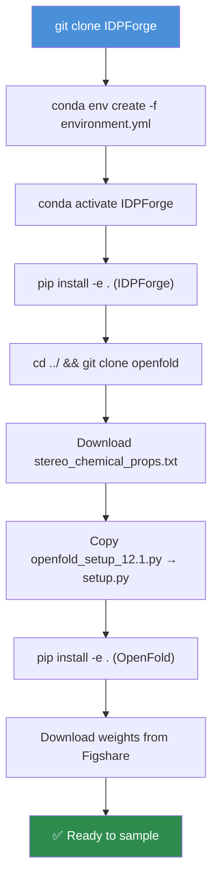

Get IDPForge running on your machine — from cloning the repository to generating your first intrinsically disordered protein (IDP) ensemble. This guide walks through environment setup, weight acquisition, and your first sampling commands in under 15 minutes.

## Prerequisites

Before you begin, ensure your system meets these requirements:

| Requirement | Details |
|---|---|
| **GPU** | NVIDIA GPU (sm_60–sm_80 for default install; newer GPUs may need the alternative CUDA 12.8 path) |
| **CUDA** | 12.1 (default) or 12.8 (alternative) |
| **Conda** | Miniconda or Anaconda with `mamba` optional for faster resolves |
| **Disk** | ~15 GB for environment + model weights + OpenFold |
| **Git** | For cloning IDPForge and OpenFold |

## Installation

The full installation has three phases: **clone → environment → OpenFold**. The diagram below maps the complete flow:



### Step 1 — Clone IDPForge

```bash
git clone https://github.com/THGLab/IDPForge.git
cd IDPForge
```

### Step 2 — Create the Conda Environment

```bash
conda env create -f environment.yml
conda activate IDPForge
pip install -e .
```

The default `environment.yml` installs **PyTorch 2.5.1 + CUDA 12.1**. If you have newer GPUs (released after Q4 2025) and encounter compatibility issues, switch to the alternative by editing four marked lines in `environment.yml`: `cuda-toolkit=12.8`, `cuda-version=12.8`, `--extra-index-url` to `cu128`, and `torch==2.7.1`.

> [!TIP]
> The environment includes DeepSpeed, PyTorch Lightning, OpenMM, MDTraj, and MMseqs2 — all required for the full training-sampling-relaxation-validation pipeline.

Sources: [README.md](/README.md#L15-L41), [environment.yml](/environment.yml#L1-L82)

### Step 3 — Install OpenFold

IDPForge depends on OpenFold utilities for protein I/O and feature computation. Clone it **in the same parent directory** as IDPForge:

```bash
cd ../
git clone https://github.com/aqlaboratory/openfold.git
cd openfold/openfold/resources
wget https://git.scicore.unibas.ch/schwede/openstructure/-/raw/7102c63615b64735c4941278d92b554ec94415f8/modules/mol/alg/src/stereo_chemical_props.txt
cd ../../
```

Then replace the OpenFold `setup.py` with the patched version from IDPForge and install:

```bash
cp path/to/my/IDPForge/dockerfiles/openfold_setup_12.1.py path/to/my/openfold/setup.py
pip install -e .
```

> If you used the CUDA 12.8 alternative, copy `openfold_setup_12.8.py` instead.

Sources: [README.md](/README.md#L43-L98)

### Step 4 — Download Model Weights and Data

Download pretrained weights, example data, and inference inputs from [Figshare](https://doi.org/10.6084/m9.figshare.28414937). Place the `weights/` directory directly into `IDPForge/weights/` and merge the contents of the downloaded `data/` into `IDPForge/data/`.

```bash
# After downloading and extracting from Figshare
cp -r weights/ /path/to/IDPForge/weights/
cp -r data/* /path/to/IDPForge/data/
```

Sources: [README.md](/README.md#L200-L204)

### Alternative: HPC / OpenFold-Led Installation

If the direct `environment.yml` approach fails (common on tightly managed clusters), install via the OpenFold-led path instead. Clone both repos side-by-side, strip `flash-attn` from OpenFold's environment file, create the env with `mamba`, then add IDPForge's missing dependencies manually:

```bash
conda install einops mdtraj pdb-tools -c conda-forge
conda install mmseqs2 -c bioconda
pip install tensorboard topoly
```

Then install both packages with `pip install . --no-build-isolation` (fall back to `pip install -e .` if that fails). See [Docker and HPC Setup](3-docker-and-hpc-setup) for containerized alternatives.

Sources: [README.md](/README.md#L99-L198)

## Your First IDP Ensemble

Once the environment is active and weights are in place, generating an ensemble is a single command. IDPForge ships two sampling modes depending on your target:

| Mode | Script | Use Case |
|---|---|---|
| **Fully disordered** | `sample_idp.py` | Single-chain intrinsically disordered proteins (IDPs) |
| **Partially disordered** | `sample_ldr.py` | Proteins with folded domains + intrinsically disordered regions (IDRs) |

### Sampling a Fully Disordered Protein (IDP)

The `sample_idp.py` script takes a protein sequence directly on the command line. Here we generate **10 conformers** for yeast Sic1, a well-studied IDP:

```bash
mkdir test
sequence="GSMTPSTPPRSRGTRYLAQPSGNTSSSALMQGQKTPQKPSQNLVPVTPSTTKSFKNAPLLAPPNSNMGMTSPFNGLTSPQRSPFPKSSVKRT"
python sample_idp.py $sequence weights/mdl.ckpt test configs/sample.yml \
    --nconf 10 --batch 4 --cuda --verbose
```

The positional and optional arguments are:

| Argument | Required | Description |
|---|---|---|
| `seq` | Yes | Amino acid sequence (one-letter code) |
| `ckpt_path` | Yes | Path to model checkpoint (e.g. `weights/mdl.ckpt`) |
| `output_dir` | Yes | Directory for output PDB files |
| `sample_cfg` | Yes | Path to sampling config YAML |
| `--batch` | No | Batch size per diffusion round (default: 32) |
| `--nconf` | No | Total conformers to generate (default: 100) |
| `--cuda` | No | Use GPU acceleration |
| `--verbose` | No | Print structural validation details |

Each conformer passes through a three-phase pipeline automatically: **Generate + Relax** (AMBER minimization), **Repair** (chirality + HIS ring fixes), and **Validate** (bond integrity, clash score, knot detection). Passing structures are saved as `N_validated.pdb`.

Sources: [README.md](/README.md#L282-L319), [sample_idp.py](/sample_idp.py#L172-L193)

### Sampling a Protein with Folded Domains (IDR)

For proteins that contain both structured and disordered regions, first **prepare the folded template**, then sample:

**Step A — Create the template** from an AlphaFold DB PDB, specifying the disordered residue range:

```bash
python mk_ldr_template.py data/AF-P05231-F1-model_v4.pdb 1-41 data/AF-P05231_ndr.npz
```

This writes an `.npz` file containing the folded-domain coordinates, torsion angles, and disorder mask that the sampler uses as a fixed scaffold.

**Step B — Sample the IDR ensemble** around that template:

```bash
mkdir P05231_build
python sample_ldr.py weights/mdl.ckpt data/AF-P05231_ndr.npz P05231_build configs/sample.yml \
    --nconf 10 --batch 4 --cuda --verbose
```

For long sequences, manage GPU memory with `--attention_chunk` (lower = less memory, slower). The provided model weights are **not recommended for predicting multiple disordered domains simultaneously** — use the AlphaFlex pipeline for multi-domain cases.

Sources: [README.md](/README.md#L336-L361), [mk_ldr_template.py](/mk_ldr_template.py#L1-L26), [sample_ldr.py](/sample_ldr.py#L233-L292)

## Configuration at a Glance

Sampling behavior is controlled by `configs/sample.yml`. The key sections you will interact with most:

| Section | Key Parameters | Purpose |
|---|---|---|
| `diffuse` | `n_tsteps: 200`, `inference_steps: 40` | Diffusion schedule: total timesteps and denoising steps |
| `potential` | `false` / `potential_cfg` | Enable experimental guidance (PRE, NOE, Rg) |
| `relax` | `stiffness: 10.0`, `max_outer_iterations: 20` | AMBER relaxation strength and iterations |
| `model` | `trunk.*`, `structure_module.*` | Transformer architecture (normally left at defaults) |

To **activate experimental guidance**, set `potential: true` and configure the `potential_cfg` block. For example, PRE data for Sic1 is provided at `data/sic1_pre_exp.txt`:

```yaml
potential: true
potential_cfg:
  pre:
    exp_path: data/sic1_pre_exp.txt
    exp_mask_p: 0.8
  timescale: 10
  grad_clip: 0.1
```

Sources: [configs/sample.yml](/configs/sample.yml#L1-L57)

## Training (Optional)

To train IDPForge on your own data, prepare a training pickle (see `data/README.md` for the format) and run:

```bash
python train.py --model_config_path configs/train.yml
```

Training uses PyTorch Lightning and is customizable via the `trainer` section in `configs/train.yml` (learning rate, gradient clipping, accumulation, epochs, etc.). The training config mirrors the sampling config's model architecture but adds loss weights, an EMA decay, and a OneCycleLR scheduler.

Sources: [README.md](/README.md#L273-L279), [train.py](/train.py#L122-L155), [configs/train.yml](/configs/train.yml#L1-L94)

## Quick-Reference Command Summary

| Task | Command |
|---|---|
| **IDP sampling** | `python sample_idp.py SEQ weights/mdl.ckpt OUTDIR configs/sample.yml --nconf N --cuda` |
| **Template creation** | `python mk_ldr_template.py PDB RANGE output.npz` |
| **IDR sampling** | `python sample_ldr.py weights/mdl.ckpt TEMPLATE.npz OUTDIR configs/sample.yml --nconf N --cuda` |
| **Training** | `python train.py --model_config_path configs/train.yml` |
| **Ensemble scoring** | `python score_ensemble.py PROTEIN ENSDIR --jc --noe --pre --fret` |

> [!TIP]
> All sampling scripts automatically resume from existing `*_validated.pdb` files in the output directory — simply re-run the same command to continue generating conformers toward your target `--nconf` count.

## What's Next?

Now that you can generate IDP/IDR ensembles, explore the deeper architecture and advanced capabilities:

- **Understand the model**: [Architecture Overview](4-architecture-overview) → [IDPForge Transformer Network](5-idpforge-transformer-network) → [SE(3) Backbone Diffusion](6-se-3-backbone-diffusion)
- **Master the sampling pipeline**: [IDP Sampling](12-idp-sampling-fully-disordered) → [IDR Sampling with Folded Templates](13-idr-sampling-with-folded-templates) → [Experimental Guidance Potentials](14-experimental-guidance-potentials)
- **Validate and score**: [AMBER Relaxation and Repair](15-amber-relaxation-and-repair) → [Structure Validation Pipeline](16-structure-validation-pipeline) → [X-EISD Ensemble Scoring](17-x-eisd-ensemble-scoring)
- **Deploy on clusters**: [Docker and HPC Setup](3-docker-and-hpc-setup)