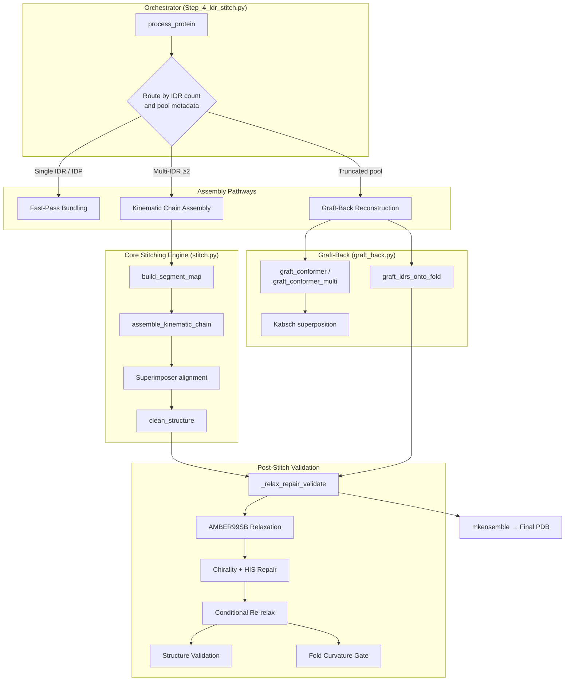
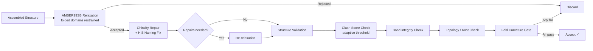

Step 4 of the AlphaFlex pipeline transforms per-IDR conformer pools into **full-length, physically valid structural ensembles** through a Monte Carlo sampling loop that kinematically stitches disordered segments onto folded scaffolds, then subjects each candidate to AMBER relaxation, chirality/bond repair, and multi-criteria validation. The pipeline dispatches across three architectural pathways—fast-pass bundling, truncated-pool graft reconstruction, and multi-IDR kinematic assembly—selected automatically by the protein's IDR topology class.

Sources: [Step_4_ldr_stitch.py](/AlphaFlex/Step_4_ldr_stitch.py#L1-L1119), [stitch.py](/AlphaFlex/utils/stitch.py#L1-L448), [graft_back.py](/AlphaFlex/utils/graft_back.py#L1-L334)

## Architectural Overview

The stitching system decomposes into four cooperating layers, each implemented as a distinct module with clear data-flow boundaries:



The orchestrator reads the labeled database from [Case Labeling and IDR Classification](19-case-labeling-and-idr-classification), resolves per-IDR conformer pools from Step 3, and routes each protein into the appropriate assembly pathway before writing the final multi-model ensemble PDB.

Sources: [Step_4_ldr_stitch.py](/AlphaFlex/Step_4_ldr_stitch.py#L623-L903), [stitch.py](/AlphaFlex/utils/stitch.py#L1-L448)

## Pathway Dispatch Logic

The `process_protein` function classifies each protein by its IDR topology and pool metadata to select the minimal-cost assembly route:

| Condition | Pathway | Rationale |
|-----------|---------|-----------|
| `Category_0_IDP` (fully disordered) or single IDR | **Fast-Pass Bundling** | No stitching needed; conformers are already full-length |
| Single IDR with `_truncation.json` sidecar | **Graft-Back Reconstruction** | Truncated pool must have distal folded domains restored |
| ≥2 IDRs with all pools truncated | **Combined Chimera Reconstruction** | Each IDR grafted independently then merged via `graft_idrs_onto_fold` |
| ≥2 IDRs, standard (non-truncated) pools | **Kinematic Chain Assembly** | Round-robin conformer draw + per-segment superposition |

The protein category is determined by `get_protein_category`, which stratifies IDR complexity as **Category 0** (IDP), **Category 1** (Tail only), **Category 2** (Linker), or **Category 3** (Loop), reflecting increasing geometric coupling between IDRs and their flanking domains.

Sources: [Step_4_ldr_stitch.py](/AlphaFlex/Step_4_ldr_stitch.py#L623-L716), [stitch.py](/AlphaFlex/utils/stitch.py#L112-L129)

## Kinematic Chain Assembly

The central algorithm for multi-IDR proteins operates on a **segment map**—an alternating sequence of folded domains (F1, F2, …) and disordered regions (D1, D2, …) that partitions the full residue sequence:

### Segment Map Construction

`build_segment_map` sorts labeled IDRs by position and interleaves folded-domain segments between them. For a protein with IDR ranges at (50–80) and (120–160) in a 200-residue chain, the resulting map is:

```
F1: [1–49]   D1: [50–80]   F2: [81–119]   D2: [120–160]   F3: [161–200]
```

This map drives sequential assembly: each segment is either copied verbatim from the static template (folded) or drawn from the conformer pool and rigid-body aligned (disordered).

Sources: [stitch.py](/AlphaFlex/utils/stitch.py#L224-L248)

### Junction Alignment via Stub Superposition

When stitching a disordered segment onto the growing chain, the algorithm computes a **junction stub**—a window of residues at the midpoint of the preceding folded domain:

1. **Stub selection**: `midpoint = median(anchor_residues)`, then `stub = [midpoint − HALF_SIZE … midpoint + HALF_SIZE]`. Falls back to the last `ALIGNMENT_JUNCTION_SIZE` residues if the midpoint window is too small.
2. **Atom extraction**: Backbone atoms (N, CA, C) are extracted from both the growing chain (`moving_anchor_atoms`) and the candidate conformer (`static_anchor_atoms`) for the stub residues.
3. **Rigid-body alignment**: BioPython's `Superimposer` computes the rotation **R** and translation **t** that minimizes RMSD between the two stub atom sets, then transforms the entire conformer: `conformer.transform(R, t)`.
4. **Residue graft**: IDR residues and flanking-domain residues are copied from the aligned conformer into the final chain, with coordinate updates for any overlapping residues.

Sources: [stitch.py](/AlphaFlex/utils/stitch.py#L292-L398)

### Round-Robin Conformer Draw

Conformers are drawn from each IDR's pool via `_next_conformer`, which maintains a shuffled order per pool and cycles through it. When the order is exhausted, a fresh random shuffle is generated—ensuring stochastic diversity across Monte Carlo iterations while guaranteeing every conformer is visited before any is repeated.

Sources: [stitch.py](/AlphaFlex/utils/stitch.py#L252-L266)

## Graft-Back Reconstruction

When Step 3 conformers were generated from **size-capped (truncated) templates**—necessary for proteins exceeding the model's residue limit—the distal folded domains are missing from the conformer pool. Graft-back reconstruction restores them through a three-step procedure implemented in `graft_conformer`:

| Step | Operation | Detail |
|------|-----------|--------|
| **1. Boundary stub** | Identify `ANCHOR_RES=2` residues at the truncation boundary | Residues shared between conformer fragment and full template |
| **2. Kabsch alignment** | Compute least-squares rigid transform mapping template → conformer frame | Uses peptide-plane atoms (N, CA, C) of stub residues |
| **3. Splice** | Write conformer verbatim, then append template's dropped residues after applying (R, t) | Template atoms at `dropped` resseqs get `xyz ← R·xyz + t` |

The function reports alignment RMSD, junction gap (CA–CA distance at IDR/fold boundary), and seam gap (CA–CA distance at fragment/template boundary)—diagnostics that flag poorly aligned grafts. For multi-domain truncations, `graft_conformer_multi` chains independent per-domain grafts sequentially.

Sources: [graft_back.py](/AlphaFlex/utils/graft_back.py#L93-L202)

### Multi-Tail Combined Chimera

Proteins with ≥2 independently-sampled IDR tails use `graft_idrs_onto_fold`, which aligns each tail conformer to the shared folded domain independently via Kabsch, then merges all IDR lines, fragment fold lines, and unfilled template fold lines into a single structure. Conformer pairings are drawn from the Cartesian product of all tail pools (no reuse within Phase 1), with random-with-replacement top-up in Phase 2.

Sources: [graft_back.py](/AlphaFlex/utils/graft_back.py#L272-L333), [Step_4_ldr_stitch.py](/AlphaFlex/Step_4_ldr_stitch.py#L498-L621)

## Post-Stitch Validation Pipeline

Every assembled candidate—regardless of pathway—passes through `_relax_repair_validate`, a five-stage gate chain that enforces physical validity:



### AMBER Relaxation with Folded-Domain Restraints

`relax_with_established_method` converts the BioPython structure to an OpenFold protein object, then calls `relax_protein` with the AMBER99SB forcefield. IDR residue indices are passed as `viol_mask` so that the minimizer applies restraint forces only to folded domains—preserving the template backbone geometry while allowing the disordered regions to relax into physically plausible conformations.

Sources: [Step_4_ldr_stitch.py](/AlphaFlex/Step_4_ldr_stitch.py#L128-L188)

### Adaptive Clash Threshold

The clash score threshold escalates adaptively via `get_smart_threshold`:

```
threshold = base + (multiplier × increment)
where multiplier = attempts // 100  if done == 0
                  attempts // 500  otherwise
```

This strategy starts strict and progressively relaxes—early candidates face a stringent clash filter, but if the Monte Carlo loop is struggling (many attempts, few accepts), the threshold rises to avoid rejecting marginally viable structures that can be improved by re-relaxation.

Sources: [smart_scoring.py](/AlphaFlex/utils/smart_scoring.py#L1-L6), [Step_4_ldr_stitch.py](/AlphaFlex/Step_4_ldr_stitch.py#L289-L291)

### Fold Curvature Gate

The folded-domain curvature gate rejects models where junction-adjacent folded residues have been artificially straightened by the stitching process. It computes the local curvature (discrete κ) within a sliding window of `STITCH_FOLD_CURV_WINDOW` residues on each side of every IDR/fold junction, comparing against the reference template curvature. If the ratio `κ_model / κ_template` falls below `STITCH_FOLD_CURV_RATIO` (default 0.5), the model is rejected.

Sources: [Step_4_ldr_stitch.py](/AlphaFlex/Step_4_ldr_stitch.py#L319-L336), [Step_4_ldr_stitch.py](/AlphaFlex/Step_4_ldr_stitch.py#L370-L382)

## Monte Carlo Sampling Loop

The outer loop in `process_protein` implements a two-phase Monte Carlo strategy:

| Phase | Strategy | Termination |
|-------|----------|-------------|
| **Phase 1: Single pass** | Visit each conformer (or conformer pairing) exactly once | `done ≥ num_conformers` or pool exhausted |
| **Phase 2: Top-up** | Random sampling **with replacement** from the pool | `done ≥ num_conformers` or `attempts ≥ STITCH_MAX_ATTEMPTS` |

Phase 1 ensures every pre-generated conformer gets a fair evaluation. Phase 2 fills remaining slots by re-attempting random conformers—exploiting the stochastic nature of relaxation and validation (different random seeds in the minimizer may yield different outcomes for the same input).

The loop supports **resume semantics**: existing ensemble files in the final destination directory are detected, and if `n_existing ≥ num_conformers`, the protein is skipped entirely.

Sources: [Step_4_ldr_stitch.py](/AlphaFlex/Step_4_ldr_stitch.py#L826-L873), [Step_4_ldr_stitch.py](/AlphaFlex/Step_4_ldr_stitch.py#L464-L480)

## Ensemble Assembly and Output

Accepted conformers are collected into a single multi-model PDB via `mkensemble`, which concatenates individual conformer files (stripping `PARENT`, `REMARK`, `MASTER`, `CRYST`, and `END` records) and appends a final `END`. The output file follows the naming convention:

```
<protein_id>_ensemble_n<N>.pdb
```

where `N` is the count of accepted models. Output is organized by category and length bin:

```
Step_4_Final_Models/
├── Category_1/
│   ├── 0-250/
│   │   └── P05231/
│   │       └── P05231_ensemble_n10.pdb
│   └── 251-500/
├── Category_2/
└── Category_3/
```

Length binning uses `get_length_label` with thresholds at 250, 500, 1000, 1500, and 2000 residues.

Sources: [Step_4_ldr_stitch.py](/AlphaFlex/Step_4_ldr_stitch.py#L38-L48), [stitch.py](/AlphaFlex/utils/stitch.py#L38-L46), [Step_4_ldr_stitch.py](/AlphaFlex/Step_4_ldr_stitch.py#L877-L894)

## Configuration Reference

All Step 4 parameters are centralized in `config.py` and overridable via CLI arguments:

| Parameter | Default | Description |
|-----------|---------|-------------|
| `STITCH_N_CONFORMERS` | 10 | Target ensemble size per protein |
| `STITCH_MAX_ATTEMPTS` | 500 | Maximum Monte Carlo attempts before giving up |
| `STITCH_FOLD_CURV_RATIO` | 0.5 | Curvature gate threshold (0 disables) |
| `STITCH_FOLD_CURV_WINDOW` | 15 | Residues into fold from junction for curvature averaging |
| `RELAX_STIFFNESS` | 10.0 | AMBER restraint force constant on folded domains |
| `RELAX_MAX_OUTER_ITER` | 20 | Outer relaxation iterations |
| `MINIMIZATION_MAX_ITER` | 0 | L-BFGS iterations (0 = OpenMM default) |
| `MINIMIZATION_TOLERANCE` | 10.0 | Convergence tolerance (kJ/mol/nm) |
| `ALIGNMENT_STUB_HALF_SIZE` | 5 | Half-window for junction stub residue selection |
| `ALIGNMENT_JUNCTION_SIZE` | 5 | Fallback stub size when midpoint window insufficient |
| `MIN_CONFORMER_POOL_SIZE` | 5 | Minimum conformers before pool-size warning |
| `STITCH_BASE_CLASH_THRESHOLD` | 10.0 | Initial clash score threshold |
| `STITCH_CLASH_INCREMENT` | 5.0 | Adaptive threshold escalation step |

Sources: [config.py](/AlphaFlex/config.py#L99-L123)

## Parallel Execution

The CLI supports **sharded parallelism** via `--total_splits` and `--split_index`, distributing the protein ID list evenly across shards using `np.array_split`. For intra-node parallelism, `--workers N` launches a `ProcessPoolExecutor` with per-protein log files streamed to `logs/Step4/perprotein/<ID>.log`, enabling real-time monitoring via `tail -f`.

> [!TIP]
> When debugging a specific protein's stitching failure, use `--workers 1 --verbose` and examine the per-attempt log output. The `[RESULT] FAILED` lines include the rejection reason and adaptive threshold value, which reveal whether failures stem from relaxation rejection, clash score, bond integrity, chirality, or fold curvature—each requiring a different remediation strategy.

> [!TIP]
> For proteins with ≥2 IDRs where the kinematic chain assembly yields low acceptance rates, consider increasing `STITCH_MAX_ATTEMPTS` and `STITCH_CLASH_INCREMENT` simultaneously. The adaptive clash threshold will escalate faster, accepting borderline models that re-relaxation can subsequently improve, while the higher attempt cap ensures enough candidates reach validation.

Sources: [Step_4_ldr_stitch.py](/AlphaFlex/Step_4_ldr_stitch.py#L906-L1119)

## Relationship to Pipeline Stages

Step 4 consumes the conformer pools produced by [IDR Sampling with Folded Templates](13-idr-sampling-with-folded-templates) (Step 3) and the labeled IDR annotations from [Case Labeling and IDR Classification](19-case-labeling-and-idr-classification) (Step 1). Its output ensembles feed directly into [X-EISD Ensemble Scoring](17-x-eisd-ensemble-scoring) for experimental reweighting, and into [AMBER Relaxation and Repair](15-amber-relaxation-and-repair) for final refinement. The folded-domain curvature gate and knot topology checks leverage validation infrastructure documented in [Structure Validation Pipeline](16-structure-validation-pipeline).
